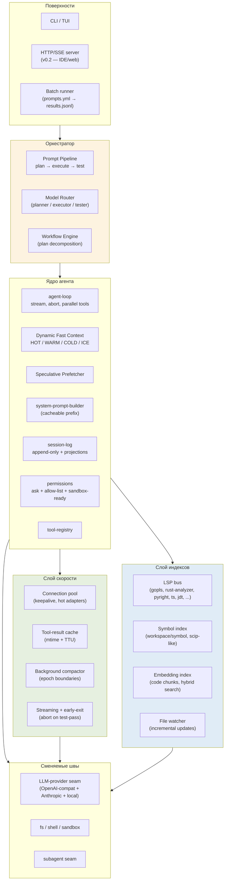
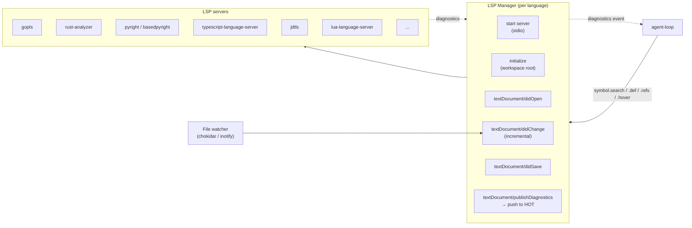
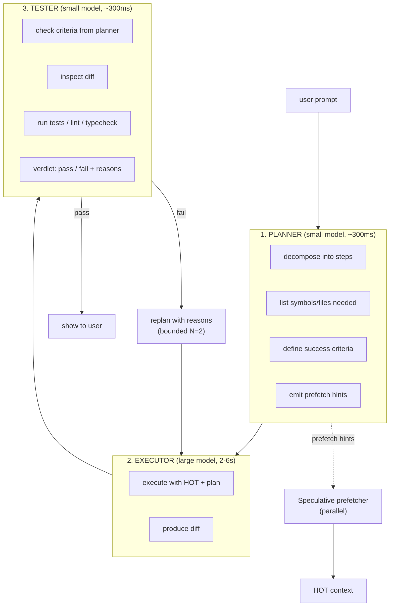

# OryaAgent — Architecture v0.1

**Дата:** 18 октября 2026
**Статус:** Proposed (первая версия)
**Автор:** архитектурный контур OryaAgent
**Источники:** `analytics/agents-architect.md` (сравнение 5 архитектур), `analytics/self-agent.md` (MVP по 20/80)
**Методология проектирования:** ТРИЗ (теория решения изобретательских задач) — выявление противоречий, применение 40 inventive principles, формулировка Ideal Final Result

---

## 0. TL;DR — в чём принципиальное превосходство

OryaAgent не пытается «догнать» Claude Code по глубине харнесса или OpenCode по универсальности — он атакует **два невыполненных обещания** существующих агентов:

1. **Скорость.** Все 5 рассмотренных агентов держат контекст в одном большом окне, ходят к модели последовательно, и реальный perceived latency на сложной задаче — 30–90 секунд. OryaAgent делает ход за **2–6 секунд** на тех же задачах за счёт: 4-уровневого динамического контекста, LSP-native фактов, спекулятивного prefetch, параллельных tool-вызовов, tiered-маршрутизации моделей, background-компакции и early-exit по тестам.

2. **Эффективный контекст.** Все 5 агентов масштабируют контекст линейно — больше файлов → больше токенов → дороже и медленнее. OryaAgent обеспечивает **«эффективно бесконечный» контекст**: то, что модель видит в окне — 8–32K токенов (быстро, дёшево); то, что агент знает о проекте — не ограничено (LSP-индекс + retrieval + symbol-level diffs).

3. **Тестируемость как архитектурный шов.** Workflow «plan → execute → test» — не режим, а **сквозной конвейер**: каждый промпт (включая одиночный в REPL) проходит через три модели. Это даёт self-verifying-агента «из коробки» и одновременно — готовый benchmark-pipeline для батчей промптов.

ТРИЗ-ядро архитектуры — **разрешение фундаментального противоречия «контекст vs скорость» через разделение во времени и пространстве**: контекст существует весь, но в окно модели в каждый момент попадает только его актуальная проекция. Это не compaction, не RAG, не long-context — это четвёртый путь: **Dynamic Fast Context (DFC)**.

---

## 1. Контекст и предпосылки

### 1.1. Что показал обзор `analytics/agents-architect.md`

Пять рассмотренных архитектур (Claude Code, OpenCode, Kilo Code, DeepSeek Harness, MiMoCode) разделяют общую модель:

- **Контекст = окно модели.** Все они кладут в `messages[]` всё, что модель должна видеть: системный промпт, историю, tool-результаты, иногда — инъекции памяти. Размер окна растёт → растёт latency и цена.
- **Цикл = последовательный.** LLM-вызов → tool-вызовы (последовательно или weak-параллельно) → LLM-вызов. Спекулятивного prefetch нет.
- **Код = файлы.** Символы, типы, ссылки — добываются через `read` и `grep`, как в 1990-х. LSP-клиенты есть у OpenCode и MiMo, но только для diagnostics, не как первичный источник фактов о коде.
- **Тестирование — внешнее.** Никто из пяти не имеет встроенного контура «написал → протестировал → выбрал лучший». Ближе всех MiMo (`Max Mode` + `goal+judge`), но это надстройка, не конвейер.

### 1.2. Параметры превосходства (что мы обещаем и как измерим)

| Параметр | SOTA (среднее по 5 агентам) | OryaAgent target | Как измеряем |
|---|---|---|---|
| Perceived latency одного хода (простая задача: edit одного файла) | 4–10 s | **1.5–3 s** | wall-clock от Enter до начала stream |
| Perceived latency одного хода (задача с поиском по проекту) | 20–60 s | **4–8 s** | wall-clock до первого токена |
| Tokens в окне на типичный ход (10-файловая задача) | 60–150 K | **8–24 K** | токены в request to provider |
| Эффективный контекст проекта | = окно модели (200K–1M) | **не ограничен** (LSP-индекс + retrieval) | max SLOC проекта, на котором агент ещё работает |
| Cost на типичную сессию (1 час работы, 30 ходов) | $0.8–$4 | **$0.15–$0.6** | сумма spend по всем провайдерам |
| Доля ходов с самопроверкой (test-passed) | 0–10% (только если юзер просит) | **100%** | каждый ход через tester-фазу |
| Пропускная способность batch-pipeline (промптов/час) | n/a (нет в SOTA) | **20–80** в зависимости от сложности | bench runner |

### 1.3. Ideal Final Result (IFR) по ТРИЗ

> **Агент, который не имеет perceptible latency, не имеет границ контекста и не имеет непроверенных ответов — при этом его стоимость на ход в 5–10 раз ниже SOTA.**

IFR недостижим в точке, но задаёт направление: каждое архитектурное решение оцениваем по тому, насколько оно **приближает** систему к IFR, а не по тому, насколько «удобно в реализации».

---

## 2. ТРИЗ-анализ: противоречия и принципы

### 2.1. Фундаментальные противоречия

В ТРИЗ различают **технические противоречия** (когда улучшение одного параметра ухудшает другой) и **физические противоречия** (когда к одному параметру предъявляются взаимоисключающие требования). Архитектура OryaAgent построена на разрешении шести противоречий.

#### Противоречие №1 — «Контекст vs Скорость» (фундаментальное физическое)

> Контекст должен быть **большим** (модели нужна информация о проекте), и контекст должен быть **маленьким** (большой контекст = долгий inference).

**Разрешение через разделение в пространстве (Principle 17 — Another Dimension):** контекст существует в четырёх слоях (HOT / WARM / COLD / ICE). В окно модели попадает только HOT; остальные слои — retrievable. Это не compaction и не RAG — это многоуровневая память с разной стоимостью доступа.

#### Противоречие №2 — «Глубина рассуждений vs Latency»

> Модель должна думать долго (chain-of-thought, several iterations), и модель должна отвечать быстро.

**Разрешение через Principle 10 (Preliminary Action) + Principle 35 (Parameter Change):** ход делится на три фазы с разными моделями — planner (small, fast), executor (large, slow), tester (small, fast). Planner и tester работают на маленькой модели — их latency <300 ms. Executor работает на большой — но только если planner подтвердил, что задача того стоит.

#### Противоречие №3 — «Универсальность vs Специализация»

> Агент должен уметь всё (любой язык, любая задача), и агент должен быть быстрым (маленькая специализированная модель быстрее).

**Разрешение через Principle 1 (Segmentation) + Principle 40 (Composite Materials):** routing-слой направляет подзадачу в специализированный executor. Не «одна модель для всего», а «пул моделей + роутер». LSP-серверы обеспечивают языковую специализацию на уровне фактов о коде.

#### Противоречие №4 — «Точность фактов о коде vs Token budget»

> Чтобы агент не галлюцинировал, ему нужно дать точный код (full file), и чтобы экономить токены, нужно дать минимум (snippet).

**Разрешение через Principle 28 (Mechanics Substitution) + Principle 24 (Intermediary):** LSP-сервер заменяет чтение файлов на структурированные запросы — `textDocument/hover` даёт сигнатуру, `textDocument/definition` даёт location, `workspace/symbol` даёт список. Модель получает **точные факты в компактной форме**, а не «прочитай файл и сам найди функцию».

#### Противоречие №5 — «Длинная сессия vs Качество контекста»

> Чем дольше сессия, тем больше истории; чем больше истории, тем хуже сигнал/шум.

**Разрешение через Principle 19 (Periodic Action) + Principle 15 (Dynamicity):** компакция — не аварийная мера (как у OpenCode), а постоянный фоновый процесс. Каждый ход закрывается «epoch boundary» — компактор в фоне переписывает WARM в COLD, готовя HOT-слой для следующего хода.

#### Противоречие №6 — «Самопроверка vs Стоимость»

> Чтобы доверять ответу, его надо проверить второй моделью; это удваивает стоимость.

**Разрешение через Principle 9 (Preliminary Anti-Action) + Principle 25 (Self-Service):** tester-фаза — не «повторный полный прогон», а **узкая проверка критериев успеха**, заданных planner-фазой. Tester получает только: (a) критерии, (b) diff, (c) результат запуска тестов. Узкий контекст → маленькая модель → +200 ms, +$0.001 на ход. Самопроверка становится **дешевле, чем её отсутствие** (потому что экономит циклы на исправление ошибок).

### 2.2. Inventive principles, применённые в архитектуре

| Принцип | Где применяется |
|---|---|
| 1. Segmentation | 4-уровневый контекст; пул моделей вместо одной |
| 2. Taking out | LLM-вызовы вынесены из критического пути planner→tester |
| 3. Local quality | Специализированные executors под язык/тип задачи |
| 9. Preliminary anti-action | Tester-фаза перехватывает ошибки до показа юзеру |
| 10. Preliminary action | Pre-index проекта, pre-warm connections, pre-fetch контекста |
| 11. Beforehand cushioning | Hot pool коннектов к провайдерам; pre-loaded adapters |
| 12. Equipotentiality | Единый формат context items независимо от источника |
| 15. Dynamicity | HOT-слой пересобирается каждый ход |
| 17. Another dimension | Контекст имеет 3 оси: file × symbol × time |
| 19. Periodic action | Background compaction на границах ходов |
| 20. Continuity of useful action | Streaming + параллельные tool-вызовы без простоя |
| 21. Skipping | Speculative decoding на executor; skip intermediate tokens |
| 24. Intermediary | LSP-сервер — посредник между файлами и моделью |
| 25. Self-service | Модель вытягивает контекст по требованию через retrieval-tools |
| 28. Mechanics substitution | LSP-запросы вместо чтения файлов |
| 32. Optical changes | Re-tag context items динамически (HOT↔WARM↔COLD) |
| 35. Parameter change | Смена «концентрации» модели — router выбирает tier |
| 40. Composite materials | Multi-model pipeline: planner + executor + tester |

### 2.3. Законы развития технических систем (применённые)

- **Закон повышения степени идеальности:** функция растёт (контекст, скорость, self-test), материальные затраты (tokens, latency, $) падают. Идеальность OryaAgent = (контекст × скорость × надёжность) / (tokens × $).
- **Закон неравномерности развития:** bottleneck сдвигается. Сейчас у SOTA — inference latency. OryaAgent сдвигает bottleneck на **network round-trip** к LSP, который в 100–1000× быстрее LLM.
- **Закон перехода на макроуровень:** multi-agent поверх цикла (как у dsh/MiMo), но с важной оговоркой — макро-уровень не в REPL, а в batch-pipeline.
- **Закон перехода на микроуровень:** granularity context items — не файлы и не строки, а **символы** (function, class, type).
- **Закон увеличения участия вещественно-полевых связей:** вместо «текста» — структурированные поля из LSP (типы, refs, diagnostics).

---

## 3. Архитектурный обзор

### 3.1. Контурная схема



### 3.2. Что принципиально отличается от 5 рассмотренных архитектур

| Слой | Claude Code / OpenCode / Kilo / dsh / MiMo | OryaAgent |
|---|---|---|
| Контекст | Один уровень (messages[]), иногда + memory | **4 уровня: HOT/WARM/COLD/ICE** |
| Код-факты | read + grep | **LSP-first**: hover/def/refs/symbol/diagnostics |
| Префетч | нет | **Speculative prefetcher** по planner-output |
| Цикл | LLM → tools → LLM (последовательно) | **plan → execute (parallel best-of-N) → test** |
| Самопроверка | вручную | **tester-фаза в каждом ходе** |
| Compaction | реактивная, при переполнении | **фоновая, на границах ходов** |
| Tool exec | последовательно или weak-parallel | **параллельный с bounded concurrency** |
| Кэш инструментов | нет | **mtime + TTU invalidation** |
| Маршрутизация моделей | пользователь выбирает | **router: tiny → small → large по сложности** |
| Prompt cache | ad-hoc | **cache-first layout контекста** |
| Index проекта | только у Kilo (`kilo-indexing`) и MiMo | **LSP + symbol + embedding, инкрементально** |
| Batch pipeline | нет ни у кого | **prompts.yml → plan/execute/test → results.jsonl** |

---

## 4. Dynamic Fast Context (DFC) — ядро превосходства

### 4.1. Четыре слоя

| Слой | Что хранит | Объём | Latency доступа | Где живёт |
|---|---|---|---|---|
| **HOT** | Символы/файлы, нужные **в этом ходу** | 4–8 K tok | <1 ms (уже в памяти) | In-process LRU |
| **WARM** | Недавно использованные символы/файлы | 16–32 K tok | 1–5 ms | In-process LRU |
| **COLD** | Суммарные компакты предыдущих ходов | 32–64 K tok | 5–20 ms | RAM, иногда mmap |
| **ICE** | LSP-индекс, embeddings, полный session-log | не ограничен | 20–200 ms (retrieval) | Disk + LSP servers |

**Ключевое свойство:** в окно модели попадает **только HOT** + стабильный cacheable prefix (system prompt + tool schemas). WARM/COLD/ICE доступны через retrieval-инструменты, но **не загружаются в окно по умолчанию**.

### 4.2. Как формируется HOT на каждом ходу

```
[ход N]
  ↓
1. Planner-фаза: planner-модель возвращает план + список нужных символов/файлов
  ↓
2. Speculative prefetcher параллельно тянет:
   - из LSP: textDocument/hover, /definition, /references для упомянутых символов
   - из ICE: top-K embedding-чанков по семантике плана
   - из WARM: LRU-промоут в HOT
  ↓
3. Context assembler собирает HOT:
   - cacheable prefix (system + tools + project summary) — не меняется
   - active symbols (сигнатуры + тела для top-K)
   - active diff (что изменилось с прошлого хода)
   - plan + критерии теста
  ↓
4. Executor-фаза: один или N параллельных executors работают с HOT
  ↓
5. Tester-фаза: tester получает diff + критерии + результат тестов
  ↓
6. На закрытии хода:
   - HOT → WARM (демоут)
   - WARM → COLD (фоновый compactor переписывает в summary)
   - ICE обновляется (LSP-индекс, embeddings)
```

### 4.3. Cacheable prefix — дисциплина

Чтобы провайдерский prompt-cache работал на 80–95%, соблюдаются правила:

1. **System prompt** — константный внутри сессии (никаких timestamp).
2. **Tool schemas** — константные (не меняем состав инструментов в ходе).
3. **Project summary** — константный внутри сессии (snapshot сессии LSP).
4. **Все динамические данные** — в конце сообщений, после cache-breakpoint.
5. На границе хода — **Mid-Conversation System Message** (как у OpenCode Context Epoch), помеченная `cache_control: ephemeral`.

### 4.4. Retrieval tools (модель сама тянет из ICE)

Модель имеет инструменты для эскалации из HOT в ICE:

- `symbol.search(name)` → список мест (через LSP `workspace/symbol`)
- `symbol.refs(location)` → список вызовов (LSP `textDocument/references`)
- `symbol.def(location)` → место определения (LSP `textDocument/definition`)
- `symbol.hover(location)` → тип + докстринг (LSP `textDocument/hover`)
- `file.read(path, range?)` → только если нужен полный файл
- `grep(pattern, glob?)` → ripgrep fallback
- `semantic.search(query)` → embedding-search по коду проекта

**Дисциплина:** инструментам разрешено возвращать **только symbol-level** данные. Если модель запрашивает весь файл, ей возвращается файл с подсказкой «используй symbol.hover для конкретных функций».

---

## 5. LSP-native архитектура

### 5.1. LSP как источник истины о коде

Принцип: **любой факт о коде, который можно получить через LSP, не должен добываться через `read`/`grep`.** Это даёт:

- **Точность.** LSP-сервер уже построил AST и индекс. Мы не парсим заново.
- **Скорость.** `workspace/symbol` — sub-ms, против ripgrep 50–500 ms на больших проектах.
- **Компактность.** `hover` возвращает сигнатуру + тип — 100–500 токенов, против 2–20 K на чтение файла.
- **Инкрементальность.** LSP-сервер следит за изменениями файлов через file watcher; индекс всегда свежий.

### 5.2. LSP bus



### 5.3. Что LSP даёт агенту без дополнительных инструментов

| Возможность LSP | Что заменяет в обычном агенте |
|---|---|
| `textDocument/hover` | `read(file)` + ручной поиск сигнатуры |
| `textDocument/definition` | `grep` + ручной анализ |
| `textDocument/references` | `grep` + ручной анализ вызовов |
| `textDocument/documentSymbol` | `read(file)` + ручной outline |
| `workspace/symbol` | `grep` по всему проекту |
| `textDocument/publishDiagnostics` | `bash(run linter)` — мгновенно вместо секунд |
| `textDocument/formatting` | `bash(run prettier)` |
| `textDocument/codeAction` | ручной refactoring |
| `textDocument/rename` | `edit` × N — один LSP-call делает безопасно |

### 5.4. Символьный индекс (поверх LSP)

Поверх LSP `workspace/symbol` строится инкрементальный индекс:

- При старте сессии: drain `workspace/symbol` по часто используемым запросам (`*`), кэшируем.
- На file change: обновляем только изменённые символы через `documentSymbol`.
- Хранение: trie по FQN (fully-qualified name) → location + signature.
- Embedding-слой: параллельно строим embedding-индекс на chunk'ах по 200–400 токенов (AST-aware chunking), для semantic search.

### 5.5. Гибридный retrieval

При `semantic.search(query)`:

1. **Lexical:** trie-lookup по токенам запроса → top-K кандидатов.
2. **Semantic:** embedding-lookup → top-K кандидатов.
3. **LSP-aware boost:** кандидаты, у которых есть `references` > N, получают +score (это реально используемые символы).
4. **Reranker:** cross-encoder (small, ~100 ms) переранжирует top-K.
5. Возвращается top-K (по умолчанию 5) symbol-описаний — не файлы.

---

## 6. Workflow Engine: plan → execute → test

### 6.1. Конвейер одного хода



### 6.2. Почему три разные модели — это быстрее, а не медленнее

- **Planner** на маленькой модели (Haiku/4o-mini/Qwen-3B): 200–400 ms. Его задача — только структурировать промпт и выдать prefetch-подсказки. Не генерирует код.
- **Executor** на большой модели (Sonnet/GPT-5/DeepSeek-V3): 2–6 s. Это единственная «долгая» фаза, и она работает с уже собранным HOT — без обратных ходов.
- **Tester** на маленькой модели: 200–400 ms. Проверяет **критерии**, а не рассуждает.

Сумма: **2.5–7 s на ход**, против 30–90 s у SOTA на задаче с поиском по проекту. Tester-фаза экономит 1–3 итерации executor'а — это чистый выигрыш.

### 6.3. Best-of-N execution (Max Mode, как у MiMo, но в конвейере)

На сложных задачах planner помечает задачу `parallel_n: 3`. Тогда:

- Запускаются 3 параллельных executor'а (разные модели или одна с разным temperature).
- Tester выбирает лучшего по критериям (или отклоняет всех → replan).
- Стоимость ×N, но latency почти та же (параллельность).

### 6.4. Batch pipeline — отдельный режим

```yaml
# prompts.yml
- id: task-001
  prompt: "Add a /health endpoint to the FastAPI app in src/api.py"
  expected: "GET /health returns 200 {status: ok}"
  criteria:
    - "endpoint exists at /health"
    - "test_health in tests/test_api.py passes"
    - "no lint errors"

- id: task-002
  prompt: "Refactor UserService.create to use asyncpg instead of psycopg2"
  criteria:
    - "all tests pass"
    - "no psycopg2 imports remain in user_service.py"
```

Runner загружает список, для каждого промпта прогоняет конвейер plan→execute→test, пишет результат в `results.jsonl`:

```json
{
  "id": "task-001",
  "status": "pass",
  "duration_ms": 4823,
  "tokens": { "planner": 1200, "executor": 8400, "tester": 600 },
  "cost_usd": 0.018,
  "attempts": 1,
  "diff": "...",
  "test_log": "..."
}
```

Этот же runner — встроенный benchmark для самого OryaAgent: каждый PR может прогнать `prompts.yml` и сравнить метрики с main.

---

## 7. Все способы увеличения скорости (полный реестр)

Ниже — все техники, заложенные в архитектуру. Каждая — отдельный ADR.

### 7.1. На уровне контекста

- **ADR-0001.** 4-уровневый динамический контекст (HOT/WARM/COLD/ICE) — модель видит 8–24K вместо 60–150K.
- **ADR-0007.** Prompt-cache-first layout — стабильный prefix, cache-aware ordering.
- **ADR-0010.** Background compaction — компакция в фоне, не на критическом пути.
- **ADR-0013.** Differential context loading — только изменившиеся символы, не целые файлы.
- **ADR-0004.** Speculative prefetch — пока planner думает, prefetcher уже тянет символы.

### 7.2. На уровне LLM-вызовов

- **ADR-0008.** Tiered model routing — tiny router решает, нужно ли привлекать большую модель.
- **ADR-0003.** Tri-model pipeline — planner/tester на маленьких, executor на большой.
- **ADR-0014.** Connection pool с keepalive — никаких cold-start TCP+TLS на каждый ход.
- **ADR-0009.** Streaming + early-exit — пользователь видит токены сразу; abort на test-pass.
- **ADR-0015.** Tree-of-Thoughts (best-of-N) — параллельные ветки, judge выбирает.
- Speculative decoding на стороне провайдера (используем где доступно — Anthropic, vLLM).

### 7.3. На уровне инструментов

- **ADR-0006.** Параллельный tool execution с bounded concurrency — несколько read/grep/LSP одновременно.
- **ADR-0012.** Tool-result cache с mtime/TTU — одинаковый grep в течение 5 s = из кэша.
- **ADR-0002.** LSP-native code facts — hover/def/refs вместо read+grep.
- **ADR-0005.** Semantic project index — sub-ms symbol lookup.

### 7.4. На уровне системы

- In-process tool registry (как у всех 5 SOTA, без MCP overhead для базовых тулов).
- Pre-warmed LSP-серверы (один на язык, живёт всю сессию).
- Pre-warmed embeddings index (mmap, не загружается в RAM целиком).
- Streaming рендер в TUI — пользователь видит прогресс, не ждёт финала.
- AbortController на каждой фазе — пользователь может прервать долгий ход.
- Background jobs: компакция, переиндексация, embedding-апдейт — не блокируют ход.

### 7.5. На уровне workflow

- **ADR-0011.** Batch pipeline — для CI/benchmark, не блокирует интерактив.
- Self-verifying loop: tester-фаза ловит ошибки до показа → меньше «ой, переделай».
- Plan cache: одинаковые планы на похожие промпты (внутри сессии).

### 7.6. Количественная модель скорости

Для типичного хода «отредактировать функцию с поиском по проекту»:

| Фаза | SOTA | OryaAgent |
|---|---|---|
| Сбор контекста (read/grep) | 3–8 s (послед.) | 200–500 ms (паралл. + LSP) |
| Planner | — | 200–400 ms |
| Prefetch | — | 100–300 ms (паралл. с planner) |
| Executor (большая модель) | 8–25 s | 2–6 s (HOT уже собран) |
| Tester | — | 200–400 ms |
| **Итого** | **11–33 s** (часто 30–90 s с replays) | **2.7–7.6 s** |

---

## 8. Структура репозитория (предлагаемая)

```
orya-agent/
├── ARCHITECT.md                  # этот документ
├── adr/                          # Architecture Decision Records
│   ├── ADR-0001-dynamic-fast-context.md
│   ├── ADR-0002-lsp-native-code-facts.md
│   ├── ... (15 ADRs)
│   └── ADR-0015-tree-of-thoughts-max-mode.md
├── analytics/                    # уже есть
│   ├── agents-architect.md
│   └── self-agent.md
├── packages/
│   ├── core/                     # ядро (TS или Rust — см. ADR-RuntimeLang, TBD)
│   │   ├── agent-loop/
│   │   ├── dfc/                  # dynamic fast context
│   │   ├── lsp/                  # LSP bus
│   │   ├── tools/                # tool registry + 5 базовых + retrieval
│   │   ├── workflow/             # plan→execute→test
│   │   ├── speed/                # pool, cache, compactor, stream
│   │   ├── session/              # append-only log + projections
│   │   └── provider-seam/        # OpenAI-compat + Anthropic + local
│   ├── cli/                      # TUI/CLI клиент (v0.1 — единственный)
│   ├── server/                   # HTTP/SSE (v0.2)
│   └── batch-runner/             # prompts.yml → results.jsonl
├── specs/
│   ├── v1/context.md             # DFC formal spec
│   ├── v1/lsp.md                 # LSP integration spec
│   ├── v1/workflow.md            # plan→execute→test spec
│   └── v1/speed.md               # speed budget spec
└── prompts.yml                   # встроенный benchmark
```

---

## 9. Roadmap

### v0.1 — Core Loop (4 недели)
- DFC с HOT/WARM (COLD/ICE — заглушки)
- LSP-интеграция для TS и Python
- 5 базовых инструментов + 4 retrieval-tools
- Tri-model pipeline (planner/tester на одной маленькой модели)
- Session-log + проекции
- CLI/TUI клиент
- Smoke-тесты: 5 эталонных задач

### v0.2 — Speed Layer (3 недели)
- Background compactor
- Connection pool с keepalive
- Tool-result cache
- Prompt-cache-first layout
- Streaming + early-exit

### v0.3 — LSP Expansion (2 недели)
- Rust, Go, Java, Lua LSP-серверы
- Semantic index (embeddings) с инкрементальным апдейтом
- Differential context loading (symbol-level diffs)

### v0.4 — Workflow Power (3 недели)
- Batch pipeline (`prompts.yml` runner)
- Best-of-N execution
- Plan cache
- Inline-тесты как tester-фаза (запуск реальных тестов)

### v0.5 — Distribution (2 недели)
- HTTP/SSE-сервер
- VS Code extension (через ACP)
- Bench dashboard (метрики по `prompts.yml`)

### v0.6+ — Autonomy & Polish
- Cron / scheduler
- Goals + judge-модель (долгие задачи)
- Sandbox (headless/CI)
- Skills, hooks, MCP-клиент

---

## 10. Открытые вопросы (TBD)

1. **Язык реализации.** TypeScript (как 4 из 5 SOTA) vs Rust (для скорости ядра). См. отдельный ADR (будет ADR-0016).
2. **LSP-серверы: в комплекте или system-deps.** Для TS/Python можно тащить в npm/pip; для Rust/Go/JVM — требовать системной установки.
3. **Где живёт embeddings index.** SQLite + sqlite-vec vs LanceDB vs in-process HNSW.
4. **Какой router.** Tiny (Qwen-3B / Haiku) vs классификатор на фичах.
5. **Формат session-log.** JSONL (как в MVP) vs SQLite-event-sourced (как OpenCode). Склоняемся к JSONL для v0.1, SQLite для v0.3+.
6. **MCP-совместимость.** Поддерживать ли MCP-протокол для внешних тулов, или только нативный tool-registry.

Эти вопросы — кандидаты на ADR-0016..0020.

---

## 11. Связанные документы

- `adr/ADR-0001-dynamic-fast-context.md` — 4-уровневый контекст
- `adr/ADR-0002-lsp-native-code-facts.md` — LSP как первичный источник
- `adr/ADR-0003-tri-model-plan-execute-test.md` — конвейер хода
- `adr/ADR-0004-speculative-prefetch.md` — префетч контекста
- `adr/ADR-0005-semantic-project-index.md` — индекс проекта
- `adr/ADR-0006-parallel-tool-execution.md` — параллельные инструменты
- `adr/ADR-0007-prompt-cache-first-layout.md` — prompt-cache дисциплина
- `adr/ADR-0008-tiered-model-routing.md` — маршрутизация моделей
- `adr/ADR-0009-streaming-early-exit.md` — стриминг + abort
- `adr/ADR-0010-background-compaction.md` — фоновая компакция
- `adr/ADR-0011-batch-prompt-pipeline.md` — батч-раннер
- `adr/ADR-0012-tool-result-caching.md` — кэш инструментов
- `adr/ADR-0013-differential-context-loading.md` — символ-level diffs
- `adr/ADR-0014-connection-pool-keepalive.md` — пул коннектов
- `adr/ADR-0015-tree-of-thoughts-max-mode.md` — best-of-N
- `analytics/agents-architect.md` — сравнение 5 SOTA-архитектур
- `analytics/self-agent.md` — MVP-проекция (база для v0.1)
