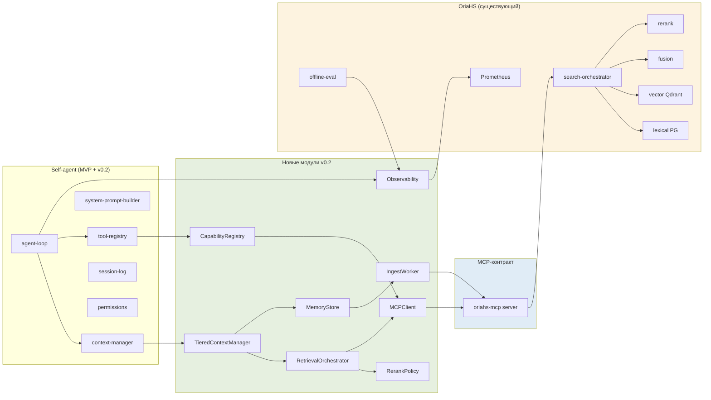
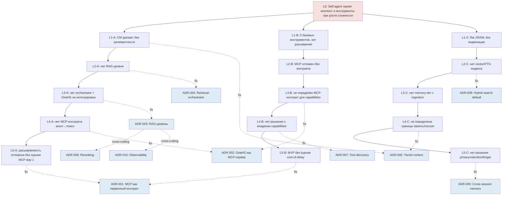
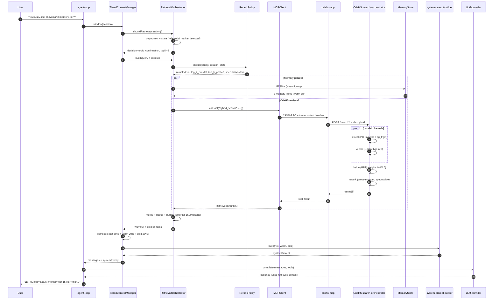
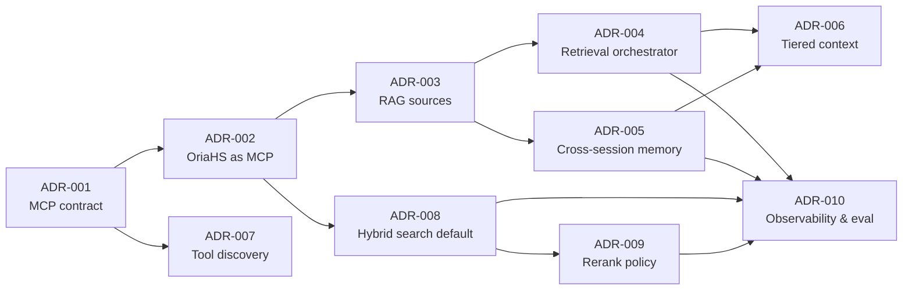
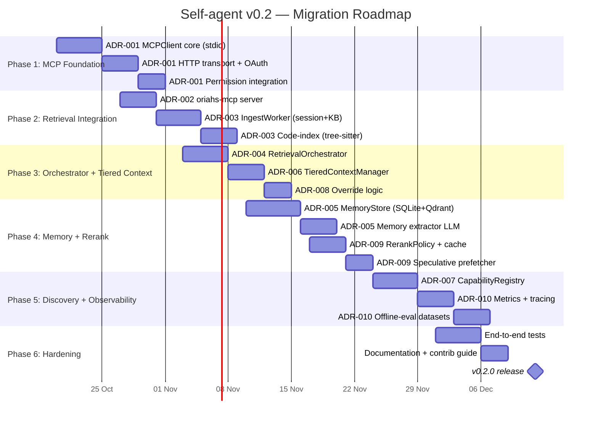

# ARCHITECT2 — Архитектурный апгрейд self-agent через MCP, RAG и гибридный поиск

**Дата:** 2026-10-19
**Автор:** Vasiliy Zhila (Reider85)
**Статус:** Proposed (v0.2 architecture proposal)
**Связанные репозитории:**
- `Reider85/OryaAgent` — дизайн self-agent (MVP из 8 модулей)
- `Reider85/OriaHS` — бэкенд гибридного поиска (PostgreSQL + Qdrant + rerank)

**Связанные документы (ADR):**
- [ADR-001: MCP как первичный контракт расширения инструментов](adr/ADR-001-mcp-as-primary-tool-contract.md)
- [ADR-002: OriaHS как MCP-сервер retrieval для self-agent](adr/ADR-002-oriahs-as-mcp-retrieval-server.md)
- [ADR-003: RAG-уровень поверх session-log и knowledge base](adr/ADR-003-rag-over-session-log.md)
- [ADR-004: Retrieval-orchestrator между context-manager и LLM-шовом](adr/ADR-004-retrieval-orchestrator.md)
- [ADR-005: Cross-session memory через SQLite FTS5 + Qdrant](adr/ADR-005-cross-session-memory.md)
- [ADR-006: Tiered context — hot/warm/cold](adr/ADR-006-tiered-context.md)
- [ADR-007: Tool discovery и capability registry через MCP](adr/ADR-007-tool-discovery-via-mcp.md)
- [ADR-008: Hybrid search fusion как дефолтный retrieval mode](adr/ADR-008-hybrid-search-default.md)
- [ADR-009: Reranking pipeline (cross-encoder) для retrieved context](adr/ADR-009-reranking-pipeline.md)
- [ADR-010: Observability и offline-eval для retrieval path](adr/ADR-010-retrieval-observability-eval.md)

---

## 0. TL;DR (Executive Summary)

Документ описывает архитектурный апгрейд self-agent из репозитория `OryaAgent`, использующий три технологии — **MCP** (Model Context Protocol), **RAG** (Retrieval-Augmented Generation) и **гибридный поиск** — на основе готовой системы `OriaHS`. Применён **каскадный метод Five Whys** к корневой архитектурной проблеме, что позволило выделить 10 ключевых архитектурных решений, оформленных как ADR.

**Ключевая идея:** `OriaHS` уже реализует половину того, что `self-agent` отложил на v2-v3 (retrieval, rerank, observability, eval, cross-session storage). Вместо переписывания — интеграция через MCP-контракт. Это даёт self-agent production-ready retrieval-стек за недели, а не месяцы разработки.

**Главные изменения архитектуры:**

1. **MCP как первичный контракт расширения** (ADR-001) — вместо откладывания на v2.
2. **OriaHS оборачивается в MCP-сервер** (ADR-002) — один retrieval-провайдер для агента, IDE-плагина, eval-джобы.
3. **RAG-уровень из трёх источников** (ADR-003): session-log, knowledge-base, code-index.
4. **Retrieval-orchestrator** (ADR-004) — отдельный модуль между context-manager и LLM-шовом, решающий «когда и как retrieve».
5. **Cross-session memory** (ADR-005) через SQLite FTS5 + Qdrant — закрытие давнего долга из self-agent.md §6.
6. **Tiered context: hot/warm/cold** (ADR-006) с раздельными token-бюджетами.
7. **Tool discovery** (ADR-007) — динамическая фильтрация инструментов для LLM.
8. **Hybrid search как дефолт** (ADR-008) — sparse + dense fusion через готовый стек OriaHS.
9. **Reranking pipeline** (ADR-009) с policy-driven skip и fallback chain.
10. **Observability + offline-eval** (ADR-010) — переиспользование Prometheus/Grafana/nightly-eval OriaHS.

**Five Whys root cause:** отсутствие контракта расширения между ядром агента и внешними capabilities (поиск, память, инструменты) — это структурный долг, который проявляется во всех трёх направлениях одновременно (контекст теряется, инструменты статичны, память не персистится). Решение одно — ввести MCP-контракт и построить retrieval-стек поверх OriaHS.

---

## 1. Контекст

### 1.1. Репозиторий OryaAgent — текущее состояние

`Reider85/OryaAgent` — аналитический репозиторий, содержащий два ключевых документа:

- `analytics/agents-architect.md` — сравнительный разбор 5 архитектур code-агентов 2026 года (Claude Code, OpenCode, Kilo Code, DeepSeek Harness, MiMoCode) с mermaid-схемами и 6 архитектурными выводами.
- `analytics/self-agent.md` — дизайн собственного MVP-агента по принципу 20/80: **8 модулей** (LLM-провайдер-шов, agent-loop, system-prompt-builder, tool-registry с 5 базовыми инструментами, session-log, context-manager, CLI/TUI, permissions).

**Стек MVP:** TypeScript (Node/Bun), один процесс, два LLM-адаптера (OpenAI-compat + Anthropic), JSONL для сессий, ask-режим + allow-list для безопасности.

**Что сознательно отложено на v2-v3** (из `self-agent.md` §6):

| Что | Когда | Почему |
|---|---|---|
| HTTP/SSE-сервер + OpenAPI-SDK | v2 | один CLI покрывает MVP |
| Subagents / Task-делегирование | v2 | один цикл решает 80% |
| Memory cross-session (SQLite FTS5) | v2 | требует privacy-политик |
| Cron / scheduler | v3 | автономность над циклом |
| Goals + judge-модель | v3 | сложный механизм |
| Workflows (JS-песочница) | v3 | compose через промпт достаточно |
| Sandbox / изоляция | v2 | ask-режим покрывает MVP |
| **MCP-клиент** | **v2** | **не блокирует базовую работу** |
| Skills-система | v2 | needs stable core |
| Hooks (pre/post tool) | v2 | permissions достаточно |
| Compaction + Context Epoch | v2 | базовая урезалка достаточна |
| Multi-agent teams | v3+ | экспериментально |
| Checkpoint-writer (subagent) | v3 | требует субагентов |
| `/dream`, `/distill`, Max Mode | v3+ | контур самоулучшения |
| IDE-плагины | v2 | один CLI покрывает MVP |

**Вывод:** MVP сделан прагматично и обоснованно. Однако три явно отложенные области — **MCP-клиент, Memory cross-session, Compaction + Context Epoch** — образуют связанный кластер «расширение + память + управление контекстом», который критичен для любого production-агента. Данный документ показывает, как закрыть этот кластер через интеграцию с `OriaHS`.

### 1.2. Репозиторий OriaHS — текущее состояние

`Reider85/OriaHS` — production-готовый бэкенд гибридного поиска, фаза Critical. Стек:

- **Python 3.11+** (FastAPI, SQLAlchemy 2.x async, asyncpg);
- **PostgreSQL 16** — лексический канал (`pg_trgm` + `tsvector`);
- **Qdrant 1.x** — векторный канал (`bge-m3` embeddings);
- **Redis 7** — кэш эмбеддингов, Streams-очередь;
- **Prometheus 2 + Grafana** — observability (8 дашбордов).

**Архитектурные компоненты OriaHS (фаза Critical):**

| Компонент | Назначение |
|---|---|
| `app/search/orchestrator.py` | координация lexical + vector + fusion + rerank + facets + pushdown |
| `app/search/lexical.py` | PostgreSQL-канал (pg_trgm, tsvector) |
| `app/search/vector.py` | Qdrant-канал (bge-m3) |
| `app/search/fusion.py` | взвешенная комбинация sparse/dense (RRF, weighted-sum) |
| `app/search/rerank.py` | cross-encoder rerank |
| `app/search/facets.py` | агрегации для навигации |
| `app/search/pushdown.py` | Postgres pre-filtering для Qdrant (C-10) |
| `app/reranker/` | cross-encoder + circuit breaker (C-01, C-03) |
| `app/eval/` | nightly offline-eval (C-07) |
| `app/reconciler/` | outbox worker + dead-letter digest |
| `app/observability/metrics.py` | Prometheus-метрики |

**Критические метрики (уже собираются):**
- `reranker_latency_ms`
- `circuit_breaker_state`, `circuit_breaker_opened_total`
- `eval_recall_at_10`, `eval_ndcg_at_10`
- `search_degraded_total`
- `qdrant_pushdown_rate_total`
- `outbox_throttled_total`

**DoD (Definition of Done):**
- DoD MVP (P-17) — `run_dod_check.sh`
- DoD Critical (C-14) + NFR — `run_dod_check_critical.sh`

**Вывод:** OriaHS — это зрелый retrieval-стек, готовый к production. Он закрывает 4 из 5 пунктов, отложенных в self-agent MVP (Memory, Compaction-via-retrieval, Skills-via-retrieval, Observability). Интеграция с self-agent через MCP — естественный следующий шаг.

### 1.3. Карта возможностей для улучшений

| Компонент self-agent | Текущее состояние | Улучшение через MCP | Улучшение через RAG | Улучшение через Hybrid Search |
|---|---|---|---|---|
| `tool-registry` (5 базовых инструментов) | статичный реестр | ✅ динамическое расширение через MCP-сервера | — | — |
| `context-manager` (базовая урезалка) | последние N сообщений | — | ✅ retrieval-инъекция релевантного контекста | ✅ гибридный поиск по session-log |
| `session-log` (JSONL) | append-only, без индексации | — | ✅ индексация в Qdrant для retrieval | ✅ гибридный поиск по истории |
| `system-prompt-builder` | секции identity/tools/context | ✅ MCP `prompts/list` для переиспользуемых промптов | ✅ секция `<retrieved_context>` | — |
| `permissions` (ask + allow-list) | статичный | ✅ per-MCP-server permission rules | — | — |
| Memory cross-session | нет | — | ✅ SQLite FTS5 + Qdrant | ✅ гибридный retrieval по памяти |
| Compaction + Context Epoch | нет | — | ✅ summarization → episodic memory | — |
| Observability | нет | — | — | ✅ переиспользование Prometheus/Grafana OriaHS |
| Tool discovery | нет | ✅ capability registry через MCP | — | — |
| Code-awareness | нет (только через `read`) | ✅ MCP-сервер code-intelligence | ✅ code-index в Qdrant | ✅ гибридный lookup по символам |

---

## 2. Цели и нефункциональные требования

### 2.1. Функциональные цели

1. **G1.** Self-agent должен иметь доступ к production-ready retrieval без 6-12 месяцев разработки.
2. **G2.** Self-agent должен сохранять и использовать кросс-сессионную память.
3. **G3.** Архитектура должна позволять добавлять новые инструменты без правок ядра.
4. **G4.** LLM должна видеть только релевантные текущему контексту инструменты (≤15 за раз).
5. **G5.** Retrieval-path должен быть полностью наблюдаем (metrics + logs + tracing + eval).

### 2.2. Нефункциональные требования (NFR)

| NFR | Целевое значение | Происхождение |
|---|---|---|
| Retrieval latency p95 | < 800 ms | UX-требование |
| Token budget utilization | 80-95% | cost-control |
| Tool-list в LLM-промпте | < 1500 токенов | decision-quality |
| Offline-eval recall@10 | > 0.85 | quality bar |
| MCP server uptime | > 99.5% | reliability |
| Privacy: project-local memory | по умолчанию | data minimization |
| Audit log completeness | 100% MCP-вызовов | security |
| Open-source readiness | все компоненты задокументированы | contribution |

### 2.3. Принципы архитектуры (унаследованы из `agents-architect.md`)

- **P1.** Клиент-серверная схема (вывод №1) — но self-agent остаётся одним процессом; OriaHS — отдельный сервис, доступ через MCP.
- **P2.** Событийно-ориентированное хранение (вывод №2) — session-log остаётся append-only JSONL; memory добавляет SQLite + Qdrant.
- **P3.** LLM-шов обязателен (вывод №6) — не нарушается.
- **P4.** Автономность надстраивается над циклом (вывод №4) — retrieval-orchestrator — надстройка, не встроенность.
- **P5.** Инструменты in-process (вывод №5) — 5 базовых остаются; новые — через MCP.
- **P6.** Базовый набор инструментов одинаков (вывод №5) — не нарушается.

---

## 3. Карта компонентов, улучшаемых через MCP / RAG / Hybrid Search

### 3.1. MCP-улучшения

MCP (Model Context Protocol) — открытый JSON-RPC-протокол поверх stdio/SSE/HTTP для динамического tool/resource/prompt discovery и вызова. Поддерживается Claude Code, OpenCode, Kilo, MiMo, dsh — индустриальный стандарт.

**Компоненты self-agent, улучшаемые через MCP:**

| Компонент | Что меняется | ADR |
|---|---|---|
| `tool-registry` | становится гибридным: in-process + MCP | ADR-001 |
| (новый) `MCPClient` | запуск/управление MCP-серверами, tool-list caching | ADR-001 |
| (новый) `CapabilityRegistry` | динамическая фильтрация инструментов для LLM | ADR-007 |
| `permissions` | per-server permission rules + scope-bearer tokens | ADR-001, ADR-002 |
| `system-prompt-builder` | поддержка MCP `prompts/list` для переиспользуемых промптов | ADR-001 |
| Связь с OriaHS | OriaHS оборачивается в MCP-сервер `oriahs-mcp` | ADR-002 |
| Связь с memory | memory-доступ через MCP-инструменты (`memory_list`, `memory_forget`) | ADR-005 |

### 3.2. RAG-улучшения

RAG (Retrieval-Augmented Generation) — паттерн инъекции retrieved-контекста в LLM-промпт перед генерацией ответа. В self-agent MVP не реализован.

**Компоненты self-agent, улучшаемые через RAG:**

| Компонент | Что меняется | ADR |
|---|---|---|
| `context-manager` | становится retrieval-aware | ADR-003, ADR-004, ADR-006 |
| (новый) `RetrievalOrchestrator` | решает, когда и как retrieve | ADR-004 |
| (новый) `IngestWorker` | индексация session-log/KB/code в OriaHS | ADR-003 |
| `session-log` | индексируется в Qdrant для retrieval | ADR-003 |
| (новый) `MemoryStore` (SQLite + Qdrant) | кросс-сессионная память | ADR-005 |
| (новый) `TieredContextManager` | hot/warm/cold с раздельными бюджетами | ADR-006 |
| `system-prompt-builder` | секция `<retrieved_context>` | ADR-003, ADR-006 |

**Три источника RAG:**

1. **session_log** — все assistant/user сообщения и tool-results из прошлых сессий.
2. **knowledge_base** — markdown-документы (ADR, README, docs/).
3. **code_index** — файлы исходного кода (tree-sitter chunking).

### 3.3. Hybrid Search-улучшения

Hybrid search — комбинация lexical (sparse) и vector (dense) поиска с последующим fusion + rerank. OriaHS уже реализует это production-ready.

**Компоненты self-agent, улучшаемые через Hybrid Search:**

| Компонент | Что меняется | ADR |
|---|---|---|
| Retrieval для RAG | hybrid как дефолт, с override-логикой | ADR-008 |
| (новый) `RerankPolicy` | policy-driven skip + fallback chain | ADR-009 |
| (новый) `RerankCache` | LRU-кэш для повторяющихся queries | ADR-009 |
| (новый) `SpeculativePrefetcher` | предсказание next-topic + prefetch | ADR-009 |
| Observability | переиспользование Prometheus/Grafana OriaHS | ADR-010 |
| Offline-eval | расширение C-07 агентскими датасетами | ADR-010 |
| Tracing | OpenTelemetry через MCP-boundary | ADR-010 |

### 3.4. Сводная матрица «компонент → технология → ADR»



---

## 4. Каскадный Five Whys анализ

### 4.1. Корневой вопрос

> **Почему self-agent MVP теряет релевантный контекст и инструменты при росте сложности задач?**

Эта формулировка выбрана как корневая, потому что:
- она покрывает три наблюдаемых симптома одновременно (потеря контекста, нехватка инструментов, отсутствие памяти);
- она проявляется именно при росте сложности (не на MVP-уровне);
- она имеет структурную причину, а не точечный баг.

### 4.2. Методика каскада

Каскадный Five Whys означает:
- **1 корневой вопрос**;
- **5 уровней «почему»** вниз;
- на **каждом уровне — 2-3 под-вопроса** (ветвление), отражающих разные грани проблемы.

Итого: 1 + 3 + 3·3 + 3·9 + 3·27... — но мы ограничиваемся 2-3 под-вопросами на уровень, чтобы каскад был обозримым.

### 4.3. Ветвление по уровням

#### Уровень 1 — корневой

**Почему self-agent MVP теряет релевантный контекст и инструменты при росте сложности задач?**

Три параллельных ответа (по три направления проблемы):

| Ветвь | Ответ Level 1 |
|---|---|
| **A. Контекст** | Потому что `context-manager` урезает только по N последним сообщениям без учёта релевантности. |
| **B. Инструменты** | Потому что `tool-registry` содержит только 5 базовых инструментов без доступа к внешним сервисам. |
| **C. Память** | Потому что `session-log` хранится как flat JSONL без семантической индексации и кросс-сессионной памяти. |

#### Уровень 2

| Ветвь | Почему (Level 1)? | Ответ Level 2 |
|---|---|---|
| **A** | урезает без учёта релевантности | Потому что нет RAG-уровня для извлечения релевантных кусков из истории сессий и базы знаний. |
| **B** | 5 базовых инструментов без расширения | Потому что MCP-клиент отложен на v2 без чёткого интерфейса и контракта. |
| **C** | flat JSONL без индексации | Потому что нет векторного хранилища и FTS-индекса по истории сессий. |

#### Уровень 3

| Ветвь | Почему (Level 2)? | Ответ Level 3 |
|---|---|---|
| **A** | нет RAG-уровня | Потому что нет retrieval-orchestrator и нет векторного хранилища; существующий OriaHS существует отдельно и не интегрирован с self-agent. |
| **B** | MCP отложен без контракта | Потому что не определён MCP-server-контракт для каждого внешнего capability (retrieval, memory, code-intelligence, integrations). |
| **C** | нет векторного/FTS-индекса | Потому что нет memory-tier с ingestion-pipeline, нет разделения оперативной/долгосрочной памяти. |

#### Уровень 4

| Ветвь | Почему (Level 3)? | Ответ Level 4 |
|---|---|---|
| **A** | OriaHS не интегрирован | Потому что нет общего MCP-контракта между агентом и поисковыми сервисами; интеграция через прямой SDK связала бы два репозитория жёстко. |
| **B** | не определён MCP-контракт для capabilities | Потому что нет архитектурного решения о том, кто владеет capabilities (ядро vs плагины vs MCP), и нет capability-registry для динамического discovery. |
| **C** | нет memory-tier с ingestion | Потому что не определена граница между оперативной (session) и долгосрочной (memory) памятью; нет решения по privacy/retention/forget. |

#### Уровень 5 — корневые причины

| Ветвь | Почему (Level 4)? | Ответ Level 5 (root cause) |
|---|---|---|
| **A** | нет общего MCP-контракта | **Потому что архитектурное решение о расширяемости было отложено на v2 без оценки альтернативы «MCP с первого дня» (как сделали 4 из 5 архитектур из обзора).** Это структурный долг — не точечное упущение. |
| **B** | нет решения о владении capabilities | **Потому что MVP сознательно выбрал «нет расширяемости» ради скорости, но не оценил cost of delay: каждый новый capability теперь требует либо правки ядра, либо откладывания.** |
| **C** | не определена граница памяти | **Потому что в MVP не было решения по privacy/retention/forget, и без него любая кросс-сессионная память — liability.** Решение: tiered-context + project-local memory + encryption + audit. |

### 4.4. Сводная таблица Five Whys

| Уровень | Ветвь A (Контекст) | Ветвь B (Инструменты) | Ветвь C (Память) |
|---|---|---|---|
| **L0 (root)** | Теряет релевантный контекст и инструменты при росте сложности | ↑ | ↑ |
| **L1** | CM урезает без учёта релевантности | 5 базовых инструментов, нет расширения | flat JSONL без индексации |
| **L2** | Нет RAG-уровня | MCP отложен без контракта | Нет векторного/FTS-индекса |
| **L3** | Нет retrieval-orchestrator + OriaHS не интегрирован | Не определён MCP-server-контракт для capabilities | Нет memory-tier с ingestion |
| **L4** | Нет MCP-контракта между агентом и поиском | Нет решения о владении capabilities + нет capability-registry | Не определена граница оперативной/долгосрочной памяти |
| **L5 (root cause)** | Расширяемость отложена на v2 без оценки «MCP с первого дня» | MVP выбрал «нет расширяемости» без оценки cost of delay | Нет решения по privacy/retention/forget |

### 4.5. Извлечённые архитектурные решения → ADR mapping

Каждая корневая причина (L5) и каждый промежуточный уровень (L1-L4) порождает архитектурное решение:

| Level | Ветвь | Решение | ADR |
|---|---|---|---|
| L5-A | Контекст | MCP как первичный контракт расширения (с v0.2, не откладывать) | **ADR-001** |
| L4-A | Контекст | OriaHS как MCP-сервер для retrieval | **ADR-002** |
| L3-A | Контекст | RAG-уровень поверх session-log + KB + code | **ADR-003** |
| L2-A | Контекст | Retrieval-orchestrator между CM и LLM-шовом | **ADR-004** |
| L1-A | Контекст | Tiered context (hot/warm/cold) с бюджетами | **ADR-006** |
| L5-B | Инструменты | То же решение, что и L5-A (ADR-001) | ADR-001 |
| L4-B | Инструменты | Tool discovery и capability registry через MCP | **ADR-007** |
| L3-B | Инструменты | (покрыто ADR-001 + ADR-002) | ADR-001, ADR-002 |
| L5-C | Память | Cross-session memory через SQLite FTS5 + Qdrant с privacy | **ADR-005** |
| L4-C | Память | Tiered context (hot=session/warm=memory/cold=KB) | **ADR-006** |
| L3-C | Память | (покрыто ADR-003 + ADR-005) | ADR-003, ADR-005 |
| L2-C | Память | Hybrid search fusion как дефолт retrieval mode | **ADR-008** |
| (cross-cutting) | Все | Reranking pipeline с policy + fallback | **ADR-009** |
| (cross-cutting) | Все | Observability + offline-eval для retrieval path | **ADR-010** |

Итого: **10 ADR**, покрывающих все 3 ветви Five Whys на всех 5 уровнях.

### 4.6. Визуализация Five Whys → ADR



---

## 5. Целевая архитектура (после v0.2)

### 5.1. Общая архитектура (before/after)

#### 5.1.1. Before (MVP v0.1 из `self-agent.md`)

```mermaid
flowchart TB
    subgraph CLI["CLI/TUI клиент"]
        TUI[TUI/CLI REPL]
    end
    subgraph CORE["Ядро агента — один процесс"]
        LOOP[agent-loop]
        SYSP[system-prompt-builder]
        CTX[context-manager<br/>last-N + truncate]
        SESS[session-log<br/>JSONL append-only]
        PERM[permissions<br/>ask + allow-list]
        subgraph TOOLS["tool-registry (5 in-process)"]
            T1[read] T2[write] T3 T4[bash] T5[grep]
        end
    end
    LLM[LLM-provider-seam<br/>OpenAI-compat + Anthropic]
    FS[Локальная ФС]
    SHELL[Локальный shell]

    TUI <--> LOOP
    LOOP --> SYSP
    LOOP --> CTX
    LOOP --> SESS
    LOOP --> TOOLS
    PERM --> TOOLS
    LOOP <--> LLM
    TOOLS --> FS
    T4 --> SHELL

    style CORE fill:#fbfbfb
    style LLM fill:#f6e0e0
```

#### 5.1.2. After (v0.2 — с MCP, RAG, hybrid search)

```mermaid
flowchart TB
    subgraph CLI["CLI/TUI клиент"]
        TUI[TUI/CLI REPL]
    end
    subgraph CORE["Ядро агента — один процесс"]
        LOOP[agent-loop]
        SPB[system-prompt-builder<br/>+ retrieved_context section]
        TC[TieredContextManager<br/>hot/warm/cold budgets]
        SESS[session-log<br/>JSONL + ingested to Qdrant]
        PERM[permissions<br/>+ per-MCP-server rules]
        RO[RetrievalOrchestrator<br/>decide/buildQuery/merge]
        RERP[RerankPolicy<br/>+ fallback chain]
        CAP[CapabilityRegistry<br/>dynamic tool-filter]
        subgraph TOOLS["tool-registry (hybrid)"]
            T1[read] T2[write] T3 T4[bash] T5[grep]
            MCPTOOLS[MCP tools<br/>dynamic]
        end
        MCP[MCPClient<br/>stdio + HTTP + OAuth]
        MEM[MemoryStore<br/>SQLite FTS5 + SQLCipher]
        OBS[Observability<br/>Prometheus + OTel]
    end

    subgraph MCPSTACK["MCP-сервера (внешние процессы)"]
        OMCP[oriahs-mcp<br/>retrieval+rerank+facets]
        FSMCP[filesystem-mcp]
        GITMCP[git-mcp]
        MEMMCP[memory-mcp<br/>SQLite access]
        OTHER[...]
    end

    subgraph OriaHS["OriaHS (существующий сервис)"]
        API[FastAPI /search /index /facets]
        ORCHS[search-orchestrator]
        LEX[lexical PG]
        VEC[vector Qdrant]
        FUS[fusion]
        RER[rerank + circuit breaker]
        OUT[outbox + reconciler]
        EVA[offline-eval C-07]
        PROM[Prometheus /metrics]
    end

    subgraph INGEST["Ingestion (отдельный процесс)"]
        IW[ingest-worker<br/>session/KB/code chunker]
    end

    LLM[LLM-provider-seam]
    FS[Локальная ФС]

    TUI <--> LOOP
    LOOP --> SPB
    LOOP --> TC
    TC --> RO
    RO --> RERP
    RO --> MCP
    RO --> MEM
    LOOP --> CAP
    CAP --> TOOLS
    MCP --> OMCP
    MCP --> FSMCP
    MCP --> GITMCP
    MCP --> MEMMCP
    OMCP --> API
    API --> ORCHS
    ORCHS --> LEX
    ORCHS --> VEC
    ORCHS --> FUS
    ORCHS --> RER
    API --> OUT
    OUT --> VEC
    SESS --> IW
    IW --> API
    LOOP <--> LLM
    TOOLS --> FS
    LOOP --> OBS
    OBS -.scrape.-> PROM
    EVA -.metrics.-> PROM

    style CORE fill:#fbfbfb
    style MCPSTACK fill:#e0ecf6
    style OriaHS fill:#fdf3e0
    style INGEST fill:#e6f0e0
    style LLM fill:#f6e0e0
```

### 5.2. Sequence-диаграмма retrieval-flow



### 5.3. Component-map до/после (сводная таблица)

| Компонент | v0.1 (MVP) | v0.2 (this proposal) | ADR |
|---|---|---|---|
| agent-loop | чистый цикл | без изменений | — |
| system-prompt-builder | identity + tools + context | + секция `<retrieved_context>` + cacheable warm-prefix | ADR-003, ADR-006 |
| context-manager | last-N + truncate | **TieredContextManager** (hot/warm/cold) | ADR-006 |
| tool-registry | 5 in-process | 5 in-process + MCP-инструменты (hybrid) | ADR-001 |
| session-log | JSONL | JSONL + ingestion в Qdrant | ADR-003 |
| permissions | ask + allow-list | + per-MCP-server rules + scope-bearer | ADR-001, ADR-002 |
| LLM-provider-seam | OpenAI-compat + Anthropic | без изменений | — |
| CLI/TUI | inquirer/chalk | без изменений | — |
| **(новый) MCPClient** | — | stdio + HTTP + OAuth, tool-list cache | ADR-001 |
| **(новый) CapabilityRegistry** | — | dynamic tool-filter для LLM | ADR-007 |
| **(новый) RetrievalOrchestrator** | — | decide/buildQuery/execute/merge/budget | ADR-004 |
| **(новый) RerankPolicy** | — | policy-driven skip + fallback chain | ADR-009 |
| **(новый) MemoryStore** | — | SQLite FTS5 + SQLCipher + Qdrant | ADR-005 |
| **(новый) TieredContextManager** | — | hot/warm/cold with budget reclaim | ADR-006 |
| **(новый) IngestWorker** | — | session/KB/code chunker + indexer | ADR-003 |
| **(новый) Observability** | — | Prometheus + OpenTelemetry + audit | ADR-010 |
| **(внешний) oriahs-mcp** | — | MCP-сервер-обёртка над OriaHS API | ADR-002 |

---

## 6. ADR Summary

### 6.1. Краткое содержание ADR

| ADR | Решение | Статус | Зависимости |
|---|---|---|---|
| **ADR-001** | MCP как первичный контракт расширения инструментов (с v0.2) | Proposed | — |
| **ADR-002** | OriaHS оборачивается в MCP-сервер `oriahs-mcp` | Proposed | ADR-001 |
| **ADR-003** | RAG-уровень из 3 источников: session-log, KB, code-index | Proposed | ADR-002 |
| **ADR-004** | Retrieval-orchestrator — отдельный модуль между CM и LLM-шовом | Proposed | ADR-001, ADR-002, ADR-003 |
| **ADR-005** | Cross-session memory через SQLite FTS5 + Qdrant + SQLCipher | Proposed | ADR-002, ADR-003 |
| **ADR-006** | Tiered context: hot/warm/cold с раздельными budget'ами | Proposed | ADR-003, ADR-004, ADR-005 |
| **ADR-007** | Tool discovery и capability registry через MCP | Proposed | ADR-001 |
| **ADR-008** | Hybrid search fusion как дефолтный retrieval mode | Proposed | ADR-002, ADR-003 |
| **ADR-009** | Reranking pipeline с policy-driven skip и fallback chain | Proposed | ADR-002, ADR-008 |
| **ADR-010** | Observability + offline-eval для retrieval path | Proposed | ADR-002..009 |

### 6.2. Граф зависимостей ADR



### 6.3. Что надстраивает каждый ADR над MVP

| ADR | Что добавляет в MVP | LOC (оценка) |
|---|---|---|
| ADR-001 | MCPClient + конфиг mcp.yml | ~600-800 TS |
| ADR-002 | oriahs-mcp сервер (Python) | ~400-500 Python |
| ADR-003 | IngestWorker (chunker + embedder) | ~600 Python |
| ADR-004 | RetrievalOrchestrator + стратегии | ~500-700 TS |
| ADR-005 | MemoryStore + extractor | ~600 Python + ~300 TS |
| ADR-006 | TieredContextManager | ~300-400 TS |
| ADR-007 | CapabilityRegistry + triggers | ~400-500 TS |
| ADR-008 | Override-логика в RetrievalOrchestrator | ~200 TS |
| ADR-009 | RerankPolicy + cache + prefetcher | ~300 TS |
| ADR-010 | Metrics + tracing + eval datasets | ~400 TS + ~300 Python |

**Итого:** ~4000-5000 строк нового кода в self-agent + ~1500 строк в oriahs-mcp/ingest-worker. Это 4-6 недель работы одного разработчика (без учёта тестирования и отладки).

---

## 7. Метрики и KPI

### 7.1. Текущие vs целевые

| Метрика | Текущее (MVP v0.1) | Целевое (v0.2) | Источник |
|---|---|---|---|
| Retrieval latency p95 | N/A (нет retrieval) | < 800 ms | self-agent + OriaHS |
| Retrieval recall@10 | N/A | > 0.85 | offline eval |
| Retrieval ndcg@10 | N/A | > 0.75 | offline eval |
| Tool-list в LLM-промпте | 5 (~200 токенов) | 8-15 (~1000-1500 токенов) | self-agent |
| Visible tools per turn | 5 (фиксировано) | 8-15 (динамически) | self-agent |
| Token budget utilization | ~100% (всегда full) | 80-95% | self-agent |
| Cross-session memory items | 0 | растёт стабильно | SQLite |
| MCP server uptime | N/A | > 99.5% | health-check |
| Rerank cache hit ratio | N/A | 15-30% | self-agent |
| Observability overhead | N/A | < 10% | benchmark |
| Prompt cache hit rate | ~0% (всегда full new) | > 60% | LLM provider |
| Time-to-first-new-tool | дни (правка ядра) | < 1 час (MCP-сервер) | end-to-end |

### 7.2. Dashboard overview

```
┌────────────────────────────────────────────────────────────────────────┐
│ Self-agent Retrieval Overview                                          │
├───────────────────────────┬────────────────────────────────────────────┤
│ Retrieval latency (p95)   │ 712 ms (target <800)              ✅        │
│ Decisions distribution    │ standard 65%, topic 18%, none 12%          │
│ Fallback rate             │ 4.2% (target <5%)                ✅        │
│ Cache hit ratio           │ 23%  (target 15-30%)             ✅        │
└───────────────────────────┴────────────────────────────────────────────┘
┌────────────────────────────────────────────────────────────────────────┐
│ Tiered Context Budget                                                  │
├────────────────────────────────────────────────────────────────────────┤
│ Hot:  18,900 tokens (59%) ████████████████████                         │
│ Warm:  4,200 tokens (13%) ████                                         │
│ Cold:  3,100 tokens (10%) ███                                          │
│ Reclaim: 12% (warm+cold unused → hot)                                  │
│ Utilization: 82%  ✅                                                   │
└────────────────────────────────────────────────────────────────────────┘
┌────────────────────────────────────────────────────────────────────────┐
│ Memory Health                                                          │
├────────────────────────────────────────────────────────────────────────┤
│ Items total: 1,801 (fact 234, preference 89, decision 56, episodic 1422)│
│ Extraction success: 96%      ✅                                        │
│ Retrieval recall@5: 0.81     ✅                                        │
│ Forget latency: 312 ms       ✅                                        │
└────────────────────────────────────────────────────────────────────────┘
┌────────────────────────────────────────────────────────────────────────┐
│ MCP Servers                                                            │
├────────────────────────────────────────────────────────────────────────┤
│ oriahs-mcp       uptime 99.8%  latency 412 ms  ✅                       │
│ filesystem-mcp   uptime 100%   latency  18 ms  ✅                       │
│ git-mcp          uptime 99.5%  latency  87 ms  ✅                       │
│ memory-mcp       uptime 100%   latency  12 ms  ✅                       │
└────────────────────────────────────────────────────────────────────────┘
┌────────────────────────────────────────────────────────────────────────┐
│ Offline-eval (nightly C-07 + agent datasets)                           │
├────────────────────────────────────────────────────────────────────────┤
│ agent_session_recall:  recall@10 = 0.87  ndcg@10 = 0.79    ✅          │
│ agent_kb_recall:       recall@10 = 0.91  ndcg@10 = 0.82    ✅          │
│ agent_code_recall:     recall@10 = 0.93  ndcg@10 = 0.85    ✅          │
│ agent_memory_recall:   recall@10 = 0.84  ndcg@10 = 0.76    ✅          │
└────────────────────────────────────────────────────────────────────────┘
```

### 7.3. Метрики по ADR (summary)

| ADR | Ключевая метрика | Цель |
|---|---|---|
| ADR-001 | Time-to-first-new-tool | < 1 час |
| ADR-002 | retrieval_hit_rate | 30-60% turns |
| ADR-003 | retrieval_false_positive_rate | < 30% |
| ADR-004 | retrieval_decision_accuracy | > 75% |
| ADR-005 | memory_extraction_success_rate | > 95% |
| ADR-006 | context_budget_utilization | 80-95% |
| ADR-007 | visible_tools_per_turn | 8-15 |
| ADR-008 | retrieval_recall_at_10 | > 0.85 |
| ADR-009 | rerank_cache_hit_ratio | 15-30% |
| ADR-010 | observability_overhead_pct | < 10% |

---

## 8. Migration Roadmap

### 8.1. Phases



### 8.2. Phase-подробности

#### Phase 1: MCP Foundation (ADR-001) — 12 дней

- **Цель:** MCP-клиент работает с stdio- и HTTP-MCP-серверами, OAuth-флоу для удалённых серверов, per-server permissions.
- **DoD:**
  - [ ] `MCPClient` запускает stdio-MCP-сервер и получает `tools/list`.
  - [ ] HTTP-MCP с bearer-token auth работает.
  - [ ] OAuth (device-code flow) для Google/Slack MCP — реализован.
  - [ ] `permissions.yml` поддерживает per-server rules.
  - [ ] Интеграционный тест: запуск filesystem-mcp, выполнение `read_file`, проверка лога.
- **Риски:** OAuth-флоу сложнее, чем кажется; mitigation — начать с bearer-token, OAuth во второй итерации.

#### Phase 2: Retrieval Integration (ADR-002, ADR-003) — 13 дней

- **Цель:** OriaHS доступен как MCP-сервер; session-log и KB инжектируются в Qdrant через OriaHS.
- **DoD:**
  - [ ] `oriahs-mcp` сервер поднят в docker-compose OriaHS.
  - [ ] Инструменты `hybrid_search`, `lexical_search`, `vector_search`, `retrieve_facets`, `get_document` работают.
  - [ ] `IngestWorker` индексирует session-log в коллекцию `agent_context` Qdrant.
  - [ ] KB-watcher отслеживает `~/.self-agent/kb/` и переиндексирует при изменениях.
  - [ ] Code-indexer использует tree-sitter для chunking по функциям/классам.
  - [ ] Secret-detector блокирует ingestion при обнаружении секретов.
- **Риски:** tree-sitter setup сложный; mitigation — начать с line-based chunking, tree-sitter в Phase 5.

#### Phase 3: Orchestrator + Tiered Context (ADR-004, ADR-006, ADR-008) — 12 дней

- **Цель:** Retrieval-orchestrator решает, когда retrieve; tiered-context-manager собирает hot/warm/cold.
- **DoD:**
  - [ ] 7 стратегий retrieval (none, standard, topic_continuation, speculative_prefetch, explicit_recall, code_lookup, degraded) реализованы.
  - [ ] TieredContextManager собирает промпт с раздельными бюджетами.
  - [ ] Reclaim-логика перекидывает unused budget в Hot.
  - [ ] Override-логика ADR-008 (identifier-detection, paraphrase-detection) работает.
  - [ ] Prompt-cache-hit rate > 40% на тестовых сессиях.
- **Риски:** Tuning гиперпараметров (60/20/20); mitigation — начать с дефолтов, тюнить по метрикам.

#### Phase 4: Memory + Rerank (ADR-005, ADR-009) — 13 дней

- **Цель:** Cross-session memory через SQLite + Qdrant; rerank-policy с fallback.
- **DoD:**
  - [ ] SQLite-схема `memory_items` + FTS5 создана.
  - [ ] Memory-extractor (на haiku/mini LLM) работает в batch-режиме.
  - [ ] Qdrant-коллекция `agent_memory` синхронизирована через outbox.
  - [ ] SQLCipher encryption включён, ключ в OS keychain.
  - [ ] Rerank-policy реализует все 10 сценариев (см. ADR-009 §2.1).
  - [ ] Rerank-cache (LRU) даёт > 15% hit-rate на тестовых сессиях.
  - [ ] Fallback-chain (hybrid+rerank → hybrid → lexical → degraded) покрыта тестами.
- **Риски:** LLM-extractor галлюцинирует; mitigation — confidence-score + user review для low-confidence.

#### Phase 5: Discovery + Observability (ADR-007, ADR-010) — 13 дней

- **Цель:** Динамическая фильтрация инструментов; полный observability-стек.
- **DoD:**
  - [ ] CapabilityRegistry активирует инструменты по file/content triggers.
  - [ ] `/use mcp://...` flow работает с permission-approval.
  - [ ] Prometheus `/metrics` endpoint отдаёт все метрики ADR-010.
  - [ ] OpenTelemetry tracing работает end-to-end (agent → MCP → OriaHS).
  - [ ] 4 agent-eval datasets (130 сценариев) добавлены в nightly C-07.
  - [ ] 4 новых Grafana-дашборда созданы.
- **Риски:** Tracing через MCP-boundary может терять context; mitigation — W3C TraceContext headers.

#### Phase 6: Hardening — 8 дней

- End-to-end тесты на 10 эталонных сценариях.
- Документация: CONTRIBUTING.md, ADR-index.md, architecture-diagrams.
- v0.2.0 release.

### 8.3. Risks & Mitigations (cross-phase)

| Риск | Phase | Влияние | Mitigation |
|---|---|---|---|
| MCP-спецификация меняется | 1 | высокое | pin версии протокола, adapter-слой |
| OriaHS API breaking change | 2 | высокое | MCP-сервер — точка стабилизации, версия в URL |
| LLM-extractor hallucinations | 4 | среднее | confidence + user review |
| Tuning гиперпараметров | 3 | среднее | defaults + offline-eval + auto-tune loop |
| Observability overhead | 5 | среднее | sampling, async-export |
| Speculative prefetch wrong-topic | 4 | низкое | low top_k + cheap mode |
| Privacy: секреты в Qdrant | 2 | критическое | secret-detector + audit |

### 8.4. Quick wins (можно сделать за 1-2 дня каждый)

1. **QW1.** Существующий `OriaHS` уже имеет `/search` REST API — можно написать минимальный `oriahs-mcp` за 1 день и подключить к self-agent как MCPClient без OAuth (bearer-token только).
2. **QW2.** Базовый RAG поверх session-log без rerank: `hybrid_search` без rerank, top_k=3, вставка в промпт. Это даст 60% пользы при 20% усилий.
3. **QW3.** Tiered-context с фиксированными 60/20/20 без reclaim — простая реализация, дающая структуру для будущих улучшений.
4. **QW4.** Secret-detector как standalone-скрипт, проверяющий session-log перед ingestion — критично для безопасности.

---

## 9. Сравнение альтернатив (сводная таблица)

### 9.1. По ключевой альтернативе: «Как интегрировать OriaHS в self-agent?»

| Подход | Плюсы | Минусы | Выбор |
|---|---|---|---|
| **MCP-сервер (ADR-002)** | слабая связанность, совместимость со сторонними клиентами, tool-discovery, ADR-001-соответствие | +JSON-RPC overhead, +слой абстракции | ✅ **Выбрано** |
| Прямой Python SDK | проще, быстрее | сильная связанность, только Python, нет tool-discovery | ❌ |
| In-process (Qdrant+PG в ядре) | минимальная latency | дублирование OriaHS, нет resource-sharing | ❌ |
| LangChain RetrievalTool | быстро поднять | не использует OriaHS, базовый hybrid | ❌ |

### 9.2. По памяти: «Как хранить cross-session memory?»

| Подход | Плюсы | Минусы | Выбор |
|---|---|---|---|
| **SQLite FTS5 + Qdrant (ADR-005)** | structured access, hybrid retrieval, privacy via SQLCipher, OriaHS reuse | двойное хранение, sync-сложность | ✅ **Выбрано** |
| Только Qdrant | простота | слабый lexical, нет structured queries | ❌ |
| Только SQLite FTS5 | простота | нет semantic search | ❌ |
| MEMORY.md plain-text | ultra-просто | не масштабируется | ❌ (только как bootstrap-слой) |
| Pinecone Cloud | managed | privacy risk, cost, no offline | ❌ |

### 9.3. По retrieval-strategy: «Когда и как retrieve?»

| Подход | Плюсы | Минусы | Выбор |
|---|---|---|---|
| **Retrieval-orchestrator + политики (ADR-004)** | тестируемость, расширяемость, observability | +модуль | ✅ **Выбрано** |
| Inline в context-manager | проще | SRP-нарушение | ❌ |
| LLM-as-router | гибкость | +latency, +cost | ❌ (v2 опция) |
| Always-retrieve | 100% coverage | noise + cost | ❌ |
| Reactive tool-call (LLM сама) | свобода LLM | непредсказуемо | ❌ как дефолт, ✅ как дополнение |

### 9.4. По fusion: «Какой режим поиска дефолтный?»

| Подход | Плюсы | Минусы | Выбор |
|---|---|---|---|
| **Hybrid (RRF, ADR-008)** | best-of-both, OriaHS-native | latency x2 | ✅ **Выбрано** |
| Vector-only | semantic-good | identifiers плохо | ❌ |
| Lexical-only | identifier-good | paraphrase плохо | ❌ |
| Query-classification | точность | +classifier cost | ❌ (v0.4 enhancement) |

### 9.5. По rerank: «Когда применять cross-encoder?»

| Подход | Плюсы | Минусы | Выбор |
|---|---|---|---|
| **Policy-driven skip (ADR-009)** | cost-control, OriaHS-circuit-breaker-aware | tuning | ✅ **Выбрано** |
| Always-rerank | проще | cost x3-x5 | ❌ |
| Never-rerank | дёшево | paraphrase-точность падает | ❌ |
| LLM-as-reranker | excellent accuracy | cost $$$, latency | ❌ (v2 для high-stakes) |
| Multi-stage (cross-encoder → LLM) | top accuracy | overkill | ❌ (v3) |

---

## 10. Open Questions / Future Work

### 10.1. Открытые вопросы (требуют отдельного ADR в будущем)

1. **OQ-1.** Compaction + Context Epoch (v2.2 из `self-agent.md` §9) — как именно summarization перекладывается в Warm-tier (episodic memory)? Нужен отдельный ADR.
2. **OQ-2.** Multi-agent scenarios (v3.0) — если несколько self-agent-инстансов работают над одним проектом, как они шарят MemoryStore? Конфликты записи?
3. **OQ-3.** Subagents + Task-делегирование (v2 из `self-agent.md` §6) — каждый subagent имеет свой retrieval-orchestrator? Или общий?
4. **OQ-4.** Autonomous mode (cron + goals + judge) — как retrieval-orchestrator взаимодействует с cron-задачами?
5. **OQ-5.** Privacy: federated learning для memory-extractor'а (чтобы не отправлять session-log в cloud LLM)?
6. **OQ-6.** Cost optimization: когда переключаться с haiku-extractor на локальную модель (Ollama)?

### 10.2. Future ADRs (запланированные)

| Future ADR | Тема | Когда |
|---|---|---|
| ADR-011 | Compaction pipeline + Context Epoch | v0.3 |
| ADR-012 | Subagents и их retrieval-context | v0.4 |
| ADR-013 | Autonomous mode (cron + goals + judge) | v0.5 |
| ADR-014 | Skills-система поверх retrieval | v0.5 |
| ADR-015 | Federated memory-extractor | v1.0 |
| ADR-016 | IDE-плагины (VS Code, JetBrains) через HTTP-API | v1.0 |

### 10.3. Что сознательно НЕ делается в v0.2

Чтобы сохранить фокус и time-to-market:

- **HTTP/SSE-сервер в ядре self-agent** — остаётся один CLI; сервер — v0.3 (после стабилизации retrieval-path).
- **Subagents** — v0.4.
- **Skills-система** — v0.5.
- **Compaction + Context Epoch** — v0.3 (но tiered-context из ADR-006 уже подготавливает структуру).
- **Sandbox / изоляция bash** — v0.3 (через `kilo-sandbox`-style или аналоги).
- **Multi-agent teams** — v1.0+.
- **Workflow engine (JS-песочница)** — v0.5+.

---

## 11. References

### 11.1. Внутренние документы

- `OryaAgent/analytics/agents-architect.md` — сравнительный разбор 5 архитектур
- `OryaAgent/analytics/self-agent.md` — дизайн MVP (8 модулей)
- `OriaHS/README.md` — стек OriaHS, фаза Critical
- `OriaHS/analitics/ARCHITECT.md` — детальная архитектура OriaHS
- `OriaHS/analitics/ROADMAP.md` — roadmap OriaHS
- `OriaHS/C03_IMPLEMENTATION_REPORT.md` — circuit breaker для reranker

### 11.2. ADR (этот документ)

- `adr/ADR-001-mcp-as-primary-tool-contract.md`
- `adr/ADR-002-oriahs-as-mcp-retrieval-server.md`
- `adr/ADR-003-rag-over-session-log.md`
- `adr/ADR-004-retrieval-orchestrator.md`
- `adr/ADR-005-cross-session-memory.md`
- `adr/ADR-006-tiered-context.md`
- `adr/ADR-007-tool-discovery-via-mcp.md`
- `adr/ADR-008-hybrid-search-default.md`
- `adr/ADR-009-reranking-pipeline.md`
- `adr/ADR-010-retrieval-observability-eval.md`

### 11.3. Внешние ссылки

- Model Context Protocol: https://modelcontextprotocol.io
- MCP servers registry: https://github.com/modelcontextprotocol/servers
- bge-m3 embedder: https://huggingface.co/BAAI/bge-m3
- bge-reranker-v2-m3: https://huggingface.co/BAAI/bge-reranker-v2-m3
- Qdrant: https://qdrant.tech
- PostgreSQL FTS: https://www.postgresql.org/docs/16/textsearch.html
- pg_trgm: https://www.postgresql.org/docs/16/pgtrgm.html
- SQLite FTS5: https://www.sqlite.org/fts5.html
- SQLCipher: https://www.zetetic.net/sqlcipher/
- OpenTelemetry: https://opentelemetry.io
- Prometheus client_nodejs: https://github.com/siimon/prom-client
- FastMCP framework: https://github.com/jlowin/fastmcp
- tree-sitter: https://tree-sitter.github.io
- Reciprocal Rank Fusion (Cormack et al.): https://plg.uwaterloo.ca/~gvcormac/cormacksigir09-rrf.pdf
- Anthropic prompt caching: https://docs.anthropic.com/en/docs/build-with-claude/prompt-caching

### 11.4. Глоссарий

| Термин | Определение |
|---|---|
| **MCP** | Model Context Protocol — JSON-RPC-протокол для tool/resource/prompt discovery |
| **RAG** | Retrieval-Augmented Generation — инъекция retrieved-контекста в LLM-промпт |
| **Hybrid search** | Комбинация lexical (sparse) и vector (dense) поиска с fusion |
| **Fusion (RRF)** | Reciprocal Rank Fusion — алгоритм объединения рангов из нескольких retrievers |
| **Cross-encoder rerank** | Точная реранжировка через модель, смотрящая на query+doc совместно |
| **Tiered context** | Разделение контекста на hot/warm/cold с разными budget'ами |
| **Outbox pattern** | Транзакционная запись в БД + async-синхронизация с внешним стором |
| **Circuit breaker** | Паттерн защиты от каскадных сбоев: при N ошибках открывается, запросы идут в fallback |
| **Speculative rerank** | Early-exit в cross-encoder при явном score-gap в top-candidates |
| **Push-down фильтры** | Применение metadata-фильтров в БД-уровне до vector-search |
| **Five Whys** | Метод root-cause-анализа: 5 последовательных «почему» до корневой причины |
| **ADR** | Architecture Decision Record — документ, фиксирующий архитектурное решение |

---

**Конец ARCHITECT2.md v0.2.**
