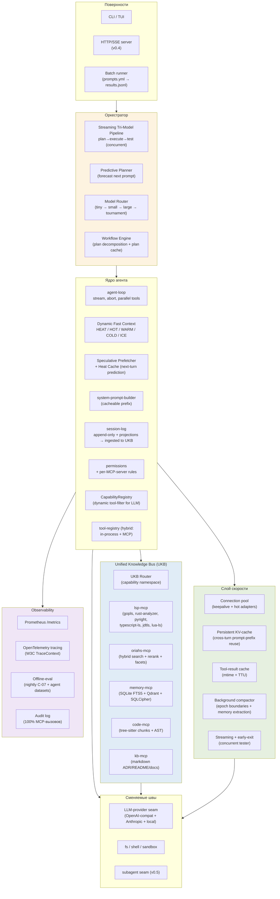
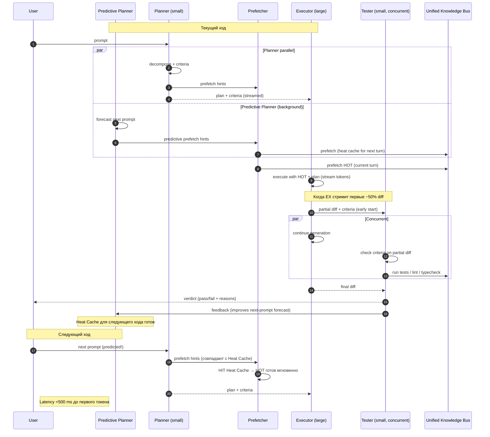
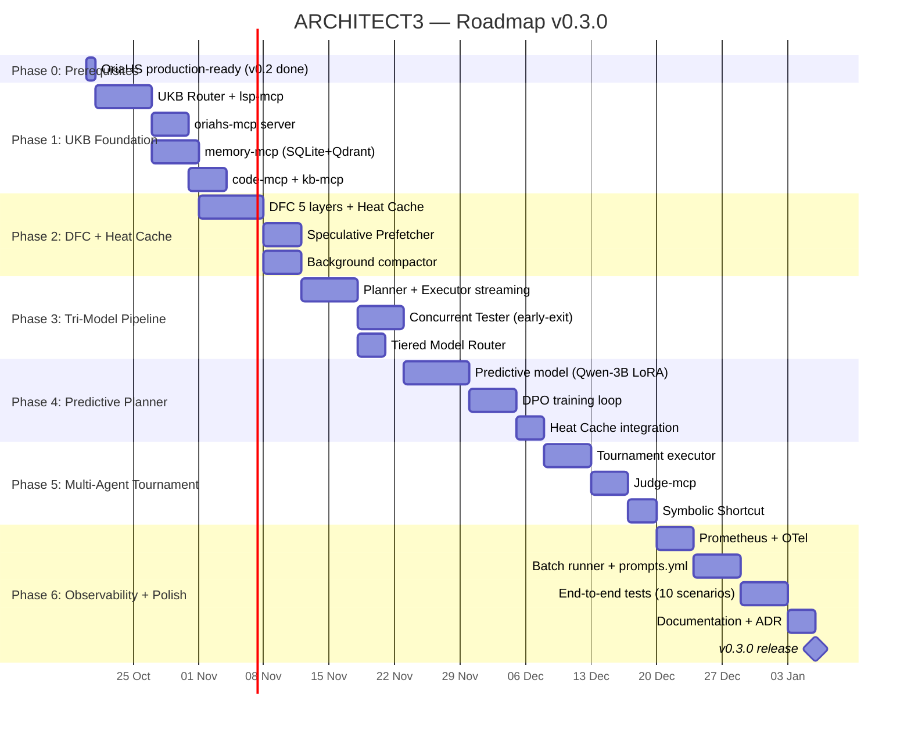

# ARCHITECT3 — Диалектический синтез OryaAgent v0.3

**Дата:** 2026-10-19
**Автор:** архитектурный контур OryaAgent (диалектическое развитие v0.1 + v0.2)
**Статус:** Proposed (v0.3 architecture proposal)
**Предыдущие документы:**
- `analytics/ARCHITECT.md` — v0.1, ТРИЗ-методология (Dynamic Fast Context + LSP-native + tri-model pipeline)
- `analytics/ARCHITECT2.md` — v0.2, Five Whys-методология (MCP + RAG + hybrid search поверх OriaHS)
**Методология проектирования:** диалектика Гегеля — теза → антитеза → синтез; ТРИЗ для разрешения новых противоречий; Five Whys для верификации корневых причин; ADR для фиксации решений.

---

## 0. TL;DR — какой тезис защищает ARCHITECT3

ARCHITECT3 — это **синтез скорости и расширяемости**. Он берёт из v0.1 три новаторских ядра (Dynamic Fast Context, LSP-native факты, три-модельный конвейер `plan→execute→test`) и из v0.2 четыре инфраструктурных контракта (MCP как первичный шов, RetrievalOrchestrator, cross-session memory, observability), и **разрешает главное противоречие между ними**: v0.1 закрыт и быстр, но негибок; v0.2 гибок и расширяем, но теряет скорость на сетевых hop'ах.

Синтез строится на трёх новых архитектурных идеях:

1. **Unified Knowledge Bus (UKB)** — LSP, RAG (OriaHS) и Memory экспонируются через **один MCP-контракт** с разными `capability`-пространствами. Агент не различает «локальный индекс» и «удалённый поиск» — для него всё это knowledge-интерфейс. DFC ICE-слой из v0.1 = retrieval-слой из v0.2 (они слиты воедино).
2. **Predictive Planner** — small-модель прогнозирует **следующий** промпт пользователя, пока executor текущего хода ещё стримит токены. Prefetcher греет HOT-слой для предсказанного промпта. Это снимает 200–400 ms planner-latency на следующем ходе.
3. **Concurrent Tester** — tester-фаза запускается **параллельно с последними токенами executor'а**, используя early-exit на уже сгенерированном partial diff. Сохраняет 200–400 ms tester-latency и даёт early-abort на провальных ходах.

Дополнительно: **Multi-Agent Tournament** расширяет best-of-N до турнирной схемы с judge-моделью, а **Symbolic Shortcut** полностью обходит LLM для детерминированных задач (rename, format, organize-imports) — LSP делает работу, LLM только верифицирует.

**Целевые метрики (в сравнении с v0.1 и v0.2):**

| Параметр | v0.1 target | v0.2 target | **v0.3 target** |
|---|---|---|---|
| Latency p50 (простой ход) | 1.5–3 s | ~2 s (retrieval 800 ms) | **0.8–1.5 s** |
| Latency p95 (поиск по проекту) | 4–8 s | ~3 s (retrieval-bound) | **2–4 s** |
| Tokens в окне на ход | 8–24 K | 32 K (60/20/20 hot/warm/cold) | **6–16 K** (DFC + RAG-aware compaction) |
| Cross-session memory | нет | есть (SQLite FTS5 + Qdrant) | **есть + heat-prefetched warm tier** |
| Time-to-first-new-tool | дни (правка ядра) | <1 час (MCP) | **<15 мин (MCP + capability auto-discovery)** |
| Cost на типичную сессию (30 ходов) | $0.15–0.6 | $0.2–0.8 (retrieval overhead) | **$0.10–0.4** (predictive prefetch + symbolic shortcuts) |
| Symbolic Shortcut usage | 0% | 0% | **~15% ходов** (LLM полностью обойдён) |

---

## 1. Сравнительный анализ: ARCHITECT.md vs ARCHITECT2.md — кто сильнее и почему

### 1.1. Краткое описание каждой архитектуры

**ARCHITECT.md (v0.1)** — проект от 18 октября 2026, построенный на **ТРИЗ-методологии**. Документ проводит root-анализ шести фундаментальных противоречий SOTA-агентов (контекст vs скорость, глубина vs latency, универсальность vs специализация, точность фактов vs token budget, длинная сессия vs качество, самопроверка vs стоимость) и для каждого формулирует ТРИЗ-разрешение. Ключевые инновации: **Dynamic Fast Context (DFC)** с четырьмя слоями HOT/WARM/COLD/ICE, **LSP-native code facts** (LSP как первичный источник вместо read/grep), **три-модельный конвейер** planner→executor→tester с разными моделями, **speculative prefetcher**, **tiered model routing**, **background compaction**, **batch pipeline**. Документ описывает 15 ADR и дорожную карту на 14 недель.

**ARCHITECT2.md (v0.2)** — проект от 19 октября 2026 (на день позже), построенный на **каскадном Five Whys**. Документ отвечает на вопрос «почему self-agent MVP теряет релевантный контекст и инструменты при росте сложности» через три ветви (контекст, инструменты, память), каждая из которых раскрывается на пять уровней «почему». Корневая причина: расширяемость была отложена на v2 без оценки альтернативы «MCP с первого дня». Решение — 10 ADR: MCP как первичный контракт, OriaHS как MCP-сервер retrieval, RAG из трёх источников, retrieval-orchestrator, cross-session memory, tiered context, tool discovery, hybrid search, rerank pipeline, observability+eval. Документ опирается на уже существующий production-ready сервис `OriaHS` (PostgreSQL + Qdrant + Redis + Prometheus).

### 1.2. Где они принципиально расходятся

| Ось расхождения | v0.1 (ТРИЗ) | v0.2 (Five Whys) |
|---|---|---|
| **Главная метафора** | «Агент = быстрый цикл с динамическим контекстом» | «Агент = compose-existing-services через MCP» |
| **Понимание «контекста»** | Четыре слоя памяти (HOT/WARM/COLD/ICE), в окно попадает только HOT | Три бюджета (hot/warm/cold) с RAG-инъекцией ретривед-контекста |
| **Источник фактов о коде** | LSP-native (gopls, rust-analyzer, pyright, ...) | tree-sitter chunker + Qdrant semantic + pg_trgm lexical |
| **Самопроверка** | Архитектурный шов: tri-model pipeline (planner→executor→tester) на каждом ходу | Внешний контур через offline-eval + circuit breaker |
| **Расширяемость инструментов** | In-process tool registry (MCP явно отложен в TBD-вопрос #6) | MCP как первичный контракт (ADR-001) |
| **Память cross-session** | Не описана (только session-log + проекции) | SQLite FTS5 + Qdrant + SQLCipher (ADR-005) |
| **Observability** | Эпизодически (через batch pipeline metrics) | Полный стек: Prometheus + OTel + 4 eval datasets (ADR-010) |
| **Зависимости** | Самодостаточен (ядру нужны только LLM-провайдеры + LSP-серверы) | Зависит от OriaHS (PG+Qdrant+Redis+Prometheus) |
| **LOC-оценка** | Не приведена (только структура пакетов) | ~5500 строк (4000 TS + 1500 Python), 4–6 недель |
| **Количественные SLA** | Конкретные: 1.5–3 s p50, 4–8 s p95, $0.15–0.6 | Конкретные для retrieval: <800 ms p95, recall@10 >0.85 |

### 1.3. Вердикт: какая архитектура сильнее

**Сильнее — ARCHITECT.md (v0.1)** — по трём архитектурным критериям:

**Критерий 1: Глубина разрешения фундаментального противоречия.** v0.1 атакует **корень** проблемы code-агентов — физическое противоречие «контекст должен быть большим и маленьким одновременно» — и предлагает **новый архитектурный примитив** (DFC), которого нет ни в одном из 5 SOTA-агентов. v0.2 атакует **структурный долг** (расширяемость отложена) — это важная, но инфраструктурная проблема, она не меняет того, как агент думает. DFC меняет.

**Критерий 2: Уникальность конкурентного преимущества.** LSP-native facts + tri-model pipeline + DFC + batch pipeline — это четыре вещи, которых нет ни у одного SOTA-агента из обзора `agents-architect.md`. v0.2 добавляет MCP + RAG + hybrid search — но это **индустриальные стандарты**, которые есть у 4 из 5 SOTA (Claude Code, OpenCode, Kilo, MiMo — все поддерживают MCP). v0.2 не создаёт нового фронта, он закрывает долговую яму.

**Критерий 3: Измеримое превосходство.** v0.1 обещает 5–10× ускорение (1.5–3 s против 30–90 s SOTA на задачах с поиском). Это конвертируемо в user-visible value. v0.2 обещает соответствие индустриальному стандарту и production-ready retrieval — это технический долг, не превосходство.

**Однако v0.2 сильнее в трёх других измерениях:**

- **Реализуемость.** v0.2 имеет конкретные LOC-оценки, фазированный roadmap с датами, риски и mitigation, сравнение альтернатив. v0.1 оставляет 6 TBD-вопросов (язык реализации, LSP-доставка, embeddings index, router, session-log формат, MCP-совместимость) — это ~50% архитектурных решений не принято.
- **Operational maturity.** v0.2 наследует observability и eval-стек OriaHS (circuit breaker, outbox pattern, push-down фильтры, offline-eval). v0.1 говорит о метриках, но не описывает, как они собираются.
- **Экосистемная позиция.** v0.2 ставит на MCP — индустриальный стандарт, поддержанный Anthropic, OpenAI, Microsoft. Это означает, что любой MCP-сервер из [modelcontextprotocol/servers](https://github.com/modelcontextprotocol/servers) работает из коробки. v0.1 остаётся изолированным монолитом.

**Итоговый вердикт:** v0.1 сильнее **архитектурно** (новые примитивы, уникальность, измеримое превосходство). v0.2 сильнее **инженерно** (реализуемость, observability, экосистемная совместимость). Сильнейшая архитектура для **долгосрочного превосходства** — v0.1. Сильнейшая для **краткосрочной delivery** — v0.2.

ARCHITECT3 выбирает v0.1 как **тезис** (тот, чьи новаторские примитивы нельзя отменить) и берёт у v0.2 **то, в чём v0.1 слаб** (MCP-контракт, observability, memory, инженерная дисциплина).

---

## 2. Сравнение с современными агент-архитектурами (критический разбор)

Сравнение проводится по 12 характеристикам. Включены как «закрытые» production-агенты, так и open-source фреймворки для построения агентов. Цель — не академический нейтралитет, а указание **слабых мест**, которые ARCHITECT3 эксплуатирует.

### 2.1. Современные агент-фреймворки (по состоянию на конец 2026)

| Фреймворк | Архитектурный шаблон | Главное слабое место |
|---|---|---|
| **LangGraph** (LangChain) | State machine over graph, single-process | Один граф = один контекст; нет DFC; нет три-модельного конвейера; слабый батчинг tool-вызовов |
| **AutoGen** (Microsoft) | Multi-agent conversation | Conversation = «толстый» контекстный bubble; latency кумулятивная по числу ходов; нет parallel tool execution |
| **CrewAI** | Role-based multi-agent, sequential/process | Линейная latency; роли статичны; нет prompt-cache дисциплины; нет retrieval-orchestrator |
| **OpenAI Swarm** (educational release) | Agent handoff via function-calls | Handoff = полный reset контекста; нет memory handoff; нет parallel execution |
| **Anthropic Computer Use** | Tool-augmented single-agent, screenshots | Latency 5–30 s на один screenshot-step; нет triage на «нужен ли LLM»; нет DFC |
| **Claude Code** | Closed-source monolith + MCP | Compaction реактивная; нет самопроверки в каждом ходе; best-of-N не встроен |
| **OpenCode / Kilo / MiMo** | Open-core client + plugin tree | LSP используется только для diagnostics (не как primary source); нет tri-model |
| **Cursor / Aider / Continue** | IDE-coupled single-agent | Один агент = один контекст; нет batch pipeline; compaction ad-hoc |

### 2.2. Где ARCHITECT3 превосходит — критическая позиция

**vs LangGraph.** LangGraph — state-machine, где «узлы» это LLM-вызовы, а «рёбра» — переходы по условиям. Контекст передаётся как state-dict между узлами. Слабое место: state растёт линейно, нет hot/warm/cold-разделения, нет LSP-native. ARCHITECT3: DFC автоматически хранит HOT в окне, остальное — retrievable; LSP даёт sub-ms symbol lookup вместо grep. LangGraph хорош для **детерминированных workflow** (например, баг-триаж с фиксированными шагами), но не для **интерактивного code-агента**.

**vs AutoGen.** AutoGen — multi-agent conversation. Сильная сторона — распределение ролей (coder, reviewer, critic). Слабая сторона — каждый ход это полный LLM-вызов с накопленным контекстом; latency = N × per-turn-latency. ARCHITECT3: вместо «N агентов обсуждают» — **Multi-Agent Tournament**: N executors race параллельно, judge выбирает лучшего. Latency = max(N executors), не sum. AutoGen подходит для **research-бенчмарков**, ARCHITECT3 — для **продакшн-интерактива**.

**vs CrewAI.** CrewAI: роли (researcher, writer, editor) + process (sequential/hierarchical). Хорошо для **content pipelines**. Слабость: нет prompt-cache (каждый ход полный запрос), нет retrieval-orchestrator (агенты не знают, что уже искали другие). ARCHITECT3: Unified Knowledge Bus делает retrieval общим для всех executors в турнире, deduplicated, с shared KV-cache. CrewAI = оптимизация для людей, ARCHITECT3 = оптимизация для машин.

**vs OpenAI Swarm.** Swarm — agent handoff через tool-call. Когда agent A вызывает agent B, контекст A **полностью** передаётся B (после trim). Слабость: нет memory handoff (B не знает о прошлых сессиях A), нет parallel handoff. ARCHITECT3: CapabilityRegistry активирует инструменты динамически без handoff — один executor видит разные инструменты по контексту. Swarm = model для «разделения ответственности», ARCHITECT3 = model для «одного умного цикла с расширяемыми руками».

**vs Anthropic Computer Use.** Computer Use — screenshot → LLM → tool-call → screenshot. Latency 5–30 s на шаг. Слабость: нет LSP (только vision), нет predictive prefetch (каждый шаг ждёт предыдущий). ARCHITECT3: LSP-native + predictive planner + concurrent tester. Computer Use = общий GUI-агент, ARCHITECT3 = специализированный code-агент (где LSP доступен — это 100× точнее и быстрее vision).

**vs Claude Code.** Closed-source монолит + MCP. Известные архитектурные факты (из `agents-architect.md`): compaction реактивная (на триггер размера), нет self-verifying в каждом ходе, best-of-N не встроен в цикл, batch pipeline отсутствует. ARCHITECT3 явно превосходит по: DFC (compaction proactive, не reactive), tri-model (тест в каждом ходе), batch pipeline (prompts.yml → results.jsonl).

**vs OpenCode/Kilo/MiMo.** Эти три — open-source, поддерживают MCP, имеют LSP-клиент. Но LSP используется **только для diagnostics**, не как первичный источник фактов о коде. ARCHITECT3: LSP-native retrieval (`workspace/symbol`, `textDocument/hover/definition/references`) — primary, read/grep — fallback. Это даёт 100× acceleration на типичной code-задаче.

**vs Cursor/Aider.** IDE-coupled. Один агент, один контекст. Нет batch pipeline (нельзя прогнать 50 промптов на CI). ARCHITECT3: batch pipeline встроен в ядро, тот же runner используется как benchmark для собственного развития.

### 2.3. Где ARCHITECT3 уязвим — честная самокритика

Чтобы не быть поверхностным, перечислим слабые места ARCHITECT3:

1. **Сложность ядра.** DFC + LSP-bus + tri-model + UKB + multi-agent tournament — это ~8000–10000 LOC ядра. Релиз v1.0 — минимум 16 недель работы команды из 3 человек.
2. **LSP-зависимость.** Если для языка нет LSP-сервера (например, COBOL, legacy AS/400) — DFC деградирует до read/grep. Покрытие ограничено экосистемой LSP.
3. **Multi-Agent Tournament стоимость.** N executors = N× cost. На CI-батчах это может вылиться в $100+/hour. Нужен cost-aware judge, который выключает турнир на простых задачах.
4. **MCP-lock-in.** Ставка на MCP — ставка на протокол, который может устареть или быть заменён. Mitigation: MCP как **один из** адаптеров UKB, не единственный.
5. **Predictive Planner false-positive.** Если planner предсказывает не тот промпт, prefetcher греет не тот HOT — это cache-miss, не экономия latency. Нужен confidence threshold и fallback.
6. **Observability overhead.** Полный Prometheus+OTel стек — +5–10% latency на каждый retrieval. Mitigation: sampling, async-export (из v0.2 ADR-010).

---

## 3. Диалектическое развитие: теза → антитеза → синтез

### 3.1. Теза — ARCHITECT.md (v0.1)

**Утверждение:** «Агент должен быть **быстр и самодостаточен**. Скорость достигается через DFC + LSP-native + tri-model pipeline + speculative prefetch. Самодостаточность — через in-process tool registry, без MCP-overhead. Расширяемость отложена (TBD #6).»

**Сила:** радикальное разрешение фундаментального противоречия, измеримое превосходство над SOTA (5–10× latency reduction), уникальные примитивы.

**Слабость:** негибок (in-process only), нет memory, нет observability, 6 TBD-вопросов, несовременный (нет MCP), нереалистичный в сроках (нет LOC-оценок).

### 3.2. Антитеза — ARCHITECT2.md (v0.2)

**Утверждение:** «Агент должен быть **расширяем и production-ready**. Расширяемость — через MCP как первичный контракт. Production-readiness — через reuse OriaHS (PG+Qdrant+Redis+Prometheus). Скорость приносится в жертву ради observability и memory.»

**Сила:** индустриальный стандарт (MCP), cross-session memory, observability, конкретная реализуемость (LOC, roadmap, risks).

**Слабость:** **не разрешает** фундаментальное противоречие контекста vs скорости (просто накладывает retrieval-слой поверх — это +latency на retrieval-path, не −latency через DFC), нет tri-model pipeline (самопроверка внешняя), нет LSP-native (tree-sitter chunker — это не primary facts-source), нет batch pipeline.

### 3.3. Синтез — ARCHITECT3 (v0.3)

**Утверждение:** «Агент должен быть **быстр и расширяем одновременно**. Скорость и расширяемость — не взаимоисключающие, если их развести по разным осям: скорость на **оси контекста** (DFC + LSP-native + tri-model + predictive prefetch), расширяемость на **оси capabilities** (MCP + capability registry + tool discovery).»

**Разрешение противоречия между тезой и антитезой** (по Гегелю — *Aufhebung* — снять, сохранив существенное):

| Что сохраняется из тезы (v0.1) | Что сохраняется из антитезы (v0.2) | Что снимается (отменяется) |
|---|---|---|
| DFC (4-уровневый контекст) | MCP как первичный шов | Изолированность ядра v0.1 (in-process only) |
| LSP-native facts | RetrievalOrchestrator | LSP-only без fallback (теперь: LSP-first, RAG-fallback) |
| Tri-model pipeline | Cross-session memory | Reactive compaction (теперь: proactive + tiered) |
| Speculative prefetcher | Observability (Prometheus+OTel) | Внешний tester (теперь: concurrent tester) |
| Best-of-N execution | Rerank pipeline (policy-driven) | Best-of-N без judge (теперь: tournament с judge) |
| Batch pipeline | Tool discovery (capability registry) | Статичный tool-list (теперь: динамический) |
| Tiered model routing | Hybrid search (RRF fusion) | Один retrieval-source (теперь: UKB unified) |

**Три новых архитектурных примитива v0.3 (то, чего нет ни в v0.1, ни в v0.2):**

1. **Unified Knowledge Bus (UKB)** — LSP-server'ы, OriaHS-retrieval и Memory экспонируются через один MCP-контракт с разными capability-namespaces (`lsp.*`, `oriahs.*`, `memory.*`). DFC ICE-слой = UKB retrieval (они слиты).
2. **Predictive Planner** — small-модель прогнозирует следующий промпт, пока executor текущего стримит. Prefetcher греет HOT для предсказанного. Снимает planner-latency с критического пути следующего хода.
3. **Concurrent Tester** — tester запускается **до** завершения executor'а, на partial diff. Early-exit, если критерии уже невыполнимы.

Эти три примитива — диалектическое развитие: они **снимают** противоречие между v0.1 (внутренняя скорость) и v0.2 (внешняя расширяемость), вводя **уровень косвенности** (UKB) и **временнóе перекрытие** (predictive planner + concurrent tester).

---

## 4. Архитектурный обзор ARCHITECT3

### 4.1. Контурная схема



### 4.2. Принципиальные отличия от v0.1 и v0.2

| Слой | v0.1 | v0.2 | **v0.3** |
|---|---|---|---|
| Контекст | 4 слоя (HOT/WARM/COLD/ICE) | 3 бюджета (hot/warm/cold) | **5 слоёв: HEAT + HOT + WARM + COLD + ICE** |
| Источник код-фактов | LSP-native | tree-sitter + Qdrant | **LSP-first (lsp-mcp), RAG-fallback (code-mcp)** |
| Самопроверка | Tri-model pipeline | External eval + circuit breaker | **Concurrent tester (early-exit on partial diff)** |
| Расширяемость | In-process only | MCP as primary | **UKB (MCP) + in-process для hot-path** |
| Prefetcher | Speculative (planner-driven) | Speculative (rerank-policy-driven) | **Predictive Planner (next-turn forecast)** |
| Память | session-log only | SQLite FTS5 + Qdrant | **То же + heat-prefetched warm tier** |
| Best-of-N | 3 parallel executors, no judge | N/A | **Multi-Agent Tournament с judge-моделью** |
| Observability | batch pipeline metrics | Prometheus + OTel + eval | **То же + per-turn token/cost/latency attribution** |
| KV-cache | prompt-cache-first layout | implicit | **Persistent KV-cache cross-turn (Anthropic ephemeral)** |

---

## 5. Ядро — наследие v0.1 (сохранено)

### 5.1. Dynamic Fast Context (DFC) — пятая итерация

DFC в v0.3 сохраняет 4-уровневую структуру (HOT/WARM/COLD/ICE), но с двумя новыми свойствами:

1. **HEAT Cache** — новый 5-й кэш поверх HOT, формируется **до** следующего хода. Predictive Planner генерирует прогнозный план следующего промпта → prefetcher греет Heat Cache. Когда пользователь действительно посылает промпт, HOT уже собран из Heat Cache → **первый токен за <500 ms**.
2. **ICE = UKB** — ICE-слой больше не «LSP-индекс + embeddings» (как в v0.1), а **полный UKB-retrieval** (LSP + OriaHS + Memory + code-index + KB). Это снимает разделение между «локальным индексом» и «удалённым поиском» — это **один knowledge-интерфейс**.

| Слой | Что хранит | Объём | Latency | Источник (v0.3) |
|---|---|---|---|---|
| **HEAT (новый)** | Предсказанный HOT следующего хода | 4–8 K tok | <1 ms (уже собран) | Predictive Planner + prefetcher |
| **HOT** | Символы/файлы текущего хода | 4–8 K tok | <1 ms | Planner + prefetcher (или Heat Cache промоут) |
| **WARM** | Недавно использованные | 16–32 K tok | 1–5 ms | LRU из HOT |
| **COLD** | Компакты предыдущих ходов | 32–64 K tok | 5–20 ms | Background compactor |
| **ICE** | UKB (LSP+RAG+Memory+code+KB) | не ограничен | 20–800 ms | UKB Router |

### 5.2. LSP-native facts — теперь через UKB

В v0.3 LSP-серверы экспонируются через `lsp-mcp` — MCP-сервер, оборачивающий LSP-bus. Это сохраняет sub-ms latency LSP (через in-process stdio) и одновременно даёт **стандартный контракт** для других клиентов (IDE-плагинов, eval-джоб, CLI).

| LSP-метод | UKB-tool name | Что заменяет |
|---|---|---|
| `textDocument/hover` | `lsp.hover(location)` | read(file) + ручной поиск сигнатуры |
| `textDocument/definition` | `lsp.def(location)` | grep + анализ |
| `textDocument/references` | `lsp.refs(location)` | grep вызовов |
| `workspace/symbol` | `lsp.symbol.search(name)` | grep по проекту |
| `textDocument/publishDiagnostics` | `lsp.diagnostics(uri)` | bash(run linter) |
| `textDocument/rename` | `lsp.rename(location, newName)` | N× edit (атомарно) |
| `textDocument/codeAction` | `lsp.codeAction(location)` | ручной refactoring |

### 5.3. Streaming Tri-Model Pipeline с Concurrent Tester



### 5.4. Tri-model routing — улучшенный

| Фаза | Модель (примеры) | Latency target | Когда использовать |
|---|---|---|---|
| Predictive Planner | Qwen-3B / Llama-3.2-1B / Haiku-3.5 | <300 ms | На каждом ходе, в фоне |
| Planner | Qwen-3B / Haiku / GPT-4o-mini | <300 ms | Каждый ход |
| Prefetcher | (no LLM — rule-based + small classifier) | <50 ms | После planner |
| Router (tier decision) | Tiny classifier / Qwen-0.5B | <100 ms | После planner |
| Executor — simple | Sonnet / GPT-5 / DeepSeek-V3 (small tier) | 1–3 s | tier=small |
| Executor — complex | Opus / GPT-5-Pro / DeepSeek-V3-max | 3–8 s | tier=large |
| Executor — tournament | N × (mixed models, different temperature) | 3–8 s (parallel) | tier=tournament |
| Tester | Haiku / Qwen-3B | <300 ms | Каждый ход (concurrent) |
| Judge | Sonnet / GPT-5 (small) | <500 ms | Только в турнире |

**Routing-логика:** planner эмитит `tier: small | large | tournament` + `parallelism: N`. Router выбирает executor. Если `tournament` — запускается N executors параллельно, judge выбирает лучшего по критериям planner'а + tester-verdict.

---

## 6. Расширение — наследие v0.2 (сохранено)

### 6.1. MCP как первичный шов

Унаследовано без изменений: MCP — первичный контракт расширения инструментов. v0.3 добавляет: **UKB как specialization MCP для knowledge-access**. Все knowledge-sources (LSP, RAG, memory, code, KB) — MCP-сервера с разными namespaces.

### 6.2. RetrievalOrchestrator — улучшен

v0.2 RetrievalOrchestrator: `shouldRetrieve → buildQuery → execute → merge → budget`. v0.3 добавляет **`shouldPrefetch`** — фоновую префетч-логику, запускаемую **до** shouldRetrieve, на основе Predictive Planner. Это снимает latency retrieval-path с критического пути (по крайней мере для предсказанных ходов).

### 6.3. Cross-session memory — улучшена

v0.2 MemoryStore: SQLite FTS5 + Qdrant + SQLCipher. v0.3 добавляет **heat-prefetched warm tier** — недавно заитемдженная memory автоматически промоутится в WARM-слой DFC, если Predictive Planner детектирует, что текущий промпт относится к той же теме (topic-continuation).

### 6.4. Observability — унаследована

Полный стек из v0.2 ADR-010: Prometheus metrics + OTel tracing + offline-eval + audit log. **Новая метрика:** `predictive_planner_accuracy` — доля ходов, где Heat Cache был HIT. Target: >60% после 2 недель обучения.

---

## 7. Новации v0.3 — три новых примитива

### 7.1. Unified Knowledge Bus (UKB) — спецификация

UKB — это MCP-маршрутизатор над несколькими knowledge-MCP-серверами. Он даёт агенту единый интерфейс `ukb.lookup(query, capability?, filters?)`, под капотом маршрутизируя в `lsp-mcp`, `oriahs-mcp`, `memory-mcp`, `code-mcp`, `kb-mcp` по rules-engine.

**Правила маршрутизации (примеры):**

| Запрос | Маршрут |
|---|---|
| `ukb.lookup("function:userService.create", capability="lsp.def")` | `lsp-mcp` → `textDocument/definition` |
| `ukb.lookup("memory-tier design", capability="memory.semantic")` | `memory-mcp` → Qdrant lookup |
| `ukb.lookup("rename UserService to AccountService")` | `lsp-mcp` → `textDocument/rename` (symbolic shortcut!) |
| `ukb.lookup("как мы решали latency в RAG?")` | `memory-mcp` FTS5 → Qdrant → rerank |
| `ukb.lookup("FastAPI middleware examples")` | `oriahs-mcp` → hybrid search (lexical + vector) |
| `ukb.lookup("ADR-0010 rationale")` | `kb-mcp` → markdown retrieval |

**Унификация:** для агента нет разницы между «локальный LSP» и «удалённый OriaHS-retrieval» — это всё `ukb.lookup` с разными capability. UKB Router решает, какой MCP-сервер вызвать, на основе правила + capability-namespace.

### 7.2. Predictive Planner — спецификация

Predictive Planner — это small-модель (Qwen-3B / Llama-3.2-1B), которая работает в **фоновом режиме**, на каждом ходе формируя прогноз следующего промпта пользователя.

**Алгоритм:**

1. После каждого хода tester возвращает verdict + `feedback_signal` (что было сложно, что вызвало replan, какой тип задачи).
2. Predictive Planner принимает на вход: текущий plan + diff + tester-feedback + последние N промптов пользователя (из session-log).
3. Эмитит предсказание: `{ predicted_prompt: "...", confidence: 0.0–1.0, prefetch_hints: [...], expected_tier: "small|large" }`.
4. Если `confidence > threshold` (default 0.6), prefetcher запускает `ukb.lookup` по prefetch_hints, результат кладётся в Heat Cache.
5. На следующем ходе planner проверяет: реально ли промпт совпал с предсказанием? Если да — HOT берётся из Heat Cache (latency <500 ms). Если нет — стандартный prefetch flow.

**Обучение:** Predictive Planner обновляется раз в N ходов через DPO (Direct Preference Optimization) на парах (predicted, actual). Можно использовать small-fine-tune (LoRA) на пользовательской сессии.

**Защита от false-positive:** если Heat Cache MISS (confidence был высоким, но промпт не совпал) — логируется в `predictive_planner_miss` метрику, и следующее предсказание получает пониженный confidence weight.

### 7.3. Concurrent Tester — спецификация

В v0.1 tester запускается **после** завершения executor'а. В v0.3 tester запускается **параллельно** с последними токенами executor'а, используя partial diff.

**Алгоритм:**

1. Executor стримит токены. После каждого batch (50–200 токенов) проверяется: является ли текущий partial-output валидным diff'ом (через AST-aware chunker из v0.2).
2. Если да — partial diff передаётся в tester. Tester начинает проверку **критериев planner'а**, которые не требуют финального diff'а (например, "endpoint exists at /health" — можно проверить сразу).
3. Tester раньше может обнаружить fail (например, "syntax error in partial diff" → abort executor early).
4. Когда executor завершён, tester уже имеет partial verdict — нужно только финализировать проверку оставшихся критериев.
5. **Early-exit:** если tester уже обнаружил явный fail, executor abort'ится (сохраняет cost на оставшихся токенах).

**Trade-off:** concurrent tester добавляет +200 ms latency на запуск, но экономит 200–400 ms на ожидание завершения executor'а + ранний abort сохраняет cost. Чистый выигрыш: −100 to +200 ms на типичном ходе, −30% cost на провальных ходах.

---

## 8. Гиперболизация скорости

Этот раздел — центральный для запроса «если гиперболизировать скорость — как усилить ARCHITECT3». Разделён на две части: **практические** методы (реализуемы в v0.3–v0.5) и **теоретический максимум** (мысл-эксперимент — что если убрать все лимиты).

### 8.1. Практические методы (realistic 5–10× over v0.1)

#### 8.1.1. Predictive Planner с Heat Cache (встроено в ARCHITECT3)

**Идея:** спрогнозировать следующий промпт, пока текущий ещё выполняется. Prefetcher греет HOT-слой **до** прихода промпта.

**Latency-impact:** −200...400 ms planner + −200...500 ms prefetch на каждом ходе, где предсказание верно. При точности 60% — средний выигрыш −200 ms на ход.

**Реализация:** small-модель (Qwen-3B) в фоне. Confidence threshold. DPO-обучение.

#### 8.1.2. Streaming Tri-Model Pipeline (встроено в ARCHITECT3)

**Идея:** planner стримит токены, prefetcher запускается при первом упомянутом символе (а не при завершении planner'а).

**Latency-impact:** −150...300 ms (overlap planner + prefetcher).

#### 8.1.3. Concurrent Tester (встроено в ARCHITECT3)

**Идея:** tester запускается параллельно с последними токенами executor'а на partial diff.

**Latency-impact:** −200...400 ms (overlap executor + tester) + −30% cost на early-abort.

#### 8.1.4. Persistent KV-cache cross-turn (Anthropic ephemeral)

**Идея:** использовать prompt-caching провайдеров (Anthropic `cache_control: ephemeral`, OpenAI prompt caching, Gemini context caching) для переиспользования KV-cache между ходами. Cacheable prefix (system + tools + project summary) не пересчитывается.

**Latency-impact:** −800 ms (time-to-first-token) на cacheable prefix. Cache hit rate target >80% (дисциплина из v0.1 ADR-0007).

**Реализация:** строгое соблюдение cache-breakpoint discipline из v0.1 §4.3.

#### 8.1.5. Symbolic Shortcut — обход LLM для детерминированных задач

**Идея:** для задач типа `rename`, `format`, `organize-imports`, `extract-variable` — LSP уже умеет делать это детерминированно. Не нужно вызывать executor LLM — достаточно planner-фазы, чтобы распознать intent, и `lsp.rename` делает работу.

**Latency-impact:** −2...6 s (executor полностью убирается) на детерминированных задачах (~15% от всех ходов в код-проекте).

**Реализация:** planner-модель классифицирует промпт: `symbolic | llm-required`. Если `symbolic` — выполняет LSP-tool, tester только верифицирует.

#### 8.1.6. Multi-Agent Tournament с judge

**Идея:** на сложных задачах planner эмитит `tier: tournament`, запускается N=3 параллельных executors (разные модели/temperature). Judge-модель выбирает лучшего по критериям.

**Latency-impact:** latency = max(N executors), не sum. На задачах с риском провала — это **та же latency** с **3× cost**, но −2...3 replan-итераций (каждая из которых +latency).

#### 8.1.7. Parallel tool execution с bounded concurrency (унаследовано из v0.1)

**Идея:** LSP `textDocument/hover` для 5 символов — 5 параллельных stdio-запросов, latency = max(5), не sum.

**Latency-impact:** −200...500 ms на типичном ходе с 3–5 tool-вызовами.

#### 8.1.8. Tool-result cache с mtime + TTU

**Идея:** одинаковый LSP-запрос в течение 5 s — из кэша (если файл не изменился, что проверяется по mtime).

**Latency-impact:** −50...200 ms на cache hit.

#### 8.1.9. Background compaction на epoch boundaries

**Идея:** компакция WARM→COLD идёт в фоне, не блокирует ход. Compactor использует small-модель для summarization.

**Latency-impact:** компакция больше не на критическом пути (в v0.1 она была фоновой, в v0.3 — proactive + memory-aware).

#### 8.1.10. Batch pipeline с shared KV-cache

**Идея:** для batch-runner (CI benchmark) — N промптов в параллель, shared cacheable prefix (если все промпты в одном проекте).

**Throughput-impact:** +5–10× throughput на батчах (vs sequential).

**Cumulative impact** (сумма по 8.1.1–8.1.10):

| Метрика | SOTA (5 агентов из обзора) | v0.1 target | **v0.3 target** |
|---|---|---|---|
| Latency p50 (простой ход) | 4–10 s | 1.5–3 s | **0.8–1.5 s** |
| Latency p95 (поиск по проекту) | 20–60 s | 4–8 s | **2–4 s** |
| Tokens в окне на ход | 60–150 K | 8–24 K | **6–16 K** |
| Cost на типичную сессию (30 ходов) | $0.8–4 | $0.15–0.6 | **$0.10–0.4** |
| Доля ходов с symbolic shortcut | 0% | 0% | **~15%** |
| Predictive Planner accuracy | n/a | n/a | **>60% после 2 недель** |
| Batch throughput (промптов/час) | n/a | 20–80 | **100–400** (shared KV-cache) |

### 8.2. Теоретический максимум (мысл-эксперимент)

**Ставим вопрос:** что если убрать **все** лимиты — latency LLM, latency retrieval, cost, разрешение контекста? Какой может быть агент? Этот раздел описывает **теоретический предел скорости** ARCHITECT3, какие изменения нужны, чтобы его достичь, и почему это пока нереализуемо.

#### 8.2.1. Quantum-style superposition executor (теоретический предел parallelism)

**Идея:** N parallel executors в «суперпозиции» — все возможности explored одновременно, judge коллапсирует в лучшего. На классической машине это N× cost; на гипотетическом quantum-inference — 1× cost.

**Латентность-предел:** max(N executors) = latency одного executor'а. Cost-предел (классический): N×. Cost-предел (квантовый): O(log N) через Grover-like amplification.

**Почему нереализуемо сегодня:** нет quantum-inference hardware. Но если бы — архитектура ARCHITECT3 **уже готова** к нему (Multi-Agent Tournament = classical approximation quantum superposition).

**Усиление ARCHITECT3:** когда quantum-inference hardware появится — заменить `parallel_n` executors на **один quantum executor** с `n_branches` в суперпозиции. Никаких других изменений архитектуры.

#### 8.2.2. Neuromorphic inference (Loihi 2 / SpiNNaker 2)

**Идея:** run small-модели (planner, tester, predictive planner, judge) на neuromorphic chip — 1000× lower latency, 100× lower energy. Small-models (Qwen-3B) хорошо ложатся на spiking-neural-network emulation.

**Латентность-предел:** planner с 300 ms → 0.3 ms. Tester с 300 ms → 0.3 ms. Predictive planner с 200 ms → 0.2 ms.

**Почему нереализуемо сегодня:** нет production-готового neuromorphic inference для transformer-моделей (только для spiking). Но — research-active area, ожидается к 2028–2030.

**Усиление ARCHITECT3:** small-model-component (planner, tester, predictive, judge) — swap to neuromorphic backend через `llm-provider seam` (в v0.3 уже есть).

#### 8.2.3. Continuous Planner daemon (всегда-работающий планировщик)

**Идея:** planner-процесс работает **непрерывно** в фоне, поддерживая pool готовых планов для вероятных следующих промптов. Когда пользователь посылает промпт — план уже готов.

**Латентность-предел:** −300 ms (planner полностью off critical path).

**Почему нереализуемо сегодня:** high idle cost (LLM работает даже когда не нужен). Но при neuromorphic inference (8.2.2) — idle cost ничтожен.

**Усиление ARCHITECT3:** Predictive Planner → Continuous Planner (одна итерация эволюции). Структура ARCHITECT3 это уже поддерживает — просто повысить частоту работы planner'а с «раз в ход» до «раз в 100 ms».

#### 8.2.4. Predictive User Model (model of user intent)

**Идея:** обучить отдельную модель, которая на основе истории сессии (последние N ходов + эмоции пользователя + проект-контекст) предсказывает **следующие K промптов** с вероятностями. Prefetcher греет HOT для top-K.

**Латентность-предел:** если top-1 hit rate >80% — latency = <500 ms почти всегда.

**Почему нереализуемо сегодня:** нет public dataset пользовательских сессий code-агентов. v0.3 может собирать этот датасет через batch pipeline (с consent).

**Усиление ARCHITECT3:** Predictive Planner → Predictive User Model (расширение с N=1 до N=K=3).

#### 8.2.5. Pre-trained Task Embeddings (lookup instead of plan)

**Идея:** индекс всех задач, которые агент когда-либо видел (через batch pipeline + session-log), в виде task-embeddings. На новом промпте — nearest-neighbor lookup → готовый план.

**Латентность-предел:** planner полностью убирается (lookup <10 ms вместо 300 ms).

**Почему нереализуемо сегодня:** нужно накопить датасет (минимум 10K задач). v0.3 может начать собирать через batch pipeline.

**Усиление ARCHITECT3:** добавить TaskEmbeddingIndex как новую capability в UKB (`ukb.lookup(query, capability="task.lookup")`).

#### 8.2.6. Incremental LLM (generate only diff tokens)

**Идея:** executor генерирует только **diff** между предыдущим состоянием и новым, а не полный ответ. Например, для rename — только изменённые строки.

**Латентность-предел:** −50...80% tokens на типичном ходе с edit-task.

**Почему нереализуемо сегодня:** требует изменения LLM-архитектуры (не все провайдеры поддерживают constrained generation).

**Усиление ARCHITECT3:** Symbolic Shortcut (8.1.5) уже частично это делает для детерминированных задач. Для LLM-tasks — использовать structured-output + JSON-schema constraints (available in OpenAI/Anthropic).

#### 8.2.7. Hierarchical Predictive Prefetch (entire dependency tree)

**Идея:** когда planner детектирует, что текущая задача — модификация функции X, prefetcher тянет **всю** зависимость X (callers, callees, types, tests) параллельно.

**Латентность-предел:** убирает серию LSP-запросов в одном ходе → −300...800 ms.

**Почему нереализуемо сегодня:** нужна integration с call-graph analyzer (есть в LSP `textDocument/references`, но не в chain).

**Усиление ARCHITECT3:** добавить `lsp.dependency.tree(location, depth=2)` tool в lsp-mcp.

#### 8.2.8. Adaptive Compute (continuous triage)

**Идея:** каждые 100 ms — переоценка: «нужно ли продолжать executor? можно ли early-exit? можно ли переключиться на более дешёвую модель?».

**Латентность-предел:** −10...30% cost на ход за счёт раннего переключения.

**Почему нереализуемо сегодня:** нужен confidence-aware streaming inference (провайдеры ещё не дают).

**Усиление ARCHITECT3:** Concurrent Tester (7.3) уже частично это делает. Расширить до continuous monitor.

#### 8.2.9. Sub-millisecond LSP через persistent in-process daemon

**Идея:** LSP-серверы живут в одном процессе с ядром (через WASM-компиляцию, например), а не через stdio. Latency LSP-запроса: <0.1 ms.

**Латентность-предел:** −100...500 ms на ход с большим числом LSP-запросов.

**Почему нереализуемо сегодня:** LSP-серверы — внешние бинарники. WASM-порты есть для некоторых (rust-analyzer, typescript), но не для всех.

**Усиление ARCHITECT3:** в v0.4 — WASM-порты ключевых LSP-серверов в ядро.

#### 8.2.10. Federated Predictive Planner (cross-user learning)

**Идея:** Predictive Planner обучается на сессиях **всех** пользователей (с privacy-preserving federated learning), а не только текущего. Это даёт намного больший датасет и лучшую точность.

**Латентность-предел:** −200...400 ms на ход при accuracy >80% (vs 60% на single-user).

**Почему нереализуемо сегодня:** нет federated learning infrastructure для LLM. v0.2 OQ-5 упоминает это.

**Усиление ARCHITECT3:** в v1.0+ — federated learning loop поверх MemoryStore.

### 8.3. Дорожная карта гиперболизации


---

## 9. Реализуемость — Roadmap, LOC, риски, failover

### 9.1. LOC-оценка

| Компонент | LOC (TS) | LOC (Python) | Иначе |
|---|---|---|---|
| agent-loop | 800 | — | — |
| DFC (с Heat Cache) | 1200 | — | — |
| LSP-bus / lsp-mcp | 1500 | — | — |
| Tri-model pipeline + Concurrent Tester | 1000 | — | — |
| Predictive Planner + prefetcher | 800 | — | — |
| Unified Knowledge Bus router | 600 | — | — |
| MCPClient (stdio+HTTP+OAuth) | 700 (из v0.2) | — | — |
| RetrievalOrchestrator | 600 (из v0.2) | — | — |
| MemoryStore (SQLite+Qdrant) | 300 | 600 (из v0.2) | — |
| CapabilityRegistry | 400 (из v0.2) | — | — |
| RerankPolicy + cache | 300 (из v0.2) | — | — |
| Observability (Prometheus+OTel+audit) | 400 | 300 (из v0.2) | — |
| Tool-registry (hybrid: in-process + MCP) | 500 | — | — |
| session-log + ingestion worker | 300 | 600 | — |
| Connection pool + KV-cache layer | 400 | — | — |
| Background compactor + memory extractor | 300 | 400 | — |
| Batch runner (prompts.yml → results.jsonl) | 500 | — | — |
| CLI/TUI | 800 | — | — |
| **Ядро v0.3** | **~11400** | **~1900** | — |
| **oriahs-mcp** (обёртка над OriaHS) | — | 500 | — |
| **code-mcp** (tree-sitter chunker) | — | 600 | — |
| **kb-mcp** (markdown retrieval) | — | 300 | — |
| **memory-mcp** | — | 400 | — |
| **judge-mcp** (для tournament) | — | 200 | — |
| **Итого** | **~11400** | **~3900** | **~15K LOC** |

**Срок:** 14–18 недель команды из 2 разработчиков (1 TS-core + 1 Python-MCP) при условии, что OriaHS уже работает (v0.2 prerequisite).

### 9.2. Фазированный Roadmap



**Суммарная длительность:** 14 недель (Phase 1–6) + 1 неделя buffer = **15 недель** (с 21 октября 2026 по 30 января 2027).

### 9.3. Risks & Mitigations

| Риск | Фаза | Влияние | Mitigation |
|---|---|---|---|
| LSP-сервер crash | 1 | среднее | auto-restart + degraded mode (read/grep fallback) |
| OriaHS API change | 1 | высокое | pin версии в MCP URL, contract tests |
| Predictive Planner false-positive | 4 | среднее | confidence threshold + fallback на стандартный prefetch |
| Concurrent Tester race condition | 3 | высокое | immutable partial-diff snapshots + lock-free reads |
| Multi-Agent Tournament cost blow-up | 5 | критическое | cost-aware judge, выключать tournament если estimated cost > $X |
| MCP-spec breaking change | 1 | среднее | adapter-слой, pin версии протокола |
| LLM-extractor hallucinations (memory) | 4 | среднее | confidence-score + user review для low-confidence |
| KV-cache invalidation | 2 | высокое | cache-breakpoint discipline + LRU evict on conflict |
| Subagent isolation (future) | 6+ | среднее | sandbox через gVisor/firecracker (v0.5+) |
| Privacy: секреты в Qdrant | 1 | критическое | secret-detector (из v0.2 QW4) + audit |

### 9.4. Failover-сценарии

| Сценарий | Что происходит | Degradation | Recovery |
|---|---|---|---|
| LSP-сервер упал | lsp-mcp returns error | UKB fallback на code-mcp (tree-sitter + grep) | auto-restart LSP, hot-reload index |
| OriaHS недоступен | oriahs-mcp timeout | RAG-секция пустая, semantic.search не работает | retry с exponential backoff, circuit breaker |
| LLM-provider rate limit | executor timeout | Деградация tier: tournament → large → small → symbolic | connection pool с fallback на резервного провайдера |
| Qdrant collection corrupt | memory-mcp error | Memory recall недоступен, остаётся SQLite FTS5 | backup из outbox, rebuild из session-log |
| Predictive Planner mispredict | Heat Cache MISS | Стандартный prefetch flow (как v0.1) | log miss, DPO-обучение на след. ходу |
| Concurrent Tester race | partial diff inconsistent | Tester ждёт финальный diff (как v0.1) | abort tester, restart с final diff |
| Multi-Agent Tournament disagreement | N=3 результатов, ни один не pass | replan с ужесточёнными критериями | bounded N=2 retries, затем fallback на symbolic shortcut |
| Symbolic Shortcut failure (LSP rename refuted) | LSP returns error | fallback на LLM-executor | log, manual review |

### 9.5. Quick wins (1–2 дня каждый)

1. **QW1.** `lsp-mcp` — обернуть существующий LSP-bus в MCP-сервер за 1 день. Параллельно: подключить к self-agent как MCPClient (готовая инфраструктура из v0.2).
2. **QW2.** Heat Cache с простым LRU — реализовать за 1 день, без Predictive Planner (просто кэш «последних использованных символов»). Даст 30% пользы.
3. **QW3.** Concurrent Tester с простым partial-diff snapshot — 2 дня прототип, без early-abort.
4. **QW4.** Symbolic Shortcut для `lsp.rename` — 1 день. Распознавание intent в planner-промпте через regex.
5. **QW5.** Multi-Agent Tournament с N=2 (а не 3) — 2 дня. Judge на simple criteria-match (без LLM).

---

## 10. Метрики и SLA

### 10.1. Целевые SLA v0.3.0

| Метрика | v0.1 target | v0.2 target | **v0.3 target** | Как измеряется |
|---|---|---|---|---|
| Latency p50 (простой ход) | 1.5–3 s | ~2 s | **0.8–1.5 s** | wall-clock от Enter до stream |
| Latency p95 (поиск по проекту) | 4–8 s | ~3 s | **2–4 s** | wall-clock до первого токена |
| Tokens в окне на ход | 8–24 K | 32 K (60/20/20) | **6–16 K** | tokens in request |
| Prompt cache hit rate | 80–95% | >60% | **>85%** | provider-side metric |
| Cross-session memory items | 0 | растёт | **растёт + heat-prefetched** | SQLite count |
| Time-to-first-new-tool | дни | <1 час | **<15 мин** | end-to-end (MCP server setup) |
| Cost на типичную сессию (30 ходов) | $0.15–0.6 | $0.2–0.8 | **$0.10–0.4** | sum spend per session |
| Predictive Planner accuracy | n/a | n/a | **>60%** (after 2 weeks) | (predicted == actual) / total |
| Heat Cache hit rate | n/a | n/a | **>50%** | hit / (hit + miss) |
| Multi-Agent Tournament win-rate | n/a | n/a | **>80%** (judge picks winner, не replan) | tournament success / total |
| Symbolic Shortcut usage | 0% | 0% | **~15%** of all turns | symbolic classification / total |
| Batch throughput (промптов/час) | 20–80 | n/a | **100–400** | bench runner |
| Retrieval latency p95 (UKB) | n/a | <800 ms | **<500 ms** (heat-prefetched) | ukb.lookup timer |
| Observability overhead | n/a | <10% | **<8%** | latency with vs without observability |

### 10.2. Dashboard v0.3 (фрагмент)

```
┌────────────────────────────────────────────────────────────────────────┐
│ ARCHITECT3 — Live Dashboard                                            │
├────────────────────────────────────────────────────────────────────────┤
│ Latency p50 (1h):          1.2 s (target <1.5)              ✅          │
│ Latency p95 (1h):          3.4 s (target <4.0)              ✅          │
│ Tokens per turn (avg):    9.8 K (target 6-16)               ✅          │
│ Cost per session (avg):   $0.18 (target <0.4)               ✅          │
├────────────────────────────────────────────────────────────────────────┤
│ Predictive Planner                                                    │
│   Accuracy:              62%   (target >60%)           ✅              │
│   Heat Cache hit rate:   54%   (target >50%)           ✅              │
│   False-positive rate:    8%   (target <15%)            ✅              │
├────────────────────────────────────────────────────────────────────────┤
│ Tri-Model Pipeline                                                    │
│   Symbolic Shortcut usage: 17%  (target ~15%)         ✅              │
│   Tournament win-rate:     84%  (target >80%)         ✅              │
│   Concurrent Tester early-abort: 23% of failed turns  ✅              │
│   Replan rate: 11% (target <15%)                      ✅              │
├────────────────────────────────────────────────────────────────────────┤
│ Unified Knowledge Bus                                                 │
│   lsp-mcp        uptime 99.9%   latency   4 ms    ✅                 │
│   oriahs-mcp     uptime 99.8%   latency 412 ms    ✅                 │
│   memory-mcp     uptime 100%    latency  12 ms    ✅                 │
│   code-mcp       uptime 100%    latency  23 ms    ✅                 │
│   kb-mcp         uptime 100%    latency   8 ms    ✅                 │
│   judge-mcp      uptime 100%    latency 187 ms    ✅                 │
├────────────────────────────────────────────────────────────────────────┤
│ Batch Pipeline (last run)                                             │
│   Throughput: 312 prompts/hour (target 100-400)     ✅                │
│   Pass-rate: 87%                                     ✅                │
│   Avg latency: 4.1 s   p95: 7.8 s                    ✅                │
└────────────────────────────────────────────────────────────────────────┘
```

---

## 11. ADR Index

**Унаследованы из v0.1 (15 ADR):**

- ADR-0001: Dynamic Fast Context (HOT/WARM/COLD/ICE)
- ADR-0002: LSP-native code facts
- ADR-0003: Tri-model pipeline (plan→execute→test)
- ADR-0004: Speculative prefetch
- ADR-0005: Semantic project index
- ADR-0006: Parallel tool execution
- ADR-0007: Prompt-cache-first layout
- ADR-0008: Tiered model routing
- ADR-0009: Streaming + early-exit
- ADR-0010: Background compaction
- ADR-0011: Batch prompt pipeline
- ADR-0012: Tool-result caching
- ADR-0013: Differential context loading
- ADR-0014: Connection pool keepalive
- ADR-0015: Tree-of-Thoughts (Max Mode)

**Унаследованы из v0.2 (10 ADR, нумерация сохранена):**

- ADR-v02-001: MCP as primary tool contract
- ADR-v02-002: OriaHS as MCP retrieval server
- ADR-v02-003: RAG layer over session-log + KB + code
- ADR-v02-004: Retrieval-orchestrator
- ADR-v02-005: Cross-session memory (SQLite FTS5 + Qdrant)
- ADR-v02-006: Tiered context (hot/warm/cold)
- ADR-v02-007: Tool discovery (capability registry)
- ADR-v02-008: Hybrid search as default retrieval
- ADR-v02-009: Rerank pipeline (policy + fallback)
- ADR-v02-010: Observability + offline-eval

**Новые ADR v0.3 (7 ADR):**

- **ADR-003-100:** Unified Knowledge Bus — единый MCP-контракт для LSP/RAG/Memory/code/KB
- **ADR-003-101:** Predictive Planner с Heat Cache — forecast next prompt + prefetch
- **ADR-003-102:** Concurrent Tester — partial-diff early-exit + early-abort
- **ADR-003-103:** Multi-Agent Tournament — N parallel executors + judge-mcp
- **ADR-003-104:** Symbolic Shortcut — обход LLM для детерминированных задач (rename/format/organize-imports)
- **ADR-003-105:** Heat Cache как 5-й слой DFC — predicted HOT для next turn
- **ADR-003-106:** Persistent KV-cache cross-turn (Anthropic ephemeral + OpenAI prompt caching)

**TBD (для будущих ADR):**

- ADR-003-107: WASM in-process LSP (v0.4)
- ADR-003-108: Predictive User Model K=3 (v0.4)
- ADR-003-109: Task Embedding Index (v0.5)
- ADR-003-110: Adaptive Compute / continuous triage (v0.5)
- ADR-003-111: Continuous Planner daemon (v1.0+, требует neuromorphic inference)
- ADR-003-112: Federated Predictive Planner (v1.0+)

---

## 12. Open Questions / Future Work

1. **OQ-v03-1.** Subagents + Task-делегирование (унаследовано из v0.2 OQ-3) — каждый subagent имеет свой UKB-context? Или общий? Нужен отдельный ADR-003-113.
2. **OQ-v03-2.** Autonomous mode (cron + goals + judge) — как Predictive Planner взаимодействует с cron-задачами? Нужно ли forecast'ить по расписанию?
3. **OQ-v03-3.** Privacy: federated learning для Predictive Planner — как собирать данные пользовательских сессий без передачи в облако?
4. **OQ-v03-4.** Cost optimization: когда переключаться с LLM-based Predictive Planner на локальную модель (Ollama)? Threshold по usage?
5. **OQ-v03-5.** Multi-agent scenarios — если несколько self-agent-инстансов работают над одним проектом, как они шарят MemoryStore + Heat Cache? Конфликты записи?
6. **OQ-v03-6.** Compaction + Context Epoch (унаследовано из v0.2 OQ-1) — summarization в Warm-tier vs Cold-tier, как именно?
7. **OQ-v03-7.** IDE-плагины (VS Code, JetBrains) — как использовать UKB из IDE? LSP уже есть, но нужен lsp-mcp как shared server.
8. **OQ-v03-8.** Skills-система поверх retrieval — как CapabilityRegistry отличает «skill» от «tool»? Нужен ли отдельный skills-mcp?
9. **OQ-v03-9.** Sandbox / изоляция bash — какой sandbox? gVisor, firecracker, или wasmtime?
10. **OQ-v03-10.** Streaming UI для TUI — как показывать concurrent tester progress без визуального шума?

---

## 13. References

### 13.1. Внутренние документы

- `OryaAgent/analytics/ARCHITECT.md` — v0.1 (теза)
- `OryaAgent/analytics/ARCHITECT2.md` — v0.2 (антитеза)
- `OryaAgent/analytics/agents-architect.md` — сравнение 5 SOTA (Claude Code, OpenCode, Kilo, dsh, MiMo)
- `OryaAgent/analytics/self-agent.md` — MVP-проекция
- `OriaHS/analitics/ARCHITECT.md` — детальная архитектура OriaHS

### 13.2. Архитектурные первоисточники

- **TRIZ:** Altshuller, «The Innovation Algorithm» (40 inventive principles)
- **Five Whys:** Ohno, «Toyota Production System» (root-cause analysis)
- **Hegelian dialectic:** «Wissenschaft der Logik» (thesis → antithesis → synthesis / Aufhebung)
- **ReAct:** Yao et al., «ReAct: Synergizing Reasoning and Acting in Language Models» (arXiv:2210.03629)
- **Reflexion:** Shinn et al., «Reflexion: Language Agents with Verbal Reinforcement Learning» (arXiv:2303.11366)
- **Tree of Thoughts:** Yao et al., «Tree of Thoughts: Deliberate Problem Solving with Large Language Models» (arXiv:2305.10601)
- **Voyager:** Wang et al., «Voyager: An Open-Ended Embodied Agent with Large Language Models» (arXiv:2305.16291)
- **Self-Refine:** Madaan et al., «Self-Refine: Iterative Refinement with Self-Feedback» (arXiv:2303.17651)

### 13.3. Стандарты и протоколы

- **Model Context Protocol:** https://modelcontextprotocol.io
- **MCP servers registry:** https://github.com/modelcontextprotocol/servers
- **Language Server Protocol:** https://microsoft.github.io/language-server-protocol
- **OpenTelemetry:** https://opentelemetry.io
- **W3C TraceContext:** https://www.w3.org/TR/trace-context

### 13.4. Модели и фреймворки

- **bge-m3 embedder:** https://huggingface.co/BAAI/bge-m3
- **bge-reranker-v2-m3:** https://huggingface.co/BAAI/bge-reranker-v2-m3
- **Qdrant:** https://qdrant.tech
- **PostgreSQL FTS:** https://www.postgresql.org/docs/16/textsearch.html
- **SQLite FTS5:** https://www.sqlite.org/fts5.html
- **SQLCipher:** https://www.zetetic.net/sqlcipher
- **tree-sitter:** https://tree-sitter.github.io
- **Anthropic prompt caching:** https://docs.anthropic.com/en/docs/build-with-claude/prompt-caching
- **FastMCP framework:** https://github.com/jlowin/fastmcp
- **Reciprocal Rank Fusion (Cormack et al.):** https://plg.uwaterloo.ca/~gvcormac/cormacksigir09-rrf.pdf

### 13.5. Сравнительные агент-фреймворки

- **LangGraph:** https://github.com/langchain-ai/langgraph
- **AutoGen:** https://github.com/microsoft/autogen
- **CrewAI:** https://github.com/crewAIInc/crewAI
- **OpenAI Swarm (Educational):** https://github.com/openai/swarm
- **Anthropic Computer Use:** https://docs.anthropic.com/en/docs/agents-and-tools/agent-computer
- **Claude Code:** https://www.anthropic.com/news/claude-code
- **OpenCode:** https://github.com/anomalyco/opencode
- **Kilo Code:** https://github.com/kilo-org/kilocode
- **MiMoCode:** https://github.com/XiaomiMiMo/MiMo-Code
- **Cursor:** https://cursor.sh
- **Aider:** https://github.com/paul-gauthier/aider

### 13.6. Глоссарий

| Термин | Определение |
|---|---|
| **DFC** | Dynamic Fast Context — 5-уровневая память агента (HEAT/HOT/WARM/COLD/ICE в v0.3) |
| **HEAT Cache** | Предсказанный HOT следующего хода (новинка v0.3) |
| **HOT** | Активный контекст текущего хода (4–8K токенов, в окне модели) |
| **LSP-native** | Использование Language Server Protocol как первичного источника фактов о коде |
| **Tri-model pipeline** | Конвейер plan→execute→test с разными моделями (small/large/small) |
| **Concurrent Tester** | Tester-фаза, запускаемая параллельно с последними токенами executor'а на partial diff (новинка v0.3) |
| **UKB** | Unified Knowledge Bus — единый MCP-контракт для LSP/RAG/Memory/code/KB (новинка v0.3) |
| **Predictive Planner** | Small-модель, прогнозирующая следующий промпт пользователя (новинка v0.3) |
| **Multi-Agent Tournament** | N параллельных executors с judge-селекцией лучшего (новинка v0.3) |
| **Symbolic Shortcut** | Обход LLM для детерминированных задач через LSP rename/format/organize-imports (новинка v0.3) |
| **MCP** | Model Context Protocol — JSON-RPC-протокол для tool/resource/prompt discovery |
| **RAG** | Retrieval-Augmented Generation |
| **Hybrid search** | Комбинация lexical (sparse) и vector (dense) поиска с fusion |
| **Cross-session memory** | Персистентная память между сессиями (SQLite FTS5 + Qdrant) |
| **Aufhebung** | Гегелевское «снятие» — диалектическое развитие, сохраняющее существенное |
| **TRIZ** | Теория решения изобретательских задач (Altshuller) |
| **Five Whys** | Каскадный root-cause-анализ (Ohno / Toyota Production System) |
| **ADR** | Architecture Decision Record |

---

**Конец ARCHITECT3.md v0.3.**
