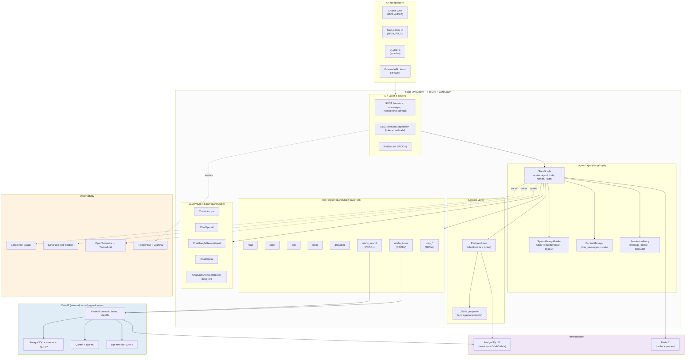

# ARCHITECT4 — Архитектура OryaAgent на Python (LangChain + LangGraph)

> **Версия документа:** 4.0 (Python-стек, LangChain/LangGraph, OriaHS-integrated)
> **Дата:** 19 октября 2026
> **Источники:** `agents-architect.md` (сравнение 5 архитектур), `self-agent.md` (MVP v3 на TypeScript), `OriaHS/ARCHITECT.md` v2.0 (TRIZ-applied), `OriaHS/ROADMAP.md` v1.0
> **Стек:** Python 3.11+, LangChain 0.3+, LangGraph 0.2+, FastAPI, PostgreSQL 16, Redis 7, Chainlit, OriaHS (как внешний гибридный поиск)
> **Статус:** design spec, готов к реализации после финальной TRIZ-проверки (см. `ARCHITECT5.md`)

---

## Содержание

1. Обзор и цели
2. Оценка предыдущих архитектур (`agents-architect.md`, `self-agent.md`)
3. Принцип 20/80: что меняется в v4
4. Python-стек: почему LangChain + LangGraph
5. Высокоуровневая архитектура
6. Описание модулей
7. Схема данных и persistence
8. API surface (internal + external)
9. Observability
10. Интеграция с OriaHS (детально)
11. UI-стратегия: «нормальный UI с фазы MVP»
12. Безопасность и permissions
13. Развёртывание
14. Проверка реализуемости (feasibility check)
15. Соответствие выводам из `agents-architect.md`
16. Риски и mitigations
17. Что сознательно НЕ делаем в v4 (по 20/80)
18. Связь с фазами `ROADMAP4.md`

---

## 1. Обзор и цели

### 1.1. Назначение

`ARCHITECT4.md` — четвёртая итерация архитектуры OryaAgent. В отличие от `self-agent.md` (v3, TypeScript/Node), v4 переходит на **Python-стек с LangChain + LangGraph**, что даёт четыре конкретных преимущества:

1. **Бесплатный agent-loop.** LangGraph `StateGraph` уже реализует цикл «запрос → tool-calls → ответ» с поддержкой циклов, прерываний, чекпоинтов и параллельных веток. Не нужно писать его с нуля.
2. **Бесплатная смена провайдера.** LangChain `ChatModel` имеет >60 готовых адаптеров (OpenAI, Anthropic, Google, локальные Ollama/vLLM, OpenRouter, модели из `models.dev`). Шов существует «из коробки».
3. **Бесплатный session-log.** LangGraph `BaseCheckpointSaver` (`MemorySaver`, `SqliteSaver`, `PostgresSaver`, `RedisSaver`) даёт append-only лог состояния с восстановлением. Проекция в сообщения тривиальна.
4. **Бесплатная observability.** LangSmith и LangFuse — нативные платформы трейсинга для LangChain/LangGraph. Никакой инструментации, кроме env-переменных.

### 1.2. Цели v4

| Цель | Метрика успеха |
|---|---|
| Сократить объём собственного кода ядра в 3–5× | ≤ 2000 строк Python-кода в `app/core/` для MVP |
| Получить production-ready agent-loop без написания | LangGraph как основа; кастомный код — только в tools и prompt-билдере |
| Готовая интеграция с OriaHS с фазы PROD | 2 нативных tool'а: `oriahs_search`, `oriahs_index` + tool `reindex_codebase` |
| Нормальный UI с фазы MVP | Chainlit-чат с markdown, diff-рендером, tool-call карточками |
| Сохранить принцип 20/80 из v3 | Те же 8 модулей, но 5 из них — готовые библиотеки |

### 1.3. Не-цели v4

- Не строим собственный фреймворк агентов. LangGraph — готовый.
- не строим собственную ORM для сессий. SQLAlchemy 2.x + LangGraph checkpointers.
- Не реализуем MCP-клиент с нуля. Используем `langchain-mcp-adapters` (community-пакет).
- Не пишем собственный UI-фреймворк. Chainlit для MVP, Next.js для PROD.

---

## 2. Оценка предыдущих архитектур

### 2.1. Сильные стороны `agents-architect.md`

Документ даёт исчерпывающий comparative-анализ пяти production-агентов (Claude Code, OpenCode, Kilo Code, DeepSeek Harness, MiMoCode) и формулирует 6 архитектурных выводов, которые остаются валидными для v4:

1. **Клиент-серверная схема победила.** Все, кроме Claude Code, строят серверное ядро с HTTP/SSE-API.
2. **Сессия — поток событий, а не строка сообщений.** Append-only лог — стандарт.
3. **LLM-шов обязателен как точка сменяемости.** Все, кроме Claude Code, ставят шов с первого дня.
4. **Автономность надстраивается над циклом, а не встраивается в него.** Cron, goals+judge, workflows — обёртки.
5. **Инструменты выполняются in-process.** Базовые tools — функции в ядре.
6. **Базовый набор инструментов одинаков у всех.** read/write/edit/bash/grep/glob.

### 2.2. Сильные стороны `self-agent.md` (v3)

v3 корректно применяет 20/80: 8 модулей MVP дают ~80% ценности. Архитектурный выбор (один процесс, JSONL, TypeScript) оправдан для прототипа, но **ограничивает рост**:

- TypeScript заставляет писать собственный agent-loop, tool-registry, session-log. В Python эти компоненты уже есть в LangChain/LangGraph.
- Один процесс без HTTP-сервера блокирует добавление второго клиента (веб, IDE). v3 откладывает сервер на v2, но это значит переписывать UI.
- JSONL для сессий — прост, но не даёт индексов и поиска. LangGraph PostgresSaver даёт это бесплатно.

### 2.3. Что v4 улучшает по принципу 20/80

| Улучшение | Усилия (от v3) | Эффект |
|---|---|---|
| Переход на LangGraph | 20% (выучить API) | 80% кода agent-loop не пишем |
| LangChain вместо своего LLM-шова | 10% (ChatModel + 2 строчки) | 80% адаптеров провайдеров уже готовы |
| Chainlit вместо своего TUI | 15% (один файл `app.py`) | 80% UI-кода не пишем; UI «нормальный» с первого дня |
| PostgresSaver вместо JSONL | 5% (одна env-переменная) | 80% фич сессий (поиск, восстановление, шардинг) — бесплатно |
| LangSmith/LangFuse вместо своего tracing | 5% (env-переменные) | 80% observability — бесплатно |

**Суммарно:** v4 сокращает объём собственного кода в 3–5× и одновременно даёт больше фич. Это и есть 20/80 в действии.

---

## 3. Принцип 20/80: что меняется в v4

### 3.1. Сохраняемые решения из v3

- **8 модулей MVP** — без изменений по составу: LLM-шов, agent-loop, system-prompt-builder, tool-registry+5 базовых, session-log, context-manager, UI-клиент, permissions.
- **TRIZ-gates с первого дня** — `dead`-состояния, fast-path по hash, partial-индексы, версионирование моделей.
- **Безопасность через ask-режим + allow-list** — минимум, без песочницы в MVP.
- **Базовый набор инструментов:** read, write, edit, bash, grep (добавим `glob` как часть grep-tool).

### 3.2. Ключевые изменения v4

| Что меняем | Было (v3) | Стало (v4) | Почему |
|---|---|---|---|
| Язык | TypeScript (Node/Bun) | Python 3.11+ | Экосистема LangChain/LangGraph зрелее в Python; async в Python 3.11+ достаточен |
| Agent-loop | Свой while-цикл | LangGraph `StateGraph` | Готовый цикл с циклами, прерываниями, чекпоинтами |
| LLM-шов | Свой `LLMProvider` | LangChain `BaseChatModel` | 60+ адаптеров из коробки; structured output, tool_calling — стандартизированы |
| Tool-registry | Свой `ToolRegistry` | LangChain `BaseTool` + `@tool`-декоратор | Type-safe, JSON Schema автоматическая, кэширование, error-handling — встроены |
| Session-log | JSONL-файл | LangGraph `PostgresSaver` + JSONL projection | ACID, индексы, recovery — бесплатно; проекция в JSONL для совместимости |
| Context-manager | Своя урезалка | LangChain `trim_messages` + LangGraph state | Стандартные стратегии token-buffer, sliding window |
| System-prompt | Свой builder | LangChain `ChatPromptTemplate` + Jinja2 | Cacheable prefix автоматически через Anthropic/OpenAI prompt-cache |
| UI-клиент | Свой TUI (inquirer+chalk) | Chainlit (MVP) → FastAPI+SSE+Next.js (PROD) | Chainlit даёт «нормальный» UI за 1 файл; переход на веб-стек — в BETA |
| Permissions | Свой ask + allow-list | LangGraph `interrupt_before` + policy-функция | Native human-in-the-loop в LangGraph |
| Observability | Structured JSON-логи | LangSmith + LangFuse + OTel | Готовые платформы трейсинга LangChain-приложений |

### 3.3. Маппинг 8 модулей MVP на Python-стек

| Модуль v3 | Реализация v4 | LOC (оценка) |
|---|---|---|
| LLM-provider-seam | `langchain_core.language_models.BaseChatModel` + `init_chat_model()` | ~50 |
| agent-loop | `langgraph.graph.StateGraph` с узлами `agent`, `tools`, `human` | ~150 |
| system-prompt-builder | `langchain_core.prompts.ChatPromptTemplate` + кастомная сборка секций | ~100 |
| tool-registry + 5 tools | `langchain_core.tools.BaseTool` / `@tool`-декоратор; 5 реализаций | ~400 |
| session-log | `langgraph.checkpoint.postgres.PostgresSaver` + JSONL projection | ~50 |
| context-manager | `langchain_core.messages.trim_messages` + state-маппер | ~50 |
| UI-клиент | Chainlit (`app.py` ~150 строк) → Next.js (~1500 строк в PROD) | ~150 (MVP) |
| permissions | LangGraph `interrupt_before=['tools']` + policy-функция | ~80 |
| **Итого MVP** | | **~1000 строк** |

**Для сравнения:** v3 оценивала собственный код MVP в ~3000–4000 строк TypeScript. v4 — ~1000 строк Python. Сокращение в 3–4×.

---

## 4. Python-стек: почему LangChain + LangGraph

### 4.1. Обоснование выбора

**LangChain 0.3+** — самый зрелый Python-фреймворк для LLM-приложений. Даёт:

- `BaseChatModel` — абстракция над LLM с 60+ адаптерами (anthropic, openai, google-genai, mistralai, ollama, vLLM, openrouter, bedrock, vertexai, …).
- `BaseTool` / `@tool` — типизированные инструменты с автоматической JSON Schema.
- `ChatPromptTemplate` — шаблоны промптов с поддержкой кэшируемого префикса.
- `trim_messages` — стандартные стратегии управления контекстом.
- `langchain-mcp-adapters` — готовый MCP-клиент (community-пакет, стабилен с 2025).
- `langchain-retrievers` — обёртки над векторными БД (Qdrant, PGVector, …), включая кастомные HTTP-API (OriaHS).

**LangGraph 0.2+** — фреймворк для stateful агентских приложений от LangChain Inc. Даёт:

- `StateGraph` — направленный граф с циклами, поддержкой параллельных веток и условных переходов.
- `BaseCheckpointSaver` и реализации: `MemorySaver`, `SqliteSaver`, `PostgresSaver`, `RedisSaver`.
- `interrupt_before` / `interrupt_after` — human-in-the-loop без кастомного кода.
- Streaming: `astream_events` — токены, tool-calls, tool-results — единый API.
- Subgraph composition — субагенты как подграфы.
- LangGraph Platform / LangGraph Cloud — опциональный managed runtime.

### 4.2. Альтернативы и почему не они

| Альтернатива | Почему не подходит |
|---|---|
| **OpenAI Agents SDK** (Python) | Привязка к OpenAI; нет checkpointing из коробки |
| **PydanticAI** | Молодой (0.x), меньше адаптеров, нет graph-циклов |
| **CrewAI** | Фокус на multi-agent, нет тонкого control-flow |
| **Autogen** | Microsoft, тяжёлый, фокус на conversation-patterns |
| **LlamaIndex** | Сильный в RAG, слабый в tool-using агентских циклах |
| **Свой фреймворк** | 80% усилий → 20% ценности; v3 это уже показала |

### 4.3. Версии и совместимость

```toml
# pyproject.toml (фрагмент)
[project]
requires-python = ">=3.11"
dependencies = [
    "langchain>=0.3.0,<0.4",
    "langchain-core>=0.3.0,<0.4",
    "langchain-anthropic>=0.2.0",
    "langchain-openai>=0.2.0",
    "langchain-google-genai>=2.0.0",
    "langchain-ollama>=0.2.0",
    "langchain-mcp-adapters>=0.1.0",
    "langgraph>=0.2.0,<0.3",
    "langgraph-checkpoint-postgres>=2.0.0",
    "langfuse>=2.0.0",            # опционально, для self-hosted observability
    "langsmith>=0.1.0",           # опционально, SaaS observability
    "fastapi>=0.115.0",
    "uvicorn[standard]>=0.32.0",
    "chainlit>=1.3.0",            # UI для MVP
    "pydantic>=2.9.0",
    "pydantic-settings>=2.5.0",
    "sqlalchemy[asyncio]>=2.0.35",
    "asyncpg>=0.29.0",
    "alembic>=1.13.0",
    "redis>=5.0.0",
    "httpx>=0.27.0",
    "tiktoken>=0.7.0",
    "rich>=13.0.0",
    "click>=8.1.0",
    "ripgrepper>=0.1.0",          # или прямой subprocess к rg
    "uv>=0.4.0",                  # пакетный менеджер
]
```

### 4.4. Проверка реализуемости (feasibility)

| Гипотеза | Проверка | Статус |
|---|---|---|
| LangGraph поддерживает циклы agent→tools→agent | `StateGraph.add_edge('tools', 'agent')` + `add_conditional_edges` | ✅ Документировано, stable API |
| `PostgresSaver` хранит сессии в PostgreSQL | `langgraph-checkpoint-postgres` 2.0+, async-поддержка | ✅ Stable |
| `interrupt_before` работает для ask-mode | `graph.compile(interrupt_before=['tools'])` + `Command(resume=...)` | ✅ Stable, human-in-the-loop tutorial |
| `BaseChatModel.bind_tools()` работает с OpenAI и Anthropic | Унифицированный API через `bind_tools` | ✅ Stable |
| Chainlit интегрируется с LangGraph | `cl.Message()` + `cl.Step()` + `astream_events` | ✅ Документировано, есть примеры |
| `langchain-mcp-adapters` даёт MCP-клиент | `ClientSession` + `load_mcp_tools` | ✅ Stable в community-пакете |
| OriaHS можно обернуть как LangChain Retriever или Tool | `@tool`-декоратор + httpx | ✅ Тривиально, ~30 строк |
| LangSmith трейсит LangGraph без правки кода | env: `LANGCHAIN_TRACING_V2=true` | ✅ Документировано |

**Вывод:** Все ключевые архитектурные решения v4 подтверждаются существующим API LangChain/LangGraph. Реализуемость — высокая.

---

## 5. Высокоуровневая архитектура

### 5.1. Схема



### 5.2. Принципиальные решения диаграммы

1. **Ядро — один процесс (FastAPI + LangGraph).** Chainlit-UI запускается отдельно в MVP, но в BETA встраивается как Next.js-клиент к FastAPI-серверу. Это даёт путь миграции без переписывания ядра.
2. **OriaHS — внешний сервис.** Агент общается с ним через HTTP. Никаких общих таблиц; только API-контракт. Изоляция позволяет OriaHS и OryaAgent эволюционировать независимо.
3. **Observability — три уровня.** LangSmith/LangFuse для agent-уровня (traces LLM-вызовов), OTel для приложения (HTTP-spans, DB-spans), Prometheus для инфраструктуры (latency, RPS, error-rate).
4. **PostgreSQL — общий.** Используется и для сессий OryaAgent (через `PostgresSaver`), и для документов OriaHS. Это допустимо: разные схемы (`orya_sessions.*` и `public.documents`), единый бэкап. При росте — выделение в отдельные кластеры (EXTENSION-PROD).

---

## 6. Описание модулей

### 6.1. LLM-provider-seam (`app/core/llm.py`)

**Зона ответственности.** Единый интерфейс к LLM-провайдеру. Скрывает различия между Anthropic, OpenAI, OpenAI-совместимыми, Google, локальными (Ollama/vLLM).

**Реализация.** LangChain `init_chat_model()` — фабрика, создающая модель по строке вида `"anthropic:claude-3-5-sonnet-latest"` или `"openai:gpt-4o"`. Конфигурация — через `pydantic-settings`.

```python
# app/core/llm.py (фрагмент)
from langchain.chat_models import init_chat_model
from langchain_core.language_models import BaseChatModel
from app.config import settings


def get_chat_model() -> BaseChatModel:
    return init_chat_model(
        model=settings.llm_model,  # "anthropic:claude-3-5-sonnet-latest"
        temperature=settings.llm_temperature,
        max_tokens=settings.llm_max_tokens,
        streaming=True,
        timeout=settings.llm_timeout_s,
    ).bind_tools(get_registered_tools())  # автоматическая генерация tool-spec
```

**Ключевые свойства:**
- `bind_tools()` — единый API для всех провайдеров; LangChain конвертирует схемы под формат провайдера.
- `streaming=True` — токены стримятся через `astream_events`.
- Structured output через `with_structured_output(PydanticModel)` — для парсинга tool-результатов.
- Prompt-cache — автоматически для Anthropic (через `cache_control` в сообщениях) и OpenAI (через стабильный префикс).

**Обоснование.** Вывод №6 из `agents-architect.md`: Claude Code остался изолятом из-за отсутствия шва. LangChain даёт шов «из коробки».

### 6.2. agent-loop (`app/core/graph.py`)

**Зона ответственности.** Главный цикл агента: пользовательский ввод → LLM-запрос → tool-calls → tool-results → повтор, пока LLM не вернёт финальный ответ.

**Реализация.** LangGraph `StateGraph` с узлами `agent`, `tools`, `human` (для ask-mode).

```python
# app/core/graph.py (фрагмент)
from langgraph.graph import StateGraph, MessagesState, START, END
from langgraph.checkpoint.postgres import PostgresSaver
from langgraph.prebuilt import ToolNode

def build_graph(tools, model, checkpointer, policy):
    g = StateGraph(MessagesState)

    async def agent_node(state):
        sys_prompt = build_system_prompt(state, tools)
        response = await model.ainvoke([sys_prompt, *state["messages"]])
        return {"messages": [response]}

    tool_node = ToolNode(tools)

    async def human_node(state):
        # вызывается только при interrupt_before=['tools']
        last_msg = state["messages"][-1]
        decision = await policy.review(last_msg.tool_calls)
        if decision == "deny":
            return {"messages": [ToolMessage(content="Denied by user", ...)]}
        return None  # resume

    g.add_node("agent", agent_node)
    g.add_node("tools", tool_node)
    g.add_node("human", human_node)
    g.add_edge(START, "agent")
    g.add_conditional_edges("agent", route_after_agent)  # → tools | END
    g.add_edge("tools", "agent")
    g.add_edge("human", "tools")

    return g.compile(
        checkpointer=checkpointer,
        interrupt_before=["tools"] if policy.ask_mode else [],
    )
```

**Ключевые свойства:**
- **Циклы бесплатно:** `tools → agent` — стандартное ребро LangGraph.
- **Streaming:** `graph.astream_events(input, version="v2")` даёт токены, tool-call-старты, tool-results.
- **Прерывание:** `interrupt_before=['tools']` — LangGraph ставит граф на паузу перед вызовом tool; пользователь подтверждает → `Command(resume=...)`.
- **Чекпоинты:** каждый шаг автоматически сохраняется в PostgresSaver; восстановление по `thread_id`.
- **Лимит итераций:** через `recursion_limit` параметр LangGraph (по умолчанию 25).

**Обоснование.** Вывод №4 из `agents-architect.md`: цикл должен быть чистым и заменяемым. LangGraph даёт чистый цикл без собственного кода.

### 6.3. system-prompt-builder (`app/core/prompt.py`)

**Зона ответственности.** Собирает системный промпт из секций: identity, tool-описания, контекст проекта (рабочий каталог, git-статус), пользовательские преференсы.

**Реализация.** LangChain `ChatPromptTemplate` с поддержкой кэшируемого префикса.

```python
# app/core/prompt.py (фрагмент)
from langchain_core.prompts import ChatPromptTemplate, MessagesPlaceholder

SYSTEM_TEMPLATE = """You are OryaAgent, a coding agent that helps with software engineering tasks.

# Identity
You work in a project repository. You have access to file system tools (read, write, edit, bash, grep).
Always prefer minimal, surgical changes. Explain your plan before executing destructive actions.

# Available Tools
{tool_descriptions}

# Project Context
Working directory: {cwd}
Git status:
{git_status}

# User Preferences
{user_memory}

# Behavior Rules
1. Before bash: explain intent.
2. After edit: re-read the file to verify.
3. For multi-file changes: outline the plan first.
4. If uncertain: ask the user.
"""

prompt = ChatPromptTemplate.from_messages(
    [
        ("system", SYSTEM_TEMPLATE),
        MessagesPlaceholder("messages"),
    ]
)


def build_system_prompt(state, tools):
    return prompt.format_messages(
        tool_descriptions=format_tools(tools),
        cwd=get_cwd(),
        git_status=get_git_status(),
        user_memory=load_user_memory(),
        messages=state["messages"],
    )
```

**Ключевые свойства:**
- **Cacheable prefix:** статическая часть (identity + tool-описания) помечается через `cache_control` для Anthropic и является стабильным префиксом для OpenAI prompt-cache.
- **Секции — separable:** каждая секция — отдельная функция; можно добавлять новые без правки основной логики.
- **Пользовательские преференсы:** `~/.orya/memory.md` — простой markdown-файл; загружается при старте сессии.
- **Project-level memory:** `ORYA.md` в корне проекта — опциональный файл с инструкциями конкретного проекта (по образцу `CLAUDE.md`).

**Обоснование.** Вывод `agents-architect.md`: у всех 5 архитектур есть отдельный модуль system-prompt. LangChain `ChatPromptTemplate` — стандарт.

### 6.4. tool-registry + 5 базовых инструментов (`app/tools/`)

**Зона ответственности.** Реестр инструментов с типизированными схемами входа/выхода. Каждый инструмент — функция с `@tool`-декоратором.

**Реализация.** LangChain `@tool`-декоратор с Pydantic-схемой аргументов.

```python
# app/tools/file_ops.py (фрагмент)
from langchain_core.tools import tool, ToolException
from pydantic import BaseModel, Field


class ReadInput(BaseModel):
    path: str = Field(description="Absolute or project-relative file path")
    start: int | None = Field(default=None, description="Start line (1-indexed)")
    limit: int | None = Field(default=None, description="Max lines to read")


@tool(args_schema=ReadInput)
async def read(path: str, start: int | None = None, limit: int | None = None) -> str:
    """Read a file with optional pagination. Returns content with line numbers."""
    # реализация с rich-рендером, обработкой binary, …
    ...


@tool
async def write(path: str, content: str) -> str:
    """Atomically write content to file (temp file + rename)."""
    ...


@tool
async def edit(path: str, old_string: str, new_string: str) -> str:
    """Exact string replacement. Fails if old_string is not unique."""
    ...


@tool
async def bash(command: str, timeout: int = 30) -> str:
    """Execute shell command via PTY. Returns stdout+stderr."""
    ...


@tool
async def grep(pattern: str, glob: str | None = None, path: str = ".") -> str:
    """Search via ripgrep. Returns matching lines with file:line prefixes."""
    ...
```

**5 базовых инструментов (минимум):**
| Tool | Реализация | Особенности |
|---|---|---|
| `read` | `pathlib` + `rich` для подсветки | Pagination, binary-detection, line-numbers |
| `write` | temp-file + `os.rename` для атомарности | Backup-файл `.bak` в dev-режиме |
| `edit` | Точный string-replace, требует уникальности old_string | `replace_all` для множественной замены |
| `bash` | `asyncio.subprocess` + PTY через `aiofiles` | Timeout, AbortController, env-control |
| `grep`/`glob` | subprocess к `rg` | JSON-output парсинг, --type фильтры |

**Расширения в PROD+ (OriaHS):**
| Tool | Назначение |
|---|---|
| `oriahs_search` | Семантический поиск по кодовой базе через OriaHS `/search` |
| `oriahs_index` | Инкрементальная индексация файла/директории через OriaHS `/index` |
| `reindex_codebase` | Полный reindex (долгая операция, с прогрессом) |

**Обоснование.** Вывод `agents-architect.md`: базовый набор одинаков у всех 5. LangChain `@tool` даёт type-safety, валидацию и JSON Schema автоматически.

### 6.5. session-log (`app/core/session.py`)

**Зона ответственности.** Append-only поток событий + проекция в сообщения для LLM + восстановление сессии.

**Реализация.** LangGraph `PostgresSaver` — основной сторадже; JSONL-проекция — для аудита и экспорта.

```python
# app/core/session.py (фрагмент)
from langgraph.checkpoint.postgres.aio import AsyncPostgresSaver


async def get_checkpointer():
    saver = AsyncPostgresSaver.from_conn_string(settings.database_url)
    await saver.setup()  # создаёт таблицы checkpoints, writes, migrations
    return saver


# JSONL projection — отдельный воркер, читает новые checkpoint-записи
# и дописывает в ~/.orya/sessions/{thread_id}.jsonl
async def project_to_jsonl(thread_id: str):
    async for event in graph.aget_state({"configurable": {"thread_id": thread_id}}):
        append_jsonl(f"~/.orya/sessions/{thread_id}.jsonl", event)
```

**Ключевые свойства:**
- **ACID-транзакции** — PostgresSaver гарантирует консистентность чекпоинтов.
- **Поиск по сессиям** — SQL-индексы на `created_at`, `thread_id`, `user_id`.
- **Восстановление** — `graph.aget_state(config)` поднимает последнее состояние; `Command(resume=...)` продолжает с прерванной точки.
- **JSONL projection** — отдельный воркер (или триггер БД) дописывает события в файл; формат совместим с v3 (для миграции).
- **Retention** — партиционирование по `created_at`, удаление старше 90 дней (по образцу OriaHS `search_events`).

**Обоснование.** Вывод №2 из `agents-architect.md`: event-sourced хранение — стандарт. PostgresSaver даёт event-sourcing бесплатно.

### 6.6. context-manager (`app/core/context.py`)

**Зона ответственности.** Управляет окном контекста: подсчёт токенов, урезание длинных tool-результатов, compaction (BETA+).

**Реализация.** LangChain `trim_messages` + кастомный state-маппер.

```python
# app/core/context.py (фрагмент)
from langchain_core.messages import trim_messages, SystemMessage


def trim_state(state, max_tokens=128_000):
    return trim_messages(
        state["messages"],
        token_counter=lambda msgs: count_tokens(msgs),
        max_tokens=max_tokens,
        strategy="last",  # оставляем последние N
        start_on="human",  # не разрывать посередине turn'а
        allow_partial=False,
        include_system=True,  # system-prompt всегда в начале
    )


# BETA+: compaction — отдельный узел графа, запускается по триггеру
async def compact_node(state):
    summary = await model.ainvoke(
        [
            SystemMessage(
                "Summarize the conversation, preserve key decisions and file states."
            ),
            *state["messages"][:50],  # первые 50 сообщений
        ]
    )
    return {
        "messages": [summary, *state["messages"][50:]],
        "compacted": True,
    }
```

**Ключевые свойства:**
- **Подсчёт токенов** — `tiktoken` для OpenAI/Anthropic, approximation для других.
- **Урезание tool-результатов** — длинные stdout урезаются: первые 100 строк + `... [N lines truncated] ...` + последние 50 строк.
- **Compaction (BETA+)** — отдельный узел графа, запускается при `token_count > 80% max`. Сохраняет summary в начале.
- **Context Epoch (PROD+)** — по образцу OpenCode: неизменяемый базовый префикс для prompt-cache.

**Обоснование.** Окно контекста конечно у всех провайдеров. LangChain `trim_messages` даёт стандартные стратегии без собственного кода.

### 6.7. UI-клиент (`app/ui/`)

**Зона ответственности.** Точка входа пользователя. REPL: чтение ввода, передача в `agent-loop`, рендер ответов с stream-токенами и tool-call-карточками.

**Реализация.** Chainlit для MVP/ALPHA; Next.js+FastAPI-SSE для BETA/PROD.

#### 6.7.1. Chainlit (MVP, ALPHA)

```python
# app/ui/chainlit_app.py (фрагмент)
import chainlit as cl
from app.core.graph import build_graph
from app.core.session import get_checkpointer


@cl.on_chat_start
async def on_start():
    checkpointer = await get_checkpointer()
    graph = build_graph(tools, model, checkpointer, policy)
    cl.user_session.set("graph", graph)
    cl.user_session.set("thread_id", str(uuid4()))


@cl.on_message
async def on_message(message: cl.Message):
    graph = cl.user_session.get("graph")
    thread_id = cl.user_session.get("thread_id")
    config = {"configurable": {"thread_id": thread_id}}

    # Если граф был прерван на tools — нужно подтверждение
    if await graph.aaget_state(config).next == ("tools",):
        decision = await cl.AskActionMessage(...).send()
        if decision == "deny":
            await graph.ainvoke(None, config, command=Command(resume="deny"))
            return

    async for event in graph.astream_events(
        {"messages": [HumanMessage(message.content)]},
        config,
        version="v2",
    ):
        if event["event"] == "on_chat_model_stream":
            token = event["data"]["chunk"].content
            await cl.Message(content=token).stream_token()
        elif event["event"] == "on_tool_start":
            async with cl.Step(name=event["name"]) as step:
                step.input = event["data"].get("input")
        elif event["event"] == "on_tool_end":
            step.output = event["data"].get("output")
```

**Преимущества Chainlit:**
- Встроенный auth (локальный, OAuth, SSO).
- Markdown, code-blocks, diff-рендер.
- Step-карточки для tool-calls (как у Claude Code).
- Async-native, интегрируется с LangGraph `astream_events`.
- Self-hosted — один `chainlit run app.py`.
- Поддержка interrupts — `cl.AskActionMessage` для ask-mode.

#### 6.7.2. Next.js + FastAPI-SSE (BETA, PROD)

В BETA добавляется отдельный Next.js-фронтенд, который общается с FastAPI-сервером через SSE. Цели:
- Кастомный UI с панелями (chat + code-viewer + diff).
- IDE-расширения (VS Code) через этот же API.
- Multi-session UI (несколько параллельных сессий в табах).

FastAPI endpoint:
```python
@app.post("/sessions/{thread_id}/messages")
async def send_message(thread_id: str, body: MessageCreate):
    async def event_stream():
        async for event in graph.astream_events(...):
            yield format_sse(event)

    return StreamingResponse(event_stream(), media_type="text/event-stream")
```

**Обоснование.** Вывод №1 из `agents-architect.md`: один клиент покрывает MVP; сервер и IDE — позже. Chainlit даёт «нормальный» UI с первого дня, а переход на Next.js — без переписывания ядра.

### 6.8. permissions (`app/core/policy.py`)

**Зона ответственности.** Контроль перед вызовом инструмента. Ask-режим (по умолчанию) + auto-режим + статический allow-list.

**Реализация.** LangGraph `interrupt_before` + policy-функция.

```python
# app/core/policy.py (фрагмент)
from enum import Enum


class Decision(str, Enum):
    ALLOW = "allow"
    DENY = "deny"
    ASK = "ask"


class PermissionPolicy:
    def __init__(self, mode: str = "ask", allow_rules: list[dict] = None):
        self.mode = mode
        self.allow_rules = allow_rules or []

    async def review(self, tool_calls: list[dict]) -> Decision:
        if self.mode == "auto":
            return Decision.ALLOW
        decisions = [self._check_one(tc) for tc in tool_calls]
        if any(d == Decision.ASK for d in decisions):
            return Decision.ASK  # LangGraph прервётся, UI спросит
        return (
            Decision.ALLOW
            if all(d == Decision.ALLOW for d in decisions)
            else Decision.DENY
        )

    def _check_one(self, tc: dict) -> Decision:
        for rule in self.allow_rules:
            if rule["tool"] == tc["name"] and re.match(rule["pattern"], tc["args"]):
                return Decision.ALLOW
        if tc["name"] in ("read", "grep"):  # read-only по умолчанию safe
            return Decision.ALLOW
        return Decision.ASK
```

**Ключевые свойства:**
- **Two modes:** `ask` (спрашивать перед bash/write/edit) и `auto` (всё разрешено, для CI).
- **Allow-list:** конфиг `~/.orya/permissions.yml` с regex-правилами по типу `bash: ls *` разрешён без подтверждения.
- **Read-only safe:** `read`, `grep` всегда разрешены (не разрушают состояние).
- **Deny-list (PROD+):** запрет опасных команд (`rm -rf /`, `git push --force` на main).

**Обоснование.** Вывод `agents-architect.md`: bash без подтверждения недопустимо. LangGraph `interrupt_before` даёт human-in-the-loop без кастомного кода.

---

## 7. Схема данных и persistence

### 7.1. PostgreSQL-схема OryaAgent

```sql
-- Схема orya_sessions (отдельная от OriaHS public-схемы)
CREATE SCHEMA IF NOT EXISTS orya_sessions;

-- Таблицы LangGraph PostgresSaver (создаются автоматически через .setup())
-- checkpoints, writes, migrations, checkpoint_blobs, checkpoint_writes

-- Кастомные таблицы OryaAgent
CREATE TABLE orya_sessions.sessions (
    thread_id UUID PRIMARY KEY DEFAULT gen_random_uuid(),
    user_id UUID,
    title TEXT,  -- auto-generated из первого сообщения
    created_at TIMESTAMPTZ NOT NULL DEFAULT now(),
    updated_at TIMESTAMPTZ NOT NULL DEFAULT now(),
    metadata JSONB NOT NULL DEFAULT '{}'
);

CREATE TABLE orya_sessions.tool_invocations (
    id BIGSERIAL PRIMARY KEY,
    thread_id UUID NOT NULL REFERENCES orya_sessions.sessions(thread_id),
    tool_name TEXT NOT NULL,
    args JSONB NOT NULL,
    result JSONB,
    started_at TIMESTAMPTZ NOT NULL DEFAULT now(),
    finished_at TIMESTAMPTZ,
    status TEXT NOT NULL DEFAULT 'running',
    error TEXT
);
CREATE INDEX orya_sessions.tool_invocations_thread_idx
    ON orya_sessions.tool_invocations(thread_id, started_at DESC);

-- Партиционирование по created_at (по образцу OriaHS search_events)
CREATE TABLE orya_sessions.events (
    id BIGSERIAL,
    thread_id UUID NOT NULL,
    event_type TEXT NOT NULL,
    payload JSONB NOT NULL,
    created_at TIMESTAMPTZ NOT NULL DEFAULT now(),
    PRIMARY KEY (id, created_at)
) PARTITION BY RANGE (created_at);
CREATE TABLE orya_sessions.events_default PARTITION OF orya_sessions.events DEFAULT;
```

### 7.2. Файловая структура (filesystem state)

```
~/.orya/
├── config.yml                  # глобальный конфиг
├── memory.md                   # пользовательские преференсы
├── permissions.yml             # режим + allow-list
├── providers.yml               # конфиг LLM-провайдеров
├── sessions/
│   ├── {thread_id}.jsonl       # JSONL projection (для аудита/экспорта)
│   └── {thread_id}.meta.json   # заголовок сессии
└── logs/
    └── orya-agent.log          # structured JSON-логи

./.orya/                        # project-level (опционально)
├── ORYA.md                     # инструкции для проекта (по образцу CLAUDE.md)
├── permissions.yml             # project-specific overrides
└── memory.md                   # project-specific notes
```

### 7.3. Redis (кэш + очереди)

- `orya:llm_cache:{sha256(prompt)}` — кэш LLM-ответов (TTL=24h).
- `orya:embedding_cache:{hash}` — кэш эмбеддингов для OriaHS (если OryaAgent делает свой embedding для prompt-cache).
- `orya:rate_limit:{user_id}` — token-bucket rate-limiting.
- `orya:webhook:{event_type}` — Redis Streams для webhook-событий (PROD+).

---

## 8. API surface

### 8.1. Internal API (между UI и ядром)

#### MVP/ALPHA (Chainlit — внутренний API)

Chainlit сам управляет transport-слоем; наше API — только `cl.on_message` / `cl.on_chat_start`.

#### BETA+ (FastAPI — открытое API)

| Method | Path | Описание |
|---|---|---|
| `POST` | `/sessions` | Создать сессию (`{user_id?, title?, metadata?}` → `{thread_id}`) |
| `GET` | `/sessions` | Список сессий (с пагинацией) |
| `GET` | `/sessions/{thread_id}` | Метаданные + последнее состояние |
| `DELETE` | `/sessions/{thread_id}` | Архивировать сессию |
| `POST` | `/sessions/{thread_id}/messages` | Отправить сообщение; возвращает SSE-stream |
| `POST` | `/sessions/{thread_id}/resume` | Подтвердить tool-call (после `interrupt`) |
| `POST` | `/sessions/{thread_id}/cancel` | Прервать текущий шаг |
| `GET` | `/sessions/{thread_id}/events` | История событий (для replay) |
| `GET` | `/tools` | Список зарегистрированных tools со схемами |
| `GET` | `/health/live` | Процесс жив |
| `GET` | `/health/ready` | Postgres + Redis + OriaHS reachable |
| `GET` | `/metrics` | Prometheus exposition |

### 8.2. External API (для других агентов/клиентов в PROD+)

В PROD добавляется публичный API (тот же FastAPI, но с auth):
- `POST /v1/chat/completions` — OpenAI-compatible endpoint (для IDE-плагинов).
- `POST /v1/sessions/{id}/stream` — streaming для сторонних клиентов.

### 8.3. API-контракт с OriaHS

См. §10 (Интеграция с OriaHS).

---

## 9. Observability

### 9.1. Три уровня observability

| Уровень | Что трейсит | Инструмент | Когда |
|---|---|---|---|
| Agent-level | LLM-вызовы, tool-calls, token-counts, latency | LangSmith (SaaS) или LangFuse (self-hosted) | MVP+ |
| App-level | HTTP-spans, DB-spans, Redis-spans, exceptions | OpenTelemetry → Tempo + Loki | ALPHA+ |
| Infra-level | RPS, error-rate, latency-p99, CPU/RAM | Prometheus + Grafana | ALPHA+ |

### 9.2. LangSmith / LangFuse (agent-level)

Включается одной env-переменной:
```bash
LANGCHAIN_TRACING_V2=true
LANGCHAIN_API_KEY=...
# или для LangFuse:
LANGFUSE_PUBLIC_KEY=...
LANGFUSE_SECRET_KEY=...
LANGFUSE_HOST=https://langfuse.local
```

Даст:
- Trace каждого `graph.astream_events` вызова.
- Дерево LLM-вызовов + tool-вызовов с latency и token-counts.
- Replay любой сессии с пошаговым воспроизведением.
- A/B-тесты между prompt-версиями.

### 9.3. OpenTelemetry (app-level)

Инструментация FastAPI + asyncpg + redis + httpx:
```python
from opentelemetry.instrumentation.fastapi import FastAPIInstrumentor
from opentelemetry.instrumentation.asyncpg import AsyncPGInstrumentor
from opentelemetry.instrumentation.redis import RedisInstrumentor
from opentelemetry.instrumentation.httpx import HTTPXClientInstrumentor

FastAPIInstrumentor.instrument_app(app)
AsyncPGInstrumentor().instrument()
RedisInstrumentor().instrument()
HTTPXClientInstrumentor().instrument()
```

Экспорт в OTel Collector → Tempo (traces) + Loki (logs) + Prometheus (metrics).

### 9.4. Prometheus + Grafana (infra-level)

Ключевые метрики:
- `orya_http_request_duration_seconds_bucket{path, method, status}`
- `orya_agent_step_duration_seconds{node}` — agent/tools/human
- `orya_tool_calls_total{tool, status}`
- `orya_llm_tokens_total{provider, model, direction}` — prompt/completion
- `orya_llm_request_duration_seconds{provider, model}`
- `orya_session_active_count`
- `orya_interrupt_waiting_count` — сколько сессий ждут подтверждения

Grafana-дашборды (по образцу OriaHS): throughput, latency, error-rate, token-usage, tool-usage.

---

## 10. Интеграция с OriaHS (детально)

### 10.1. Роли OriaHS в OryaAgent

OriaHS — внешний сервис гибридного поиска. В OryaAgent он используется как:

1. **Semantic codebase search** — вместо `grep` для нечётких запросов («где у нас обрабатывается retry-логика?»).
2. **Documentation search** — индексация README/ARCHITECT/комментариев.
3. **Conversation memory (PROD+)** — индексация прошлых сессий для RAG по истории.

### 10.2. Когда подключается OriaHS

OriaHS — **внешний сервис**. В MVP он **не требуется** — `grep` покрывает 80% потребностей. Подключение — в **PROD-фазе**, когда:
- Кодовая база > 10k файлов (grep становится медленным).
- Появляется RAG по документации/истории.
- Нужно семантическое сопоставление «запрос пользователя → релевантный код».

### 10.3. API-контракт

OryaAgent вызывает OriaHS через HTTP (httpx async):

| OryaAgent Tool | OriaHS Endpoint | Назначение |
|---|---|---|
| `oriahs_search` | `POST /search` | Семантический поиск по коду/документации |
| `oriahs_index` | `POST /index` | Инкрементальная индексация файла |
| `oriahs_index_batch` | `POST /index` (batch) | Индексация директории (git-aware) |
| `oriahs_wait_index` | `GET /index/status/{token}` | Wait-for-index (read-your-writes) |
| `oriahs_delete` | `DELETE /index/{doc_id}` | Удаление при git-rm |
| `oriahs_health` | `GET /health/ready` | Healthcheck для `/health/ready` OryaAgent |

### 10.4. Реализация `oriahs_search` tool

```python
# app/tools/oriahs.py (фрагмент)
import httpx
from langchain_core.tools import tool
from pydantic import BaseModel, Field


class OriasSearchInput(BaseModel):
    query: str = Field(description="Natural language query or code snippet")
    top_k: int = Field(default=20, ge=1, le=100)
    filters: dict | None = Field(
        default=None, description="tenant_id, language, tags, attributes"
    )
    rerank: bool = Field(default=True, description="Enable cross-encoder rerank")
    fusion: str = Field(default="rrf", pattern="^(rrf|weighted)$")


@tool(args_schema=OriasSearchInput)
async def oriahs_search(
    query: str,
    top_k: int = 20,
    filters: dict = None,
    rerank: bool = True,
    fusion: str = "rrf",
) -> str:
    """Semantic codebase search via OriaHS hybrid search (Postgres + Qdrant + reranker).
    Use for fuzzy intent queries like 'where do we handle retries' or natural language
    lookups. For exact string matches, prefer `grep` tool."""
    async with httpx.AsyncClient(timeout=10.0) as client:
        resp = await client.post(
            f"{settings.oriahs_url}/search",
            json={
                "query": query,
                "top_k": top_k,
                "filters": filters or {},
                "rerank": rerank,
                "fusion": fusion,
                "explain": False,
                "timeout_ms": 5000,
            },
        )
        resp.raise_for_status()
        data = resp.json()
    return format_search_results(data)  # markdown-список с file:line + snippet
```

### 10.5. Стратегия индексации (PROD+)

| Триггер | Действие |
|---|---|
| `agent`-startup | `oriahs_health` check; если OriaHS недоступен — tool `oriahs_search` возвращает "service unavailable, use grep" |
| Файл изменён через `write`/`edit` | `oriahs_index(path)` в post-hook (async, fire-and-forget) |
| Файл удалён через bash `rm` | `oriahs_delete(doc_id)` — нужно вычислить `doc_id` по пути (cache `path→doc_id`) |
| Новый проект/branch | `reindex_codebase` — долгая операция (1M файлов ~20 мин на A10g) |
| Git pull/merge | Дифф → индексация только изменённых файлов |

### 10.6. Достаточность промптов OriaHS (PRODUCTION LIKE фаза)

**Проверка:** пользователь просит уточнить, достаточно ли промптов OriaHS на фазе **PRODUCTION LIKE** (в OriaHS это соответствует фазе **Production-Ready** в `ROADMAP.md` §5) для работы OryaAgent.

**Анализ:**

OriaHS на фазе Production-Ready (см. `OriaHS/ROADMAP.md` §5) предоставляет:
- ✅ `POST /search` с RRF/Weighted fusion + cross-encoder rerank + circuit breaker + degraded mode.
- ✅ `POST /index` с outbox-синхронизацией, `wait_for_index` для read-your-writes.
- ✅ Push-down фильтры, фасеты, адаптивный K.
- ✅ Персонализация (user profile vector) + MMR diversification.
- ✅ A/B-фреймворк с `experiment_id`.
- ✅ OpenTelemetry distributed tracing.
- ✅ Миграционный фреймворк (zero-downtime смена embedding-модели).
- ✅ Shadow traffic для новых стратегий.
- ✅ Chaos engineering (weekly).
- ✅ Партиционирование `search_events` + архивация в S3.

**Чего НЕ хватает для OryaAgent (gap-анализ):**

| Gap | Что нужно добавить в OriaHS или OryaAgent |
|---|---|
| 1. **Code-aware chunking** | OriaHS индексирует «документы», но не знает о структуре кода (functions, classes, imports). Решение: в OryaAgent добавить `code_chunker` (tree-sitter), который нарезает файл на chunks перед отправкой в `/index`. OriaHS остаётся agnostic. |
| 2. **Path-based doc_id** | OriaHS использует `external_ref`, но для кода нужно `path + git_sha`. Решение: в OryaAgent формировать `external_ref = f"{path}:{git_sha}"` или `f"{path}::{symbol}"`. |
| 3. **Incremental reindex on git diff** | OriaHS не знает про git. Решение: в OryaAgent tool `reindex_codebase` вычисляет `git diff` и вызывает `/index` только для изменённых файлов. |
| 4. **Symbol-level search** | Поиск «все вызовы функции foo()» лучше делать через tree-sitter + LSP, а не через embeddings. Решение: отдельный tool `symbol_search` (LSP-based), не OriaHS. |
| 5. **Multi-tenant isolation по проектам** | OriaHS поддерживает `tenant_id`, но нужна конвенция: `tenant_id = project_id`. Решение: в OryaAgent mapper `project_path → tenant_id`. |
| 6. **Code-specific filters** | `language` (Python/JS/…), `path_prefix`, `symbol_type` (function/class/…). Решение: использовать `attributes` в OriaHS. |
| 7. **Diff/search explainability** | При `explain=true` OriaHS отдаёт debug-инфу. Решение: проксировать в tool-result для прозрачности. |

**Вывод:** Промптов OriaHS на фазе Production-Ready **достаточно** для базовой интеграции (search + index). Шесть из семи gaps закрываются в **OryaAgent** (code-chunker, git-aware indexer, path-mapper, symbol-search как отдельный tool). Только gap #7 (explainability) требует доработки на стороне OriaHS, и то — опционально.

**Рекомендация:** не модифицировать OriaHS под OryaAgent. Все code-specific аспекты — в OryaAgent tools. Это сохраняет изоляцию и позволяет OriaHS использоваться другими клиентами.

---

## 11. UI-стратегия: «нормальный UI с фазы MVP»

### 11.1. Требование пользователя

UI должен быть «нормальный уже с фазы MVP» — то есть не REPL-заглушка, а полноценный чат-интерфейс с:
- Markdown-рендером (заголовки, списки, таблицы).
- Code-blocks с подсветкой синтаксиса.
- Diff-рендер для `edit` tool.
- Step-карточки для tool-calls (как у Claude Code).
- Streaming токенов.
- Interrupt-prompt для ask-mode.
- История сессий (sidebar).
- Переключатель модели/провайдера.

### 11.2. Выбор: Chainlit

**Почему Chainlit:**
- ✅ Полностью покрывает все требования из §11.1.
- ✅ Один Python-файл `app.py` для старта.
- ✅ Self-hosted — `chainlit run app.py`, порт 8000.
- ✅ Async-native, нативно интегрируется с LangGraph `astream_events`.
- ✅ Встроенный auth (локальный, OAuth, SSO) — на PROD.
- ✅ Поддержка `cl.AskActionMessage` для human-in-the-loop.
- ✅ Активная разработка, стабильный API с 1.x.
- ✅ Custom components (React) — для расширения в BETA.

**Альтернативы (отклонены):**
- **Streamlit** — chat-поддержка слабая, нет streaming-token-native.
- **Gradio** — UI выглядит как playground, не «нормальный».
- **Textual TUI** — терминальный, не «нормальный» в смысле графического UI.
- **Свой React-app с нуля** — 80% усилий ради 20% отличий от Chainlit.

### 11.3. Эволюция UI

| Фаза | UI-стек | Особенности |
|---|---|---|
| **MVP** | Chainlit | Базовый чат, tool-step-карточки, ask-prompt, sidebar сессий |
| **ALPHA** | Chainlit + custom components | Diff-viewer, file-tree sidebar, model-selector |
| **BETA** | Chainlit (fallback) + Next.js | Next.js как primary; Chainlit — для dev. Code-editor-in-sidebar (Monaco) |
| **PROD** | Next.js + FastAPI-SSE | Мульти-табы, parallel sessions, full-featured code-viewer |
| **EXTENSION-PROD** | Next.js + IDE-плагины | VS Code/JetBrains через тот же API |
| **FUTURE** | Desktop (Tauri/Electron) | Офлайн-режим, локальные модели |

### 11.4. UI-метрики (DoD для UI)

| Метрика | MVP-цель | PROD-цель |
|---|---|---|
| Time-to-first-token | ≤ 800 мс | ≤ 300 мс |
| Tool-call card render | ≤ 50 мс | ≤ 20 мс |
| Diff-view render (1000 строк) | ≤ 200 мс | ≤ 80 мс |
| Interrupt-prompt appearance | ≤ 100 мс | ≤ 50 мс |
| Session list refresh | ≤ 500 мс | ≤ 200 мс |

---

## 12. Безопасность и permissions

### 12.1. Уровни защиты

| Уровень | Что защищает | Реализация |
|---|---|---|
| **Tool-level** | Bash/write/edit без подтверждения | LangGraph `interrupt_before` + policy (§6.8) |
| **Command-level** | Опасные команды (`rm -rf /`, `git push --force`) | Deny-list в policy |
| **Path-level** | Запись вне проекта | Path-validation в `write`/`edit` tools |
| **Network-level** | Нежелательные HTTP-запросы из bash | Опциональный egress-proxy (PROD+) |
| **Provider-level** | Утечка API-ключей | Ключи только в env, не в сессиях |
| **Audit-level** | All tool-calls logged | `orya_sessions.tool_invocations` + JSONL |

### 12.2. Path-validation

`write`/`edit`/`bash` tools проверяют, что целевой путь внутри «разрешённой зоны»:
- Рабочий каталог (project root).
- `~/.orya/` (сессии, конфиги).
- Явно разрешённые пути в `permissions.yml`.

```python
def validate_path(path: str) -> str:
    abs_path = Path(path).resolve()
    allowed_roots = [Path.cwd(), Path.home() / ".orya", *settings.extra_allowed_paths]
    if not any(abs_path.is_relative_to(root) for root in allowed_roots):
        raise ToolException(f"Path {abs_path} is outside allowed roots")
    return str(abs_path)
```

### 12.3. Bash sandboxing (PROD+)

В MVP/ALPHA — `ask`-mode достаточно. В PROD добавляется:
- `bwrap` (Linux) / `sandbox-exec` (macOS) для изоляции bash.
- Egress-filter через `iptables`/`pf` rules.
- CPU/memory limits через `cgroups`.

---

## 13. Развёртывание

### 13.1. Локальная разработка

```bash
# 1. Поднять инфраструктуру
docker compose up -d postgres redis

# 2. Установить зависимости
uv sync

# 3. Применить миграции (OryaAgent)
alembic upgrade head

# 4. Запустить Chainlit UI
chainlit run app/ui/chainlit_app.py --port 8000

# 5. (опционально) Запустить OriaHS параллельно
cd ../OriaHS && ./scripts/infra_up.sh
```

### 13.2. Docker Compose (production-like)

```yaml
# docker-compose.yml (фрагмент)
services:
  orya-agent:
    build: .
    ports: ["${API_PORT:-8000}:8000"]
    env_file: .env
    depends_on: [postgres, redis]
    command: chainlit run app/ui/chainlit_app.py --host 0.0.0.0 --port 8000

  postgres:
    image: postgres:16
    environment:
      POSTGRES_DB: orya
      POSTGRES_USER: orya
      POSTGRES_PASSWORD: ${POSTGRES_PASSWORD}
    volumes: ["pgdata:/var/lib/postgresql/data"]
    ports: ["5433:5432"]

  redis:
    image: redis:7-alpine
    ports: ["6379:6379"]

  # OriaHS подключается как внешний сервис (deploy отдельно)
```

### 13.3. Продакшен-деплой (PROD+)

- **API:** FastAPI + uvicorn workers за nginx/traefik.
- **DB:** Managed PostgreSQL (AWS RDS / Cloud SQL / self-hosted с PATRONI).
- **Cache:** Managed Redis (ElastiCache / MemoryStore).
- **OriaHS:** Отдельный кластер (см. `OriaHS/docker-compose.yml`).
- **Observability:** LangSmith SaaS или self-hosted LangFuse + OTel Collector + Tempo + Loki + Prometheus + Grafana.
- **CI/CD:** GitHub Actions: lint → test → build → deploy.

---

## 14. Проверка реализуемости (feasibility check)

### 14.1. Чек-лист реализуемости

| Гипотеза | Как проверяем | Статус |
|---|---|---|
| LangGraph поддерживает циклы agent→tools→agent | `StateGraph.add_edge('tools', 'agent')` | ✅ |
| `PostgresSaver` хранит сессии в PostgreSQL | `langgraph-checkpoint-postgres` 2.0+ | ✅ |
| `interrupt_before` работает для ask-mode | LangGraph HITL tutorial | ✅ |
| `BaseChatModel.bind_tools()` работает с OpenAI и Anthropic | LangChain unified tools API | ✅ |
| Chainlit интегрируется с LangGraph | `cl.Message()` + `astream_events` | ✅ |
| `langchain-mcp-adapters` даёт MCP-клиент | `load_mcp_tools` | ✅ |
| OriaHS можно обернуть как LangChain Tool | `@tool` + httpx | ✅ |
| LangSmith трейсит LangGraph без правки кода | env: `LANGCHAIN_TRACING_V2=true` | ✅ |
| `trim_messages` поддерживает sliding-window | LangChain 0.3+ | ✅ |
| FastAPI-SSE streaming LangGraph events | `astream_events` → SSE | ✅ |
| Tree-sitter для code-chunking в Python | `tree-sitter-languages` | ✅ |
| Alembic миграции для LangGraph-таблиц | `AsyncPostgresSaver.setup()` + custom Alembic | ✅ |

**Вывод:** Все ключевые компоненты v4 имеют готовые реализации в LangChain/LangGraph или стандартных Python-библиотеках. Реализуемость — высокая. Ожидаемое время MVP — 2–3 недели (один разработчик).

### 14.2. Риски реализуемости

| Риск | Mitigation |
|---|---|
| LangGraph API меняется (0.x-версия) | Фиксируем `langgraph>=0.2,<0.3` в `pyproject.toml`; тесты на совместимость при upgrade |
| Chainlit ограничивает кастомизацию (BETA+) | Переход на Next.js запланирован; API ядра остаётся прежним |
| `PostgresSaver` не поддерживает какие-то фичи (например, custom indexes) | JSONL projection + custom `orya_sessions.*` таблицы для дополнительной индексации |
| `langchain-mcp-adapters` нестабилен | Фолбэк на собственный MCP-клиент через `mcp` SDK (~200 строк) |
| Tree-sitter для code-chunking сложен в настройке | Стартуем с line-based chunking (по 100 строк); tree-sitter в BETA |

---

## 15. Соответствие выводам из `agents-architect.md`

| Вывод № | Содержание | Реализация в v4 |
|---|---|---|
| 1 | Клиент-сервер победил | FastAPI-сервер с первого дня; Chainlit — отдельный процесс; в BETA — Next.js клиент |
| 2 | Сессия — поток событий | LangGraph `PostgresSaver` + JSONL projection (event-sourced) |
| 3 | LLM-шов обязателен | LangChain `BaseChatModel` с 60+ адаптерами |
| 4 | Автономность надстраивается | LangGraph `StateGraph` — чистый цикл; cron/goals/workflows — в FUTURE |
| 5 | Инструменты in-process | `@tool`-декоратор, функции в `app/tools/` |
| 6 | Базовый набор одинаков | read/write/edit/bash/grep + (PROD+) oriahs_search/index |
| 7 | Три философии расширяемости | MVP: permissions (как у Claude Code); BETA+: MCP + hooks (как у OpenCode); FUTURE: skills + custom-agents |

---

## 16. Риски и mitigations

### 16.1. Архитектурные риски

| Риск | Вероятность | Impact | Mitigation |
|---|---|---|---|
| LangGraph breaking changes | Средняя | Высокий | Фиксация версий; тесты совместимости; fallback на `langchain.agents` |
| Chainlit не тянет PROD-нагрузку | Низкая | Средний | Переход на Next.js в BETA; FastAPI-SSE abstraction сейчас |
| OriaHS недоступен | Средняя | Низкий | Tool `oriahs_search` возвращает fallback-сообщение «use grep»; circuit-breaker |
| PostgreSQL — SPOF | Низкая | Высокий | PATRONI-кластер в PROD; backup + PITR |
| Prompt-cache не работает с нашим паттерном | Низкая | Средний | Тесты на cache-hit-rate; корректировка prompt-структуры |

### 16.2. Операционные риски

| Риск | Mitigation |
|---|---|
| LLM-провайдер уходит с рынка | Шов позволяет переключение за минуты (env-variable) |
| Rate-limit от LLM-провайдера | Redis token-bucket per-user + circuit-breaker |
| Утечка API-ключей | Ключи только в env/vault; secret-scanning в CI |
| Cost overruns (токены) | Daily cost-alarm в LangSmith; hard daily limit per user |
| Hallucinations в file-edits | `edit` требует уникальности old_string; re-read после edit |

---

## 17. Что сознательно НЕ делаем в v4 (по 20/80)

| Что откладываем | Почему | Когда |
|---|---|---|
| **Multi-agent teams / subagents** | Один цикл решает 80% задач; субагенты нужны для длинных конвейеров | FUTURE |
| **Cron / scheduler** | Автономность — надстройка над циклом | FUTURE |
| **Goals + judge-модель** | Сложный механизм, нужен только автономному режиму | FUTURE |
| **Workflows (JS/Python sandbox)** | LangGraph покрывает детерминированные пайплайны как subgraphs | FUTURE |
| **Memory cross-session (semantic)** | PostgresSaver уже даёт поиск по сессиям; семантический RAG по истории — EXTENSION-PROD | EXTENSION-PROD |
| **Skills-система** | Имеет смысл только со стабильным ядром и повторяющимися паттернами | BETA+ |
| **Hooks (pre/post tool)** | `interrupt_before` + policy покрывают MVP; hooks — расширение | BETA+ |
| **Compaction + Context Epoch** | `trim_messages` достаточно для MVP; Context Epoch — PROD+ | PROD |
| **Sandbox (bwrap/sandbox-exec)** | Ask-mode покрывает MVP; sandbox — для CI/headless | PROD |
| **MCP-клиент** | Не блокирует базовую работу; стандартные tools покрывают 80% | BETA |
| **IDE-плагины (VS Code, JetBrains)** | Chainlit-web покрывает MVP; IDE-плагины требуют FastAPI-SSE | EXTENSION-PROD |
| **Desktop-приложение** | Веб-UI достаточен; desktop — для офлайн-режима | FUTURE |
| **Voice-ввод (VAD + ASR)** | Экзотика для MVP; MiMo-style фичи | FUTURE |
| **`/dream`, `/distill` (self-improvement)** | Контур самоулучшения — последний этап | FUTURE |
| **Max Mode (best-of-N with judge)** | Дорогой (2-3× токенов); нужен только для сложных задач | FUTURE |
| **Multi-tenant isolation (org-level)** | Single-tenant в MVP/ALPHA; multi-tenant в PROD | PROD |

---

## 18. Связь с фазами `ROADMAP4.md`

| Фаза ROADMAP4 | Что добавляет к ARCHITECT4 | Ключевые модули |
|---|---|---|
| **MVP** | Ядро + UI (Chainlit) + 5 базовых tools | §6.1–6.8 |
| **ALPHA** | Production-safe: auth, rate-limits, observability (LangSmith/OTel), eval | §9, §12 |
| **BETA** | Memory + MCP + hooks + Next.js UI + Skills | §6.5 (compaction), §6.7 (Next.js), §17 (skills, hooks, MCP) |
| **PROD** | OriaHS integration + A/B + multi-tenant + sandbox + Compaction/Context Epoch | §10 (OriaHS), §6.6 (Epoch), §12.3 (sandbox) |
| **EXTENSION-PROD** | Semantic memory + IDE-плагины + parallel sub-agents + scaling | §17 (subagents, IDE-плагины, memory) |
| **FUTURE** | Multi-agent teams + cron + goals+judge + workflows + Max Mode + voice + self-improvement | §17 (everything deferred) |

---

## 19. Итог v4

`ARCHITECT4.md` — это переход от «свего фреймворка на TypeScript» (v3) к «сборке из готовых блоков на Python» (v4). Главный выигрыш — сокращение собственного кода в 3–5× при одновременном росте возможностей. LangGraph даёт agent-loop с чекпоинтами и human-in-the-loop бесплатно; LangChain даёт LLM-шов с 60+ провайдерами и tool-registry с type-safety; Chainlit даёт «нормальный» UI за один Python-файл.

Принцип 20/80 в v4 применяется на уровне **выбора библиотек**: вместо реализации каждого модуля с нуля, мы выбираем библиотеку, которая покрывает 80% потребностей за 20% усилий (одна зависимость + тонкий слой интеграции). Это позволяет сфокусировать собственный код на том, что уникально для OryaAgent: integration с OriaHS, code-aware tooling, project-specific policies.

В `ARCHITECT5.md` будет проведён повторный анализ по принципам 20/80 и ТРИЗ для поиска того, что v4 всё ещё упускает.

---

*Конец документа ARCHITECT4.md*
