# ARCHITECT6 — Архитектура OryaAgent v6 (long-term memory + /learn + observability proxy)

> **Версия документа:** 6.0
> **Дата:** 20 октября 2026
> **Источники:** `ARCHITECT5.md` v5.0 (baseline), `BACKLOG5.md` v5.0, `ROADMAP5.md` v5.0, `analytics/orya-architect2/adr/ADR-005-cross-session-memory.md`, `analytics/orya-architect2/adr/ADR-010-retrieval-observability-eval.md`, репозиторий `Reider85/OryaObservability` (sampler-proxy PC30–PC32)
> **Стек:** Python 3.11+, LangChain 0.3+, LangGraph 0.2+, FastAPI, PostgreSQL 16, Redis 7, Chainlit, OriaHS, OryaObservability SDK
> **Статус:** архитектура готова к реализации; v6 — надстройка над v5, не замена
> **Метод:** повторный анализ v5 по принципу 20/80 + проверка гипотезы «память в MD» против альтернатив

---

## Содержание

0. Что изменилось относительно v5 (executive summary)
1. Повторный 20/80-анализ v5: 5 новых улучшений
2. Долговременная память: должны ли это быть MD-файлы?
3. Трёхслойная память OryaAgent (L0 MD + L1 SQLite FTS5 + L2 Qdrant)
4. Команда `/learn` и быстрый механизм обновления MD-памяти
5. Финальная архитектура v6 (delta от v5)
6. Описание модулей (delta от v5)
7. Схема данных и persistence (delta от v5)
8. API surface (delta от v5)
9. Observability: интеграция с OryaObservability (proxy mode)
10. Интеграция с OriaHS (delta от v5)
11. UI-стратегия (delta от v5)
12. Безопасность (delta от v5)
13. Развёртывание (delta от v5)
14. Проверка реализуемости v6
15. Соответствие выводам из `agents-architect.md`
16. Риски и mitigations (delta от v5)
17. Что сознательно НЕ делаем в v6
18. Связь с фазами `ROADMAP6.md`

---

## 0. Что изменилось относительно v5 (executive summary)

`ARCHITECT5.md` — solid baseline. 12 TRIZ-улучшений закрывают security/cost/UX-пробелы v4. Повторный 20/80-анализ выявил **5 новых улучшений** (4 через 20/80 + 1 через ТРИЗ #25 Self-service), которые:

1. **Закрывают главный пробел v5 — отсутствие долговременной памяти с быстрым обновлением.** В v5 B-00 (Memory cross-session) — «как в v4» через PostgresStore, без явной стратегии по MD-файлам и без команды `/learn`. v6 вводит трёхслойную память.
2. **Добавляют команду `/learn`** — пользователь (и сам агент) могут зафиксировать успешный паттерн в один HTTP-call без рестарта сессии.
3. **Вводят быстрый механизм обновления MD-памяти** — append-only writes + periodic compaction, чтобы MD-файлы не превращались в «свалку».
4. **Интегрируют OryaObservability SDK** на уровне ALPHA (вместо ad-hoc LangSmith/LangFuse), переиспользуя PII-маскирование, cost-tracking, guardrail и adaptive tail-sampler.
5. **Используют sampler-proxy в режиме `proxy`** — OryaAgent шлёт OTLP/HTTP в `sampler-proxy`, тот применяет динамическую rate-политику (`cpu_high`/`error_high`/`default`) и форвардит в Langfuse. Это устраняет рестарт Collector при смене rate.

### Ключевые изменения v6 vs v5

| # | Изменение | Принцип | Фаза | Эффект |
|---|---|---|---|---|
| 13 | **Трёхслойная память L0+L1+L2** (MD + SQLite FTS5 + Qdrant) | 20/80 + ТРИЗ #1 Segmentation + #15 Dynamicity | MVP→PROD | Сквозная память от session-локальной до cross-project semantic |
| 14 | **Команда `/learn`** — capture успешных command-паттернов в `LEARNED.md` | ТРИЗ #25 Self-service + #19 Periodic action | MVP | Память пополняется из работы, а не только вручную |
| 15 | **Fast MD-update mechanism** (atomic append + periodic compaction) | ТРИЗ #21 Rushing + #19 Periodic action | MVP | Запись за <10 мс, MD-файл остаётся коротким |
| 16 | **OryaObservability SDK integration** (вместо raw LangSmith/LangFuse) | 20/80 + ТРИЗ #28 Mechanics substitution | ALPHA | PII-маскирование, cost-tracking, guardrail — готовые, не пишем свои |
| 17 | **Sampler-proxy mode integration** (LANGFUSE_HOST → proxy) | ТРИЗ #15 Dynamicity + #11 Beforehand cushioning | ALPHA | Динамическая sample-rate без рестарта, always-keep для cost/security incidents |

### Что НЕ меняется

- 8 модулей MVP остаются теми же (плюс 3 новых модуля памяти).
- Python-стек (LangChain + LangGraph) — без изменений.
- 6 фаз (MVP → ALPHA → BETA → PROD → EXTENSION-PROD → FUTURE) — без изменений.
- 12 TRIZ-улучшений v5 — без изменений, v6 их расширяет, не отменяет.
- Принцип 20/80 на уровне выбора библиотек — без изменений.
- ADR-001..010 из `analytics/orya-architect2/adr/` — все остаются в силе; ADR-005 (cross-session memory) реализуется в v6 (а не откладывается, как в v5).

---

## 1. Повторный 20/80-анализ v5: 5 новых улучшений

### 1.1. Сильные стороны v5 (сохраняем)

- ✅ 12 TRIZ-улучшений — все релевантные, не откатываем.
- ✅ FastAPI-слой с MVP — устраняет дублирование Chainlit/Next.js.
- ✅ CacheWrapper, prompt-injection defense, token-efficient output — все в MVP.
- ✅ CostAwareRouter, fuzzy matching — в ALPHA.
- ✅ Periodic compaction, branching, composite tools, undo — в BETA.
- ✅ Speculative pre-fetcher, streaming partial — в PROD.
- ✅ Чёткая фазовая структура с exit-criteria, fast-track, rollback, deprecation.

### 1.2. Слабые стороны v5 (исправляем в v6)

| Слабость v5 | Усилия исправления | Ценность | Решение v6 |
|---|---|---|---|
| B-00 Memory — «как в v4 через PostgresStore», без конкретной стратегии по MD-файлам | 10% (спроектировать 3-слойную память) | 80% (без памяти агент каждый раз с нуля) | §3: L0 MD + L1 SQLite + L2 Qdrant |
| Нет команды `/learn` — успешные паттерны не фиксируются | 5% (новый endpoint + tool) | 80% UX для power-users | §4: `/learn` команда |
| Нет fast-update для MD-памяти — либо «rewrite whole file» (медленно), либо «append-only без compaction» (MD растёт бесконечно) | 5% (atomic-append + periodic-compaction) | 80% (запись <10 мс + MD остаётся коротким) | §4.3: fast-update mechanism |
| Observability — «LangSmith/LangFuse через env» без конкретики; нет PII-маскирования в traces | 5% (заменить на OryaObservability SDK) | 80% (PII/cost/guardrail — готовые, не пишем свои) | §9: OryaObservability SDK integration |
| Sampler в OryaObservability требует рестарта Collector при смене rate | 0% (настроить LANGFUSE_HOST на proxy) | 80% (динамическая rate-политика без даунтайма) | §9.3: sampler-proxy mode |

### 1.3. Что НЕ включаем в v6 (отклонено по 20/80)

| Кандидат | Почему отклонён |
|---|---|
| Полностью переписать memory на vector-only через OriaHS (отказ от SQLite) | ADR-005 уже показал: structured access и forget-by-pattern требуют SQL. Qdrant — для semantic, не для primary. |
| Continuous prompt-learning (LLM обучается на user-corrections в реальном времени) | Risk of regression; FUTURE |
| Cross-user memory sharing | Privacy risk; FUTURE |
| MEMORY.md как единственный storage | ADR-005 §4.C: не масштабируется > 100 строк; только bootstrap-слой |
| Auto-deprecation mechanism для memory-items | Overengineering; supersede-by-pattern достаточно |
| Real-time memory drift detection (как в OryaObservability) | Дорого; достаточно nightly offline-eval |
| LLM-judge для каждой memory-write | Cost; confidence-score + user review достаточно |

---

## 2. Долговременная память: должны ли это быть MD-файлы?

Пользователь явно просит: «**обязательно добавь долговременную память в md файлах**» — но сразу добавляет: «**посмотри точно ли в md файлах, возможно найдутся архитектурно более лучшие альтернативы**». Ниже — честный разбор.

### 2.1. Что нужно от долговременной памяти

| Свойство | Зачем | Приоритет |
|---|---|---|
| Always-in-prompt (bootstrap) | Критические preferences доступны без retrieval — «пользователь не любит TypeScript» | high |
| Fast write (<10 мс) | `/learn` не должен блокировать turn | high |
| Fast read (<5 мс) | Bootstrap-чтение на каждый turn | high |
| Human-readable & editable | Пользователь хочет открыть файл и поправить руками | high |
| Git-diffable & version-controlled | Memory — это артефакт проекта, должен быть в git | medium |
| Structured queries (type, project, date-range) | «покажи все TODO за месяц» | medium |
| Lexical search (FTS) | «помнишь, обсуждали memory-tier?» | medium |
| Semantic search (vector) | «как мы решали похожую проблему?» | low (PROD+) |
| Forget by pattern | GDPR-like: «забудь всё про X» | medium |
| Conflict resolution (supersede) | «старая версия X заменена на Y» | medium |
| Cross-session | Память между сессиями одного проекта | high |
| Cross-project (опционально) | Global facts (например, «я предпочитаю tab indentation») | low |

### 2.2. Кандидаты storage

| Storage | Always-in-prompt | Fast write | Human-readable | Git-diffable | Structured | FTS | Semantic | Forget | Supersede | Cross-session | Cross-project |
|---|---|---|---|---|---|---|---|---|---|---|---|
| **MEMORY.md / LEARNED.md (plain MD)** | ✅ | ✅ (<1 мс append) | ✅ | ✅ | ❌ | ❌ | ❌ | ⚠️ ручной edit | ⚠️ ручной | ✅ | ✅ (global file) |
| **SQLite FTS5 (per-project)** | ❌ (требует retrieval) | ✅ (<5 мс INSERT) | ⚠️ (через CLI) | ⚠️ (.sqlite в LFS) | ✅ SQL | ✅ | ❌ | ✅ LIKE | ✅ superseded_by | ✅ | ⚠️ (отдельная БД) |
| **Qdrant via OriaHS** | ❌ | ⚠️ (через MCP) | ❌ | ❌ | ⚠️ payload-filters | ⚠️ | ✅ | ✅ filter-delete | ❌ append-only | ✅ | ✅ |
| **PostgresStore (как в v5 B-00)** | ❌ | ✅ | ❌ | ❌ | ✅ | ✅ pg_trgm | ❌ | ✅ | ✅ | ✅ | ⚠️ (RLS) |
| **Markdown + frontmatter (hybrid)** | ✅ | ✅ | ✅ | ✅ | ⚠️ (YAML meta) | ⚠️ (grep) | ❌ | ⚠️ | ⚠️ | ✅ | ✅ |

### 2.3. Вывод: один storage не покрывает все требования

**MD-файлы идеальны для:**
- Always-in-prompt bootstrap (несколько десятков коротких критических записей).
- Human-editable artefact, который виден в git.
- Fast append через `/learn` — `O(1)` запись в конец файла.

**MD-файлы НЕ подходят для:**
- Structured queries (нет SQL, нет type-filter).
- Semantic search (нет embeddings).
- Forget-by-pattern на масштабе > 100 записей.
- Conflict resolution (нужно руками удалять старое).

**SQLite FTS5 идеален для:**
- Structured + lexical access (SQL + FTS5).
- Conflict resolution (superseded_by column).
- Forget-by-pattern (`UPDATE memory_items SET is_deleted=1 WHERE content LIKE '%X%'`).

**Qdrant via OriaHS идеален для:**
- Semantic search («похожая проблема»).
- Переиспользование инфраструктуры OriaHS (outbox, reconciler, observability).

### 2.4. Решение v6: трёхслойная гибридная память (L0 + L1 + L2)

```
┌──────────────────────────────────────────────────────────────────────┐
│  L0: MD-файлы (bootstrap + /learn hot-storage)                       │
│  ──────────────────────────────────────────────────────────────────  │
│  ~/.orya/memory/                                                     │
│    ├── PREFERENCES.md   — короткие preferences, всегда в system-prompt│
│    ├── LEARNED.md       — успешно выполненные команды (через /learn)  │
│    ├── FACTS.md         — критические факты о проекте                 │
│    └── DECISIONS.md     — архитектурные решения (короткие выжимки)    │
│  Размер: < 4 KB на файл (compaction при превышении)                  │
│  Всегда целиком инжектируется в system-prompt                        │
└──────────────────────────┬───────────────────────────────────────────┘
                           │  periodic compaction (overflow → L1)
                           ▼
┌──────────────────────────────────────────────────────────────────────┐
│  L1: SQLite FTS5 (per-project, structured + lexical)                 │
│  ──────────────────────────────────────────────────────────────────  │
│  ~/.orya/memory/<project>.sqlite (SQLCipher encrypted)               │
│  memory_items (id, type, content, project, source, confidence, ...)  │
│  memory_fts USING fts5(content, tokenize='porter unicode61')         │
│  memory_outbox (id, op, payload) → drain to L2                       │
│  ~600-800 LOC memory-ingest-worker                                    │
└──────────────────────────┬───────────────────────────────────────────┘
                           │  outbox-drain (batch, async)
                           ▼
┌──────────────────────────────────────────────────────────────────────┐
│  L2: Qdrant via OriaHS (PROD+, semantic, cross-project)              │
│  ──────────────────────────────────────────────────────────────────  │
│  collection: agent_memory (1024-dim, Cosine)                         │
│  payload: memory_id, type, project, source, created_at, confidence   │
│  Доступ через MCP: oriahs.hybrid_search(collection="agent_memory")   │
└──────────────────────────────────────────────────────────────────────┘
```

**Почему так, а не «MEMORY.md как единственный storage»:**
- ADR-005 §4.C уже доказал: MEMORY.md не масштабируется > 100 строк. При ~1000 memory-items весь файл в system-prompt съедает 50% контекстного окна.
- ADR-005 §4.A уже доказал: Qdrant-only — слаб для structured queries и forget-by-pattern.
- ADR-005 §4.B уже доказал: SQLite-only — слаб для semantic search.

**Почему MD-файлы всё же нужны (а не сразу SQLite+Qdrant):**
- Human-readable artefact для git — критично для кодинг-агента.
- `/learn` должен писать за <10 мс; SQLite INSERT — 5-10 мс, MD append — <1 мс.
- Always-in-prompt bootstrap: 4 KB MD-файла в system-prompt — это ~1000 токенов; эквивалент из SQLite через retrieval — 50-100 мс latency + LLM round-trip.
- Manual editing: пользователь открывает `LEARNED.md`, видит список, правит; с SQLite нужен CLI.

**Принцип 20/80 здесь работает так:** 80% ценности памяти дают 6 MD-файлов L0 (4 scored-файла + `PROJECT.md` + `MEMORY_INDEX.md`), которые пишутся за 20% усилий от full SQLite+Qdrant. L1 и L2 — для масштаба и semantic, добавляются по фазам.

### 2.5. Что меняется относительно ADR-005

ADR-005 описывает SQLite FTS5 + Qdrant как **основной** storage, MEMORY.md — как **bootstrap-слой**. v6 **сохраняет** это разделение, но:

1. **Уточняет структуру MD-слоя:** не один `MEMORY.md`, а 6 специализированных файлов — 4 scored-файла (`PREFERENCES.md`, `LEARNED.md`, `FACTS.md`, `DECISIONS.md`) плюс `PROJECT.md` (project context, вне scored-записей) и `MEMORY_INDEX.md` (пустой индекс L1/L2 до BETA) — это упрощает /learn (пишет только в `LEARNED.md`/`FACTS.md`/`PREFERENCES.md`), упрощает compaction (компактятся только 4 scored-файла), упрощает human-editing (один файл = одна ответственность).
2. **Вводит fast-update mechanism для MD:** atomic append + periodic compaction — этого нет в ADR-005, но критично для /learn.
3. **Вводит команду `/learn`** — ADR-005 говорит про `/remember`, но `/learn` — другая семантика: `/remember` добавляет произвольный факт, `/learn` — автоматически фиксирует **успешно выполненную команду** (паттерн «tool-call sequence → result»).
4. **Привязывает memory-write к observability:** каждый `/learn` эмитит `memory.write` span (см. §9), это даёт audit-trail и eval-данные.

---

## 3. Трёхслойная память OryaAgent (L0 MD + L1 SQLite FTS5 + L2 Qdrant)

### 3.1. L0: MD-файлы (bootstrap + /learn hot-storage)

#### 3.1.1. Структура файлов

Расположение: `~/.orya/memory/` (или `$ORYA_MEMORY_DIR`).

| Файл | Назначение | Источник записей | Макс. размер | Compaction |
|---|---|---|---|---|
| `PROJECT.md` | Проект-контекст (mission, stack, conventions) — вне scored-записей | bootstrap, manual edit | 8 KB | Нет (контекст, не scored-записи; не компактится) |
| `LEARNED.md` | Успешно выполненные команды (через `/learn`) | `/learn`, auto-learn | 4 KB | Когда > 4 KB → похожие паттерны мержатся |
| `PREFERENCES.md` | Короткие preferences пользователя/проекта | `/remember`, manual edit | 2 KB | Когда > 2 KB → low-confidence items переносятся в L1 |
| `FACTS.md` | Критические факты о проекте | `/remember fact`, agent-inferred (high-confidence) | 2 KB | Когда > 2 KB → low-confidence переносятся в L1 |
| `DECISIONS.md` | Архитектурные решения (ADR-выжимки) | `/remember decision`, ADR-import | 2 KB | Когда > 2 KB → старые superseded-решения переносятся в L1 |
| `MEMORY_INDEX.md` | Auto-generated индекс L1/L2 memory (пустой placeholder в MVP, full в BETA+) | auto-generated | 8 KB | Нет (placeholder до BETA) |

Всего **6 файлов** (`MDStore.FILES`): 4 scored-файла выше + `PROJECT.md` + `MEMORY_INDEX.md`. Бюджеты — `MDStore.MAX_BYTES` / `DEFAULT_MAX_BYTES` (8 KB).

**Формат записей (одна запись = один блок):**

```markdown
- [preference] id=pref_001 | confidence=0.95 | source=user_explicit | ts=2026-10-20T10:00:00Z
  Пользователь предпочитает tabs, не spaces.

- [learned] id=learn_001 | confidence=0.90 | source=/learn | ts=2026-10-20T10:05:00Z
  Сценарий: «refactor extract function».
  Паттерн: `grep <name>` → `read <file>` → `edit <file>` (extract function).
  Контекст: Python 3.11+.
  Условие успеха: edit применился без conflict, lint прошёл.

- [fact] id=fact_001 | confidence=1.0 | source=user_explicit | ts=2026-10-20T10:10:00Z
  Проект использует PostgreSQL 16.

- [decision] id=dec_001 | confidence=1.0 | source=ADR-import | ts=2026-10-20T10:15:00Z
  ADR-001: MCP как первичный tool-contract.
  Причина: унификация tool-доступа через единый протокол.
```

#### 3.1.2. Инъекция в system-prompt

В `build_system_prompt(state, tools)` (см. ARCHITECT5 §6.3) добавляется секция `# Long-term memory`:

```python
def build_system_prompt(state, tools) -> list[BaseMessage]:
    sections = [
        identity_block(),
        tool_descriptions(tools),
        project_context_block(state),
        # 🆕 v6: long-term memory from L0 MD-files
        long_term_memory_block(),  # читает 4 scored-файла L0 (из 6), конкатенирует
        behavior_rules_block(),
        untrusted_content_policy_block(),  # из v5
    ]
    return [SystemMessage(content="\n\n".join(sections))]
```

`long_term_memory_block()` читает 4 scored-файла L0 (`LEARNED.md`, `PREFERENCES.md`, `FACTS.md`, `DECISIONS.md` — из 6 файлов `MDStore.FILES`; `PROJECT.md` подаётся отдельным `project_context_block()`, `MEMORY_INDEX.md` пуст до BETA), проверяет общий размер (если > 8 KB — компактирует синхронно, блокирующе — это редко), и возвращает конкатенацию.

**Token-budget:** L0 memory ограничена ~2000 токенов (8 KB). Если превышено — compaction переносит low-value записи в L1.

### 3.2. L1: SQLite FTS5 (per-project, structured + lexical)

Полностью соответствует ADR-005 §2.2–2.3. Ключевые моменты:

- Файл: `~/.orya/memory/<project>.sqlite` (SQLCipher-encrypted, ключ в OS keychain).
- Таблицы: `memory_items`, `memory_fts`, `memory_outbox`.
- Типы: `fact | preference | decision | todo | learned_skill | episodic | checkpoint`.
- Trigger: `INSERT INTO memory_items` → синхронно пишет в `memory_fts` и добавляет запись в `memory_outbox`.
- Outbox-drain-воркер (async) читает outbox, делает embedding (bge-m3) и POST `/index` в OriaHS → попадает в L2.

**Доступ из OryaAgent:** через `app/core/memory/sqlite_store.py` (sync, `better-sqlite3`-эквивалент на Python — `sqlite3` или `aiosqlite`).

### 3.3. L2: Qdrant via OriaHS (PROD+, semantic, cross-project)

Соответствует ADR-005 §2.3. Доступ через MCP-tool `oriahs.hybrid_search`:

```python
# app/tools/memory.py (PROD)
@tool
async def memory_search(query: str, types: list[str] = None, top_k: int = 5) -> str:
    """Search cross-session memory. Lexical (L1) + semantic (L2) hybrid."""
    # 1. L1 SQLite FTS5 — lexical
    lexical = await sqlite_store.search(query, types=types, top_k=top_k)
    # 2. L2 Qdrant via OriaHS MCP — semantic
    if oriahs_available:
        semantic = await mcp.call_tool(
            "hybrid_search",
            {
                "query": query,
                "top_k": top_k,
                "filters": {"collection": "agent_memory", "project": current_project()},
            },
        )
    else:
        semantic = []
    # 3. Merge + dedup by memory_id
    return merge_results(lexical, semantic)
```

**Privacy:** L2 — per-project collection. Cross-project memory — только явно помеченные `global=true` items.

### 3.4. Compaction flow (L0 → L1 → L2)

```
/learn или /remember
       │
       ▼
[1] atomic-append в L0 MD-файл  (<1 мс)
       │
       ▼
[2] проверка размера L0
       │
       ├─ < 4 KB  →  OK, завершено
       │
       └─ ≥ 4 KB  →  [3] compaction (async, не блокирует turn)
                          │
                          ▼
                  [4] выбрать low-confidence / старые записи
                          │
                          ▼
                  [5] перенести в L1 SQLite (INSERT + outbox)
                          │
                          ▼
                  [6] удалить из L0 MD (rewrite, atomic-rename)
                          │
                          ▼
                  [7] outbox-drain переносит в L2 Qdrant (batch)
```

**Почему так:**
- Шаг [1] — fast-write, не блокирует user-turn.
- Шаг [3] — async, пользователь не ждёт.
- Шаг [6] — `os.rename(tmp, target)` — atomic на POSIX, безопасно при crash.
- Шаг [7] — batch, экономит LLM-cost на embeddings (bge-m3 локальный, но batch всё равно эффективнее).

---

## 4. Команда `/learn` и быстрый механизм обновления MD-памяти

### 4.1. Семантика `/learn`

**`/learn`** — команда пользователя или auto-learn триггер, который фиксирует **успешно выполненную команду** (или sequence команд) в `LEARNED.md`.

**Успешная команда** определяется как:
- Tool-call завершился без exception.
- Exit-code / status — success (для bash: `exit_code=0`, для edit: `applied=true`, для read: `file_exists=true`).
- Пользователь не прервал (не нажал «cancel» в interrupt-modal).
- Опционально: LLM-self-judge подтверждает «команда решила подзадачу».

**Два режима:**

1. **`/learn`** (без аргументов) — фиксирует **последнюю успешно выполненную команду** (или sequence с последнего user-сообщения).
2. **`/learn <pattern_name> <description>`** — фиксирует с явным именем паттерна и описанием; пользователь даёт человекочитаемое имя (например, `/learn refactor_extract_function "Refactor: extract function from method"`).

**Auto-learn mode** (опционально, через настройку):
- После каждого 10-го успешного tool-call agent сам решает, стоит ли зафиксировать паттерн.
- LLM-mini (Haiku) оценивает: «этот tool-call sequence достоин сохранения как learned-skill?» — да/нет.
- Если да — auto-append в `LEARNED.md` с пометкой `source=auto-learn` и confidence=0.7 (ниже, чем у explicit `/learn`).

### 4.2. Fast MD-update mechanism

**Проблема naive-подхода:** «прочитать MD → дописать в конец → записать» — это 3 syscalls, но при concurrent /learn (multi-turn parallel) возможны lost-updates.

**Решение v6 — atomic append + periodic compaction:**

#### 4.2.1. Atomic append (для одной записи)

```python
# app/core/memory/md_store.py (v6)
import os
from pathlib import Path
from typing import TextIO


class MDStore:
    def __init__(self, memory_dir: Path):
        self.memory_dir = memory_dir
        self._locks: dict[str, threading.Lock] = {}  # per-file lock
        self.memory_dir.mkdir(parents=True, exist_ok=True)

    def append(self, filename: str, entry: str) -> None:
        """Atomic append. Thread-safe. <1 ms typical."""
        path = self.memory_dir / filename
        lock = self._locks.setdefault(filename, threading.Lock())
        with lock:
            # 'a' mode — atomic append on POSIX for small writes (< PIPE_BUF = 4096)
            # Записи в LEARNED.md — всегда < 4096 bytes (см. формат §3.1.1)
            with open(path, "a", encoding="utf-8") as f:
                f.write(entry)
                f.flush()
                os.fsync(f.fileno())  # durability при crash
```

**Почему это работает:**
- POSIX гарантирует atomicity для writes < `PIPE_BUF` (4096 bytes) в O_APPEND mode.
- Запись в LEARNED.md — это один блок ~100-500 bytes (см. формат §3.1.1).
- `threading.Lock` + per-file — защищает от lost-updates внутри процесса.
- `fsync` — durability; если crash между flush и fsync, теряется максимум последняя запись.

**Alternatives considered:**
- SQLite WAL для MD — overkill, MD и так append-friendly.
- File-lock (flock) — медленнее threading.Lock для in-process concurrency.
- Async queue + batch writer — добавляет latency; для /learn нужна immediate-запись.

#### 4.2.2. Periodic compaction (когда MD > 4 KB)

```python
# app/core/memory/md_store.py (v6, продолжение)
async def compact_if_needed(self, filename: str, max_bytes: int = 4096) -> bool:
    """If file > max_bytes, move low-value entries to L1 SQLite.
    Returns True if compaction ran."""
    path = self.memory_dir / filename
    if not path.exists() or path.stat().st_size <= max_bytes:
        return False

    # 1. Read all entries
    entries = self._parse_entries(path)

    # 2. Score entries: keep high-confidence, recent, user-explicit
    #    Move to L1: low-confidence, old, auto-learned
    keep, move = self._partition(entries, strategy="score-weighted")

    # 3. Write moved entries to L1 SQLite (with outbox for L2)
    for entry in move:
        await sqlite_store.insert(entry)  # → outbox → L2 Qdrant

    # 4. Atomic rewrite L0 file with kept entries only
    tmp = path.with_suffix(".md.tmp")
    with open(tmp, "w", encoding="utf-8") as f:
        for entry in keep:
            f.write(entry.to_markdown())
    os.rename(tmp, path)  # atomic on POSIX

    return True
```

**Compaction-strategy:**
- `PREFERENCES.md`: keep all `source=user_explicit`; move `source=agent_inferred` с `confidence < 0.8`.
- `LEARNED.md`: keep last 10 + high-confidence; move старые / low-confidence.
- `FACTS.md`: keep all `confidence >= 0.9`; move остальные.
- `DECISIONS.md`: keep non-superseded; move superseded.

**Compaction-trigger:**
- Синхронно (блокирующе) — если MD > 8 KB (опасно для system-prompt).
- Async (вне turn) — если MD > 4 KB (нормально, но пора чистить).
- Periodic (cron) — каждые 24 часа проверка всех 6 файлов (компактятся только 4 scored-файла; `PROJECT.md`/`MEMORY_INDEX.md` без стратегии).

### 4.3. `/learn` как FastAPI endpoint + tool

#### 4.3.1. FastAPI endpoint

```python
# app/api/routes/learn.py (v6)
from fastapi import APIRouter, Depends
from pydantic import BaseModel

router = APIRouter(prefix="/sessions/{thread_id}", tags=["learn"])


class LearnRequest(BaseModel):
    pattern_name: str | None = None  # если None — auto-name
    description: str | None = None
    scope: str = "session"  # "session" | "project" | "global"


class LearnResponse(BaseModel):
    learned_id: str
    file: str  # "LEARNED.md"
    compacted: bool  # была ли запущена compaction


@router.post("/learn", response_model=LearnResponse)
async def learn(
    thread_id: str,
    req: LearnRequest,
    md_store: MDStore = Depends(get_md_store),
    session_log: SessionLog = Depends(get_session_log),
) -> LearnResponse:
    # 1. Извлечь последний успешный tool-call sequence из session-log
    sequence = await session_log.get_last_successful_sequence(thread_id)
    if not sequence:
        raise HTTPException(400, "No successful tool-call sequence to learn")

    # 2. Сформировать запись в формате §3.1.1
    entry = format_learned_entry(
        sequence=sequence,
        pattern_name=req.pattern_name or auto_name(sequence),
        description=req.description,
        scope=req.scope,
    )

    # 3. Atomic append в LEARNED.md
    md_store.append("LEARNED.md", entry)

    # 4. Async compaction (не блокирует response)
    compacted = await md_store.compact_if_needed("LEARNED.md")

    # 5. Observability: emit memory.write span (см. §9)
    emit_memory_write_span(
        source="/learn",
        memory_id=entry.id,
        file="LEARNED.md",
        compacted=compacted,
    )

    return LearnResponse(
        learned_id=entry.id,
        file="LEARNED.md",
        compacted=compacted,
    )
```

#### 4.3.2. Chainlit/Next.js command

В UI `/learn` — это slash-command. Обработка:

```python
# app/ui/chainlit_app.py (v6)
@cl.on_message
async def on_message(message: cl.Message):
    if message.content.strip() == "/learn":
        # Вызов FastAPI /learn endpoint
        async with httpx.AsyncClient() as client:
            resp = await client.post(
                f"{settings.api_url}/sessions/{thread_id}/learn",
                json={"scope": "project"},
                headers=auth_headers(),
            )
            data = resp.json()
            await cl.Message(
                content=f"✅ Learned: `{data['learned_id']}` → {data['file']}"
                + (" (compacted)" if data["compacted"] else "")
            ).send()
        return
    # ... обычная обработка
```

#### 4.3.3. Agent-side tool (для auto-learn)

В tool-registry добавляется `self_learn` (только в PROD+, когда auto-learn включён):

```python
@tool
async def self_learn(pattern_name: str, description: str) -> str:
    """Capture the current successful tool-call sequence as a learned skill.
    Use only after a sequence that solved a non-trivial sub-task."""
    sequence = await get_current_sequence()
    entry = format_learned_entry(
        sequence, pattern_name, description, source="auto-learn"
    )
    md_store.append("LEARNED.md", entry)
    await md_store.compact_if_needed("LEARNED.md")
    return f"Learned: {entry.id}"
```

LLM вызывает `self_learn` сама, когда решает, что паттерн достоин сохранения. В system-prompt инструкция: «After a non-trivial successful sequence, consider calling `self_learn` with a descriptive name. Do not over-use: 1-2 learned entries per session is typical.»

### 4.4. Полный набор memory-команд

| Команда | Что делает | Storage | Фаза |
|---|---|---|---|
| `/learn [name] [desc]` | Зафиксировать последний успешный паттерн | L0 `LEARNED.md` | MVP |
| `/remember <text>` | Добавить fact/preference | L0 + L1 | BETA |
| `/forget <pattern>` | Soft-delete по pattern-match | L0 (remove) + L1 (`is_deleted=1`) + L2 (filter-delete) | BETA |
| `/forget session <id>` | Forget эпизодов конкретной сессии | L1 metadata-filter + L2 filter-delete | BETA |
| `/memory list [type]` | Просмотр памяти | L0 (cat) + L1 (SQL) | BETA |
| `/memory export` | Экспорт в JSON | L0 + L1 | BETA |
| `/memory import <file>` | Импорт | L0 + L1 + outbox → L2 | BETA |
| `/memory compact` | Принудительная compaction | L0 → L1 | MVP |
| `/memory stats` | Размер, кол-во записей, last-write | L0 + L1 | MVP |

---

## 5. Финальная архитектура v6 (delta от v5)

### 5.1. Схема v6 (delta от v5 отмечена 🆕)

```mermaid
flowchart TB
    subgraph UI["UI-поверхности"]
        CHAT["Chainlit Chat (через FastAPI)"]
        WEBUI["Next.js Web UI (BETA+)"]
    end

    subgraph CORE["Ядро OryaAgent v6"]
        subgraph API["API Layer (FastAPI)"]
            REST["REST: /sessions, /messages"]
            SSE["SSE: /sessions/{id}/stream"]
            REWIND["POST /rewind, /fork (BETA)"]
            LEARN["POST /learn 🆕"]
            MEMORY["POST /remember, /forget, /memory/* 🆕"]
        end

        subgraph AGENT["Agent Layer (LangGraph)"]
            GRAPH["StateGraph"]
            SYSP["SystemPromptBuilder\n+ L0 memory injection 🆕"]
            CTX["ContextManager"]
            PERM["PermissionPolicy"]
            PREFETCH["SpeculativePreFetcher (PROD)"]
            AUTOLEARN["AutoLearnEvaluator 🆕 (PROD+)"]
        end

        subgraph TOOLS["Tool Registry"]
            BASIC["read, write, edit, bash, grep"]
            CACHE["CacheWrapper (Redis)"]
            COMPOSITE["Composite tools (BETA)"]
            ORIAHS["oriahs_search, oriahs_index (PROD)"]
            SELFLEARN["self_learn 🆕 (PROD+)"]
            MEMSEARCH["memory_search 🆕 (PROD)"]
        end

        subgraph MEMORY_LAYER["Memory Layer 🆕 v6"]
            MDSTORE["MDStore\n(6 MD-файлов, atomic-append)"]
            SQLITESTORE["SQLiteStore\n(FTS5, SQLCipher)"]
            OUTBOX["MemoryOutbox\n→ drain to L2"]
            COMPACTOR["Compactor\n(async, periodic)"]
        end

        subgraph SESS["Session Layer"]
            PGSAVE["PostgresSaver"]
            JSONL["JSONL projection"]
            BRANCH["BranchManager (BETA)"]
        end

        subgraph LLM_SEAM["LLM Provider Seam"]
            ROUTER["CostAwareRouter (ALPHA)"]
            CHAT_ANTHROPIC["ChatAnthropic"]
            CHAT_HAIKU["ChatAnthropic (Haiku fallback)"]
        end

        subgraph OBS_SEAM["Observability Seam 🆕 v6"]
            OBS_SDK["OryaObservability SDK\n(agent_obs package)"]
            OTLP_EXPORT["OTLP/HTTP exporter"]
        end
    end

    subgraph ORIAHS["OriaHS (external, PROD+)"]
        ORIAHS_API["FastAPI"]
        PG_ORIAHS["PostgreSQL"]
        QDRANT["Qdrant (L2 memory collection)"]
        RERANKER["bge-reranker"]
    end

    subgraph ORYOBS["OryaObservability stack 🆕 v6"]
        SAMPLER["sampler-proxy\n(PC30-32, mode=proxy)"]
        POLICY["PolicyEngine\n(30s tick, reads PC29)"]
        LANGFUSE["Langfuse v3"]
        COLLECTOR["OTel Collector (optional, file-mode)"]
        PROM["Prometheus + Grafana"]
        CH["ClickHouse (audit_events_hot)"]
        VAULT["Vault (PII keys)"]
    end

    subgraph INFRA["Infrastructure"]
        POSTGRES["PostgreSQL 16"]
        REDIS["Redis 7"]
    end

    UI --> API
    API --> GRAPH
    GRAPH --> SYSP
    SYSP --> MDSTORE
    GRAPH --> CTX
    GRAPH --> PERM
    GRAPH --> PREFETCH
    GRAPH --> AUTOLEARN
    GRAPH --> CACHE
    CACHE --> BASIC
    CACHE --> COMPOSITE
    GRAPH --> PGSAVE
    GRAPH --> ROUTER
    ROUTER --> CHAT_ANTHROPIC
    ROUTER --> CHAT_HAIKU
    PGSAVE --> JSONL
    PGSAVE --> BRANCH
    COMPOSITE --> ORIAHS
    MEMSEARCH --> SQLITESTORE
    MEMSEARCH --> ORIAHS
    SELFLEARN --> MDSTORE
    LEARN --> MDSTORE
    MEMORY --> MDSTORE
    MEMORY --> SQLITESTORE
    MDSTORE --> COMPACTOR
    COMPACTOR --> SQLITESTORE
    SQLITESTORE --> OUTBOX
    OUTBOX -.->|async batch| ORIAHS_API

    %% Observability flow
    GRAPH -.->|spans| OBS_SDK
    API -.->|spans| OBS_SDK
    MDSTORE -.->|memory.write span| OBS_SDK
    OBS_SDK --> OTLP_EXPORT
    OTLP_EXPORT -->|OTLP/HTTP| SAMPLER
    SAMPLER -->|OTLP/HTTP| LANGFUSE
    SAMPLER -.->|audit| CH
    POLICY -.->|reads gauges| PROM
    POLICY -.->|pushes rate| SAMPLER
    LANGFUSE --> COLLECTOR
    COLLECTOR --> PROM

    PGSAVE --> POSTGRES
    ORIAHS_API --> POSTGRES
    CACHE --> REDIS
    ROUTER --> REDIS

    style CORE fill:#fbfbfb
    style MEMORY_LAYER fill:#e8f5e9
    style OBS_SEAM fill:#fff3e0
    style ORYOBS fill:#fce4ec
    style ORIAHS fill:#e0ecf6
```



### 5.2. Принципиальные изменения v6

1. **Memory Layer** 🆕 — отдельный subgraph: `MDStore` (L0) + `SQLiteStore` (L1) + `MemoryOutbox` (→ L2 Qdrant) + `Compactor`.
2. **SystemPromptBuilder** читает L0 MD-файлы и инжектирует в каждый system-prompt.
3. **FastAPI** — новые endpoints `/learn`, `/remember`, `/forget`, `/memory/*`.
4. **Tool Registry** — новые tools `self_learn` (PROD+) и `memory_search` (PROD).
5. **AutoLearnEvaluator** (PROD+) — LLM-mini оценивает, достоин ли tool-call-sequence сохранения.
6. **Observability Seam** 🆕 — OryaObservability SDK (`agent_obs` package) как единая точка экспорта spans; OTLP/HTTP → sampler-proxy → Langfuse.
7. **Integration с OriaHS** — `MemoryOutbox` асинхронно сливается в OriaHS Qdrant collection `agent_memory`.

---

## 6. Описание модулей (delta от v5)

### 6.1. memory-layer (новое в v6)

#### 6.1.1. `app/core/memory/md_store.py` (MVP, M-25)

```python
class MDStore:
    """L0 storage: 6 MD-файлов, atomic-append, periodic compaction."""

    FILES = (
        "PROJECT.md",
        "LEARNED.md",
        "PREFERENCES.md",
        "FACTS.md",
        "DECISIONS.md",
        "MEMORY_INDEX.md",
    )
    MAX_BYTES = {  # per file; PROJECT.md/MEMORY_INDEX.md — DEFAULT_MAX_BYTES
        "LEARNED.md": 4096,
        "PREFERENCES.md": 2048,
        "FACTS.md": 2048,
        "DECISIONS.md": 2048,
    }

    def __init__(self, memory_dir: Path): ...
    def append(self, filename: str, entry: str) -> None: ...  # O_APPEND + fsync, atomic
    def read_all(self) -> dict[str, str]: ...  # 6 ключей, вход system-prompt injection
    async def compact_if_needed(self, filename: str) -> bool: ...
    def stats(self) -> dict[str, dict]: ...  # размер, кол-во, last-write
```

#### 6.1.2. `app/core/memory/sqlite_store.py` (BETA, B-21, см. ADR-005 §2.2)

```python
class SQLiteStore:
    """L1 storage: SQLite FTS5 + SQLCipher, per-project."""

    def __init__(self, db_path: Path, key: str): ...
    async def insert(self, item: MemoryItem) -> str: ...
    async def search(
        self, query: str, types: list[str] = None, top_k: int = 5
    ) -> list[MemoryItem]: ...
    async def forget(self, pattern: str) -> int: ...  # soft-delete, returns count
    async def supersede(self, old_id: str, new_id: str) -> None: ...
    async def export(self) -> list[dict]: ...
    async def import_(self, items: list[dict]) -> int: ...
```

#### 6.1.3. `app/core/memory/outbox.py` (BETA, B-21)

```python
class MemoryOutbox:
    """Outbox-pattern: SQLite → Qdrant (L2) sync."""

    async def enqueue(self, memory_id: str, op: str, payload: dict) -> None: ...
    async def drain_batch(self, batch_size: int = 50) -> list[OutboxItem]: ...
    async def mark_done(self, item_id: str) -> None: ...
```

Outbox-drain-воркер (async background task) читает outbox, делает embedding (bge-m3), POST `/index` в OriaHS.

#### 6.1.4. `app/core/memory/compactor.py` (MVP, M-27)

```python
class Compactor:
    """Periodic compaction: L0 → L1 when files exceed MAX_BYTES."""

    STRATEGIES = {  # только 4 scored-файла; PROJECT.md/MEMORY_INDEX.md без стратегии
        "PREFERENCES.md": "keep-user-explicit",
        "LEARNED.md": "keep-recent-and-high-confidence",
        "FACTS.md": "keep-high-confidence",
        "DECISIONS.md": "keep-non-superseded",
    }

    async def compact(self, filename: str) -> CompactionResult: ...
    async def compact_all(
        self,
    ) -> dict[str, CompactionResult]: ...  # 4 scored-файла (из 6)
```

### 6.2. system-prompt-builder + L0 memory injection 🆕

(см. v5 §6.3 + новые требования)

В `build_system_prompt` добавляется секция:

```python
def long_term_memory_block() -> str:
    md = MDStore(settings.memory_dir)
    files = md.read_all()
    blocks = []
    for name, content in files.items():
        if not content.strip():
            continue
        blocks.append(f"## {name.replace('.md', '').title()}\n{content}")
    if not blocks:
        return ""
    return "# Long-term memory (L0, always loaded)\n\n" + "\n\n".join(blocks)
```

Секция попадает в system-prompt между `project_context` и `behavior_rules`.

### 6.3. tool-registry: self_learn, memory_search 🆕

(см. §4.3.3 и §3.3)

### 6.4. API Layer: /learn, /memory/* 🆕

(см. §4.3.1 и §4.4)

### 6.5. Observability Seam: OryaObservability SDK 🆕

(см. §9)

---

## 7. Схема данных и persistence (delta от v5)

### 7.1. Файлы L0

```
~/.orya/memory/
├── PROJECT.md         # ≤ 8 KB — project context (вне scored-записей)
├── LEARNED.md         # ≤ 4 KB
├── PREFERENCES.md     # ≤ 2 KB
├── FACTS.md           # ≤ 2 KB
├── DECISIONS.md       # ≤ 2 KB
├── MEMORY_INDEX.md    # ≤ 8 KB — пустой placeholder до BETA
└── <project>.sqlite   # L1, SQLCipher-encrypted
```

### 7.2. L1 SQLite-схема (BETA)

(см. ADR-005 §2.2 — без изменений)

```sql
CREATE TABLE memory_items (
  id TEXT PRIMARY KEY, type TEXT NOT NULL, content TEXT NOT NULL,
  source TEXT NOT NULL, project TEXT, created_at INTEGER NOT NULL,
  updated_at INTEGER NOT NULL, superseded_by TEXT, confidence REAL DEFAULT 1.0,
  metadata TEXT, embedding_id TEXT, is_deleted INTEGER DEFAULT 0
);
CREATE VIRTUAL TABLE memory_fts USING fts5(content, content_type UNINDEXED, tokenize='porter unicode61');
CREATE TABLE memory_outbox (id TEXT PRIMARY KEY, memory_id TEXT, op TEXT, payload TEXT, created_at INTEGER, status TEXT DEFAULT 'pending');
```

### 7.3. Redis-структуры v6 (дополнение к v5)

- `orya:memory:learn_queue:{thread_id}` — очередь последних успешных tool-call sequences для `/learn` (TTL 1 час).
- `orya:memory:compaction_lock:{filename}` — distributed lock для compaction (если multi-instance).
- `orya:memory:stats:{filename}` — cached stats (size, count, last-write) для `/memory stats`.

### 7.4. L2 Qdrant collection

(см. ADR-005 §2.3 — без изменений)

---

## 8. API surface (delta от v5)

### 8.1. Новые endpoints в v6

| Method | Path | Фаза | Описание |
|---|---|---|---|
| `POST` | `/sessions/{thread_id}/learn` | MVP | Зафиксировать последний успешный паттерн в `LEARNED.md` |
| `POST` | `/sessions/{thread_id}/remember` | BETA | Добавить fact/preference в L0 + L1 |
| `POST` | `/sessions/{thread_id}/forget` | BETA | Soft-delete по pattern в L0 + L1 + L2 |
| `GET` | `/sessions/{thread_id}/memory` | MVP | Просмотр памяти (L0 cat + L1 SQL) |
| `GET` | `/sessions/{thread_id}/memory/stats` | MVP | Размер, кол-во записей, last-write |
| `POST` | `/sessions/{thread_id}/memory/compact` | MVP | Принудительная compaction |
| `GET` | `/sessions/{thread_id}/memory/export` | BETA | Экспорт в JSON |
| `POST` | `/sessions/{thread_id}/memory/import` | BETA | Импорт из JSON |

### 8.2. Изменённые endpoints

- `POST /sessions/{thread_id}/messages` — в system-prompt теперь инжектируется L0 memory block (увеличивает prompt-size на ~1000 токенов максимум).

---

## 9. Observability: интеграция с OryaObservability (proxy mode)

### 9.1. Зачем OryaObservability, а не «просто LangSmith/LangFuse через env»

В v5 observability описана как «LangSmith/LangFuse через env-переменные» (ARCHITECT5 §9). Это работает, но упускает 4 важных слоя observability для LLM-агентов (см. OryaObservability `analytics/ARCHITECT.md` §2):

1. **Security-слой** — PII-маскирование в traces (OryaObservability `agent_obs.guardrail`).
2. **Cost-слой** — per-token cost-tracking через `price_book.yaml` (OryaObservability `agent_obs.cost`).
3. **Eval-слой** — rule-based + LLM-as-judge (OryaObservability `agent_obs.eval`).
4. **Drift-слой** — embedding-drift и KL-divergence (OryaObservability `agent_obs.drift`).

**20/80:** вместо написания своего PII-маскирования, cost-tracker'а и eval-пайплайна (это ~2000+ LOC), OryaAgent подключает готовый `agent_obs` package — 5% усилий, 80% ценности.

### 9.2. Что именно интегрируется

```python
# app/core/observability.py (v6, ALPHA)
from agent_obs import ObservabilitySDK, SpanContext
from agent_obs.exporters import LangfuseExporter
from agent_obs.guardrail import GuardrailEngine
from agent_obs.cost import compute_cost, PriceBook


class OryaObservability:
    def __init__(self, settings):
        self.sdk = ObservabilitySDK(
            enabled=settings.obs_enabled,
            content_rate=settings.obs_content_rate,  # 10% по умолчанию
            guardrail=GuardrailEngine(
                pii_detectors=settings.obs_pii_detectors,
                injection_model=settings.obs_injection_model,
            ),
            exporter=LangfuseExporter(
                host=settings.langfuse_host,  # → sampler-proxy!
                public_key=settings.langfuse_public_key,
                secret_key=settings.langfuse_secret_key,
            ),
            price_book=PriceBook.from_yaml("price_book.yaml"),
        )

    def instrument_graph(self, graph):
        """Decorate agent.loop, llm.call, tool.call spans."""
        self.sdk.instrument_langgraph(graph)

    def emit_memory_write(
        self, memory_id: str, file: str, source: str, compacted: bool
    ):
        """Emit memory.write span — для /learn, /remember, auto-learn."""
        with self.sdk.start_span("memory.write") as span:
            span.set_attributes(
                {
                    "memory.id": memory_id,
                    "memory.file": file,
                    "memory.source": source,
                    "memory.compacted": compacted,
                }
            )
```

### 9.3. Sampler-proxy mode: зачем и как

#### 9.3.1. Проблема, которую решает sampler-proxy

В OryaObservability `scripts/sampler/sampler_proxy.py` (PC30-32) решена конкретная проблема:

> OTel Collector интерполирует `${env:TAIL_SAMPLER_NORMAL_RATE}` один раз при старте процесса и не имеет admin-API для reload. Сменить sample-rate без рестарта контейнера — нельзя.

Рестарт Collector во время инцидента — худшее время: 10 секунд `decision_wait` без pipeline. Sampler-proxy решает это: rate хранится in-memory, применение — одно присваивание под lock, без рестарта.

#### 9.3.2. Архитектура интеграции

```
┌─────────────────────────────────────────────────────────────────┐
│  OryaAgent (Python)                                             │
│  ┌─────────────────────────────────────────────────────────┐    │
│  │ agent_obs SDK                                            │    │
│  │  - PII-маскирование (in-process, fail-closed)            │    │
│  │  - cost-tracking (per llm.call span)                     │    │
│  │  - guardrail (prompt-injection classifier)               │    │
│  │  - content-sampling (10% traces с полным текстом)        │    │
│  └─────────────────┬───────────────────────────────────────┘    │
│                    │ OTLP/HTTP JSON                              │
│                    ▼                                            │
└────────────────────┼────────────────────────────────────────────┘
                     │
                     ▼
┌─────────────────────────────────────────────────────────────────┐
│  sampler-proxy (Python, OryaObservability/scripts/sampler/)    │
│  - port 4321 (OTLP/HTTP)                                        │
│  - port 9095 (Prometheus /metrics)                              │
│  - AdaptiveSampler:                                             │
│      if system_cpu_ratio > 0.8:        rate = 0.05  (cpu_high) │
│      elif agent_error_rate_5m > 0.05:  rate = 0.30  (error_high)│
│      else:                             rate = 0.10  (default)  │
│  - Always-keep traces с:                                        │
│      status.code == ERROR                                       │
│      cost.over_budget == "true"                                 │
│      security.incident == "true"                                │
│  - Audit в ClickHouse audit_events_hot                          │
└─────────────────┬───────────────────────────────────────────────┘
                  │ OTLP/HTTP (форвард с применённой rate)
                  ▼
┌─────────────────────────────────────────────────────────────────┐
│  Langfuse v3 (или OTel Collector — для file-mode)              │
│  - Хранение traces, dashboards, queries                         │
└─────────────────────────────────────────────────────────────────┘
                  ▲
                  │ Prometheus gauges (PC29)
                  │
┌─────────────────────────────────────────────────────────────────┐
│  PolicyEngine (30s tick)                                       │
│  - читает agent_obs_system_cpu_ratio                            │
│  - читает agent_obs_agent_error_rate_5m                         │
│  - проталкивает новую rate в AdaptiveSampler                   │
└─────────────────────────────────────────────────────────────────┘
```

#### 9.3.3. Что OryaAgent должен эмитить для always-keep

Sampler-proxy всегда сохраняет трейсы с атрибутами `cost.over_budget=true` или `security.incident=true`. Чтобы OryaAgent попадал в эти always-keep:

1. **CostAwareRouter (ALPHA, v5 #5)** — при `budget_ratio >= 0.9` эмитит `cost.over_budget=true` на текущем `agent.loop` span:

```python
class CostAwareRouter:
    async def get_model_for_user(self, user_id: UUID) -> tuple[BaseChatModel, bool]:
        budget_ratio = await self._get_budget_ratio(user_id)
        # ... existing logic ...
        if budget_ratio >= 0.9:
            # 🆕 v6: пометить текущий span для always-keep
            current_span = trace.get_current_span()
            if current_span:
                current_span.set_attribute("cost.over_budget", "true")
        return model, is_degraded
```

2. **Prompt-injection detector (MVP, v5 #3)** — при detect эмитит `security.incident=true`:

```python
def detect_injection(content: str) -> bool:
    detected = any(re.search(p, content, re.IGNORECASE) for p in INJECTION_PATTERNS)
    if detected:
        # 🆕 v6: пометить текущий span для always-keep
        current_span = trace.get_current_span()
        if current_span:
            current_span.set_attribute("security.incident", "true")
    return detected
```

3. **Memory-write spans** — каждый `/learn`, `/remember`, auto-learn эмитит `memory.write` span (см. §6.5). Это даёт:
   - Audit-trail: кто, когда, что добавил в память.
   - Eval-data: какие паттерны агент «учит» чаще всего.
   - Drift-detection: изменение distribution learned-skills во времени.

#### 9.3.4. Environment variables для подключения

```bash
# .env (OryaAgent, ALPHA+)
LANGFUSE_HOST=http://localhost:4321              # sampler-proxy, не Langfuse напрямую!
LANGFUSE_PUBLIC_KEY=...                          # forwarded downstream as Basic Auth
LANGFUSE_SECRET_KEY=...
AGENT_OBS_ENABLED=true
AGENT_OBS_CONTENT_RATE=10                        # 10% traces с полным текстом
AGENT_OBS_GUARDRAIL_ENABLED=true
AGENT_OBS_PII_DETECTORS=email,phone,inn,passport,payment
AGENT_OBS_INJECTION_MODEL=deepset/deberta-v3-base-prompt-injection
TAIL_SAMPLER_COST_THRESHOLD=0.05                 # USD — всегда сохранять при cost > $0.05
TAIL_SAMPLER_NORMAL_RATE=10                      # начальная rate (proxy может менять)
```

#### 9.3.5. Что меняется в режиме `proxy` vs `file`

| Аспект | `mode=proxy` (default) | `mode=file` |
|---|---|---|
| Путь трейсов | SDK → proxy → Langfuse | SDK → Collector → Langfuse |
| Rate применяется | proxy, in-memory | Collector, при boot |
| Рестарт при смене rate | не нужен | нужен (out-of-band) |
| Latency overhead | +1 hop в Docker network | нет |
| Использование для OryaAgent | ✅ рекомендуем | escape-hatch |

**Для OryaAgent default — `proxy`:** latency-overhead (1 hop в localhost Docker network) < 1 мс, не блокирует бизнес-логику, даёт динамическую rate без рестарта.

### 9.4. Новые метрики v6

#### 9.4.1. Memory-метрики (экспортируются OryaAgent → Prometheus)

- `orya_memory_md_file_size_bytes{file}` — размер каждого L0 файла.
- `orya_memory_md_entries_total{file}` — кол-во записей в каждом L0 файле.
- `orya_memory_learn_total{source="/learn|auto-learn|/remember"}` — counter.
- `orya_memory_compaction_total{file}` — counter.
- `orya_memory_compaction_duration_ms{file}` — histogram.
- `orya_memory_sqlite_items_total{type}` — L1 items count (BETA+).
- `orya_memory_outbox_pending` — gauge, drain-lag indicator.
- `orya_memory_retrieval_latency_ms{source="l0|l1|l2"}` — histogram.

#### 9.4.2. Observability-метрики (экспортируются OryaObservability → Prometheus)

Все метрики из OryaObservability `agent_obs/metrics.py` автоматически собираются:
- `agent_obs_spans_total{type="agent.loop|llm.call|tool.call|memory.write"}`
- `agent_obs_cost_usd_total{model}` — per-model cost.
- `agent_obs_pii_redacted_total{detector}` — PII-masking count.
- `agent_obs_injection_blocked_total` — prompt-injection blocks.
- `agent_obs_tail_sampler_current_rate{policy_reason}` — текущая sample-rate.
- `agent_obs_tail_sampler_traces_sampled_total{decision}` — keep/drop count.

#### 9.4.3. Integration health-чеки

- `GET /health/observability` — status OryaObservability SDK (enabled, exporter connected, guardrail ready).
- `GET /health/sampler-proxy` — ping `http://sampler-proxy:4321/sampler/status`, проверка `current_rate`.

### 9.5. Distributed tracing через MCP boundary

(см. ADR-010 §2.3 — без изменений, реализуется в PROD при появлении OriaHS integration)

При вызове OriaHS через MCP, trace-context передаётся через headers:
```
MCP-Trace-Id: <trace_id>
MCP-Span-Id: <span_id>
MCP-Parent-Span-Id: <parent_span_id>
```

OriaHS принимает эти заголовки и включает в свои span'ы → единая trace в Jaeger/Tempo:
```
[agent.loop] user_request
  ├─ [llm.call] sonnet_generate
  ├─ [tool.call] memory_search
  │   ├─ [memory.read] sqlite_fts5
  │   └─ [memory.read] qdrant (via MCP)
  │       └─ [oriahs-mcp] hybrid_search
  │           ├─ [OriaHS] lexical (PG)
  │           ├─ [OriaHS] vector (Qdrant)
  │           └─ [OriaHS] rerank
  └─ [memory.write] /learn (when user types /learn)
```

### 9.6. Offline-eval (расширение ADR-010 §2.4)

В ADR-010 определены 4 eval-датасета. В v6 добавляется 5-й — для `/learn`:

#### 9.6.1. `eval/datasets/agent_learn_quality.jsonl`

```jsonl
{"id":"lq001","session_id":"sess_2026_10_20_a","sequence":["grep","read","edit"],"pattern_name":"refactor_extract","expected_reuse_count":">=2","min_confidence":0.8}
{"id":"lq002","session_id":"sess_2026_10_20_b","sequence":["bash","read","bash"],"pattern_name":"debug_cycle","expected_reuse_count":">=1","min_confidence":0.7}
```

Метрика: `learn_reuse_rate` — доля learned-паттернов, которые были реально переиспользованы в последующих сессиях (target > 30% за 30 дней).

---

## 10. Интеграция с OriaHS (delta от v5)

(см. v5 §10 + новые требования)

### 10.1. Что нового в v6

1. **Memory collection `agent_memory`** в Qdrant (PROD, P-18) — соответствует ADR-005 §2.3.
2. **Outbox-drain** из SQLite → OriaHS (BETA, B-21) — соответствует ADR-005 §6.3.
3. **`memory_search` tool** — гибридный retrieval из L1 SQLite + L2 Qdrant через MCP (PROD, P-18).
4. **Retrieval-observability** — все memory-retrieval-call'ы логируются с trace_id (PROD, P-19, см. ADR-010 §2.2).

### 10.2. Что НЕ меняется

- Codebase-indexing через OriaHS — без изменений (PROD, P-00..P-05).
- `oriahs_search`, `oriahs_index` tools — без изменений.
- Reranker, fusion, hybrid-search — без изменений.

---

## 11. UI-стратегия (delta от v5)

(см. v5 §11 + новые)

### 11.1. Изменения v6

| Фаза | Что нового |
|---|---|
| MVP | Chainlit: `/learn` slash-command с instant-feedback («✅ Learned: learn_001 → LEARNED.md»); `/memory` slash-command показывает содержимое L0 |
| BETA | Next.js: sidebar с memory-tree (L0 files + L1 search), «learn this» button у каждого message, compaction-indicator |
| PROD | Next.js: memory-search panel с hybrid results (L0 + L1 + L2), memory-timeline (когда что добавлено), drift-indicator |

### 11.2. UI-метрики v6

(см. v5 §11.2 + новые)

| Метрика | MVP | ALPHA | BETA | PROD |
|---|---|---|---|---|
| `/learn` button render | ✅ | ✅ | ✅ | ✅ |
| `/memory` panel render | ✅ (L0 cat) | ✅ | ✅ (+L1 search) | ✅ (+L2 hybrid) |
| Memory size indicator (per file) | — | ✅ | ✅ | ✅ |
| Compaction indicator | — | ✅ | ✅ | ✅ |
| Memory-tree sidebar | — | — | ✅ | ✅ |
| Memory-search panel | — | — | ✅ (L1) | ✅ (hybrid) |
| Memory timeline | — | — | — | ✅ |
| Drift indicator | — | — | — | ✅ |

---

## 12. Безопасность (delta от v5)

(см. v5 §12 + новые)

### 12.1. Новые меры в v6

| Мера | Фаза | Эффект |
|---|---|---|
| SQLCipher encryption for L1 SQLite | BETA | Memory at-rest encrypted, ключ в OS keychain |
| Memory-isolation per-user (RLS-style) | BETA | Multi-tenant: user не видит чужую memory |
| Memory-audit log (JSONL) | MVP | Все /learn, /remember, /forget логируются |
| PII-маскирование в traces (через OryaObservability) | ALPHA | PII не покидает process boundary |
| Prompt-injection detection → security.incident span | MVP | Always-keep trace, alert |
| Auto-learn confidence threshold (0.7) | PROD | Auto-learned записи помечаются lower-confidence |
| Memory-forget by pattern | BETA | GDPR-like forget |
| Cross-project memory only if `global=true` | PROD | Защита от leak между проектами |

### 12.2. Memory-audit log

```jsonl
{"ts":"2026-10-20T10:05:00Z","user":"u_123","op":"learn","file":"LEARNED.md","memory_id":"learn_001","source":"/learn","trace_id":"abc123"}
{"ts":"2026-10-20T10:10:00Z","user":"u_123","op":"forget","pattern":"*TS*","deleted_count":3,"trace_id":"def456"}
{"ts":"2026-10-20T10:15:00Z","user":"u_123","op":"compact","file":"LEARNED.md","moved_to_l1":5,"trace_id":"ghi789"}
```

Файл: `~/.orya/logs/memory_audit.jsonl`. Rotation: 30 дней.

---

## 13. Развёртывание (delta от v5)

(см. v5 §13 + новые)

### 13.1. Новые docker-compose сервисы

```yaml
# docker-compose.yml (v6, дополнение к v5)
services:
  orya-agent:
    environment:
      - LANGFUSE_HOST=http://sampler-proxy:4321  # 🆕 v6: через proxy
      - AGENT_OBS_ENABLED=true
      - AGENT_OBS_GUARDRAIL_ENABLED=true
      - ORYA_MEMORY_DIR=/data/memory
    volumes:
      - ./data/memory:/data/memory  # L0 MD + L1 SQLite

  sampler-proxy:  # 🆕 v6
    image: agent-obs-sampler:latest
    ports:
      - "4321:4321"  # OTLP/HTTP
      - "9095:9095"  # Prometheus /metrics
    environment:
      - DOWNSTREAM_URL=http://langfuse:3000
      - PROMETHEUS_URL=http://prometheus:9090
      - AGENT_OBS_SAMPLER_MODE=proxy
    depends_on:
      - langfuse
      - prometheus

  # OryaObservability stack (полный — см. OryaObservability/infra/docker-compose.yml)
  langfuse:
    # ...
  prometheus:
    # ...
  clickhouse:  # для audit_events_hot
    # ...
  vault:  # для PII keys
    # ...
```

### 13.2. Memory-dir layout

```
/data/memory/
├── PREFERENCES.md
├── LEARNED.md
├── FACTS.md
├── DECISIONS.md
├── <project1>.sqlite
├── <project2>.sqlite
└── audit/
    └── memory_audit.jsonl
```

Volume mount: `./data/memory:/data/memory`. Backup: ежедневный cron `pg_dump` для PostgresSaver + `tar` для `/data/memory`.

---

## 14. Проверка реализуемости v6

### 14.1. Новые гипотезы v6 (дополнение к v5 §14.1)

| Гипотеза | Как проверяем | Статус |
|---|---|---|
| Atomic-append в MD через `open(path, "a")` + `fsync` — POSIX-atomic для writes < PIPE_BUF | `man 7 pipe`, POSIX standard | ✅ |
| SQLCipher через `sqlcipher3` package | `pip install sqlcipher3-binary` | ✅ |
| OryaObservability SDK как dependency | `pip install -e ../OryaObservability` (editable) или `pip install agent-obs` | ✅ |
| Sampler-proxy принимает OTLP/HTTP и форвардит в Langfuse | `scripts/sampler/sampler_proxy.py` PC30-32 | ✅ реализовано |
| `agent.loop` span attribute `cost.over_budget=true` попадает в always-keep | `is_interesting_span()` в sampler_proxy.py | ✅ проверено |
| LangGraph instrumentation через `agent_obs.instrument_langgraph` | TODO: wrapper в SDK (A-16) | ⚠️ needs wrapper |
| `memory.write` span-type | OryaObservability ARCHITECT.md §2.3 уже определяет | ✅ |
| 6 MD-файлов + L1 SQLite + L2 Qdrant — consisent state через outbox | ADR-005 §6.3 outbox-pattern | ✅ |

### 14.2. Оценка LOC v6 vs v5

| Компонент | v5 LOC | v6 LOC | Delta |
|---|---|---|---|
| MDStore (L0) | 0 | ~200 | +200 |
| SQLiteStore (L1) | 0 | ~350 | +350 |
| MemoryOutbox + drain-worker | 0 | ~250 | +250 |
| Compactor | 0 | ~150 | +150 |
| /learn endpoint + tool | 0 | ~150 | +150 |
| /memory/* endpoints | 0 | ~200 | +200 |
| System-prompt L0 injection | 0 | ~50 | +50 |
| self_learn, memory_search tools | 0 | ~120 | +120 |
| AutoLearnEvaluator | 0 | ~150 | +150 |
| OryaObservability integration (observability.py) | 0 | ~200 | +200 |
| LangGraph instrumentation wrapper | 0 | ~100 | +100 |
| CostAwareRouter + injection → security/cost span attributes | ~100 | ~140 | +40 |
| Memory-audit log | 0 | ~80 | +80 |
| Tests (memory + observability) | 0 | ~600 | +600 |
| **Итого delta v6 vs v5** | | | **+2940** |
| **Итого v6 MVP** | ~1500 | ~2700 | +80% (но 80% — это memory + observability, core-фичи) |
| **Итого v6 BETA** | ~5500 | ~8000 | +45% |
| **Итого v6 PROD** | ~8500 | ~11000 | +30% |

**Вывод:** v6 добавляет ~3000 LOC, но 60% — это memory-layer (который v5 откладывал) и 30% — observability integration (которая v5 оставляла как «env-переменные»). Соотношение 20/80: 20% усилий (3000 LOC из ~14000) закрывают 80% ценности (memory + observability).

---

## 15. Соответствие выводам из `agents-architect.md`

(см. v5 §15 + дополнения)

Дополнительно: v6 усиливает соответствие выводам:
- **Вывод №2 (память — критичная подсистема):** v6 вводит трёхслойную память с fast-update mechanism и /learn, вместо «Memory cross-session отложена» в v5.
- **Вывод №5 (observability — первый класс):** v6 делает observability не «env-переменными», а полноценной интеграцией с OryaObservability SDK + sampler-proxy.
- **Вывод №7 (20/80 на инструментах):** /learn — пример 20/80: 5% усилий (1 endpoint + atomic-append) дают 80% UX-ценности (capture без manual editing).

---

## 16. Риски и mitigations (delta от v5)

(см. v5 §16 + новые)

### 16.1. Новые риски v6

| Риск | Фаза | Mitigation |
|---|---|---|
| MD-файл corrupted при crash в середине append | MVP | POSIX atomic-append для writes < PIPE_BUF (4096 bytes); записи всегда < 4096 |
| MD compaction удаляет нужную запись | MVP | Compaction only moves to L1 (не удаляет); user может восстановить из L1 |
| L0 ↔ L1 diverge (compaction не успела) | BETA | Read-path проверяет оба; L0 — authoritative для bootstrap, L1 — для search |
| L1 ↔ L2 diverge (outbox lag) | PROD | Outbox-drain с retry; reconciler-джоб раз в час проверяет консистентность |
| `/learn` захватывает «мусор» (пользователь нажал случайно) | MVP | `confidence=0.9` для explicit, `0.7` для auto-learn; `/forget` доступен сразу |
| Auto-learn (PROD+) генерирует шум | PROD | LLM-mini judge с порогом; user может отключить через `auto_learn_enabled=false` |
| Sampler-proxy — single point of failure для traces | ALPHA | Health-check; fail-open (если proxy down — SDK шлёт напрямую в Langfuse) |
| OryaObservability SDK добавляет overhead | ALPHA | < 2 мс p99 (см. AGENTS.md); через `AGENT_OBS_ENABLED=false` отключается |
| PII в memory (пользователь записал в /remember) | BETA | PII-маскирование в traces; в MD-файлах PII не маскируется (это user-content) |
| Memory-pollution (много low-quality auto-learn) | PROD | Periodic cleanup (старше 90 дней с low-confidence → archive); user review для low-confidence |

---

## 17. Что сознательно НЕ делаем в v6

(см. v5 §17 + дополнения)

### Дополнительно НЕ делаем в v6:

| Что | Почему |
|---|---|
| Real-time memory drift detection (как в OryaObservability) | Дорого; nightly offline-eval достаточно |
| LLM-judge для каждой memory-write | Cost; confidence-score + user review достаточно |
| Cross-user memory sharing | Privacy risk; FUTURE |
| Continuous prompt-learning (online weight updates) | Risk of regression; FUTURE |
| MEMORY.md как единственный storage | ADR-005 §4.C: не масштабируется |
| Vector-only memory (отказ от SQLite) | ADR-005 §4.A: слаб для structured queries |
| Свой PII-masking в OryaAgent | OryaObservability уже имеет; дублирование |
| Свой cost-tracker в OryaAgent | OryaObservability уже имеет через price_book |
| Свой prompt-injection classifier | OryaObservability `agent_obs.guardrail` уже имеет |
| MD-файлы в git (как часть репозитория) | Privacy; MD-файлы локальные в `~/.orya/memory/`, не в проектном git |
| Memory replication между машинами | Out-of-scope; single-machine default, multi-instance — EXTENSION-PROD |

---

## 18. Связь с фазами `ROADMAP6.md`

| Фаза ROADMAP6 | Что добавляет к ARCHITECT6 | Ключевые модули |
|---|---|---|
| **MVP** | L0 MD-память (6 файлов: 4 scored + PROJECT + MEMORY_INDEX) + /learn + /memory/stats + /memory/compact + memory-audit log | §3.1, §4, §6.1.1, §6.1.4 |
| **ALPHA** | OryaObservability SDK integration + sampler-proxy mode + memory-metrics + cost/security span attributes | §9.1–9.4, §6.5 |
| **BETA** | L1 SQLite FTS5 (SQLCipher) + outbox + /remember, /forget, /memory list/export/import + memory injection в system-prompt | §3.2, §6.1.2, §6.1.3, §6.2 |
| **PROD** | L2 Qdrant via OriaHS + memory_search tool + AutoLearnEvaluator + self_learn tool + distributed tracing + offline-eval для /learn | §3.3, §6.3, §9.5, §9.6 |
| **EXTENSION-PROD** | Cross-project semantic memory + multi-instance memory replication + IDE-плагины для memory-viewer | (без изменений от v5 EXTENSION-PROD + memory-replication) |
| **FUTURE** | Continuous prompt-learning + LLM-judge per memory-write + multi-agent memory sharing | (без изменений от v5 FUTURE + memory) |

---

## 19. Итог v6

`ARCHITECT6.md` — расширение `ARCHITECT5.md` пятью улучшениями, закрывающими главный пробел v5 — отсутствие долговременной памяти с быстрым обновлением и команды `/learn`, а также формализующими интеграцию с OryaObservability.

### Что v6 добавляет к v5

1. **Трёхслойную гибридную память** (L0 MD + L1 SQLite FTS5 + L2 Qdrant via OriaHS) — вместо «Memory cross-session via PostgresStore как в v4».
2. **Команду `/learn`** — capture успешных command-паттернов в `LEARNED.md` через atomic-append.
3. **Fast MD-update mechanism** — atomic-append + periodic compaction; запись < 1 мс, MD-файлы остаются короткими.
4. **OryaObservability SDK integration** — PII-маскирование, cost-tracking, guardrail, eval — готовые, не пишем свои.
5. **Sampler-proxy mode integration** — динамическая sample-rate без рестарта, always-keep для cost/security incidents.

### Проверка гипотезы «память в MD-файлах»

Пользователь просил проверить, действительно ли MD — лучший выбор. Ответ (см. §2): **MD-файлы — лучший выбор для L0 (bootstrap + /learn hot-storage), но НЕ единственный storage.** Полное решение — трёхслойное: MD + SQLite FTS5 + Qdrant. Это соответствует ADR-005, который уже есть в репозитории, но не был интегрирован в BACKLOG5/ROADMAP5. v6 интегрирует его.

### Проверка интеграции с OryaObservability

OryaObservability — зрелый проект (81 commit, 81 test-file, PC02–PC33 реализованы). Ключевые компоненты для OryaAgent:
- `agent_obs` Python SDK — готов, `pip install -e .` работает.
- `scripts/sampler/sampler_proxy.py` — реализован PC30-32, mode=proxy дефолтный.
- Langfuse exporter, OTLP-mapping — готовы.
- Guardrail (PII + injection) — готовы.
- Cost-tracking через `price_book.yaml` — готов.
- Compliance catalog (GDPR export) — готов.

**Стыковка с OryaAgent — хорошая:** SDK — Python 3.11+, тот же стек. Нужно только:
1. Добавить `agent-obs` в dependencies (A-16).
2. Настроить `LANGFUSE_HOST` на sampler-proxy (A-17).
3. Instrument LangGraph graph через wrapper (A-16).
4. Эмитить `cost.over_budget` и `security.incident` span attributes (доработка CostAwareRouter и injection-detector).
5. Эмитить `memory.write` spans для /learn и /remember.

**Особенно хорошо стыкуется в режиме proxy (PC30-32):**
- Sampler-proxy решает проблему OryaAgent: динамическая sample-rate без рестарта.
- Always-keep для `cost.over_budget=true` и `security.incident=true` — идеально совпадает с v5 CostAwareRouter и prompt-injection detector.
- Audit-trail в ClickHouse — даёт debuggability для memory-write operations.
- Phoenix annotations — дают timeline correlation между rate changes и dropped spans.

### Принцип 20/80 на v6

Из ~20 возможных улучшений v5 выбраны 5, которые дают 80% ценности при 20% усилий:
- Memory (L0+L1+L2) — 80% ценности «агент помнит» за 20% усилий (используем существующие ADR-005 + OriaHS).
- /learn — 80% UX-ценности «capture без manual edit» за 5% усилий (1 endpoint + atomic-append).
- OryaObservability integration — 80% observability-ценности за 10% усилий (pip install + instrument).
- Sampler-proxy — 80% dynamic-rate ценности за 0% усилий (env-variable).

**Финальный статус:** архитектура v6 готова к реализации. `ROADMAP6.md` и `BACKLOG6.md` описывают план и задачи.

---

*Конец документа ARCHITECT6.md*
