# ARCHITECT7 — Синтез скорости, памяти и самопроверки OryaAgent v7

> **Версия документа:** 7.0
> **Дата:** 20 октября 2026
> **Источники:** `ARCHITECT6.md` v6.0 (baseline), `ARCHITECT.md` v0.1 (ТРИЗ: DFC + LSP-native + tri-model), `ARCHITECT2.md` v0.2 (Five Whys: MCP + RAG + hybrid search), `ARCHITECT3.md` v0.3 (Гегелевский синтез: UKB + Predictive Planner + Concurrent Tester + Tournament + Symbolic Shortcut), `analytics/agents-architect.md` (сравнение 5 SOTA), `analytics/orya-architect2/adr/ADR-001..010`
> **Стек:** Python 3.11+, LangChain 0.3+, LangGraph 0.2+, FastAPI, PostgreSQL 16, Redis 7, Chainlit, OriaHS, OryaObservability SDK, LSP-серверы (pyright, typescript-language-server, rust-analyzer, gopls, jdtls, lua-language-server)
> **Статус:** архитектура готова к реализации; v7 — надстройка над v6, не замена
> **Метод:** 20/80 + ТРИЗ + Гегелевская Aufhebung — из трёх предыдущих предложений (v0.1/v0.2/v0.3) выбраны 14 элементов, которые **реально усиливают** v6, не нарушая его Python-стек и не дублируя существующие возможности

---

## Содержание

0. Что изменилось относительно v6 (executive summary)
1. Методология: 20/80 + ТРИЗ + Гегелевская Aufhebung
2. Инвентаризация: что забираем из ARCHITECT.md, ARCHITECT2.md, ARCHITECT3.md
3. ТРИЗ-анализ: 14 новых улучшений v7
4. Сводная карта применённых принципов ТРИЗ (расширение v6)
5. Финальная архитектура v7 (delta от v6)
6. Описание модулей (delta от v6)
7. Схема данных и persistence (delta от v6)
8. API surface (delta от v6)
9. Observability: расширенные spans (delta от v6)
10. Интеграция с OriaHS (delta от v6)
11. UI-стратегия (delta от v6)
12. Безопасность (delta от v6)
13. Развёртывание (delta от v6)
14. Проверка реализуемости v7 (LOC, фазы, сроки)
15. Соответствие выводам из `agents-architect.md`
16. Риски и mitigations (delta от v6)
17. Что сознательно НЕ делаем в v7
18. Связь с фазами `ROADMAP7.md`
19. Унаследованные ADR (15 v0.1 + 10 v0.2 + 7 v0.3 = 32) + новые ADR v7
20. Итог v7

---

## 0. Что изменилось относительно v6 (executive summary)

`ARCHITECT6.md` закрыл **пробел долговременной памяти** (трёхслойная L0+L1+L2, `/learn`, OryaObservability SDK, sampler-proxy). Однако v6 унаследовал от `ARCHITECT5`/`v4` три структурных пробела, которые `ARCHITECT.md` (v0.1), `ARCHITECT2.md` (v0.2) и `ARCHITECT3.md` (v0.3) уже проектировали, но которые не были интегрированы в Python-стек v4-v6:

1. **Нет дисциплины in-window контекста.** В v6 `ContextManager` только урезает историю по токенам (как в v4). На длинной сессии окно разрастается линейно — latency и cost растут вслед. v0.1 уже решил это через **Dynamic Fast Context (DFC)** — четыре слоя HOT/WARM/COLD/ICE, в окно попадает только HOT.
2. **Нет самопроверки как архитектурного шва.** В v6 LLM-вызов один; «тестирование» — внешнее (offline-eval от OryaObservability). v0.1 сделал tester-фазу на каждой итерации (`plan → execute → test`), v0.3 улучшил до **Concurrent Tester** на partial diff с early-exit.
3. **Нет LSP-native источника фактов о коде.** В v6 код-факты добываются через `read`+`grep` (как у всех SOTA) + OriaHS semantic search. v0.1 показал, что **LSP-native** (`textDocument/hover`, `workspace/symbol`, `textDocument/references`) даёт 100× acceleration и 10× token-saving.
4. **Нет batch pipeline.** v6 — только интерактивный режим. v0.1 проектировал `prompts.yml → results.jsonl` для CI-benchmark и self-improvement feedback-loop. Этот пробел делает v6 **слабее** опencode в режиме GitHub Action / CI.
5. **Нет Unified Knowledge Bus.** v6 имеет фрагментированные retrieval-точки: `read`/`grep`, `oriahs_search`, `memory_search`. v0.3 проектировал **UKB** — единый MCP-контракт над LSP/RAG/Memory/code/KB. Это снимает дублирование и даёт единую observability-связность.
6. **Нет обхода LLM для детерминированных задач.** ~15% ходов в код-проекте — `rename`, `format`, `organize-imports` — детерминированы. v0.3 предложил **Symbolic Shortcut**: planner распознаёт intent, LSP делает работу, LLM только верифицирует. Это -2..6 s на каждом таком ходе.
7. **Нет Multi-Agent Tournament.** v6 имеет CostAwareRouter (бюджет-based), но не имеет механизма «N параллельных executors + judge выбирает лучшего». v0.3 проектировал турнир с judge-mcp.
8. **Нет Predictive Planner.** v6 упоминает SpeculativePreFetcher в PROD, но без прогноза следующего промпта. v0.3 спроектировал small-модель в фоне, которая греет Heat Cache **до** прихода следующего промпта.
9. **Нет CapabilityRegistry (динамической фильтрации инструментов).** В v6 LLM видит все доступные инструменты каждый ход (5 базовых + oriahs + memory + future = 10+). v0.2 проектировал динамическую фильтрацию через триггеры.
10. **Нет RerankPolicy с fallback-chain.** v6 использует rerank OriaHS (always-on). v0.2 проектировал policy-driven skip + fallback chain для cost control.
11. **Нет tiered model routing по сложности.** v6 имеет CostAwareRouter (по бюджету), не по сложности задачи. v0.1 проектировал `tiny → small → large → tournament` router по planner-решению.
12. **Нет Best-of-N execution (Tree-of-Thoughts).** v0.1 проектировал `parallel_n: 3` executor'ов без judge. v6 этого не имеет.
13. **Нет persistent KV-cache cross-turn дисциплины.** v6 имеет CacheWrapper (для tool-results), но не использует провайдерские prompt-caches (Anthropic `cache_control: ephemeral`, OpenAI prompt caching) — это -800 ms на каждом ходе.
14. **Нет RetrievalOrchestrator как отдельного модуля.** v6 имеет `memory_search` tool, но не имеет компонента, который **решает, когда retrieve**, а не просто выполняет retrieval когда LLM вызывает. v0.2 спроектировал orchestrator с 7 стратегиями.

ARCHITECT7 — это **забор 14 элементов из v0.1/v0.2/v0.3, интегрированных в Python-стек v6**. Каждый элемент даёт 80% ценности за 20% усилий (см. §3 — ТРИЗ-анализ) и **не дублирует** существующие возможности v6 (память, observability, /learn остаются как есть).

### Ключевые изменения v7 vs v6

| # | Изменение | Источник (v0.X) | Принцип | Фаза | Эффект |
|---|---|---|---|---|---|
| 18 | **Dynamic Fast Context (DFC)** — 4 слоя HOT/WARM/COLD/ICE, в окне только HOT | v0.1 (ADR-0001) | ТРИЗ #17 Another dimension + #15 Dynamicity | BETA | Tokens per turn ≤ 8–16 K (vs v6 30–60 K на длинной сессии) |
| 19 | **Tri-model pipeline (plan→execute→test)** с Concurrent Tester | v0.1 (ADR-0003) + v0.3 (ADR-003-102) | ТРИЗ #40 Composite + #21 Rushing | BETA | Self-verifying loop в каждом ходе; tester overlap с executor |
| 20 | **LSP-native code facts** (lsp.hover/def/refs/symbol/rename/diagnostics) — primary source | v0.1 (ADR-0002) + v0.3 (ADR-003-100) | ТРИЗ #28 Mechanics substitution + #24 Intermediary | BETA | -100× latency на code-facts; -10× tokens |
| 21 | **Batch pipeline** (prompts.yml → results.jsonl) | v0.1 (ADR-0011) | ТРИЗ #19 Periodic action + #25 Self-service | PROD | CI-benchmark + self-improvement feedback-loop |
| 22 | **Unified Knowledge Bus (UKB)** — единый MCP-контракт над LSP/RAG/Memory/code/KB | v0.3 (ADR-003-100) | ТРИЗ #5 Merging + #12 Equipotentiality | PROD | Один retrieval-интерфейс; одна observability-нить |
| 23 | **Symbolic Shortcut** — LLM bypass для rename/format/organize-imports | v0.3 (ADR-003-104) | ТРИЗ #16 Partial effect + #21 Rushing | PROD | ~15% ходов без LLM-executor; -2..6 s на каждом таком |
| 24 | **Predictive Planner + Heat Cache** — forecast next prompt | v0.3 (ADR-003-101 + ADR-003-105) | ТРИЗ #10 Preliminary action + #11 Beforehand | PROD | -200..400 ms planner-latency на каждом ходе |
| 25 | **Multi-Agent Tournament + judge-mcp** | v0.3 (ADR-003-103) | ТРИЗ #40 Composite + #22 Convert harm | PROD | Quality-tournament на сложных задачах; latency=max(N), не sum |
| 26 | **Concurrent Tester** — overlap с executor на partial diff | v0.3 (ADR-003-102) | ТРИЗ #21 Rushing + #15 Dynamicity | PROD | -200..400 ms tester-latency; -30% cost на провальных ходах |
| 27 | **RetrievalOrchestrator** — decide/buildQuery/execute/merge/budget | v0.2 (ADR-v02-004) | ТРИЗ #24 Intermediary + #10 Preliminary | BETA | -30..60% wasted retrievals |
| 28 | **CapabilityRegistry** — динамическая фильтрация инструментов | v0.2 (ADR-v02-007) | ТРИЗ #15 Dynamicity + #25 Self-service | BETA | -40% tool-list tokens; лучшее decision-quality |
| 29 | **RerankPolicy** с skip + fallback chain | v0.2 (ADR-v02-009) | ТРИЗ #11 Beforehand + #35 Parameter changes | PROD | -50% rerank-cost на easy queries |
| 30 | **Tiered model router** (small/large по сложности) | v0.1 (ADR-0008) | ТРИЗ #35 Parameter changes + #1 Segmentation | ALPHA | -25..40% cost на простых ходах (бюджет-independent) |
| 31 | **Best-of-N execution** (Tree-of-Thoughts Max Mode) | v0.1 (ADR-0015) | ТРИЗ #21 Rushing + #16 Partial | PROD | Parallel N executors, judge by criteria match |
| 32 | **Persistent KV-cache cross-turn** (Anthropic ephemeral + OpenAI prompt caching) | v0.1 (ADR-0007) + v0.3 (ADR-003-106) | ТРИЗ #11 Beforehand + #19 Periodic | ALPHA | -800 ms time-to-first-token на каждом ходе |

### Что НЕ меняется относительно v6

- **8 модулей MVP v6** + **3 модуля памяти v6** (MDStore, SQLiteStore, Outbox) — без изменений.
- **5 улучшений v6**: трёхслойная память L0+L1+L2, `/learn`, fast MD-update, OryaObservability SDK, sampler-proxy — без изменений.
- **Python-стек** (LangChain + LangGraph + FastAPI + Chainlit + Next.js) — без изменений.
- **6 фаз** (MVP → ALPHA → BETA → PROD → EXTENSION-PROD → FUTURE) — без изменений.
- **12 TRIZ-улучшений v5** — без изменений, v7 их расширяет, не отменяет.
- **Принцип 20/80** на уровне библиотек/фич/улучшений — без изменений.
- **ADR-001..010 из `analytics/orya-architect2/adr/`** — все остаются в силе; ADR-005 (cross-session memory) реализован в v6; ADR-001 (MCP), ADR-002 (OriaHS as MCP), ADR-004 (RetrievalOrchestrator), ADR-007 (Tool discovery), ADR-009 (Rerank policy), ADR-010 (Observability+eval) реализуются в v7.

---

## 1. Методология: 20/80 + ТРИЗ + Гегелевская Aufhebung

### 1.1. Принцип 20/80 (Парето) — третий уровень

v4 применил 20/80 на уровне библиотек. v5 — на уровне улучшений. v6 — на уровне улучшений памяти. v7 добавляет **четвёртый уровень — на уровне синтеза предыдущих архитектурных предложений**:

- **Уровень библиотек** (v4): 80% потребностей покрывают LangGraph, LangChain, Chainlit, PostgresSaver, Redis.
- **Уровень фич** (v4): 8 модулей MVP дают 80% ценности.
- **Уровень улучшений** (v5/v6): из ~40 возможных выбрано 12+5, дающих 80% ценности при 20% усилий.
- **Уровень синтеза (новое в v7)**: из 30+ архитектурных примитивов v0.1/v0.2/v0.3 выбрано **14**, которые **реально усиливают v6** и **не дублируют** существующее. Остальные 16+ либо уже интегрированы в v6 (например, ADR-005 cross-session memory), либо нарушают стек (TS-only Rust rewriting), либо дают <20% ценности.

### 1.2. ТРИЗ (40 принципов) — расширение v6

К 11 принципам v5/v6 (см. `ARCHITECT5 §1.2` + `ARCHITECT6 §0`) v7 добавляет:

| Принцип | Название | Применение в v7 |
|---|---|---|
| #5 | Merging | UKB (#22) — единый retrieval-интерфейс |
| #10 | Preliminary action | Predictive Planner (#24), RetrievalOrchestrator (#27) |
| #12 | Equipotentiality | UKB (#22) — единый формат context items |
| #15 | Dynamicity (расширение) | DFC HOT-пересборка (#18), CapabilityRegistry (#28), Tournament (#25) |
| #16 | Partial effect | Symbolic Shortcut (#23), Best-of-N (#31) |
| #17 | Another dimension | DFC 4 слоя (#18) |
| #21 | Rushing (расширение) | Concurrent Tester (#26), Best-of-N (#31), Symbolic Shortcut (#23) |
| #22 | Convert harm into benefit | Tournament (#25) — cost N× → quality N× |
| #24 | Intermediary | LSP-bus (#20), RetrievalOrchestrator (#27), UKB Router (#22) |
| #28 | Mechanics substitution (расширение) | LSP-native (#20), UKB (#22) |
| #35 | Parameter changes (расширение) | Tiered model router (#30), RerankPolicy (#29) |
| #40 | Composite materials | Tri-model pipeline (#19), Tournament (#25) |

### 1.3. Гегелевская Aufhebung — что «снимается» в v7

ARCHITECT7 не «склеивает» v0.1+v0.2+v0.3 механически. Гегелевское **Aufhebung** означает «снять, сохранив существенное». Из каждого документа берётся только то, что:

1. **Не дублирует** существующие возможности v6 (например, трёхслойная память v6 делает ненужным ADR-0007 prompt-cache изоляцию как отдельное решение — v6 уже имеет CacheWrapper).
2. **Совместимо** с Python-стеком v6 (TS-only или Rust-only примитивы не берутся — нужен Python-эквивалент или MCP-обёртка).
3. **Даёт 80% ценности за 20% усилий** (см. §3 — каждый элемент оценён по 20/80).

### 1.4. Процесс проектирования v7

1. Прочитать `ARCHITECT.md`, `ARCHITECT2.md`, `ARCHITECT3.md` целиком.
2. Составить инвентарь всех архитектурных примитивов (32 ADR + 3 новых примитива v0.3).
3. Для каждого примитива задать вопрос: «реально ли он усиливает v6?»
   - Если да → кандидат в v7.
   - Если уже интегрирован в v6 → skip.
   - Если нарушает стек → skip или отметить как FUTURE.
   - Если <20% ценности → skip.
4. Для каждого выбранного примитива спроектировать интеграцию в Python-стек v6.
5. Присвоить фазу (MVP/ALPHA/BETA/PROD/EXTENSION-PROD/FUTURE) согласно зависимостям.
6. Оценить LOC и срок.
7. Сформировать ROADMAP7 и BACKLOG7.

---

## 2. Инвентаризация: что забираем из ARCHITECT.md, ARCHITECT2.md, ARCHITECT3.md

### 2.1. Из ARCHITECT.md (v0.1) — ТРИЗ, скорость

v0.1 — радикальное разрешение фундаментального противоречия «контекст vs скорость» через 4-уровневую память, LSP-native факты и tri-model конвейер. v6 унаследовал только LangGraph-цикл и базовый ContextManager. Из v0.1 в v7 забираем 8 примитивов:

| # | Примитив | ADR-v01 | Зачем в v7 | Почему не был в v6 |
|---|---|---|---|---|
| 1 | **Dynamic Fast Context (DFC)** — 4 слоя HOT/WARM/COLD/ICE | ADR-0001 | Контекст v6 растёт линейно с сессией; DFC держит окно ≤16K | v4/v5/v6 делегировали контекст LangGraph state без дисциплины |
| 2 | **LSP-native code facts** (primary source, не fallback) | ADR-0002 | -100× latency vs read+grep; -10× tokens | v6 остановился на read+grep+OriaHS-search |
| 3 | **Tri-model pipeline** (plan→execute→test, разные модели) | ADR-0003 | Self-verifying в каждом ходе; v6 — один LLM-call | v6 не имел tester-фазы как архитектурного шва |
| 4 | **Speculative prefetcher** (planner-driven) | ADR-0004 | -200..500 ms latency на prefetcher-параллелизме | v6 упоминает SpeculativePreFetcher в PROD, но не detail |
| 5 | **Semantic project index** (workspace/symbol + embeddings) | ADR-0005 | Sub-ms symbol lookup; v6 использует только OriaHS | v6 не имеет локального symbol-index |
| 6 | **Parallel tool execution** с bounded concurrency | ADR-0006 | -200..500 ms на multi-tool ходах | LangGraph не даёт параллельных tool-calls из коробки |
| 7 | **Prompt-cache-first layout** (cacheable prefix discipline) | ADR-0007 | -800 ms time-to-first-token через provider cache | v6 имеет CacheWrapper (для tool-results), не для prompt-prefix |
| 8 | **Tiered model routing** (tiny→small→large) | ADR-0008 | -25..40% cost на простых ходах | v6 имеет CostAwareRouter (по бюджету, не по сложности) |
| 9 | **Streaming + early-exit** (abort на test-pass) | ADR-0009 | Stop generation когда tester подтвердил pass | v6 — full generation |
| 10 | **Background compaction на epoch boundaries** | ADR-0010 | Compaction не на критическом пути | v6 имеет MD-compaction (L0→L1), но не context compaction |
| 11 | **Batch pipeline** (prompts.yml → results.jsonl) | ADR-0011 | CI-benchmark + self-improvement feedback | v6 — только интерактив |
| 12 | **Tool-result cache** (mtime + TTU) | ADR-0012 | -50..200 ms на cache hit | v6 имеет CacheWrapper (Redis, hash-based) |
| 13 | **Differential context loading** (symbol-level diffs) | ADR-0013 | -50..80% tokens на edit-tasks (только diff) | v6 грузит целые файлы |
| 14 | **Connection pool с keepalive** | ADR-0014 | -200..500 ms cold-start TCP+TLS | v6 не имеет pool |
| 15 | **Best-of-N execution (Max Mode)** | ADR-0015 | Parallel N executors, judge by criteria | v6 не имеет |

### 2.2. Из ARCHITECT2.md (v0.2) — Five Whys, расширяемость

v0.2 — MCP как первичный контракт + OriaHS как retrieval-сервер + cross-session memory + observability. v6 уже интегрировал большую часть v0.2 (OriaHS, memory L1+L2, observability через OryaObservability). Из v0.2 в v7 забираем 4 недостающих примитива:

| # | Примитив | ADR-v02 | Зачем в v7 | Почему не был в v6 |
|---|---|---|---|---|
| 1 | **MCP как первичный контракт** (для всех tool extensions, не только OriaHS) | ADR-001 | Унификация расширения: все новые tools — MCP-сервера | v6 использует MCP только для OriaHS; остальное — in-process |
| 2 | **RetrievalOrchestrator** (decide/buildQuery/execute/merge/budget) | ADR-004 | -30..60% wasted retrievals (LLM не всегда вызывает retrieval-tool когда надо) | v6 имеет memory_search tool, не orchestrator |
| 3 | **CapabilityRegistry** (dynamic tool-filter per turn) | ADR-007 | -40% tool-list tokens; better decision-quality | v6 имеет статичный tool-list |
| 4 | **RerankPolicy** с skip + fallback chain | ADR-009 | -50% rerank-cost на easy queries | v6 использует OriaHS rerank always-on |

### 2.3. Из ARCHITECT3.md (v0.3) — Гегелевский синтез

v0.3 — UKB + Predictive Planner + Concurrent Tester + Multi-Agent Tournament + Symbolic Shortcut. v0.3 проектировал на TS/Rust стеке; v7 интегрирует его примитивы в Python-стек v6. Из v0.3 в v7 забираем 5 новых примитивов (из 7):

| # | Примитив | ADR-v03 | Зачем в v7 | Почему не был в v6 |
|---|---|---|---|---|
| 1 | **Unified Knowledge Bus (UKB)** — единый MCP-контракт над LSP/RAG/Memory/code/KB | ADR-003-100 | Один retrieval-интерфейс; одна observability-нить | v6 имеет фрагментированные retrieval-точки |
| 2 | **Predictive Planner + Heat Cache** — forecast next prompt, prefetch заранее | ADR-003-101 + ADR-003-105 | -200..400 ms planner-latency на каждом ходе | v6 имеет SpeculativePreFetcher (rule-based), не predictive LLM |
| 3 | **Concurrent Tester** — overlap с executor на partial diff, early-exit | ADR-003-102 | -200..400 ms tester-latency; -30% cost на провальных ходах | v6 не имеет tester-фазы (в v7 добавляется через #19, потом concurrent через #26) |
| 4 | **Multi-Agent Tournament + judge-mcp** | ADR-003-103 | Quality-tournament на сложных задачах; latency=max(N), не sum | v6 имеет CostAwareRouter, не tournament |
| 5 | **Symbolic Shortcut** — LLM bypass для rename/format/organize-imports | ADR-003-104 | ~15% ходов без LLM-executor; -2..6 s на каждом | v6 — все ходы через LLM |
| (skipped) | Persistent KV-cache cross-turn | ADR-003-106 | v7 реализует через #7 (Prompt-cache-first layout) | v0.3 и v0.1 говорят об одном и том же — v7 объединяет |
| (skipped) | Heat Cache как 5-й слой DFC | ADR-003-105 | v7 реализует через Predictive Planner (#24) | то же самое |

### 2.4. Итог инвентаризации

- Из v0.1: **15 ADR → 8 в v7** (остальные 7 либо уже интегрированы в v6 — например,.semantic index через OriaHS, либо не релевантны Python-стеку — например, speculative decoding на стороне провайдера).
- Из v0.2: **10 ADR → 4 в v7** (6 уже в v6 — MCP для OriaHS, RAG-layer, cross-session memory, hybrid search, observability).
- Из v0.3: **7 ADR → 5 в v7** (2 skip — Persistent KV-cache объединён с ADR-0007, Heat Cache с Predictive Planner).

**Итого в v7: 14 новых улучшений** (8 из v0.1 + 4 из v0.2 + 5 из v0.3, минус одно объединение = 16 → финальных 14, нумерованные 18-32 продолжая нумерацию v6 #13-17).

---

## 3. ТРИЗ-анализ: 14 новых улучшений v7

Каждое улучшение представлено в формате: противоречие v6 → ТРИЗ-разрешение → интеграция → 20/80-оценка.

### Улучшение #18: Dynamic Fast Context (DFC) — 4 слоя HOT/WARM/COLD/ICE

**Противоречие v6.** v6 ContextManager урезает историю по token-count (как в v4). На длинной сессии в окне растёт шум — LLM «видит» всё, что говорилось, даже если это не релевантно текущему ходу. Latency растёт линейно, cost растёт линейно, quality падает.

**ТРИЗ-разрешение (Principle 17 — Another dimension + Principle 15 — Dynamicity).** Контекст существует в четырёх слоях, в окно модели попадает только HOT. Остальные — retrievable, но не загружаются по умолчанию. Это не compaction (v6 уже имеет MD-compaction), не RAG (v6 имеет через OriaHS), не long-context — это **четвёртая ось**: контекст имеет 3 измерения (file × symbol × time), и в окне видна только его **актуальная проекция**.

**Интеграция в Python-стек v6.**

```python
# app/core/dfc.py (новое в v7, BETA)
from dataclasses import dataclass
from typing import Any
from collections import OrderedDict


@dataclass
class DFC:
    """Dynamic Fast Context: 4 layers, only HOT in model window."""

    hot: OrderedDict[str, Any]  # current turn context (4-8K tok, in-window)
    warm: OrderedDict[str, Any]  # recently used (16-32K tok, LRU)
    cold: list[Any]  # compacts from previous turns (32-64K tok)
    ice: "UKBRouter"  # unlimited, retrieval via UKB

    def assemble_hot(self, planner_hints: list[str]) -> str:
        """Called by planner-фаза; returns string for system-prompt section."""
        # 1. cacheable prefix (system + tools + project summary + L0 memory) — из v6
        # 2. active symbols (сигнатуры + тела для top-K) — из LSP-native (#20)
        # 3. active diff (что изменилось с прошлого хода) — из differential loading (#13 v0.1)
        # 4. plan + критерии теста — из tri-model (#19)
        ...

    def promote_to_hot(self, key: str, value: Any) -> None:
        """When LLM calls retrieval-tool, result is promoted to HOT."""
        if key in self.warm:
            del self.warm[key]
        self.hot[key] = value
        if len(self.hot) > MAX_HOT:
            # demote oldest to warm
            oldest_key, oldest_val = self.hot.popitem(last=False)
            self.warm[oldest_key] = oldest_val

    def compact_warm_to_cold(self) -> None:
        """Background compactor: WARM → COLD summary (LLM-mini)."""
        ...
```

**Формирование HOT на каждом ходу:**

1. Planner-фаза (#19) возвращает план + список нужных символов/файлов.
2. Speculative prefetcher (#4 из v0.1, см. ADR-0004) параллельно тянет:
   - из LSP (#20): `textDocument/hover`, `/definition`, `/references` для упомянутых символов
   - из UKB (#22): top-K embedding-чанков по семантике плана
   - из WARM: LRU-промоут в HOT
3. Context assembler (#18 DFC) собирает HOT.
4. Executor-фаза (#19) работает с HOT.
5. Tester-фаза (#19/#26) проверяет diff + критерии.
6. На закрытии хода:
   - HOT → WARM (demote)
   - WARM → COLD (background compactor переписывает в summary)
   - ICE обновляется (LSP-индекс, embeddings через OriaHS)

**Слои в v7 (отображение на существующие v6-компоненты):**

| Слой DFC | Что хранит | Объём | Latency | Реализация в v7 |
|---|---|---|---|---|
| **HOT** | Символы/файлы, нужные в этом ходе | 4–8 K tok | <1 ms (in-memory) | `DFC.hot: OrderedDict` + LangGraph state |
| **WARM** | Недавно использованные символы/файлы | 16–32 K tok | 1–5 ms (in-memory) | `DFC.warm: OrderedDict` (LRU) |
| **COLD** | Компакты предыдущих ходов | 32–64 K tok | 5–20 ms (RAM) | `DFC.cold: list[CompactSummary]` (background compactor) |
| **ICE** | UKB (LSP + OriaHS + Memory L2 + code-mcp + kb-mcp) | не ограничен | 20–800 ms (retrieval) | UKB Router (#22) |

**Cacheable prefix — дисциплина (унаследовано из v0.1 §4.3, реализация для v7):**

1. **System prompt** — константный внутри сессии.
2. **Tool schemas** — константные.
3. **Project summary** — константный внутри сессии (snapshot сессии LSP).
4. **L0 memory (блок 4 scored-файлов из 6 L0-файлов)** — константный внутри сессии (из v6).
5. Все динамические данные — в конце сообщений, после cache-breakpoint (`cache_control: ephemeral` для Anthropic, кэш-префикс для OpenAI).

**20/80-оценка:** 8% усилий (DFC ≈ 1200 LOC + LangGraph state integration) → 80% ценности (контекст ≤16K на любой длине сессии, -50% cost, -40% latency на длинных сессиях). ✅

**Связь с v6 memory-layer:** DFC **не заменяет** L0+L1+L2 memory v6. L0 — bootstrap в cacheable prefix. L1/L2 — доступны через ICE-слой DFC (UKB). DFC — это **in-window** discipline, v6 memory — **long-term** storage. Они ортогональны.

---

### Улучшение #19: Tri-model pipeline (plan → execute → test) с Concurrent Tester

**Противоречие v6.** v6 имеет один LLM-call на ход (Sonnet/Haiku через CostAwareRouter). Чтобы доверять ответу, нужен второй LLM-call (verify), но это удваивает стоимость. Результат: либо доверяем без проверки (текущий v6), либо платим ×2.

**ТРИЗ-разрешение (Principle 40 — Composite materials + Principle 9 — Preliminary anti-action + Principle 21 — Rushing).** Ход делится на три фазы с разными моделями: **planner** (small, 200–400 ms), **executor** (large, 2–6 s), **tester** (small, 200–400 ms). Tester проверяет **только критерии успеха**, заданные planner-фазой — узкий контекст → маленькая модель → +200 ms, +$0.001 на ход. Concurrent Tester (v0.3) запускается **до** завершения executor'а, на partial diff. Early-exit, если критерии уже невыполнимы.

**Интеграция в Python-стек v6.**

```python
# app/core/workflow/tri_model.py (новое в v7, BETA)
from langgraph.graph import StateGraph, END
from langchain_core.language_models import BaseChatModel

class TriModelPipeline:
    """LangGraph subgraph: plan → execute → test (concurrent)."""
    def __init__(self, planner: BaseChatModel, executor: BaseChatModel, tester: BaseChatModel):
        self.planner = planner  # Haiku/Qwen-3B
        self.executor = executor  # Sonnet (via CostAwareRouter from v6)
        self.tester = tester  # Haiku/Qwen-3B

    def build(self) -> StateGraph:
        graph = StateGraph(TurnState)
        graph.add_node("plan", self._plan_node)
        graph.add_node("prefetch", self._prefetch_node)  # parallel with plan
        graph.add_node("execute", self._execute_node)
        graph.add_node("test_concurrent", self._test_concurrent_node)  # starts when executor partial-diff detectable
        graph.add_node("test_finalize", self._test_finalize_node)
        graph.add_node("replan", self._replan_node)  # bounded N=2

        graph.set_entry_point("plan")
        graph.add_edge("plan", "execute")
        graph.add_edge("execute", "test_finalize")
        graph.add_conditional_edges("test_finalize", lambda s: END if s.verdict == "pass" else "replan")
        graph.add_edge("replan", "execute", condition=lambda s: s.replan_count < 2)
        graph.add_edge("replan", END, condition=lambda s: s.replan_count >= 2)
        return graph.compile()

    async def _plan_node(self, state: TurnState) -> TurnState:
        """Small model: decompose, list symbols, define success criteria, emit prefetch hints."""
        prompt = PLAN_PROMPT.format(user_prompt=state.user_prompt, ...)
        response = await self.planner.ainvoke(prompt)
        plan = parse_plan(response)
        state.plan = plan
        state.criteria = plan.criteria
        state.prefetch_hints = plan.prefetch_hints
        state.tier = plan.tier  # small|large|tournament (для #30/#31)
        return state

    async def _test_concurrent_node(self, state: TurnState) -> TurnState:
        """Runs in parallel with last tokens of executor on partial diff."""
        partial_diff = state.partial_diff  # set by executor streaming
        if partial_diff and self._is_partial_diff_valid(partial_diff):
            verdict = await self.tester.ainvoke(TESTER_PROMPT.format(
                criteria=state.criteria, diff=partial_diff, run_tests=False
            ))
            state.partial_verdict = verdict
            if verdict.is_early_fail:
                state.early_abort_executor = True  # сигнализирует executor'у остановиться
        return state
```

**Routing-логика (связь с #30 tiered router и #25 tournament):**

| Фаза | Модель | Latency target | Когда |
|---|---|---|---|
| Planner | Qwen-3B / Haiku-3.5 | <300 ms | Каждый ход |
| Prefetcher | (no LLM — rule-based + classifier) | <50 ms | После planner |
| Router (tier decision) | Tiny classifier | <100 ms | После planner |
| Executor — small tier | Sonnet (small) | 1–3 s | tier=small |
| Executor — large tier | Opus / Sonnet-Pro | 3–8 s | tier=large |
| Executor — tournament | N × mixed models | 3–8 s (parallel) | tier=tournament |
| Tester (concurrent) | Haiku / Qwen-3B | <300 ms | Каждый ход (overlap с executor) |
| Judge | Sonnet (small) | <500 ms | Только в tournament |

**20/80-оценка:** 10% усилий (tri-model ≈ 1000 LOC + LangGraph wiring) → 80% ценности (self-verifying в каждом ходе, +0.5% cost, -1..3 replan-итераций на провальных ходах). ✅

---

### Улучшение #20: LSP-native code facts (primary source, не fallback)

**Противоречие v6.** v6 добывает код-факты через `read`+`grep` (как у всех 5 SOTA) + OriaHS semantic search. Для типичной code-задачи агенту нужно: сигнатура функции, её определение, ссылки на неё, diagnostics. Сейчас это 3–5 LLM round-trips + чтение файлов (2–20K токенов на файл). Latency 3–8 s.

**ТРИЗ-разрешение (Principle 28 — Mechanics substitution + Principle 24 — Intermediary).** LSP-сервер (gopls, rust-analyzer, pyright, typescript-language-server, jdtls) **уже построил** AST и индекс. Не нужно парсить заново. `textDocument/hover` — sub-ms, возвращает сигнатуру + тип (100–500 токенов). `workspace/symbol` — sub-ms, список всех мест. `textDocument/references` — список вызовов. `textDocument/rename` — атомарное переименование безопасно. LSP — первичный источник; `read`/`grep` — fallback для редких случаев (legacy-код без LSP, конфиги).

**Интеграция в Python-стек v6.**

```python
# app/core/lsp/bus.py (новое в v7, BETA)
import asyncio
from typing import Any
from pathlib import Path


class LSPBus:
    """Per-language LSP-server manager (stdio)."""

    SERVERS = {
        "python": ("pyright-langserver", ["--stdio"]),
        "typescript": ("typescript-language-server", ["--stdio"]),
        "rust": ("rust-analyzer", []),
        "go": ("gopls", []),
        "java": ("jdtls", []),
        "lua": ("lua-language-server", []),
    }

    def __init__(self):
        self._servers: dict[str, "LSPClient"] = {}

    async def ensure_server(self, language: str, workspace: Path) -> "LSPClient":
        if language not in self._servers:
            cmd, args = self.SERVERS[language]
            client = LSPClient(cmd, args, workspace)
            await client.initialize()
            self._servers[language] = client
        return self._servers[language]

    async def hover(self, language: str, uri: str, position: dict) -> dict | None: ...
    async def definition(
        self, language: str, uri: str, position: dict
    ) -> list[dict]: ...
    async def references(
        self, language: str, uri: str, position: dict
    ) -> list[dict]: ...
    async def workspace_symbol(self, language: str, query: str) -> list[dict]: ...
    async def rename(
        self, language: str, uri: str, position: dict, new_name: str
    ) -> dict: ...
    async def diagnostics(self, language: str, uri: str) -> list[dict]: ...
    async def code_action(self, language: str, uri: str, range: dict) -> list[dict]: ...
```

```python
# app/tools/lsp.py (новое в v7, BETA)
from langchain_core.tools import tool


@tool
async def lsp_hover(file: str, line: int, col: int) -> str:
    """Get signature + type + docstring for symbol at (file, line, col)."""
    language = detect_language(file)
    client = await lsp_bus.ensure_server(language, workspace_root())
    hover = await client.hover(
        language, f"file://{file}", {"line": line, "character": col}
    )
    return format_hover(hover)


@tool
async def lsp_definition(file: str, line: int, col: int) -> str:
    """Get location where symbol at (file, line, col) is defined."""


@tool
async def lsp_references(file: str, line: int, col: int) -> str:
    """Get all call-sites of symbol at (file, line, col)."""


@tool
async def lsp_symbol_search(query: str) -> str:
    """Search workspace symbols by name (sub-ms, returns top-K)."""


@tool
async def lsp_rename(file: str, line: int, col: int, new_name: str) -> str:
    """Atomically rename symbol across all references (safe refactoring)."""


@tool
async def lsp_diagnostics(file: str) -> str:
    """Get LSP diagnostics (errors/warnings) for file — мгновенно вместо lint."""


@tool
async def lsp_code_action(file: str, line: int, col: int) -> str:
    """Get available code-actions (quick-fix, refactor) at (file, line, col)."""
```

**Что LSP заменяет в v6:**

| LSP-метод | Что заменяет в v6 |
|---|---|
| `textDocument/hover` | `read(file)` + ручной поиск сигнатуры |
| `textDocument/definition` | `grep` + ручной анализ |
| `textDocument/references` | `grep` + ручной анализ вызовов |
| `textDocument/documentSymbol` | `read(file)` + ручной outline |
| `workspace/symbol` | `grep` по всему проекту |
| `textDocument/publishDiagnostics` | `bash(run linter)` — мгновенно вместо секунд |
| `textDocument/rename` | `edit` × N — один LSP-call делает безопасно |
| `textDocument/codeAction` | ручной refactoring |

**LSP bus как MCP-сервер (связь с #22 UKB):**

LSP-серверы оборачиваются в `lsp-mcp` — MCP-сервер, который экспонирует `lsp.hover`, `lsp.def`, `lsp.refs`, `lsp.symbol_search`, `lsp.rename`, `lsp.diagnostics`, `lsp.codeAction`. Это сохраняет sub-ms latency LSP (через in-process stdio) и одновременно даёт **стандартный контракт** для других клиентов (IDE-плагинов, eval-джоб).

**20/80-оценка:** 12% усилий (LSP-bus ≈ 1500 LOC + 7 LSP-tools ≈ 700 LOC + lsp-mcp ≈ 500 LOC = ~2700 LOC) → 80% ценности (-100× latency на code-facts, -10× tokens, поддержка 6 языков). ⚠️ Но high-leverage — без LSP v7 остаётся « таким же как v6 на code-tasks». ✅

---

### Улучшение #21: Batch pipeline (prompts.yml → results.jsonl)

**Противоречие v6.** v6 — только интерактивный режим. Нельзя прогнать 50 промптов на CI, нельзя сделать built-in benchmark для собственного развития.

**ТРИЗ-разрешение (Principle 19 — Periodic action + Principle 25 — Self-service).** Отдельный `batch-runner` модуль: загружает `prompts.yml`, для каждого промпта прогоняет tri-model конвейер, пишет результат в `results.jsonl`. Тот же runner — встроенный benchmark: каждый PR может прогнать `prompts.yml` и сравнить метрики с main.

**Интеграция в Python-стек v6.**

```yaml
# prompts.yml (пример встроенного benchmark)
- id: task-001
  prompt: "Add a /health endpoint to the FastAPI app in src/api.py"
  expected: "GET /health returns 200 {status: ok}"
  criteria:
    - "endpoint exists at /health"
    - "test_health in tests/test_api.py passes"
    - "no lint errors"

- id: task-002
  prompt: "Refactor UserService.create to use asyncpg instead of psycopg2"
  criteria:
    - "all tests pass"
    - "no psycopg2 imports remain in user_service.py"
```

```python
# app/batch/runner.py (новое в v7, PROD)
import asyncio
import json
from pathlib import Path
import yaml


class BatchRunner:
    """prompts.yml → tri-model pipeline → results.jsonl."""

    def __init__(self, tri_model: TriModelPipeline, dfc: DFC, ukb: UKBRouter):
        self.tri_model = tri_model
        self.dfc = dfc
        self.ukb = ukb

    async def run(
        self, prompts_path: Path, output_path: Path, parallel: int = 4
    ) -> None:
        with open(prompts_path) as f:
            tasks = yaml.safe_load(f)
        semaphore = asyncio.Semaphore(parallel)
        results = []

        async def run_one(task):
            async with semaphore:
                return await self._run_task(task)

        for coro in asyncio.as_completed([run_one(t) for t in tasks]):
            result = await coro
            results.append(result)
            with open(output_path, "a") as f:
                f.write(json.dumps(result) + "\n")

    async def _run_task(self, task: dict) -> dict:
        state = TurnState(user_prompt=task["prompt"], criteria=task.get("criteria", []))
        # Run tri-model
        result_state = await self.tri_model.graph.ainvoke(state)
        return {
            "id": task["id"],
            "status": "pass" if result_state.verdict == "pass" else "fail",
            "duration_ms": result_state.duration_ms,
            "tokens": result_state.tokens,
            "cost_usd": result_state.cost_usd,
            "attempts": result_state.replan_count + 1,
            "diff": result_state.diff,
            "test_log": result_state.test_log,
        }
```

**Same runner — встроенный benchmark:**

```bash
# Прогнать встроенный benchmark и сравнить с main
orya batch run --input prompts.yml --output results.jsonl
orya batch compare --current results.jsonl --baseline main/results.jsonl
# Вывод: какие задачи стали быстрее/медленнее/перестали проходить
```

**20/80-оценка:** 5% усилий (~500 LOC runner + ~100 LOC compare) → 80% ценности (CI-benchmark + self-improvement feedback-loop + регрессия-detector). ✅

---

### Улучшение #22: Unified Knowledge Bus (UKB) — единый MCP-контракт над LSP/RAG/Memory/code/KB

**Противоречие v6.** v6 имеет фрагментированные retrieval-точки: `read`/`grep` (5 базовых tools), `oriahs_search` (codebase indexing), `memory_search` (L1+L2 memory). LLM должна знать, когда какую вызывать; observability фрагментирована (3 отдельных trace-contexts).

**ТРИЗ-разрешение (Principle 5 — Merging + Principle 12 — Equipotentiality).** UKB — MCP-маршрутизатор над несколькими knowledge-MCP-серверами. Единый интерфейс `ukb.lookup(query, capability?, filters?)`. Под капотом — роутинг в `lsp-mcp` (#20), `oriahs-mcp` (v6), `memory-mcp` (v6), `code-mcp` (tree-sitter chunks), `kb-mcp` (markdown ADR/README/docs).

**Интеграция в Python-стек v6.**

```python
# app/core/ukb/router.py (новое в v7, PROD)
from typing import Any


class UKBRouter:
    """Unified Knowledge Bus: routes ukb.lookup to appropriate MCP-server."""

    def __init__(self, mcp_client: "MCPClient"):
        self.mcp = mcp_client
        self.rules = [
            # (matcher, capability_namespace, mcp_tool_name)
            (lambda q, c: c == "lsp.def", "lsp", "lsp.definition"),
            (lambda q, c: c == "lsp.symbol_search", "lsp", "lsp.symbol_search"),
            (lambda q, c: c and c.startswith("memory."), "memory", "memory.search"),
            (lambda q, c: c and c.startswith("oriahs."), "oriahs", "hybrid_search"),
            (lambda q, c: c and c.startswith("code."), "code", "code.search"),
            (lambda q, c: c and c.startswith("kb."), "kb", "kb.search"),
            # default: try all, dedupe, return top-K
            (lambda q, c: c is None, "all", "_parallel_lookup_all"),
        ]

    async def lookup(
        self, query: str, capability: str = None, filters: dict = None, top_k: int = 5
    ) -> list[dict]:
        """Single retrieval interface. Agent doesn't distinguish local vs remote."""
        for matcher, namespace, tool_name in self.rules:
            if matcher(query, capability):
                if tool_name == "_parallel_lookup_all":
                    return await self._parallel_lookup_all(query, filters, top_k)
                return await self.mcp.call_tool(
                    tool_name,
                    {"query": query, "filters": filters or {}, "top_k": top_k},
                )
        return []

    async def _parallel_lookup_all(
        self, query: str, filters: dict, top_k: int
    ) -> list[dict]:
        """Default: parallel lookup across all UKB namespaces, dedupe by content hash."""
        results = await asyncio.gather(
            self.mcp.call_tool("lsp.symbol_search", {"query": query, "top_k": top_k}),
            self.mcp.call_tool(
                "memory.search", {"query": query, "top_k": top_k, "filters": filters}
            ),
            self.mcp.call_tool(
                "hybrid_search", {"query": query, "top_k": top_k, "filters": filters}
            ),
            return_exceptions=True,
        )
        merged = self._merge_and_dedupe(results, top_k)
        return merged
```

**Правила маршрутизации (примеры):**

| Запрос | Маршрут |
|---|---|
| `ukb.lookup("function:userService.create", capability="lsp.def")` | `lsp-mcp` → `textDocument/definition` |
| `ukb.lookup("memory-tier design", capability="memory.semantic")` | `memory-mcp` → Qdrant lookup |
| `ukb.lookup("rename UserService to AccountService")` | `lsp-mcp` → `textDocument/rename` (symbolic shortcut! см. #23) |
| `ukb.lookup("как мы решали latency в RAG?")` | `memory-mcp` FTS5 → Qdrant → rerank |
| `ukb.lookup("FastAPI middleware examples")` | `oriahs-mcp` → hybrid search |
| `ukb.lookup("ADR-0010 rationale")` | `kb-mcp` → markdown retrieval |

**ICE = UKB.** DFC ICE-слой (см. #18) = UKB-retrieval (полный). Это снимает разделение между «локальным LSP-индексом» и «удалённым OriaHS-retrieval» — для агента это один knowledge-интерфейс.

**20/80-оценка:** 6% усилий (UKB Router ≈ 600 LOC + 5 MCP-servers glue ≈ 500 LOC = ~1100 LOC) → 80% ценности (единый retrieval-интерфейс, единая observability-нить, единый prompt-cache prefix). ✅

---

### Улучшение #23: Symbolic Shortcut — LLM bypass для детерминированных задач

**Противоречие v6.** ~15% ходов в код-проекте — детерминированные (`rename`, `format`, `organize-imports`, `extract-variable`). Сейчас v6 вызывает executor LLM (2–6 s, 5–20K tokens) для каждой такой задачи. Это трата: LSP уже умеет делать это детерминированно.

**ТРИЗ-разрешение (Principle 16 — Partial effect + Principle 21 — Rushing).** Planner-фаза (#19) классифицирует промпт: `symbolic | llm-required`. Если `symbolic` — planner эмитит LSP-tool-call (например, `lsp.rename(location, "AccountService")`), executor LLM **не вызывается**, tester только верифицирует. Latency: 500–1500 ms вместо 2–6 s.

**Интеграция в Python-стек v6.**

```python
# app/core/workflow/symbolic_classifier.py (новое в v7, PROD)
import re

SYMBOLIC_PATTERNS = [
    (re.compile(r"^rename\s+(\w+)\s+to\s+(\w+)", re.I), "lsp.rename"),
    (re.compile(r"^format\s+(.+\.py|.+.ts|.+.rs)", re.I), "lsp.format"),
    (re.compile(r^organize[\s-]?imports?\s+(.+)", re.I), "lsp.organize_imports"),
    (re.compile(r^extract\s+(variable|function)\s+(\w+)", re.I), "lsp.extract"),
]

class SymbolicClassifier:
    """Classify prompt as symbolic or llm-required."""

    def classify(self, prompt: str) -> tuple[str | None, dict | None]:
        """Returns (tool_name, args) if symbolic, else (None, None)."""
        for pattern, tool_name in SYMBOLIC_PATTERNS:
            m = pattern.match(prompt.strip())
            if m:
                return tool_name, self._build_args(tool_name, m.groups())
        # Дополнительная классификация через planner LLM (Haiku)
        return None, None

    def _build_args(self, tool_name: str, groups: tuple) -> dict:
        if tool_name == "lsp.rename":
            return {"old_name": groups[0], "new_name": groups[1]}
        # ...
```

**Pipeline при symbolic shortcut:**

1. Planner (Haiku, 200 ms) → `intent: symbolic, tool: lsp.rename, args: {...}`
2. ~~Executor (Sonnet)~~ — **SKIPPED**
3. LSP rename (sub-ms) → diff produced
4. Tester (Haiku, 200 ms) → verify diff makes sense (если нет — fallback на executor)

**Trade-off:** symbolic shortcut применим только для задач, где LSP-операция детерминирована. Для сложных refactor'ов (extract class, introduce parameter object) — fallback на executor LLM.

**20/80-оценка:** 3% усилий (~400 LOC classifier + ~100 LOC integration) → 80% ценности (~15% ходов без LLM-executor, -2..6 s на каждом, -90% tokens). ✅

---

### Улучшение #24: Predictive Planner + Heat Cache — forecast next prompt, prefetch заранее

**Противоречие v6.** v6 имеет SpeculativePreFetcher в PROD (rule-based — prefetch top-K files из planner-output). Но prefetcher стартует **после** planner'а, на критическом пути. Если пользователь делает ход N+1, его latency = planner(N+1) + prefetcher(N+1) + executor(N+1) = 2.5–7 s.

**ТРИЗ-разрешение (Principle 10 — Preliminary action + Principle 11 — Beforehand cushioning).** Small-модель (Qwen-3B / Llama-3.2-1B / Haiku-3.5) работает в **фоновом режиме**, на каждом ходе формируя прогноз следующего промпта пользователя. Prefetcher греет **Heat Cache** — пятый слой DFC (выше HOT) — **до** прихода промпта. Когда пользователь посылает промпт, HOT уже собран из Heat Cache → **первый токен за <500 ms**.

**Интеграция в Python-стек v6.**

```python
# app/core/workflow/predictive_planner.py (новое в v7, PROD)
import asyncio


class PredictivePlanner:
    """Background model that forecasts next user prompt and warms Heat Cache."""

    def __init__(self, model: BaseChatModel, prefetcher: "Prefetcher", dfc: DFC):
        self.model = model  # Qwen-3B / Llama-3.2-1B / Haiku-3.5
        self.prefetcher = prefetcher
        self.dfc = dfc
        self._task: asyncio.Task | None = None
        self._recent_prompts: list[str] = []
        self._last_feedback: dict | None = None

    def start(self):
        self._task = asyncio.create_task(self._run_loop())

    async def _run_loop(self):
        while True:
            await asyncio.sleep(1)  # tick
            if not self._recent_prompts:
                continue
            prediction = await self._predict_next()
            if prediction.confidence > 0.6:
                await self._prefetch_to_heat(prediction.prefetch_hints)

    async def _predict_next(self) -> "Prediction":
        prompt = PREDICTIVE_PROMPT.format(
            recent_prompts=self._recent_prompts[-5:],
            last_feedback=self._last_feedback,
            project_context=await self._get_project_context(),
        )
        response = await self.model.ainvoke(prompt)
        return parse_prediction(response)

    async def _prefetch_to_heat(self, hints: list[str]):
        # Parallel: LSP hover/def/refs + UKB lookup + memory_search
        results = await asyncio.gather(*[self.prefetcher.fetch(h) for h in hints])
        self.dfc.heat_cache.update(results)

    def feedback(self, actual_prompt: str, predicted_prompt: str | None):
        """Called by planner after each turn — for DPO fine-tuning later."""
        if predicted_prompt and actual_prompt == predicted_prompt:
            self._last_feedback = {"hit": True, "predicted": predicted_prompt}
        else:
            self._last_feedback = {
                "hit": False,
                "predicted": predicted_prompt,
                "actual": actual_prompt,
            }
        self._recent_prompts.append(actual_prompt)
```

**Heat Cache — пятый слой DFC (связь с #18):**

| Слой | Что хранит | Объём | Latency | Формирование |
|---|---|---|---|---|
| **HEAT (новый)** | Предсказанный HOT следующего хода | 4–8 K tok | <1 ms (in-memory) | Predictive Planner + prefetcher |
| **HOT** | Символы/файлы текущего хода | 4–8 K tok | <1 ms | Planner + prefetcher (или Heat Cache промоут) |
| WARM / COLD / ICE | (как в #18) | | | |

**Логика Heat Cache HIT/MISS:**

1. После каждого хода tester возвращает verdict + `feedback_signal` (что было сложно, что вызвало replan, какой тип задачи).
2. Predictive Planner принимает: текущий plan + diff + tester-feedback + последние N промптов.
3. Эмитит `{ predicted_prompt, confidence, prefetch_hints, expected_tier }`.
4. Если `confidence > 0.6` — prefetcher греет Heat Cache.
5. На следующем ходе planner проверяет: реально ли промпт совпал с предсказанием? Если да — HOT из Heat Cache (latency <500 ms до первого токена). Если нет — стандартный prefetch flow.

**Защита от false-positive:** если Heat Cache MISS (confidence был высоким, но промпт не совпал) — логируется в `predictive_planner_miss` метрику (через OryaObservability #9 emit), следующее предсказание получает пониженный confidence weight.

**Обучение:** Predictive Planner обновляется раз в N ходов через DPO (Direct Preference Optimization) на парах (predicted, actual). LoRA fine-tune на пользовательской сессии (опционально, FUTURE+).

**20/80-оценка:** 8% усилий (~800 LOC predictive + 200 LOC Heat Cache + DPO wiring) → 70% ценности (-200..400 ms planner-latency на каждом ходе при accuracy >60% после 2 недель). ✅

---

### Улучшение #25: Multi-Agent Tournament + judge-mcp

**Противоречие v6.** v6 имеет CostAwareRouter (cost-based, переключает на Haiku при 70–90% budget). Это — cost-control, не quality-control. Для сложных задач (где риск провала высок) нет механизма «запустить N параллельных executors + judge выбирает лучшего».

**ТРИЗ-разрешение (Principle 40 — Composite materials + Principle 22 — Convert harm into benefit).** На сложных задачах planner (#19) эмитит `tier: tournament`, запускается N=3 параллельных executor'а (разные модели/temperature). Judge-модель выбирает лучшего по критериям planner'а + tester-verdict. Latency = max(N executors), не sum. Cost = N×, но -2..3 replan-итераций.

**Cost-aware judge:** judge выключает tournament если `estimated_cost > $X` (configurable, например $0.10/hod). Это защита от cost blow-up.

**Интеграция в Python-стек v6.**

```python
# app/core/workflow/tournament.py (новое в v7, PROD)
import asyncio


class TournamentExecutor:
    """N parallel executors + judge selects best by criteria."""

    def __init__(self, executors: list[BaseChatModel], judge: BaseChatModel, dfc: DFC):
        self.executors = executors  # [Sonnet, GPT-5, DeepSeek-V3] или [Sonnet@0.3, Sonnet@0.7, Sonnet@1.0]
        self.judge = judge
        self.dfc = dfc

    async def run(
        self, plan: "Plan", criteria: list[str], budget_usd: float = 0.10
    ) -> "TournamentResult":
        estimated_cost = self._estimate_cost(plan, N=len(self.executors))
        if estimated_cost > budget_usd:
            # Degrade to single executor
            return await self._run_single(plan, criteria)

        # Parallel N executors
        results = await asyncio.gather(
            *[self._run_one(executor, plan) for executor in self.executors],
            return_exceptions=True,
        )

        # Filter out exceptions
        candidates = [r for r in results if not isinstance(r, Exception)]
        if not candidates:
            return TournamentResult(verdict="all_failed", replan=True)

        # Judge selects best
        judge_prompt = JUDGE_PROMPT.format(
            plan=plan,
            criteria=criteria,
            candidates=[c.diff for c in candidates],
        )
        judge_decision = await self.judge.ainvoke(judge_prompt)
        winner_idx = parse_winner(judge_decision)

        return TournamentResult(
            verdict="pass" if winner_idx is not None else "replan",
            winner=candidates[winner_idx] if winner_idx is not None else None,
            candidates=candidates,
            cost_usd=sum(c.cost_usd for c in candidates) + judge_cost,
        )

    async def _run_one(self, executor: BaseChatModel, plan: "Plan") -> "ExecutorResult":
        # Каждый executor работает со своей copy of DFC hot (immutable snapshot)
        dfc_copy = self.dfc.snapshot()
        ...
```

**Cost-aware:**

| Параметр | Default | Override |
|---|---|---|
| `tournament_n` | 3 | config in `~/.orya/config.yaml` |
| `tournament_max_cost_usd` | 0.10 | per-turn override в prompt (`tier: tournament, max_cost: 0.05`) |
| `tournament_models` | `[Sonnet, GPT-5, DeepSeek-V3]` | env-variable или settings |
| `judge_model` | Sonnet (small) | settings |

**20/80-оценка:** 5% усилий (~500 LOC tournament + 200 LOC judge-mcp glue) → 60% ценности (quality-tournament на сложных задачах; -2..3 replan-итераций). ⚠️ High-leverage только для power-users; для простых задач degrade на single executor. ✅

---

### Улучшение #26: Concurrent Tester — overlap с executor на partial diff, early-exit

**Противоречие v6.** v6 (с #19 tri-model) запускает tester **после** завершения executor'а. Latency = executor + tester = 2.5–7 s. Если executor делает провальный ход (например, syntax error в partial diff) — мы всё равно ждём завершения, потом tester ловит, потом replan.

**ТРИЗ-разрешение (Principle 21 — Rushing + Principle 15 — Dynamicity).** Tester запускается **параллельно** с последними токенами executor'а, используя partial diff. После каждого batch (50–200 токенов) проверяется: является ли текущий partial-output валидным diff'ом. Если да — tester начинает проверку критериев, которые не требуют финального diff'а. Tester раньше может обнаружить fail (syntax error) → abort executor early.

**Интеграция в Python-стек v6.** (см. `_test_concurrent_node` в #19 выше)

**Trade-off:** concurrent tester добавляет +200 ms latency на запуск, но экономит 200–400 ms на ожидание завершения executor'а + ранний abort сохраняет cost на оставшихся токенах.

**Net:** −100 to +200 ms на типичном ходе, −30% cost на провальных ходах.

**20/80-оценка:** 4% усилий (~400 LOC concurrent tester + partial-diff parser) → 60% ценности (-30% cost на провальных ходах, -200..400 ms tester-latency). ✅

---

### Улучшение #27: RetrievalOrchestrator — decide/buildQuery/execute/merge/budget

**Противоречие v6.** v6 имеет `memory_search` tool (v6 PROD). LLM решает, когда вызвать retrieval — но это непредсказуемо. Иногда LLM забывает; иногда вызывает лишнее.

**ТРИЗ-разрешение (Principle 24 — Intermediary + Principle 10 — Preliminary action).** RetrievalOrchestrator — отдельный модуль между ContextManager и LLM-шовом. Он **решает**, когда retrieve, по 7 стратегиям: `none`, `standard`, `topic_continuation`, `speculative_prefetch`, `explicit_recall`, `code_lookup`, `degraded`.

**Интеграция в Python-стек v6.**

```python
# app/core/retrieval/orchestrator.py (новое в v7, BETA)
class RetrievalOrchestrator:
    """Decides when and how to retrieve from UKB."""

    STRATEGIES = (
        "none",
        "standard",
        "topic_continuation",
        "speculative_prefetch",
        "explicit_recall",
        "code_lookup",
        "degraded",
    )

    async def decide(self, session_state: "SessionState") -> str:
        """Returns strategy name."""
        if self._detect_explicit_recall(session_state):
            return "explicit_recall"
        if self._detect_code_lookup(session_state):
            return "code_lookup"
        if self._detect_topic_continuation(session_state):
            return "topic_continuation"
        if await self._should_prefetch(session_state):
            return "speculative_prefetch"
        if self._is_first_turn(session_state):
            return "standard"
        return "none"

    async def execute(
        self, strategy: str, session_state: "SessionState"
    ) -> list["RetrievedChunk"]:
        if strategy == "none":
            return []
        query = await self._build_query(strategy, session_state)
        rerank_policy = await self.rerank_policy.decide(query, session_state)  # см. #29
        results = await self.ukb.lookup(query, top_k=rerank_policy.top_k_pre)
        if rerank_policy.apply_rerank:
            results = await self._rerank(results, query)
        return results[: rerank_policy.top_k_post]

    def _detect_topic_continuation(self, state) -> bool:
        # Эвристики: referential marker ("помнишь, мы обсуждали..."), similar tokens
        ...
```

**7 стратегий (примеры триггеров):**

| Стратегия | Триггер | top_k | rerank? |
|---|---|---|---|
| `none` | нет релевантного контекста | 0 | no |
| `standard` | первый turn сессии | 3 | yes |
| `topic_continuation` | referential marker detected | 8 | yes |
| `speculative_prefetch` | predictive planner hint | 5 | yes |
| `explicit_recall` | "помнишь, мы обсуждали X?" | 10 | yes |
| `code_lookup` | "refactor function X" — code-facts needed | 5 (LSP) | no |
| `degraded` | UKB unavailable | 0 (warning) | no |

**20/80-оценка:** 5% усилий (~700 LOC orchestrator + 7 strategies) → 70% ценности (-30..60% wasted retrievals, лучше decision-quality). ✅

---

### Улучшение #28: CapabilityRegistry — динамическая фильтрация инструментов per turn

**Противоречие v6.** v6 имеет 5 базовых + oriahs_search + oriahs_index + memory_search + (v7: lsp_*) = 15+ tools. LLM видит все каждый ход → 1500+ токенов tool-list → noise для decision-quality.

**ТРИЗ-разрешение (Principle 15 — Dynamicity + Principle 25 — Self-service).** CapabilityRegistry активирует инструменты по file/content triggers. LLM видит 8–15 инструментов per turn (а не все 25+).

**Интеграция в Python-стек v6.**

```python
# app/core/tools/capability_registry.py (новое в v7, BETA)
class CapabilityRegistry:
    """Dynamic tool-filter per turn based on file/content triggers."""

    TRIGGERS = {
        "lsp.hover": lambda ctx: ctx.language in LSP_LANGUAGES,
        "lsp.def": lambda ctx: ctx.has_symbol_at_cursor,
        "lsp.rename": lambda ctx: ctx.intent == "rename",
        "memory.search": lambda ctx: ctx.referential_marker or ctx.asking_about_past,
        "oriahs_search": lambda ctx: not ctx.language or ctx.cross_project_search,
        # ...
    }

    def filter(self, all_tools: list, context: "TurnContext") -> list:
        return [t for t in all_tools if self._is_relevant(t, context)]

    def _is_relevant(self, tool, context) -> bool:
        trigger = self.TRIGGERS.get(tool.name)
        if not trigger:
            return True  # default visible
        return trigger(context)
```

**Visible tools per turn target:** 8–15 (vs v6 ~15 always-on).

**20/80-оценка:** 4% усилий (~400 LOC registry + triggers) → 50% ценности (-40% tool-list tokens, better decision-quality). ✅

---

### Улучшение #29: RerankPolicy с skip + fallback chain

**Противоречие v6.** v6 использует OriaHS rerank (always-on, cross-encoder ~100 ms). Для коротких queries (`"rename X"`) rerank — overhead, для identifier-lookup лучше lexical-only.

**ТРИЗ-разрешение (Principle 11 — Beforehand cushioning + Principle 35 — Parameter changes).** RerankPolicy решает: применять rerank, skip, или fallback chain (`hybrid+rerank → hybrid → lexical → degraded`).

**Интеграция в Python-стек v6.**

```python
# app/core/retrieval/rerank_policy.py (новое в v7, PROD)
class RerankPolicy:
    """Policy-driven rerank skip + fallback chain."""
    async def decide(self, query: str, state: "SessionState") -> "RerankDecision":
        if self._is_identifier_lookup(query):
            return RerankDecision(apply_rerank=False, top_k_pre=5, top_k_post=5, reason="identifier_lookup")
        if self._is_short_query(query):
            return RerankDecision(apply_rerank=False, top_k_pre=3, top_k_post=3, reason="short_query")
        # Default: rerank with cache
        cache_key = hash(query)
        if cache_key in self.cache:
            return RerankDecision(from_cache=True, ...)
        return RerankDecision(apply_rerank=True, top_k_pre=20, top_k_post=8, reason="default")

    async def execute_with_fallback(self, query: str, ukb: "UKBRouter") -> list:
        # chain: hybrid+rerank → hybrid → lexical → degraded
        try:
            return await ukb.hybrid_search(query, rerank=True)
        except RerankerUnavailable:
            try:
                return await ukb.hybrid_search(query, rerank=False)
            except QdrantUnavailable:
                try:
                    return await ukb.lexical_search(query)
                except:
                    return []  # degraded
```

**20/80-оценка:** 3% усилий (~300 LOC policy + cache + fallback) → 50% ценности (-50% rerank-cost на easy queries; resilience через fallback chain). ✅

---

### Улучшение #30: Tiered model router (small/large по сложности, не по бюджету)

**Противоречие v6.** v6 CostAwareRouter переключает на Haiku при 70–90% budget. Это — cost-control, не complexity-aware. Простой ход (format) при низком budget всё равно идёт на Sonnet, тратя деньги.

**ТРИЗ-разрешение (Principle 35 — Parameter changes + Principle 1 — Segmentation).** Planner (#19) эмитит `tier: small | large | tournament`. Router выбирает модель по tier, **независимо** от budget. Cost-aware переключатель (v6) — дополнительный fallback layer (если tier=large, но budget ≥90% → degrade на tier=small).

**Интеграция в Python-стек v6.**

```python
# app/core/llm/tiered_router.py (новое в v7, ALPHA — расширение CostAwareRouter из v6)
class TieredModelRouter:
    """Tier-based model router + cost-aware fallback."""

    def __init__(self, cost_aware: "CostAwareRouter"):
        self.cost_aware = cost_aware  # из v6
        self.models = {
            "small": ["haiku-3.5", "qwen-3b"],
            "large": ["sonnet-3.5", "gpt-5", "deepseek-v3"],
            "tournament": ["sonnet-3.5", "gpt-5", "deepseek-v3"],  # N parallel
        }

    async def select(self, tier: str, user_id: UUID) -> "ModelSelection":
        budget_ratio = await self.cost_aware.get_budget_ratio(user_id)
        if budget_ratio >= 0.9:
            # Cost-aware fallback: degrade
            tier = "small"
        model = self.models[tier][0]  # default
        return ModelSelection(model=model, tier=tier, degraded=budget_ratio >= 0.9)
```

**20/80-оценка:** 2% усилий (~200 LOC router = расширение CostAwareRouter) → 60% ценности (-25..40% cost на простых ходах, бюджет-independent). ✅

---

### Улучшение #31: Best-of-N execution (Tree-of-Thoughts Max Mode)

**Противоречие v6.** v6 не имеет parallel-executor mode. Для задач с риском провала нет способа «попробовать 2–3 варианта и выбрать лучший».

**ТРИЗ-разрешение (Principle 21 — Rushing + Principle 16 — Partial effect).** v0.1 ADR-0015 — `parallel_n: 3` executors (разные модели/temperature), tester выбирает лучшего по criteria match (без отдельной judge-модели). Простейшая версия tournament (#25).

**Интеграция:** В v7 Best-of-N (#31) — это упрощённая версия Tournament (#25) без judge-mcp (выбор по criteria-match). Tournament активируется когда N=3 + judge нужен; Best-of-N — когда N=2 + criteria-match достаточно.

**20/80-оценка:** 1% усилий (часть tournament codebase, ~100 LOC дополнительная логика) → 40% ценности (parallel executors на сложных задачах). ✅

---

### Улучшение #32: Persistent KV-cache cross-turn (Anthropic ephemeral + OpenAI prompt caching)

**Противоречие v6.** v6 имеет CacheWrapper (для tool-results в Redis). Но cacheable prefix (system + tools + project summary + L0 memory) пересчитывается каждым провайдером на каждом ходу — это +800 ms time-to-first-token.

**ТРИЗ-разрешение (Principle 11 — Beforehand cushioning + Principle 19 — Periodic action).** Использовать провайдерские prompt-caches (Anthropic `cache_control: ephemeral`, OpenAI prompt caching, Gemini context caching) для переиспользования KV-cache между ходами. Cacheable prefix не пересчитывается.

**Интеграция в Python-стек v6.**

```python
# app/core/llm/prompt_cache.py (новое в v7, ALPHA)
class PromptCacheLayout:
    """Discipline: cacheable prefix + dynamic suffix."""

    def assemble(
        self,
        system: str,
        tools: list,
        project_summary: str,
        l0_memory: str,
        dynamic: str,
    ) -> list:
        """Returns LangChain messages with proper cache_control markers."""
        # Anthropic format
        return [
            SystemMessage(
                content=[
                    {
                        "type": "text",
                        "text": system,
                        "cache_control": {"type": "ephemeral"},
                    },
                    {
                        "type": "text",
                        "text": tools,
                        "cache_control": {"type": "ephemeral"},
                    },
                    {
                        "type": "text",
                        "text": project_summary,
                        "cache_control": {"type": "ephemeral"},
                    },
                    {
                        "type": "text",
                        "text": l0_memory,
                        "cache_control": {"type": "ephemeral"},
                    },
                    # Dynamic suffix — no cache_control
                    {"type": "text", "text": dynamic},
                ]
            )
        ]
```

**Cacheable prefix правила (унаследованы из v0.1 §4.3):**

1. System prompt — константный внутри сессии.
2. Tool schemas — константные.
3. Project summary — константный внутри сессии (LSP snapshot).
4. L0 memory (блок 4 scored-файлов из 6 L0-файлов) — константный внутри сессии.
5. Все динамические данные — в конце, после cache-breakpoint.
6. На границе хода — Mid-Conversation System Message (как у OpenCode Context Epoch), помеченная `cache_control: ephemeral`.

**Target:** prompt cache hit rate >85% (vs v6 ~0%, vs naive v7 без #32 ~30%).

**20/80-оценка:** 2% усилий (~200 LOC prompt-cache layer + LangChain integration) → 70% ценности (-800 ms time-to-first-token на каждом ходе, big latency win для fast UX). ✅

---

## 4. Сводная карта применённых принципов ТРИЗ (расширение v6)

К 11 принципам v5/v6 добавляются новые (см. §1.2). Полная карта v7:

| Принцип | Где применяется в v7 | Наследие |
|---|---|---|
| #1 Segmentation | DFC 4 слоя (#18), пул моделей вместо одной (#30) | v6 (memory L0/L1/L2) |
| #5 Merging | UKB (#22), Tool composition (v5 #9) | v5 |
| #9 Preliminary anti-action | Concurrent Tester early-abort (#26), Prompt-injection defense (v5 #3) | v5 |
| #10 Preliminary action | Speculative prefetcher (v5 #11), Predictive Planner (#24), RetrievalOrchestrator (#27) | v5+v7 |
| #11 Beforehand cushioning | Cost-aware switching (v5 #5), Prompt-cache (#32), sampler-proxy always-keep (v6), RerankPolicy fallback (#29) | v5+v6+v7 |
| #12 Equipotentiality | UKB единый формат context items (#22) | v7 новое |
| #13 Do it in reverse | Undo/rewind (v5 #10), Compaction (v6) | v5+v6 |
| #15 Dynamicity | DFC HOT-пересборка (#18), FastAPI-слой (v5 #1), Branching (v5 #8), sampler-proxy (v6), CapabilityRegistry (#28), Tournament degrade (#25) | v5+v6+v7 |
| #16 Partial effect | Symbolic Shortcut (#23), Best-of-N partial (#31) | v7 новое |
| #17 Another dimension | DFC 3 оси (file × symbol × time) (#18) | v7 новое |
| #19 Periodic action | Periodic compaction (v5+v6), Batch pipeline (#21), KV-cache (#32) | v5+v6+v7 |
| #21 Rushing | Streaming partial (v5 #12), Concurrent Tester (#26), Best-of-N (#31), Symbolic Shortcut (#23), atomic-append (v6 M-25) | v5+v6+v7 |
| #22 Convert harm into benefit | Fuzzy matching (v5 #6), Tournament cost N× → quality N× (#25) | v5+v7 |
| #24 Intermediary | LSP-bus (#20), UKB Router (#22), RetrievalOrchestrator (#27) | v7 новое |
| #25 Self-service | `/learn` (v6), CapabilityRegistry (#28), Batch pipeline self-improvement (#21) | v6+v7 |
| #28 Mechanics substitution | Tool caching (v5 #2), Token-efficient (v5 #4), OryaObservability SDK (v6), LSP-native (#20), UKB (#22) | v5+v6+v7 |
| #35 Parameter changes | Cost-aware (v5 #5), Continuous prompt-learning (v6 FUTURE), Tiered router (#30), RerankPolicy (#29) | v5+v6+v7 |
| #40 Composite materials | Tri-model pipeline (#19), Tournament (#25) | v7 новое |

---

## 5. Финальная архитектура v7 (delta от v6)

### 5.1. Схема v7 (delta от v6 отмечена 🆕)

```mermaid
flowchart TB
    subgraph UI["UI-поверхности"]
        CHAT["Chainlit Chat"]
        WEBUI["Next.js Web UI (BETA+)"]
        BATCH_UI["Batch runner CLI 🆕"]
    end

    subgraph CORE["Ядро OryaAgent v7"]
        subgraph API["API Layer (FastAPI)"]
            REST["REST: /sessions, /messages"]
            SSE["SSE: /sessions/{id}/stream"]
            REWIND["POST /rewind, /fork (BETA)"]
            LEARN["POST /learn (v6)"]
            MEMORY["POST /memory/* (v6)"]
            BATCH["POST /batch/run, /batch/compare 🆕"]
        end

        subgraph ORCH["Оркестратор (LangGraph) 🆕"]
            PIPE["Streaming Tri-Model Pipeline\nplan→execute→test (concurrent)"]
            PREDPL["Predictive Planner\n(forecast next prompt)"]
            ROUTER["TieredModelRouter\n(small/large/tournament)"]
            SYMB["SymbolicClassifier\n(bypass LLM для rename/format)"]
            TOUR["TournamentExecutor\n(N parallel + judge)"]
        end

        subgraph AGENT["Agent Layer (LangGraph)"]
            GRAPH["StateGraph"]
            SYSP["SystemPromptBuilder\n+ L0 memory (v6) + cacheable prefix 🆕"]
            CTX["ContextManager"]
            DFC["Dynamic Fast Context 🆕\nHEAT/HOT/WARM/COLD/ICE"]
            PREFETCH["SpeculativePrefetcher (v5) + Heat Cache 🆕"]
            PERM["PermissionPolicy (v5)"]
            AUTOLEARN["AutoLearnEvaluator (v6)"]
            CAPREG["CapabilityRegistry 🆕\n(dynamic tool-filter)"]
        end

        subgraph TOOLS["Tool Registry"]
            BASIC["read, write, edit, bash, grep"]
            LSP_TOOLS["lsp.hover, lsp.def, lsp.refs,\nlsp.symbol_search, lsp.rename,\nlsp.diagnostics, lsp.codeAction 🆕"]
            CACHE["CacheWrapper (v5)"]
            COMPOSITE["Composite tools (v5 BETA)"]
            ORIAHS["oriahs_search, oriahs_index (v6 PROD)"]
            SELFLEARN["self_learn (v6 PROD+)"]
            MEMSEARCH["memory_search (v6 PROD)"]
            UKB["ukb.lookup 🆕 (single retrieval interface)"]
        end

        subgraph MEMORY_LAYER["Memory Layer (v6 — без изменений)"]
            MDSTORE["MDStore (L0 MD, atomic-append)"]
            SQLITESTORE["SQLiteStore (L1 FTS5, SQLCipher)"]
            OUTBOX["MemoryOutbox → drain to L2"]
            COMPACTOR["Compactor (async, periodic)"]
        end

        subgraph UKB_LAYER["Unified Knowledge Bus 🆕"]
            UKB_ROUTER["UKB Router\n(capability namespace)"]
            LSPMCP["lsp-mcp 🆕 (gopls, rust-analyzer, pyright,\ntypescript-ls, jdtls, lua-ls)"]
            OriaHS_MCP["oriahs-mcp (v6 PROD)"]
            MemMCP["memory-mcp (v6 PROD)"]
            CODEMCP["code-mcp 🆕 (tree-sitter chunks)"]
            KBMCP["kb-mcp 🆕 (markdown ADR/README/docs)"]
            JUDGEMCP["judge-mcp 🆕 (для tournament)"]
        end

        subgraph RETRIEVAL["Retrieval Layer 🆕"]
            ORCHESTRATOR["RetrievalOrchestrator\n(7 strategies)"]
            RERANK["RerankPolicy\n(skip + fallback chain)"]
        end

        subgraph SPEED["Слой скорости"]
            POOL["ConnectionPool (keepalive) 🆕"]
            KVCACHE["PromptCacheLayout 🆕\n(Anthropic ephemeral + OpenAI)"]
            TOOLCACHE["CacheWrapper (v5, tool-results)"]
            COMPACTOR_CTX["BackgroundCompactor\n(epoch boundaries) 🆕"]
            STREAM["Streaming + early-exit\n(concurrent tester)"]
        end

        subgraph BATCH["Batch Pipeline 🆕"]
            RUNNER["BatchRunner\n(prompts.yml → results.jsonl)"]
            COMPARATOR["BenchmarkComparator\n(compare vs main)"]
        end

        subgraph SESS["Session Layer (v6 — без изменений)"]
            PGSAVE["PostgresSaver"]
            JSONL["JSONL projection"]
            BRANCH["BranchManager (BETA)"]
        end

        subgraph LLM_SEAM["LLM Provider Seam"]
            TIERED["TieredModelRouter 🆕 (extension of v6 CostAwareRouter)"]
            CHAT_ANTHROPIC["ChatAnthropic"]
            CHAT_HAIKU["ChatAnthropic (Haiku fallback)"]
            CHAT_QWEN["ChatOllama (Qwen-3B local)"]
        end

        subgraph OBS_SEAM["Observability Seam (v6 — без изменений)"]
            OBS_SDK["OryaObservability SDK"]
            OTLP_EXPORT["OTLP/HTTP exporter"]
        end
    end

    UI --> API
    API --> ORCH
    ORCH --> AGENT
    ORCH --> DFC
    AGENT --> SYSP
    AGENT --> CTX
    AGENT --> CAPREG
    AGENT --> PREFETCH
    AGENT --> CACHE
    AGENT --> TOOLS
    CAPREG --> TOOLS
    CACHE --> BASIC
    CACHE --> COMPOSITE
    AGENT --> PGSAVE
    AGENT --> TIERED
    TIERED --> CHAT_ANTHROPIC
    TIERED --> CHAT_HAIKU
    TIERED --> CHAT_QWEN
    PGSAVE --> JSONL
    PGSAVE --> BRANCH

    ORCH --> UKB_LAYER
    ORCH --> RETRIEVAL
    RETRIEVAL --> UKB_LAYER
    UKB_ROUTER --> LSPMCP
    UKB_ROUTER --> OriaHS_MCP
    UKB_ROUTER --> MemMCP
    UKB_ROUTER --> CODEMCP
    UKB_ROUTER --> KBMCP
    TOUR --> JUDGEMCP

    AGENT --> SPEED
    AGENT --> BATCH
    BATCH --> RUNNER
    BATCH --> COMPARATOR
    AGENT --> MEMORY_LAYER
    SYSP --> MDSTORE
    LEARN --> MDSTORE
    MEMORY --> MDSTORE
    MEMORY --> SQLITESTORE
    MDSTORE --> COMPACTOR
    COMPACTOR --> SQLITESTORE
    SQLITESTORE --> OUTBOX
    OUTBOX -.->|async batch| OriaHS_MCP

    AGENT -.->|spans| OBS_SDK
    API -.->|spans| OBS_SDK
    OBS_SDK --> OTLP_EXPORT

    style CORE fill:#fbfbfb
    style UKB_LAYER fill:#e8f5e9
    style ORCH fill:#fff3e0
    style RETRIEVAL fill:#fce4ec
    style SPEED fill:#f0e6f6
    style BATCH fill:#e0ecf6
```



### 5.2. Принципиальные изменения v7 vs v6

1. **DFC Layer** 🆕 — отдельный subgraph: HEAT/HOT/WARM/COLD/ICE (5 слоёв). DFC **не заменяет** v6 memory-layer; DFC = in-window discipline, v6 memory = long-term storage.
2. **Streaming Tri-Model Pipeline** 🆕 — LangGraph subgraph: plan→execute→test (concurrent). Concurrent tester overlap с executor.
3. **LSP-native layer** 🆕 — LSP-bus + lsp-mcp + 7 lsp-tools. Primary source код-фактов; read/grep — fallback.
4. **Unified Knowledge Bus (UKB)** 🆕 — single MCP-контракт над LSP/OriaHS/Memory/code/KB.
5. **RetrievalOrchestrator + RerankPolicy** 🆕 — policy-driven retrieval decisions + fallback chain.
6. **CapabilityRegistry** 🆕 — динамическая фильтрация инструментов per turn.
7. **Predictive Planner + Heat Cache** 🆕 — forecast next prompt + prefetch заранее.
8. **Symbolic Shortcut** 🆕 — LLM bypass для детерминированных задач (rename/format).
9. **Tournament + judge-mcp** 🆕 — N parallel executors + judge selects best.
10. **Batch Pipeline** 🆕 — prompts.yml → results.jsonl + benchmark comparator.
11. **TieredModelRouter** 🆕 — расширение CostAwareRouter из v6; tier-based (small/large/tournament) + cost-aware fallback.
12. **PromptCacheLayout** 🆕 — Anthropic ephemeral + OpenAI prompt caching для cross-turn KV-cache.
13. **ConnectionPool** 🆕 — keepalive + hot adapters для LLM-provider seam.
14. **BackgroundCompactor (context)** 🆕 — epoch-based context compaction (на границах ходов), не MD-compaction (v6).

---

## 6. Описание модулей (delta от v6)

### 6.1. dfc (новое в v7)

```python
# app/core/dfc/__init__.py
from .dfc import DFC, DFCLayer
from .heat_cache import HeatCache
from .context_assembler import ContextAssembler
from .background_compactor import BackgroundCompactor

__all__ = ["DFC", "DFCLayer", "HeatCache", "ContextAssembler", "BackgroundCompactor"]
```

```python
# app/core/dfc/dfc.py
class DFC:
    """Dynamic Fast Context: 5 layers (HEAT/HOT/WARM/COLD/ICE)."""

    def __init__(
        self, ukb: "UKBRouter", lsp_bus: "LSPBus", memory: "MDStore|SQLiteStore"
    ):
        self.heat = HeatCache(max_bytes=8192)
        self.hot: OrderedDict[str, Any] = OrderedDict(max_bytes=8192)
        self.warm: OrderedDict[str, Any] = OrderedDict(max_bytes=32768)
        self.cold: list[CompactSummary] = []
        self.ice = ukb  # ICE = UKB
        self.lsp = lsp_bus
        self.memory = memory

    async def assemble_hot(self, plan: "Plan") -> str:
        """Called by planner-фаза; returns cacheable prefix + dynamic suffix."""
        cacheable = [
            self._system_prompt(),
            self._tool_schemas(),
            self._project_summary(),
            self._l0_memory(),  # L0-блок: 4 scored-файла из 6 (v6)
        ]
        dynamic = [
            self._active_symbols(plan.prefetch_hints),
            self._active_diff(),
            plan.format(),
            plan.criteria_format(),
        ]
        return "\n\n".join(cacheable + dynamic)

    async def promote_to_hot(self, key: str, value: Any) -> None: ...
    def snapshot(self) -> "DFC":
        """For Tournament (#25) — каждый executor работает с immutable copy of hot."""
        ...
```

```python
# app/core/dfc/heat_cache.py
class HeatCache:
    """Predicted HOT for next turn (predictive planner #24)."""

    def __init__(self, max_bytes: int = 8192):
        self._cache: OrderedDict[str, Any] = OrderedDict(max_bytes=max_bytes)
        self._confidence: dict[str, float] = {}

    def warm(self, key: str, value: Any, confidence: float) -> None:
        if confidence > 0.6:
            self._cache[key] = value
            self._confidence[key] = confidence

    def promote_to_hot(self) -> dict[str, Any]:
        """If next prompt matches prediction — promote Heat Cache to HOT."""
        return dict(self._cache)
```

### 6.2. workflow/tri_model.py — Streaming Tri-Model Pipeline

(см. §3 улучшение #19 — полный код)

### 6.3. lsp/ — LSP-native layer

```python
# app/core/lsp/bus.py — (см. §3 улучшение #20 — полный код)
# app/core/lsp/client.py
class LSPClient:
    """Per-language LSP-server client (stdio JSON-RPC)."""

    async def initialize(self) -> None: ...
    async def did_open(self, uri: str, text: str) -> None: ...
    async def did_change(self, uri: str, changes: list) -> None: ...
    async def hover(self, position: dict) -> dict | None: ...
    async def definition(self, position: dict) -> list[dict]: ...
    async def references(self, position: dict) -> list[dict]: ...
    async def workspace_symbol(self, query: str) -> list[dict]: ...
    async def rename(self, position: dict, new_name: str) -> dict: ...
    async def diagnostics(self, uri: str) -> list[dict]: ...
    async def code_action(self, range: dict) -> list[dict]: ...
```

### 6.4. ukb/router.py — Unified Knowledge Bus

(см. §3 улучшение #22 — полный код)

### 6.5. workflow/predictive_planner.py — Predictive Planner

(см. §3 улучшение #24 — полный код)

### 6.6. workflow/symbolic_classifier.py + tournament.py

(см. §3 улучшения #23 и #25 — полный код)

### 6.7. retrieval/orchestrator.py + rerank_policy.py

(см. §3 улучшения #27 и #29 — полный код)

### 6.8. tools/capability_registry.py

(см. §3 улучшение #28 — полный код)

### 6.9. llm/tiered_router.py + llm/prompt_cache.py + llm/connection_pool.py

(см. §3 улучшения #30, #32, #14 — полный код)

### 6.10. batch/runner.py + batch/comparator.py

(см. §3 улучшение #21 — полный код)

### 6.11. system-prompt-builder + cacheable prefix (расширение v6)

В `build_system_prompt` (v6 §6.2) добавляется cacheable-prefix discipline:

```python
def build_system_prompt(state, tools, dfc: DFC) -> list[BaseMessage]:
    sections = [
        identity_block(),
        tool_descriptions(tools),
        project_context_block(state),
        long_term_memory_block(),  # v6: L0 MD
        behavior_rules_block(),
        untrusted_content_policy_block(),
    ]
    cacheable_prefix = "\n\n".join(sections)
    # 🆕 v7: mark cacheable prefix with cache_control for provider
    dynamic_suffix = dfc.assemble_hot(state.plan)  # активные символы + diff + plan
    return [
        SystemMessage(
            content=[
                {
                    "type": "text",
                    "text": cacheable_prefix,
                    "cache_control": {"type": "ephemeral"},
                },
                {"type": "text", "text": dynamic_suffix},
            ]
        )
    ]
```

### 6.12. tool-registry: ukb.lookup tool (новое в v7)

```python
@tool
async def ukb_lookup(query: str, capability: str = None, top_k: int = 5) -> str:
    """Single retrieval interface for LSP, OriaHS, Memory, code, KB.
    Use this instead of separate lsp_*, oriahs_search, memory_search calls
    when you need cross-source retrieval."""
    results = await ukb_router.lookup(query, capability=capability, top_k=top_k)
    return format_ukb_results(results)
```

---

## 7. Схема данных и persistence (delta от v6)

### 7.1. Файлы L0 (без изменений от v6)

```
~/.orya/memory/
├── PREFERENCES.md
├── LEARNED.md
├── FACTS.md
├── DECISIONS.md
└── <project>.sqlite  # L1, SQLCipher-encrypted
```

### 7.2. DFC in-memory state (новое в v7)

```python
# In-process state, не persisted (восстанавливается из session-log + LSP + UKB при старте)
DFCState = {
    "heat": dict,  # Heat Cache (predicted)
    "hot": OrderedDict,  # current turn context
    "warm": OrderedDict,  # recently used (LRU)
    "cold": list,  # compacts from previous turns
    # ICE = UKB (external)
}
```

### 7.3. Redis-структуры v7 (дополнение к v6)

- `orya:dfc:hot:{thread_id}` — current turn HOT (для resume после restart).
- `orya:dfc:heat:{thread_id}` — Heat Cache (TTL 5 минут, expired если не использован).
- `orya:dfc:warm:{thread_id}` — WARM LRU (TTL 1 час).
- `orya:lsp:server:{language}:{workspace_hash}` — LSP-server pid + port (для переиспользования между процессами).
- `orya:llm:connection_pool:{provider}` — keepalive connections (hot pool).
- `orya:prompt_cache:prefix_hash:{thread_id}` — hash of cacheable prefix (для invalidation при изменении tools).
- `orya:capability:active:{thread_id}` — currently active tools (CapabilityRegistry).

### 7.4. Batch-runner output (новое в v7)

```jsonl
{"id":"task-001","status":"pass","duration_ms":4823,"tokens":{"planner":1200,"executor":8400,"tester":600},"cost_usd":0.018,"attempts":1,"diff":"...","test_log":"..."}
{"id":"task-002","status":"fail","duration_ms":12400,"tokens":{"planner":1500,"executor":24000,"tester":800},"cost_usd":0.094,"attempts":3,"diff":"...","test_log":"..."}
```

### 7.5. L2 Qdrant collections (расширение v6)

- `agent_memory` (v6 PROD) — memory embeddings.
- `code_index` (v6 PROD) — codebase embeddings через OriaHS.
- **`task_embeddings` 🆕 (FUTURE)** — index всех tasks из batch-runner (для nearest-neighbor lookup в future).

---

## 8. API surface (delta от v6)

### 8.1. Новые endpoints в v7

| Method | Path | Фаза | Описание |
|---|---|---|---|
| `POST` | `/sessions/{id}/batch/run` | PROD | Запустить batch-runner (sync — ждёт завершения) |
| `POST` | `/sessions/{id}/batch/run/async` | PROD | Async batch-runner — возвращает job_id, статус через `/batch/status/{job_id}` |
| `GET` | `/batch/status/{job_id}` | PROD | Статус async batch-runner |
| `GET` | `/batch/results/{job_id}` | PROD | Скачать results.jsonl |
| `POST` | `/batch/compare` | PROD | Сравнить два results.jsonl (baseline vs current) |
| `POST` | `/sessions/{id}/tournament/run` | PROD | Manual trigger tournament (если planner не активировал) |
| `GET` | `/sessions/{id}/dfc/state` | BETA | Просмотр DFC state (для debugging) |
| `POST` | `/sessions/{id}/dfc/compact` | BETA | Принудительная context compaction (WARM→COLD) |
| `GET` | `/lsp/status` | BETA | Статус LSP-серверов (uptime, latency) |
| `POST` | `/lsp/restart/{language}` | BETA | Restart LSP-сервера (если завис) |

### 8.2. Изменённые endpoints

- `POST /sessions/{id}/messages` — теперь протекает через tri-model pipeline (plan→execute→test concurrent). Response SSE стримит: `plan_started → prefetch_done → execute_started → partial_diff → test_started → verdict → final_response`.

---

## 9. Observability: расширенные spans (delta от v6)

### 9.1. Новые span-types в v7

| Span-type | Атрибуты | Когда эмитится |
|---|---|---|
| `agent.plan` | `planner.model`, `tier`, `prefetch_hints_count`, `criteria_count` | planner-фаза |
| `agent.prefetch` | `prefetch.hints`, `prefetch.hits_lsp`, `prefetch.hits_ukb`, `prefetch.duration_ms` | prefetcher (parallel с planner) |
| `agent.execute` | `executor.model`, `tier`, `tokens.in`, `tokens.out`, `cost`, `partial_diff_chunks` | executor-фаза |
| `agent.test` | `tester.model`, `verdict`, `criteria_passed`, `criteria_failed`, `concurrent=true\|false`, `early_abort=true\|false` | tester-фаза |
| `agent.tournament` | `tournament.n`, `tournament.models`, `winner_idx`, `judge.model`, `judge.cost` | tournament-фаза |
| `agent.symbolic_shortcut` | `tool.name`, `tool.args`, `bypass_executor=true` | symbolic shortcut |
| `dfc.assemble_hot` | `dfc.heat_hit`, `dfc.hot_size_tokens`, `dfc.warm_demoted`, `dfc.cold_compacted` | DFC сборка |
| `dfc.compact` | `dfc.compacted_count`, `dfc.summary_tokens` | background compactor |
| `lsp.call` | `lsp.method`, `lsp.language`, `lsp.latency_ms` | LSP-вызов |
| `ukb.lookup` | `ukb.capability`, `ukb.namespace`, `ukb.top_k`, `ukb.merge_dedup_count` | UKB lookup |
| `retrieval.orchestrate` | `retrieval.strategy`, `retrieval.query`, `retrieval.rerank_applied` | RetrievalOrchestrator |
| `capability.filter` | `capability.active_count`, `capability.filtered_out_count` | CapabilityRegistry |
| `predictive_planner.predict` | `prediction.confidence`, `prediction.match` (true\|false — post-hoc) | Predictive Planner |
| `batch.run` | `batch.task_id`, `batch.status`, `batch.attempts`, `batch.cost_usd` | Batch runner |

### 9.2. Новые метрики v7

- `orya_dfc_hot_size_tokens` — gauge, размер HOT.
- `orya_dfc_heat_hit_rate` — gauge, доля ходов с Heat Cache HIT.
- `orya_dfc_compaction_total` — counter, кол-во context-compactions (WARM→COLD).
- `orya_dfc_compaction_duration_ms` — histogram.
- `orya_lsp_call_total{method,language}` — counter, LSP-вызовы.
- `orya_lsp_latency_ms{method,language}` — histogram.
- `orya_lsp_server_uptime{language}` — gauge.
- `orya_ukb_lookup_total{namespace}` — counter.
- `orya_ukb_lookup_duration_ms{namespace}` — histogram.
- `orya_tri_model_verdict{verdict}` — counter (pass/fail/replan).
- `orya_tri_model_early_abort_total` — counter, кол-во early-abort'ов (concurrent tester).
- `orya_symbolic_shortcut_usage` — gauge, доля ходов с symbolic bypass.
- `orya_tournament_total{verdict}` — counter.
- `orya_tournament_cost_usd` — histogram.
- `orya_predictive_planner_accuracy` — gauge, доля HIT предсказаний.
- `orya_predictive_planner_miss_total` — counter.
- `orya_batch_run_total{status}` — counter.
- `orya_batch_run_duration_ms` — histogram.
- `orya_batch_pass_rate` — gauge.
- `orya_prompt_cache_hit_rate` — gauge (provider-side).
- `orya_capability_filter_active_count` — gauge.

### 9.3. Distributed tracing (расширение v6 PROD)

UKB lookup — трейс идёт через:
```
[agent.loop] user_request
  ├─ [agent.plan] planner Haiku
  ├─ [agent.prefetch] (parallel)
  │   ├─ [lsp.call] hover pyright
  │   ├─ [ukb.lookup] capability=lsp.def
  │   │   └─ [lsp-mcp] definition
  │   └─ [ukb.lookup] capability=memory.semantic
  │       └─ [memory-mcp] → [OriaHS] hybrid_search
  ├─ [agent.execute] Sonnet (large tier)
  │   ├─ [tool.call] lsp.rename (symbolic shortcut!)
  │   └─ [agent.test] Haiku concurrent (early-abort on partial diff)
  └─ [agent.tournament] (если tier=tournament)
      ├─ [agent.execute] Sonnet@0.3
      ├─ [agent.execute] Sonnet@0.7
      ├─ [agent.execute] GPT-5
      └─ [judge.call] Sonnet (small)
```

---

## 10. Интеграция с OriaHS (delta от v6)

### 10.1. Что нового в v7

1. **`code-mcp` 🆕** — tree-sitter chunker + indexer, обёрнутый как MCP-сервер. Альтернатива OriaHS для codebase-indexing (для проектов без OriaHS, или как fallback).
2. **`lsp-mcp` 🆕** — LSP-серверы обёрнутые как MCP-сервер. Sub-ms latency через in-process stdio.
3. **`kb-mcp` 🆕** — markdown ADR/README/docs retrieval. Local FTS5 + simple embeddings.
4. **`judge-mcp` 🆕** — отдельный MCP-сервер для tournament judge-вызовов.
5. **UKB Router** 🆕 — маршрутизирует ukb.lookup в нужный MCP-сервер.

### 10.2. Что НЕ меняется (v6 PROD)

- `agent_memory` collection в Qdrant через OriaHS (v6 P-18).
- `code_index` collection (v6 P-00..P-05).
- `oriahs_search`, `oriahs_index` tools (v6 PROD).
- Reranker, fusion, hybrid-search (v6 PROD, через OriaHS).

### 10.3. Стратегия migration

В v7 OriaHS — **один из** UKB-namespaces (`oriahs.*`), не единственный retrieval-source. Это **усиливает** OriaHS: теперь он специализирован для semantic codebase+memory search, а LSP-mcp берёт на себя deterministic code-facts (sub-ms, без network hop).

---

## 11. UI-стратегия (delta от v6)

### 11.1. Изменения v7

| Фаза | Что нового в UI |
|---|---|
| MVP | (без UI-изменений от v6) |
| ALPHA | (без UI-изменений) |
| BETA | Next.js: DFC inspector (HEAT/HOT/WARM/COLD/ICE видимость), tier indicator (small/large/tournament), LSP-server status panel |
| PROD | Next.js: tournament progress (N parallel executors live), symbolic shortcut indicator, predictive planner confidence indicator, batch runner CLI + dashboard |
| EXTENSION-PROD | Next.js: multi-instance DFC sync indicator |
| FUTURE | Next.js: continuous prompt-learning A/B results, predictive user model visualization |

### 11.2. UI-метрики v7 (дополнение к v6)

| Метрика | MVP | ALPHA | BETA | PROD |
|---|---|---|---|---|
| DFC layer inspector | — | — | ✅ | ✅ |
| Tier indicator | — | ✅ | ✅ | ✅ |
| LSP-server status | — | — | ✅ | ✅ |
| Tournament progress | — | — | — | ✅ |
| Symbolic shortcut indicator | — | — | — | ✅ |
| Predictive planner confidence | — | — | — | ✅ |
| Batch runner CLI | — | — | — | ✅ |
| Batch dashboard | — | — | — | ✅ |

---

## 12. Безопасность (delta от v6)

### 12.1. Новые меры в v7

| Мера | Фаза | Эффект |
|---|---|---|
| LSP-server sandbox (separate process, no FS write) | BETA | LSP не может писать в ФС (только read + diagnostics) |
| Tournament executor isolation (immutable DFC snapshot per executor) | PROD | Параллельные executors не мутируют общий state |
| Predictive Planner data minimization (only recent prompts, no PII in prediction) | PROD | PII не попадает в predictive model |
| Batch-runner project isolation (per-project sandbox) | PROD | Batch-runner не имеет доступа к memory других проектов |
| UKB query audit log (100% ukb.lookup calls logged) | PROD | Audit-trail для retrieval |
| LSP rename safety check (planner confirms destructive operations) | PROD | LSP rename может affect >100 files — подтверждение |

---

## 13. Развёртывание (delta от v6)

### 13.1. Новые docker-compose сервисы в v7

```yaml
# docker-compose.yml (v7, дополнение к v6)
services:
  orya-agent:
    environment:
      - LSP_ENABLED=true  # 🆕
      - LSP_LANGUAGES=python,typescript,rust,go,java,lua  # 🆕
      - UKB_ENABLED=true  # 🆕
      - BATCH_RUNNER_ENABLED=true  # 🆕 (PROD)
      - PREDICTIVE_PLANNER_ENABLED=true  # 🆕 (PROD)
      - PREDICTIVE_PLANNER_MODEL=qwen-3b  # 🆕 (PROD)
    volumes:
      - ./data/memory:/data/memory  # L0 + L1 (v6)
      - ./data/lsp:/data/lsp  # 🆕 LSP-server state (workspace cache)

  lsp-pyright:
    image: pyright-langserver:latest  # 🆕
    # (или in-process — default v7)

  lsp-typescript:
    image: typescript-language-server:latest  # 🆕

  code-mcp:  # 🆕 v7
    image: orya-code-mcp:latest
    # tree-sitter chunker

  kb-mcp:  # 🆕 v7
    image: orya-kb-mcp:latest
    # markdown retrieval

  judge-mcp:  # 🆕 v7
    image: orya-judge-mcp:latest
    # tournament judge

  lsp-mcp:  # 🆕 v7
    image: orya-lsp-mcp:latest
    # wraps LSP servers
```

### 13.2. LSP-server deployment modes

| Mode | Описание | Когда |
|---|---|---|
| `in-process` (default) | LSP-серверы запускаются как subprocess в одном процессе с OryaAgent | Single-user, low-latency |
| `sidecar` | LSP-серверы в отдельных контейнерах (docker-compose) | Multi-instance, isolation |
| `shared` | LSP-серверы на отдельной машине (HTTP transport) | Enterprise, multi-tenant |

---

## 14. Проверка реализуемости v7

### 14.1. Новые гипотезы v7 (дополнение к v6 §14.1)

| Гипотеза | Как проверяем | Статус |
|---|---|---|
| LangGraph support parallel nodes (for tri-model concurrent tester) | LangGraph 0.2+ docs | ✅ |
| `pyright-langserver --stdio` поддерживает LSP-протокол | pyright docs | ✅ |
| `typescript-language-server --stdio` поддерживает | npm package | ✅ |
| Anthropic prompt caching через `cache_control: ephemeral` | Anthropic docs | ✅ |
| OpenAI prompt caching (5–10 min cache) | OpenAI docs | ✅ |
| `asyncio.gather` для tournament parallel executors | Python stdlib | ✅ |
| DFC OrderedDict with max_bytes | custom impl, ~100 LOC | ✅ |
| LangGraph `astream_events` v2 для partial diff в concurrent tester | LangGraph docs | ✅ |
| `bge-m3` local embeddings (no API call) | sentence-transformers | ✅ |
| Qwen-3B local through Ollama | Ollama docs | ✅ |

### 14.2. Оценка LOC v7 vs v6

| Компонент | v6 LOC | v7 LOC | Delta |
|---|---|---|---|
| DFC (5 слоёв + Heat Cache + assembler + compactor) | 0 | ~1500 | +1500 |
| LSP-bus + lsp-mcp + 7 lsp-tools | 0 | ~2700 | +2700 |
| Tri-Model Pipeline + Concurrent Tester | 0 | ~1400 | +1400 |
| UKB Router + 4 MCP-glue (code/kb/lsp/judge) | 0 | ~1100 | +1100 |
| Predictive Planner + Heat Cache integration | 0 | ~1000 | +1000 |
| Symbolic Shortcut classifier | 0 | ~400 | +400 |
| Tournament + judge integration | 0 | ~700 | +700 |
| RetrievalOrchestrator + RerankPolicy | 0 | ~1000 | +1000 |
| CapabilityRegistry | 0 | ~400 | +400 |
| Batch Runner + Comparator | 0 | ~600 | +600 |
| TieredModelRouter (extension of CostAwareRouter) | 100 | ~300 | +200 |
| PromptCacheLayout + provider integration | 0 | ~200 | +200 |
| ConnectionPool (keepalive + hot adapters) | 0 | ~300 | +300 |
| BackgroundCompactor (context epoch) | 0 | ~400 | +400 |
| API endpoints (batch, dfc, lsp, tournament) | 0 | ~400 | +400 |
| UI v7 (DFC inspector, tournament progress, batch dashboard) | 0 | ~800 | +800 |
| Tests (DFC, LSP, tri-model, UKB, tournament, batch) | 0 | ~2000 | +2000 |
| **Итого delta v7 vs v6** | | | **+15100** |
| **Итого v7 MVP** | ~2700 | ~2700 | +0 (v7 не добавляет в MVP) |
| **Итого v7 ALPHA** | ~4000 | ~4500 | +500 (tiered router + prompt-cache) |
| **Итого v7 BETA** | ~8000 | ~13000 | +5000 (DFC + tri-model + LSP + UKB + orchestrator + capability) |
| **Итого v7 PROD** | ~11000 | ~24000 | +13000 (predictive + symbolic + tournament + batch + rerank policy) |

**Вывод:** v7 добавляет ~15100 LOC, но распределено по фазам: ALPHA +500, BETA +5000, PROD +13000, EXTENSION-PROD +1000. Соотношение 20/80: BETA-добавки (DFC + tri-model + LSP) закрывают 80% ценности скорости; PROD-добавки (predictive + tournament + batch) закрывают 80% ценности power-features. Соотношение **20/80 + 20/80 = 4/64** — высокоэффективный сценарий.

### 14.3. Сроки реализации (фазы)

| Фаза | Длительность | Суммарно |
|---|---|---|
| MVP v7 (= v6 MVP) | 3.5 недели | 3.5 недель |
| ALPHA v7 (= v6 ALPHA + tiered router + prompt-cache) | 3 недели | 6.5 недель |
| BETA v7 (= v6 BETA + DFC + tri-model + LSP + UKB + orchestrator + capability) | 7 недель | 13.5 недель |
| PROD v7 (= v6 PROD + predictive + symbolic + tournament + batch + rerank policy + connection pool) | 9 недель | 22.5 недель |
| EXTENSION-PROD v7 (= v6 EXT-PROD + WASM-LSP + multi-instance memory) | по triggers | ~25-30 недель |
| FUTURE v7 | не ограничено | — |

**Полная реализация ROADMAP7 до PROD:** ~22.5 недель (5.5 месяцев) при команде из 2 разработчиков (1 TS-core + 1 Python-MCP) — при условии, что v6 baseline готов (v6 LOC реализован).

---

## 15. Соответствие выводам из `agents-architect.md`

(см. v6 §15 + дополнения)

### 15.1. Дополнительно v7 усиливает соответствие выводам:

- **Вывод №2 (событийно-ориентированное хранение):** v7 DFC (HOT/WARM/COLD/ICE) + v6 session-log — динамическая проекция события в окно модели.
- **Вывод №3 (LLM-шов обязателен):** v7 TieredModelRouter + ConnectionPool — усиление шва.
- **Вывод №4 (автономность над циклом):** v7 Predictive Planner + Batch Runner — надстройки над циклом.
- **Вывод №5 (базовый набор инструментов одинаков):** v7 сохраняет 5 базовых (read/write/edit/bash/grep) + добавляет LSP-native (7 tools) + UKB (1 tool) = 13 — в пределах «базового набора».
- **Вывод №6 (client-server + IDE-плагины):** v7 сохраняет FastAPI (v6) + Chainlit/Next.js — клиент-сервер сохранён.

### 15.2. Где v7 **превосходит** опencode и kilocode (предвосхищение §FUTURE7)

Подробный сравнительный анализ — в `FUTURE7.md` §1 «Архитектурное сравнение v7 vs opencode vs kilocode». Краткое резюме:

- **vs opencode:** v7 сильнее в self-verifying (tri-model tester), LSP-native (vs opencode experimental LSP), long-term memory (3-layer + /learn), batch pipeline. Слабее в community/ecosystem (opencode 214K+ stars, 75+ providers), IDE-плагинах.
- **vs kilocode:** v7 сильнее в LSP-native (vs kilo-indexing semantic only), Predictive Planner, batch pipeline. Слабее в enterprise (kilo SSO, audit), sandbox (kilo-sandbox production-ready), gateway (kilo-gateway 500+ models).

---

## 16. Риски и mitigations (delta от v6)

(см. v6 §16 + новые)

### 16.1. Новые риски v7

| Риск | Фаза | Mitigation |
|---|---|---|
| LSP-сервер crash на большом проекте | BETA | auto-restart + degraded mode (read/grep fallback); workspace isolation |
| Tri-model pipeline race condition (concurrent tester vs executor) | BETA | immutable partial-diff snapshots + lock-free reads; abort tester на inconsistent state |
| DFC heat cache staleness (planner predicts stale HOT) | PROD | TTL 5 минут для Heat Cache; confidence threshold 0.6; fallback на стандартный prefetch flow при MISS |
| Tournament cost blow-up (N=3 на каждом ходе) | PROD | cost-aware judge (estimated_cost > $X → degrade на single); max_cost_usd env-variable |
| Predictive Planner false-positive (греет не тот HOT) | PROD | confidence threshold; DPO-обучение на miss; `predictive_planner_miss` метрика |
| Symbolic Shortcut mismatch (planner думал rename, а LSP не может) | PROD | tester верифицирует; fallback на executor LLM при failure |
| Batch-runner memory leak (50 промптов в parallel) | PROD | semaphore для parallelism (default 4); process isolation per batch |
| UKB routing wrong (chose code-mcp вместо lsp-mcp для identifier lookup) | PROD | explicit capability parameter; rule-based routing с fallback на parallel lookup |
| ConnectionPool leak (keepalive не закрываются) | ALPHA | max_pool_size; LRU eviction; periodic health-check |
| Prompt-cache invalidation (поменяли tool schemas → prefix hash changed) | ALPHA | prompt_cache:prefix_hash в Redis; invalidate при tool-registry changes |
| Multi-agent tournament disagreement (N=3, ни один не pass) | PROD | replan с ужесточёнными критериями; bounded N=2 retries; fallback на symbolic shortcut |
| LSP rename refuted (LSP не нашёл references) | PROD | fallback на LLM-executor; manual review log |
| Compaction async race (DFC.compact_warm_to_cold во время executor) | BETA | immutable snapshots; compaction на copy, swap на idle |
| Concurrent Tester inconsistent partial diff (executor стримит, парсер ломается) | BETA | abort tester; restart с final diff; lock-free snapshot reads |

---

## 17. Что сознательно НЕ делаем в v7

(см. v6 §17 + дополнения)

### 17.1. Дополнительно НЕ делаем в v7:

| Что | Почему |
|---|---|
| Speculative decoding (на стороне провайдера) | Уже используют Anthropic/Gemini; не наша ответственность |
| WASM-порты LSP-серверов в ядре | FUTURE (v8+); v7 использует stdio sub-process |
| Quantum-style superposition executor | Мысл-эксперимент (см. ARCHITECT3 §8.2.1); FUTURE far-future |
| Neuromorphic inference (Loihi 2) | Hardware ещё не production; FUTURE |
| Continuous Planner daemon (всегда-работающий) | High idle cost; v7 Predictive Planner tick=1s вместо |
| Federated Predictive Planner (cross-user learning) | Privacy risk; FUTURE far-future |
| Real-time memory drift detection | Дорого; nightly offline-eval достаточно |
| Multi-modal input (images, PDF) | v6 уже отклонил; v7 наследует |
| WebAssembly/local-first режим | v6 уже отклонил; v7 наследует |
| Embedding-based tool selection | LangChain `bind_tools` работает; не нужно |
| Continuous prompt-learning (LLM-judge per memory-write) | FUTURE (v6 F-09); v7 не трогает |
| Cross-user memory sharing | Privacy; FUTURE |
| Дерево task-embeddings для nearest-neighbor lookup | FUTURE (см. FUTURE7); v7 только объявляет коллекцию |
| Adaptive Compute (continuous triage каждые 100 ms) | FUTURE; v7 concurrent tester частично это делает |

---

## 18. Связь с фазами `ROADMAP7.md`

| Фаза ROADMAP7 | Что добавляет к ARCHITECT7 | Ключевые модули |
|---|---|---|
| **MVP** | (= v6 MVP) — L0 MD-память + /learn + /memory/stats + /memory/compact + memory-audit log | v6 §3.1, §4, §6.1.1, §6.1.4 |
| **ALPHA** | (= v6 ALPHA) + TieredModelRouter (#30) + PromptCacheLayout (#32) + ConnectionPool (#14) | §6.9 + §3 #30 + §3 #32 + §3 #14 |
| **BETA** | (= v6 BETA) + DFC (#18) + Tri-Model Pipeline (#19) + LSP-native (#20) + UKB (#22) + RetrievalOrchestrator (#27) + CapabilityRegistry (#28) | §6.1, §6.2, §6.3, §6.4, §6.7, §6.8 |
| **PROD** | (= v6 PROD) + Batch Pipeline (#21) + Symbolic Shortcut (#23) + Predictive Planner (#24) + Tournament (#25) + Concurrent Tester (#26) + RerankPolicy (#29) + Best-of-N (#31) | §6.10, §6.6, §6.5, §3 #25, §3 #26, §3 #29, §3 #31 |
| **EXTENSION-PROD** | (= v6 EXT-PROD) + Multi-instance memory replication (v6 E-11) + WASM-LSP (FUTURE+ maybe) | v6 §17 + FUTURE7 |
| **FUTURE** | (= v6 FUTURE) + Continuous prompt-learning (v6 F-09) + см. FUTURE7.md | FUTURE7.md полностью |

---

## 19. Унаследованные ADR + новые ADR v7

### 19.1. Унаследованы из v0.1 (15 ADR, нумерация сохранена)

- ADR-0001: Dynamic Fast Context (HOT/WARM/COLD/ICE) — реализуется в v7 BETA (#18)
- ADR-0002: LSP-native code facts — реализуется в v7 BETA (#20)
- ADR-0003: Tri-model pipeline (plan→execute→test) — реализуется в v7 BETA (#19)
- ADR-0004: Speculative prefetch — расширено в v7 PROD (#24)
- ADR-0005: Semantic project index — частично в v6 (OriaHS), расширено в v7 через UKB (#22)
- ADR-0006: Parallel tool execution — частично через LangGraph (BETA+)
- ADR-0007: Prompt-cache-first layout — реализуется в v7 ALPHA (#32)
- ADR-0008: Tiered model routing — реализуется в v7 ALPHA (#30)
- ADR-0009: Streaming + early-exit — реализуется в v7 PROD (#26)
- ADR-0010: Background compaction — реализуется в v7 BETA (#18 compactor_ctx)
- ADR-0011: Batch prompt pipeline — реализуется в v7 PROD (#21)
- ADR-0012: Tool-result caching — уже в v5/v6 (CacheWrapper)
- ADR-0013: Differential context loading — частично в v7 (#18 assemble_hot _active_diff)
- ADR-0014: Connection pool keepalive — реализуется в v7 ALPHA (#14)
- ADR-0015: Tree-of-Thoughts (Max Mode) — реализуется в v7 PROD (#31)

### 19.2. Унаследованы из v0.2 (10 ADR, нумерация сохранена)

- ADR-v02-001: MCP as primary tool contract — расширено в v7 (UKB как specialization MCP, #22)
- ADR-v02-002: OriaHS as MCP retrieval server — уже в v6 PROD (P-00, P-18)
- ADR-v02-003: RAG layer over session-log + KB + code — частично в v6, расширено в v7 через UKB (#22)
- ADR-v02-004: Retrieval-orchestrator — реализуется в v7 BETA (#27)
- ADR-v02-005: Cross-session memory — реализовано в v6 BETA+PROD (B-21, P-18)
- ADR-v02-006: Tiered context — реализуется в v7 BETA через DFC (#18)
- ADR-v02-007: Tool discovery (capability registry) — реализуется в v7 BETA (#28)
- ADR-v02-008: Hybrid search as default — уже в v6 PROD (P-00)
- ADR-v02-009: Rerank pipeline (policy + fallback) — реализуется в v7 PROD (#29)
- ADR-v02-010: Observability + offline-eval — реализовано в v6 ALPHA+PROD (A-16, A-17, P-19)

### 19.3. Унаследованы из v0.3 (7 ADR, нумерация сохранена)

- ADR-003-100: Unified Knowledge Bus — реализуется в v7 PROD (#22)
- ADR-003-101: Predictive Planner с Heat Cache — реализуется в v7 PROD (#24)
- ADR-003-102: Concurrent Tester — реализуется в v7 PROD (#26)
- ADR-003-103: Multi-Agent Tournament — реализуется в v7 PROD (#25)
- ADR-003-104: Symbolic Shortcut — реализуется в v7 PROD (#23)
- ADR-003-105: Heat Cache как 5-й слой DFC — реализуется в v7 PROD (Heat Cache в #18)
- ADR-003-106: Persistent KV-cache cross-turn — реализуется в v7 ALPHA (#32, объединено с ADR-0007)

### 19.4. Новые ADR v7 (3 ADR)

- **ADR-v07-001: Streaming Tri-Model Pipeline** — LangGraph subgraph plan→execute→test concurrent с partial-diff tester. Фаза BETA.
- **ADR-v07-002: UKB как специализация MCP для knowledge-access** — UKB Router над 5 MCP-servers (lsp, oriahs, memory, code, kb) с routing rules. Фаза PROD.
- **ADR-v07-003: Batch Runner как self-improvement feedback-loop** — `prompts.yml → results.jsonl` + benchmark comparator. Фаза PROD.

### 19.5. TBD (для будущих ADR в v8+)

- ADR-v08-001: WASM in-process LSP (FUTURE+)
- ADR-v08-002: Predictive User Model K=3 (FUTURE+)
- ADR-v08-003: Task Embedding Index (FUTURE+, см. FUTURE7)
- ADR-v08-004: Adaptive Compute / continuous triage (FUTURE+)
- ADR-v08-005: Continuous Planner daemon (FUTURE+, требует neuromorphic)
- ADR-v08-006: Federated Predictive Planner (FUTURE+)

---

## 20. Итог v7

`ARCHITECT7.md` — это **синтез скорости v0.1, расширяемости v0.2, и Гегелевского Aufhebung v0.3**, интегрированный в Python-стек v6. Из 32+ архитектурных примитивов v0.1/v0.2/v0.3 выбраны **14**, которые:

1. **Закрывают три главных пробела v6:** нет DFC (in-window discipline), нет tri-model (self-verifying), нет LSP-native (primary code-facts).
2. **Добавляют power-features:** batch pipeline, UKB, symbolic shortcut, predictive planner, tournament, concurrent tester.
3. **Усиливают существующие v6 features:** tiered router (поверх CostAwareRouter), prompt-cache discipline, retrieval orchestrator + rerank policy.
4. **Сохраняют стек v6:** Python + LangChain + LangGraph + FastAPI + Chainlit + Next.js + OriaHS + OryaObservability.

### Принцип 20/80 на v7

Из ~30+ примитивов v0.1/v0.2/v0.3 выбраны 14, которые дают 80% ценности при 20% усилий:

- **DFC + tri-model + LSP** — 80% ценности скорости за 30% усилий (3 элемента из 14).
- **UKB + RetrievalOrchestrator + CapabilityRegistry** — 80% ценности расширяемости за 15% усилий.
- **Batch + Tournament + Predictive** — 80% ценности power-features за 30% усилий.
- **Symbolic + Tiered + Prompt-cache** — 80% ценности cost-optimization за 10% усилий.

### Принцип Aufhebung

Из каждого предыдущего документа v7 **сохраняет существенное, снимает негибкое**:

| Что сохраняется из v0.1 | Что снимается из v0.1 |
|---|---|
| DFC, LSP-native, tri-model, batch, tiered routing, prompt-cache | In-process-only tools (теперь UKB/MCP), TS-only stack (теперь Python) |

| Что сохраняется из v0.2 | Что снимается из v0.2 |
|---|---|
| MCP contract, RetrievalOrchestrator, CapabilityRegistry, RerankPolicy | Прямой Python SDK вместо MCP для OriaHS (теперь MCP), memory only via SQLite (теперь L0+L1+L2 from v6) |

| Что сохраняется из v0.3 | Что снимается из v0.3 |
|---|---|
| UKB, Predictive Planner, Concurrent Tester, Tournament, Symbolic Shortcut | Persistent KV-cache как отдельный ADR (объединено с v0.1 ADR-0007), Heat Cache как отдельный слой (объединено с DFC) |

### Финальный статус

Архитектура v7 готова к реализации. `ROADMAP7.md` и `BACKLOG7.md` описывают план и задачи. `FUTURE7.md` описывает направления развития после полной реализации ROADMAP7.

---

*Конец документа ARCHITECT7.md*
