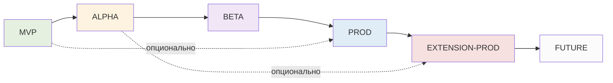

# ROADMAP4 — Дорожная карта OryaAgent v4 (Python + LangChain + LangGraph)

> **Версия документа:** 4.0
> **Дата:** 19 октября 2026
> **Источники:** `ARCHITECT4.md` v4.0, `OriaHS/ROADMAP.md` v1.0 (структура фаз и TRIZ-gates)
> **Стек:** Python 3.11+, LangChain 0.3+, LangGraph 0.2+, FastAPI, PostgreSQL 16, Redis 7, Chainlit, OriaHS (external)
> **Методология:** фазы отсортированы по 6 категориям зрелости — **MVP → ALPHA → BETA → PROD → EXTENSION-PROD → FUTURE**
> **Статус:** готов к реализации; финальная TRIZ-проверка — в `ROADMAP5.md`

---

## Содержание

1. Обзор и принципы категоризации
2. Сводная карта фаз
3. Фаза MVP — минимальный рабочий контур
4. Фаза ALPHA — production-safe baseline
5. Фаза BETA — расширяемость и память
6. Фаза PROD — OriaHS + A/B + multi-tenant
7. Фаза EXTENSION-PROD — масштабирование и интеграции
8. Фаза FUTURE — автономность и self-improvement
9. Сводная матрица фаз × компонентов
10. Карта зависимостей между фазами
11. Критерии перехода между фазами (exit criteria)
12. TRIZ-gates по фазам
13. NFR-таргеты по фазам
14. Риски и mitigations
15. Метрики прогресса внедрения
16. UI-стратегия по фазам (отдельная секция, т.к. «нормальный UI с MVP»)

---

## 1. Обзор и принципы категоризации

### 1.1. Назначение документа

Данный roadmap — операционная декомпозиция архитектуры `ARCHITECT4.md`. Он переводит архитектурные решения в последовательность поставляемых инкрементов с явными Definition of Done, целевыми NFR на каждой стадии и критериями перехода между категориями. Документ предназначен для engineering-команды и product-owners — он даёт общий словарь для обсуждения «что у нас уже есть, что критично, а что можно отложить».

Каждая фаза спроектирована как **самостоятельно поставляемый продукт**: после завершения фазы система остаётся в эксплуатационно-корректном состоянии и может продолжать работать, даже если следующая фаза откладывается. Это устраняет «частично готовые» релизы, где половина фич зависит от ещё не доставленной инфраструктуры.

### 1.2. Принципы разбиения на 6 категорий

Категории соответствуют зрелости системы с точки зрения эксплуатационных рисков, а не календарной последовательности:

| Фаза | Суть | Что добавляет |
|---|---|---|
| **MVP** | Минимальный рабочий агент | Ядро + UI + 5 tools |
| **ALPHA** | Production-safe baseline | Auth, rate-limits, observability, eval |
| **BETA** | Расширяемость и память | Memory, MCP, hooks, Next.js UI, Skills |
| **PROD** | Полноценная эксплуатация | OriaHS, A/B, multi-tenant, sandbox, Compaction |
| **EXTENSION-PROD** | Масштабирование | Semantic memory, IDE-плагины, subagents, scaling |
| **FUTURE** | Автономность и self-improvement | Multi-agent teams, cron, goals+judge, workflows, Max Mode, voice |

### 1.3. Отличия от OriaHS ROADMAP

OriaHS использует 4 фазы (MVP → Critical → Production-Ready → Improvements). OryaAgent v4 расширяет до 6 фаз, потому что:

1. **UI — первоклассный компонент.** В OriaHS UI нет (только API). В OryaAgent UI — это то, что пользователь видит с первого дня. Поэтому UI эволюционирует через все фазы.
2. **Агентский цикл сложнее search-API.** Search — stateless-запрос. Агент — long-running stateful-сессия. Поэтому больше фаз на эволюцию.
3. **Multi-agent и автономность** — отдельная большая категория, которая в OriaHS вообще не рассматривается. Выносим в FUTURE.

### 1.4. Принцип 20/80 на уровне фаз

Каждая фаза должна приносить ≥80% ценности своей категории при ≤20% усилий. Если фича требует >20% усилий и приносит <20% ценности — она переносится в следующую фазу или в FUTURE. Это правило применяется жёстко: лучше выпустить фазу с меньшим объёмом, но вовремя.

---

## 2. Сводная карта фаз

| Фаза | Длительность (ориентир) | Главная цель | Что лежит в основе |
|---|---|---|---|
| **MVP** | 2–3 недели | Рабочий кодинг-агент с нормальным UI | LangGraph + Chainlit + 5 tools + PostgresSaver |
| **ALPHA** | 2 недели | Production-safe: auth, observability, eval | LangSmith + OTel + Auth + rate-limits + offline eval |
| **BETA** | 3–4 недели | Расширяемость и память | MCP + hooks + Skills + Compaction + Next.js UI |
| **PROD** | 4–5 недель | OriaHS + multi-tenant + A/B | OriaHS integration + sandbox + A/B framework + Context Epoch |
| **EXTENSION-PROD** | По триггерам | Масштабирование | Semantic memory + IDE-плагины + parallel subagents + horizontal scaling |
| **FUTURE** | Не ограничено | Автономность | Multi-agent teams + cron + goals+judge + workflows + Max Mode + voice + self-improvement |

**Ключевая инвариантность:** каждая следующая фаза опирается на компоненты предыдущей, но не модифицирует их контракт. Например, OriaHS integration (PROD) использует `@tool`-абстракцию из MVP, но не меняет `BaseTool`-интерфейс. Это позволяет возвращаться к предыдущей фазе для доработок без каскадной переделки.

---

## 3. Фаза MVP — минимальный рабочий контур

### 3.1. Цели фазы

Доставить end-to-end работающего кодинг-агента: пользователь открывает Chainlit-UI, пишет «прочитай main.py и предложи улучшения», агент через `read` tool читает файл, через LLM анализирует, через `edit` tool правит, через `bash` tool запускает тесты, возвращает результат. Сессия сохраняется в PostgreSQL, при перезапуске агент поднимает последнее состояние и продолжает.

Принцип MVP: **«нормальный UI с первого дня»**. Это значит — Chainlit-чат с markdown, code-blocks, tool-step-карточками, streaming-токенами и ask-prompt для подтверждения опасных действий. Никаких «заглушек» или CLI-only-режима.

### 3.2. Компоненты фазы

#### 3.2.1. Ядро LangGraph (`app/core/graph.py`)

- `StateGraph` с узлами: `agent`, `tools`, `human` (для ask-mode).
- `MessagesState` для хранения истории сообщений.
- `interrupt_before=['tools']` в `ask`-режиме.
- `recursion_limit=25` (по умолчанию).
- Streaming через `astream_events(version='v2')`.

#### 3.2.2. LLM-шов (`app/core/llm.py`)

- LangChain `init_chat_model()` с конфигом из `pydantic-settings`.
- Поддержка двух провайдеров из коробки: `anthropic:claude-3-5-sonnet-latest` и `openai:gpt-4o`.
- `bind_tools()` для автоматической генерации tool-spec.
- Streaming через `astream`.
- Prompt-cache для Anthropic (через `cache_control`).

#### 3.2.3. Tool-registry + 5 базовых tools (`app/tools/`)

- `read(path, start?, limit?)` — чтение файла с pagination.
- `write(path, content)` — атомарная запись (temp+rename).
- `edit(path, old_string, new_string)` — точечная замена.
- `bash(command, timeout?)` — выполнение через `asyncio.subprocess`.
- `grep(pattern, glob?, path?)` — обёртка над `rg`.
- Все tools — `@tool`-декорированные async-функции с Pydantic-схемами.

#### 3.2.4. Session-log (`app/core/session.py`)

- LangGraph `AsyncPostgresSaver` для checkpoints.
- JSONL projection — отдельный воркер, читает новые checkpoints и дописывает в `~/.orya/sessions/{thread_id}.jsonl`.
- Таблицы `orya_sessions.sessions`, `orya_sessions.tool_invocations` (Alembic-миграции).
- Восстановление сессии по `thread_id` через `graph.aget_state(config)`.

#### 3.2.5. Context-manager (`app/core/context.py`)

- LangChain `trim_messages` со стратегией `last` + `start_on='human'`.
- Подсчёт токенов через `tiktoken` (OpenAI/Anthropic) или approximation (`chars/4`).
- Урезание длинных tool-результатов: первые 100 строк + `... [N lines truncated] ...` + последние 50 строк.
- `max_tokens` из конфига (default 128_000).

#### 3.2.6. System-prompt-builder (`app/core/prompt.py`)

- LangChain `ChatPromptTemplate` с секциями: identity, tool-описания, project-context, user-memory, behavior-rules.
- Project-level memory: `ORYA.md` в корне проекта (опционально).
- User-level memory: `~/.orya/memory.md` (опционально).
- Cacheable prefix — статическая часть помечается для prompt-cache.

#### 3.2.7. Permissions (`app/core/policy.py`)

- Два режима: `ask` (default) и `auto`.
- Allow-list в `~/.orya/permissions.yml` (regex-правила).
- Read-only tools (`read`, `grep`) всегда разрешены.
- Path-validation: `write`/`edit` только внутри разрешённых зон (cwd + `~/.orya/`).

#### 3.2.8. UI (Chainlit) (`app/ui/chainlit_app.py`)

- `cl.on_chat_start` — инициализация графа, генерация `thread_id`.
- `cl.on_message` — отправка сообщения, streaming ответа.
- `cl.AskActionMessage` — ask-prompt при `interrupt_before`.
- `cl.Step` — tool-call карточки с input/output.
- Markdown + code-blocks + diff-рендер (встроено в Chainlit).
- Sidebar с историей сессий (chainlit-нативный `cl.ChatSettings`).

### 3.3. TRIZ-gates фазы

| Gate | Что встроено с первого дня | Эффект |
|---|---|---|
| `dead`-состояние в tool_invocations | `status IN ('running','ok','failed','dead')` | Предотвращает вечные «зависшие» tool-вызовы |
| JSONL projection | Каждый event дублируется в JSONL | Audit-trail + backup-формат |
| Pydantic `extra='forbid'` в tool-schemas | Запрет неизвестных полей в args | Schema-drift = ошибка валидации |
| Path-validation в tools | `validate_path()` в write/edit/bash | Защита от записи вне cwd с первого дня |
| `recursion_limit` в LangGraph | 25 итераций max | Защита от бесконечного цикла |
| `interrupt_before` для ask-mode | Native LangGraph HITL | Безопасный bash с первого дня |

### 3.4. Definition of Done (DoD)

- ✅ `chainlit run app/ui/chainlit_app.py` поднимает UI; можно написать промпт и получить стримящийся ответ.
- ✅ Агент может прочитать файл, отредактировать его (с подтверждением), запустить bash-команду (с подтверждением), найти строку через grep.
- ✅ Сессия сохраняется в PostgreSQL; после `Ctrl+C` и рестарта можно продолжить.
- ✅ Переключение между Anthropic и OpenAI — одной строкой `.env` (без правки кода).
- ✅ Ask-prompt появляется перед bash/write/edit; allow-list работает (например, `bash: ls *` не спрашивает).
- ✅ `orya_sessions.tool_invocations` содержит лог всех tool-вызовов с args/result/status.
- ✅ `~/.orya/sessions/{thread_id}.jsonl` создаётся и корректно проектирует events.
- ✅ Smoke-тесты: 5 эталонных задач (read, grep, edit, bash, create-file) проходят без падения ядра.
- ✅ README.md с инструкцией `uv sync && chainlit run app/ui/chainlit_app.py`.

### 3.5. Целевые NFR фазы

| Параметр | Целевое значение |
|---|---|
| Time-to-first-token | ≤ 1500 мс |
| Tool-call latency (read/write/edit/grep) | ≤ 200 мс (p95) |
| Bash-tool latency (короткие команды) | ≤ 5 сек (p95) |
| Session recovery time | ≤ 2 сек |
| Concurrent sessions per instance | ≥ 10 |
| Recursion limit (max iterations) | 25 |
| Cost per session (средний) | ≤ $0.50 |

### 3.6. Риски фазы и их mitigations

- **LangGraph breaking change в 0.x**: фиксация `langgraph>=0.2,<0.3`; integration-тесты при upgrade.
- **Chainlit несовместимость с LangGraph streaming**: fallback на `cl.Step` + polling; в крайнем случае — переход на FastAPI+SSE раньше BETA.
- **PostgresSaver медленный на больших сессиях**: тест на 1000+ сообщений; при проблемах — переключение на `RedisSaver` для hot-sessions + PostgresSaver для cold.
- **Prompt-cache не срабатывает**: тест cache-hit-rate через LangSmith; корректировка `cache_control` placement.

---

## 4. Фаза ALPHA — production-safe baseline

### 4.1. Цели фазы

Превратить «работающий MVP» в «безопасный MVP»: добавить auth, rate-limits, observability и offline-eval. После этой фазы команду/продукт можно выкатывать в production для ограниченной аудитории (например, внутренние пользователи компании) без неприемлемых рисков.

ALPHA не добавляет нового функционала с точки зрения end-user-фич — пользователь по-прежнему пишет промпт и получает ответ. Но система устойчива к деградации LLM-провайдера, превышению rate-limit, регрессиям prompt-версий.

### 4.2. Компоненты фазы

#### 4.2.1. Auth (Chainlit native + FastAPI middleware)

- Local auth (username/password) — для dev/internal.
- OAuth (Google, GitHub) — для external users.
- API-key auth для external API-клиентов.
- Session-based auth с JWT.

#### 4.2.2. Rate-limiting (Redis token-bucket)

- Per-user rate-limit: ≤ 100 messages/hour, ≤ 100k tokens/hour.
- Per-user cost-limit: ≤ $50/day (configurable).
- Per-IP rate-limit для unauthenticated endpoints.
- Circuit-breaker при достижении limit: 429 с `Retry-After`.

#### 4.2.3. Observability — три уровня

**Agent-level (LangSmith/LangFuse):**
- Trace каждого graph-вызова с деревом LLM + tool.
- Token-counts, latency, cost.
- Replay любой сессии.
- Prompt-version diff.

**App-level (OpenTelemetry):**
- FastAPI-spans: HTTP-request → handler → graph-call.
- asyncpg-spans: SQL-queries в PostgresSaver.
- httpx-spans: запросы к OriaHS (пока не подключён — к LLM-провайдерам).
- Export в OTel Collector → Tempo (traces) + Loki (logs).

**Infra-level (Prometheus + Grafana):**
- `orya_http_request_duration_seconds_bucket`
- `orya_agent_step_duration_seconds{node}`
- `orya_tool_calls_total{tool, status}`
- `orya_llm_tokens_total{provider, model, direction}`
- `orya_llm_cost_usd_total{provider, model}`
- `orya_session_active_count`
- `orya_interrupt_waiting_count`
- 4 Grafana-дашборда: throughput, latency, cost, errors.

#### 4.2.4. Offline-eval (nightly job)

- Eval-датасет: 50 размеченных задач (read-only, edit-required, bash-required, multi-step).
- Nightly job прогоняет все задачи против текущей prompt-версии.
- Метрики: success-rate, avg-steps, avg-cost, p95-latency.
- Сравнение с baseline (вчера); алерт при регрессии > 5% success-rate.
- CI-gate: блокировка релиза при провале eval.

#### 4.2.5. Cost-alarm

- LangSmith/LangFuse dashboard с daily cost.
- Hard daily limit per user ($50 default) → account suspension.
- Soft alert at 80% of limit → email notification.

#### 4.2.6. Secret-management

- API-ключи только в env / vault (не в коде, не в БД).
- `.env.example` для документации, `.env` в `.gitignore`.
- Secret-scanning в CI (gitleaks/trufflehog).
- Rotation-policy: 90 дней для LLM API-keys.

### 4.3. TRIZ-gates фазы

| Gate | Эффект |
|---|---|
| Circuit-breaker при LLM 5xx | Предотвращает каскадный таймаут при деградации провайдера |
| Nightly eval как regression-gate | Регрессия prompt → блокировка релиза |
| Hard cost-limit per user | Защита от cost-overruns |
| `interrupt_waiting_count` метрика | Видимость «зависших» сессий |
| OTel correlation ID | Точное отслеживание запроса через все слои |

### 4.4. Definition of Done (DoD)

- ✅ Local auth работает; можно создать пользователя, залогиниться, сессия сохраняется.
- ✅ Rate-limit блокирует при превышении; 429 с корректным `Retry-After`.
- ✅ LangSmith/LangFuse показывает trace каждой сессии с деревом вызовов.
- ✅ Prometheus `/metrics` отдаёт все метрики; Grafana-дашборды отображают throughput/latency/cost.
- ✅ Nightly eval прогоняет 50 задач; отчёт в Markdown + алерт при регрессии.
- ✅ Cost-alarm срабатывает при достижении 80% лимита.
- ✅ Secret-scanning в CI падает при commit ключа в код.
- ✅ CI-gate: провал nightly eval блокирует merge в main.

### 4.5. Целевые NFR фазы

| Параметр | Целевое значение |
|---|---|
| Time-to-first-token | ≤ 1000 мс |
| Tool-call latency (p95) | ≤ 150 мс |
| Eval success-rate | ≥ 90% |
| Observability coverage | 100% LLM-вызовов, 100% tool-вызовов |
| Auth-latency overhead | ≤ 20 мс |
| SLA | 99% (planned downtime допустим) |

### 4.6. Риски фазы и их mitigations

- **LangSmith SaaS недоступен**: fallback на LangFuse self-hosted; env-variable switching.
- **Nightly eval даёт false-positives**: ручной review при алерте; threshold-tuning.
- **Rate-limit блокирует легитимных пользователей**: whitelist для power-users; configurable limits.

---

## 5. Фаза BETA — расширяемость и память

### 5.1. Цели фазы

Превратить «безопасный MVP» в «расширяемую платформу»: добавить memory, MCP-клиент, hooks, Skills, продвинутый UI (Next.js) и полноценную compaction. После этой фазы сторонние разработчики могут расширять агента своими tools (через MCP), hooks (pre/post tool), skills (переиспользуемые prompt-шаблоны), не форкая ядро.

BETA — это фаза, где OryaAgent начинает выглядеть как «платформа», а не как «один продукт». Пользователь может подключить свой GitHub-MCP-server, свой Jira-MCP-server, свой internal-tool-MCP-server — и агент начнёт с ними работать.

### 5.2. Компоненты фазы

#### 5.2.1. Memory (cross-session)

- LangGraph `BaseStore` (или PostgresStore) для cross-session memory.
- Semantic search по прошлым сессиям через pgvector (для embedding — `bge-m3` или OpenAI text-embedding-3-small).
- Auto-summarization: после закрытия сессии — summary в memory-store.
- Memory injection в system-prompt: top-3 релевантные past-summaries.
- Privacy: memory — per-user; между tenant'ами изоляция.

#### 5.2.2. MCP-клиент

- `langchain-mcp-adapters` для загрузки MCP-tools в tool-registry.
- Конфиг MCP-servers в `~/.orya/mcp.yml`:
  ```yaml
  servers:
    github:
      transport: stdio
      command: npx
      args: ["-y", "@modelcontextprotocol/server-github"]
      env:
        GITHUB_TOKEN: ${GITHUB_TOKEN}
    jira:
      transport: sse
      url: https://mcp.atlassian.com/sse
  ```
- Динамическая регистрация: при старте сессии MCP-tools добавляются в graph.
- MCP-tool-permissions: каждый MCP-tool проходит через тот же `policy.review()`.

#### 5.2.3. Hooks (pre/post tool)

- Pre-tool hooks: async-функции, запускаемые до tool-execution.
- Post-tool hooks: async-функции после tool-execution.
- Конфиг в `~/.orya/hooks.yml`:
  ```yaml
  hooks:
    post_tool:
      - match: { tool: "write" }
        action: run_bash
        command: "ruff format {args.path}"
      - match: { tool: "edit" }
        action: oriahs_index  # PROD+: индексация после edit
  ```
- Встроенные hooks: format-on-write, lint-on-edit, reindex-on-write (PROD+).

#### 5.2.4. Skills (переиспользуемые prompt-шаблоны)

- Формат: markdown-файл с front-matter.
  ```markdown
  ---
  name: refactor-extract-function
  description: Extract code block into a new function
  tools: [read, edit, grep]
  ---
  # Instructions
  1. Read the file at {path}
  2. Identify the code block at lines {start}-{end}
  3. ...
  ```
- Хранение: `~/.orya/skills/` (user) или `.orya/skills/` (project).
- Активация: пользователь пишет `/skill refactor-extract-function path=main.py start=10 end=20`.
- LangGraph добавляет skill-инструкции в system-prompt на один ход.

#### 5.2.5. Compaction (LangGraph native)

- Отдельный узел `compact` в графе, запускается при `token_count > 80% max`.
- LLM-summarization первых N сообщений.
- Summary сохраняется как `SystemMessage` в начале.
- Полные сообщения переносятся в cold-storage (S3 / отдельная таблица).

#### 5.2.6. Next.js UI (primary), Chainlit (fallback)

- Next.js 15+ app с React 19.
- FastAPI-SSE endpoint `/sessions/{id}/stream`.
- Компоненты:
  - Chat-panel (markdown + code-blocks + diff).
  - Code-viewer (Monaco editor, read-only).
  - File-tree sidebar.
  - Session-list sidebar.
  - Tool-call cards (collapsible).
  - Interrupt-prompt modal.
  - Settings (model, mode, allow-list).
- Multi-tab: несколько параллельных сессий.
- Chainlit остаётся как `chainlit_app.py` для dev/quick-start.

#### 5.2.7. Prompt-версионирование и A/B-prompt

- Каждое изменение system-prompt → новая версия в БД.
- A/B-тест между версиями: 50% пользователей видят v1, 50% — v2.
- Метрики: success-rate, avg-steps, user-satisfaction (thumbs up/down).
- Statistical significance через sequential testing.

### 5.3. TRIZ-gates фазы

| Gate | Эффект |
|---|---|
| Memory isolation per-user | Защита приватности между пользователями |
| MCP-tool permissions через тот же policy | Единый security-контур |
| Compaction при 80% window | Предотвращает context-overflow |
| Prompt-versioning + A/B | Управление качеством через данные |
| Skills как markdown | Минимальный friction для добавления |

### 5.4. Definition of Done (DoD)

- ✅ После закрытия сессии — summary сохраняется; при следующей сессии relevant past-summaries инжектируются в system-prompt.
- ✅ MCP-server (например, GitHub) подключается через конфиг; его tools появляются в агенте.
- ✅ Post-tool hook `ruff format` срабатывает после `write` tool.
- ✅ Skill `/skill refactor-extract-function` корректно выполняет multi-step refactor.
- ✅ Compaction срабатывает при длинной сессии (1000+ сообщений); agent продолжает работать.
- ✅ Next.js UI запускается, подключается к FastAPI-SSE, отображает streaming-токены.
- ✅ A/B-prompt: две версии промпта разделяют трафик; метрики собираются.
- ✅ Eval-датасет расширен до 200 задач; success-rate ≥ 92%.

### 5.5. Целевые NFR фазы

| Параметр | Целевое значение |
|---|---|
| Time-to-first-token | ≤ 800 мс |
| Memory-search latency | ≤ 200 мс (top-3 from 10k summaries) |
| MCP-tool load time | ≤ 5 сек при старте сессии |
| Compaction latency | ≤ 10 сек |
| Next.js UI TTI | ≤ 2 сек |
| Eval success-rate | ≥ 92% |
| SLA | 99.5% |

### 5.6. Риски фазы и их mitigations

- **Memory-leak данных между пользователями**: integration-тесты на изоляцию; OWASP-аудит.
- **MCP-server конфликтует с базовыми tools**: namespace `mcp__{server}__{tool}`; запрет на shadowing.
- **Compaction теряет контекст**: user-confirm перед compact; undo через LangGraph checkpoint.
- **Next.js UI сложнее Chainlit**: постепенный rollout; Chainlit как fallback.

---

## 6. Фаза PROD — OriaHS + multi-tenant + A/B

### 6.1. Цели фазы

Превратить «расширяемую платформу» в «полноценную production-систему»: добавить интеграцию с OriaHS (semantic codebase search), multi-tenant isolation, A/B-фреймворк для стратегий, sandbox для bash, Context Epoch (продвинутая compaction для prompt-cache), и подтверждённую через chaos engineering устойчивость к реальным сбоям.

После этой фазы система способна:
- **Управлять качеством через данные**: A/B между prompt-версиями, prompt-strategies, tool-sets.
- **Эволюционировать**: zero-downtime миграция LLM-моделей (Anthropic Claude 3.5 → 4, GPT-4o → 5).
- **Восстанавливаться**: при потере PostgreSQL — restore from backup за минуты; при потере OriaHS — fallback на grep.
- **Доказывать устойчивость**: chaos-сценарии в CI.

### 6.2. Компоненты фазы

#### 6.2.1. OriaHS integration

Подробно — см. `ARCHITECT4.md` §10. Ключевые tools:
- `oriahs_search` — semantic search по коду/документации.
- `oriahs_index` — индексация файла (post-write hook).
- `oriahs_index_batch` — индексация директории (git-aware).
- `oriahs_wait_index` — read-your-writes.
- `oriahs_delete` — удаление при git-rm.
- `oriahs_health` — healthcheck.

Code-chunker на tree-sitter: нарезает Python/JS/TS/Go/Rust файлы на semantic chunks (functions, classes) перед отправкой в OriaHS `/index`.

#### 6.2.2. Multi-tenant isolation

- `tenant_id` в каждой сессии (по образцу OriaHS).
- Row-level security в PostgreSQL для `orya_sessions.*` таблиц.
- Per-tenant rate-limits, per-tenant cost-limits.
- Per-tenant LLM-model policies (например, tenant A — только Anthropic; tenant B — любой).
- Per-tenant memory isolation.

#### 6.2.3. A/B-фреймворк (полноценный)

- `experiment_id` в каждой сессии.
- Sticky distribution: один пользователь всегда в одной группе.
- Метрики эксперимента (daily): success-rate, avg-cost, avg-steps, user-satisfaction.
- Sequential testing для статистической значимости.
- Admin-UI для создания/просмотра экспериментов.

#### 6.2.4. Sandbox для bash

- `bwrap` (Linux) / `sandbox-exec` (macOS) для изоляции.
- Egress-filter: только whitelist доменов (LLM-API, package-managers).
- CPU/memory limits через cgroups.
- Timeout 60 сек (configurable).
- `auto`-mode (без подтверждения) — только в sandbox.

#### 6.2.5. Context Epoch

- Неизменяемый базовый префикс для prompt-cache.
- Epoch-boundary: при изменении system-prompt-version → новая epoch.
- Cache-hit-rate метрика; цель — ≥ 60% на Anthropic.
- Epoch-invalidation: при добавлении MCP-tool / skill.

#### 6.2.6. LLM-модель migration framework

- Zero-downtime миграция Claude 3.5 → 4 (или GPT-4o → 5):
  1. Заводим запись в `llm_models` с `is_default=false`.
  2. Канарейка 1% трафика на новую модель.
  3. Сравнение eval-метрик; алерт при регрессии.
  4. Постепенный ramp-up 5% → 25% → 50% → 100%.
  5. Rollback при любой аномалии.
- Snapshot сессий перед миграцией (для отката).

#### 6.2.7. Shadow-traffic

- При выкатке новой prompt-version — shadow-режим:
  - На каждый запрос считаем оба варианта (old + new).
  - Логируем оба в `search_events`-аналог.
  - Клиенту отдаём только old.
- Безопасная валидация без риска.

#### 6.2.8. Chaos engineering (weekly)

- Каждое воскресенье 06:00 UTC в non-prod: плановые инъекции.
- Сценарии:
  - Убить OriaHS на 60 сек → проверить fallback на grep.
  - Убить PostgreSQL на 30 сек → проверить reconnect.
  - Задержать LLM-провайдера на 5 сек → проверить circuit-breaker.
  - Забить Redis → проверить cache-miss-handling.
- Postcondition-чек в CI; провал блокирует релиз.

#### 6.2.9. Backup & DR

- PostgreSQL: PITR (point-in-time-recovery), daily snapshot, 30-day retention.
- Redis: AOF + RDB, hourly snapshot.
- S3 (или аналог): cold-storage для old sessions, 90-day retention.
- DR-runbook: восстановление за ≤ 30 минут.

### 6.3. TRIZ-gates фазы

| Gate | Эффект |
|---|---|
| OriaHS fallback на grep | Graceful degradation при потере OriaHS |
| Multi-tenant RLS | Изоляция данных между tenant'ами на уровне БД |
| Shadow-traffic | Безопасная валидация новых стратегий |
| Chaos engineering weekly | Доказанная устойчивость к сбоям |
| Context Epoch | 60%+ экономии токенов на prompt-cache |
| LLM-migration framework | Смена модели без downtime |
| Sandbox egress-filter | Защита от data-exfiltration |

### 6.4. Definition of Done (DoD)

- ✅ `oriahs_search` работает; возвращает релевантные результаты за ≤ 200 мс p95.
- ✅ Post-write hook автоматически индексирует изменённые файлы (с debounce 5 сек).
- ✅ Multi-tenant: пользователь tenant A не видит сессии tenant B (RLS-тест).
- ✅ A/B-фреймворк: создан эксперимент, трафик разделён 50/50, метрики собираются.
- ✅ Sandbox: bash в `auto`-mode работает только в sandbox; egress-filter блокирует не-whitelist домены.
- ✅ Context Epoch: cache-hit-rate ≥ 60% на Anthropic (метрика в LangSmith).
- ✅ Chaos: 4 сценария проходят; fallback на grep при OriaHS-down.
- ✅ LLM-migration: тестовый migration Claude 3.5 → 3.7 через канарейку; rollback срабатывает.
- ✅ Backup & DR: restore-test прошёл за ≤ 30 минут.

### 6.5. Целевые NFR фазы

| Параметр | Целевое значение |
|---|---|
| Time-to-first-token | ≤ 500 мс (with prompt-cache) |
| oriahs_search latency p95 | ≤ 200 мс |
| Concurrent sessions per instance | ≥ 100 |
| Cache-hit-rate (Anthropic) | ≥ 60% |
| Multi-tenant RLS overhead | ≤ 5 мс |
| Sandbox bash overhead | ≤ 50 мс |
| Eval success-rate | ≥ 95% |
| SLA | 99.9% |
| DR-RTO | ≤ 30 минут |
| DR-RPO | ≤ 5 минут |

### 6.6. Риски фазы и их mitigations

- **OriaHS даёт нерелевантные результаты**: nightly eval на code-search-датасете; prompt-tuning.
- **RLS замедляет запросы**: индексы на `tenant_id`; benchmarking перед выкаткой.
- **Sandbox ломает legitimate bash (например, `git clone`)**: whitelist доменов; per-project overrides.
- **Context Epoch не работает с dynamic content**: separation static vs dynamic в system-prompt.
- **Migration-rollback теряет данные**: snapshot перед миграцией; tested-rollback в CI.

---

## 7. Фаза EXTENSION-PROD — масштабирование и интеграции

### 7.1. Цели фазы

Превратить «полноценную production-систему» в «масштабируемую платформу»: добавить semantic memory (RAG по всем прошлым сессиям всех пользователей — где допустимо), IDE-плагины (VS Code, JetBrains), parallel subagents для длинных задач, horizontal scaling (stateless API-instances). Фаза включается по триггерам: > 1000 активных пользователей, > 100k sessions, > 10M tokens/day.

### 7.2. Компоненты фазы

#### 7.2.1. Semantic memory (RAG по истории)

- Все past-summaries индексируются в OriaHS (отдельный tenant `orya_memory`).
- При стартe новой сессии — top-5 релевантных past-summaries инжектируются в system-prompt.
- Privacy: per-user memory; cross-user только для admin-аналитики (anonymized).
- Memory-decay: старше 90 дней → reduced-weight; старше 1 года → archive.

#### 7.2.2. IDE-плагины (VS Code, JetBrains)

- VS Code extension: chat-sidebar + inline-completion + diff-apply.
- JetBrains plugin: аналогично.
- Backend — тот же FastAPI; OpenAI-compatible endpoint `/v1/chat/completions`.
- Auth: OAuth через browser (как у GitHub Copilot).

#### 7.2.3. Parallel subagents

- LangGraph `Send` API для параллельных подграфов.
- Use-case: «refactor 5 файлов» → 5 параллельных subagents, каждый на свой файл.
- Subagent — отдельный `StateGraph` с собственным tool-set (без `write` — только `read`; родительский агент делает `write` после review).
- Subagent-results агрегируются в родительском агенте.

#### 7.2.4. Horizontal scaling

- Stateless API-instances за load-balancer.
- PostgresSaver → distributed PostgreSQL (PATRONI или managed RDS).
- Redis-cluster для cache + queues.
- LangGraph state в PostgreSQL (не в памяти) → любой instance может продолжить любую сессию.
- Session-affinity через sticky-session в LB (опционально, для cache-locality).

#### 7.2.5. Cost-optimization

- Smart model-routing: простые задачи → Haiku/mini; сложные → Sonnet/Opus.
- Token-budget per turn: агент получает «бюджет» 5000 токенов; при превышении — fallback на более дешёвую модель.
- Caching: одинаковые промпты в течение 24 часов → cache-hit (Redis).
- Batch API для оффлайн-задач (LangGraph batch processing).

#### 7.2.6. Advanced analytics

- ClickHouse (или BigQuery) для аналитики по всем сессиям.
- Метрики: DAU/MAU, retention, avg-session-length, top-tools, top-skills, cost-per-user.
- Dashboards в Grafana / Metabase.

### 7.3. TRIZ-gates фазы

| Gate | Эффект |
|---|---|
| Smart model-routing | 40-60% cost-reduction без потери качества |
| Subagents без `write` tool | Безопасность параллельных задач |
| Stateless API | Горизонтальное масштабирование |
| Semantic memory per-user | RAG без утечки приватных данных |
| Token-budget per turn | Защита от cost-overruns на сложных задачах |

### 7.4. Definition of Done (DoD)

- ✅ Semantic memory: top-5 релевантных past-summaries инжектируются; A/B показывает +10% success-rate.
- ✅ VS Code extension публикуется в marketplace; установлен ≥ 100 пользователям.
- ✅ Parallel subagents: 5 файлов рефакторятся за 1.5× времени одного файла (не за 5×).
- ✅ Horizontal scaling: 10 API-instances за LB; сессия продолжается на любом instance.
- ✅ Smart model-routing: 50% запросов идут на Haiku/mini; cost-reduction 40%.
- ✅ Advanced analytics: 5 Metabase-dashboards с DAU/MAU/retention/cost.

### 7.5. Целевые NFR фазы

| Параметр | Целевое значение |
|---|---|
| Throughput (sessions/day) | ≥ 100k |
| Concurrent active sessions | ≥ 1000 (на кластере)
| P95 latency (with scaling) | ≤ 500 мс |
| Cost per session | ≤ $0.20 (-60% от PROD) |
| Semantic memory injection | ≤ 300 мс |
| IDE-plugin install + connect | ≤ 5 минут |

### 7.6. Риски фазы и их mitigations

- **Semantic memory нарушает приватность**: per-user isolation; admin-review для cross-user.
- **Subagents конфликтуют при write**: запрет write в subagents; родитель делает write.
- **Load-balancer ломает streaming**: sticky-session для active-streams; SSE-reconnect.
- **Smart-routing ухудшает качество**: eval-gate per routing-rule; manual override.

---

## 8. Фаза FUTURE — автономность и self-improvement

### 8.1. Цели фазы

Добавить контур автономности: cron-расписания, goals+judge-модель, workflows, Max Mode, multi-agent teams, voice-input, self-improvement (`/dream`, `/distill`). Фаза не имеет жёстких сроков — фичи добавляются по demand.

### 8.2. Компоненты фазы (концептуально)

#### 8.2.1. Cron / scheduler

- Расписание задач: «каждый понедельник 9:00 прогонять тесты и репортить».
- Джиттер ± 5 минут для предотвращения thundering-herd.
- Sentinel-файлы для идемпотентности.

#### 8.2.2. Goals + judge-модель

- Пользователь ставит цель: «отрефактори модуль X к концу дня».
- Агент работает автономно; при попытке завершиться — judge-модель оценивает, достигнута ли цель.
- Если нет — агент продолжает (с budget-limit на итерации).

#### 8.2.3. Workflows (детерминированные пайплайны)

- LangGraph subgraphs как детерминированные workflow.
- Пример: `compose-feature` = brainstorm → design → implement → verify → review → merge.
- Ретраи с ограничениями; auto-parallelism в git-worktrees.

#### 8.2.4. Max Mode (best-of-N with judge)

- Параллельно запускаются N=3 агентов с одним промптом.
- Judge-модель выбирает лучший результат.
- 3× cost, но +10-15% quality на сложных задачах.

#### 8.2.5. Multi-agent teams

- Agent Teams (по образцу DeepSeek Harness): roster, task-board, mailbox.
- Roles: PM-agent, dev-agent, reviewer-agent, tester-agent.
- Внутренняя коммуникация через mailbox.

#### 8.2.6. Voice-ввод (VAD + ASR)

- TenVAD для voice-activity-detection.
- Whisper (или cloud-ASR) для transcription.
- Wake-word «Hey Orya».

#### 8.2.7. `/dream` and `/distill` (self-improvement)

- `/dream`: анализ прошлых сессий, выделение паттернов, сохранение в memory.
- `/distill`: упаковка повторяющихся ручных пайплайнов в skills.

#### 8.2.8. Desktop-приложение (Tauri/Electron)

- Офлайн-режим через локальные модели (Ollama).
- Native file-system access.
- System-tray integration.

### 8.3. Целевые NFR фазы

Не формализуются — фаза по demand.

---

## 9. Сводная матрица фаз × компонентов

| Компонент | MVP | ALPHA | BETA | PROD | EXTENSION-PROD | FUTURE |
|---|---|---|---|---|---|---|
| LangGraph core | ✅ | — | — | Context Epoch | Scaling | Subagents, workflows |
| LLM-шов (LangChain) | ✅ 2 провайдера | — | — | Migration framework | Smart-routing | — |
| 5 базовых tools | ✅ | — | — | Sandbox | — | — |
| OriaHS integration | — | — | — | ✅ | — | — |
| MCP-клиент | — | — | ✅ | — | — | — |
| Hooks | — | — | ✅ | — | — | — |
| Skills | — | — | ✅ | — | — | `/distill` auto-generation |
| Compaction | — | — | ✅ basic | ✅ Context Epoch | — | — |
| Memory (cross-session) | — | — | ✅ basic | — | ✅ Semantic (RAG) | `/dream` |
| Auth | — | ✅ | — | Multi-tenant | — | — |
| Rate-limits + cost-alarm | — | ✅ | — | — | — | — |
| Observability (3 уровня) | — | ✅ | — | — | Advanced analytics | — |
| Offline-eval | — | ✅ | — | — | — | — |
| A/B-prompt | — | — | ✅ basic | ✅ full | — | — |
| Multi-tenant RLS | — | — | — | ✅ | — | — |
| Sandbox | — | — | — | ✅ | — | — |
| Chaos engineering | — | — | — | ✅ | — | — |
| Backup & DR | — | basic | — | ✅ full | — | — |
| Semantic memory (RAG) | — | — | — | — | ✅ | — |
| IDE-плагины | — | — | — | — | ✅ | — |
| Parallel subagents | — | — | — | — | ✅ | — |
| Horizontal scaling | — | — | — | — | ✅ | — |
| Smart model-routing | — | — | — | — | ✅ | — |
| Cron / scheduler | — | — | — | — | — | ✅ |
| Goals + judge | — | — | — | — | — | ✅ |
| Workflows | — | — | — | — | — | ✅ |
| Max Mode | — | — | — | — | — | ✅ |
| Multi-agent teams | — | — | — | — | — | ✅ |
| Voice-input | — | — | — | — | — | ✅ |
| Self-improvement | — | — | — | — | — | ✅ |
| Desktop app | — | — | — | — | — | ✅ |

---

## 10. Карта зависимостей между фазами



**Жёсткие зависимости:**
- ALPHA требует MVP (нечего делать safe).
- BETA требует ALPHA (нечего делать multi-tenant без auth).
- PROD требует BETA (OriaHS integration требует hooks для post-write indexing).
- EXTENSION-PROD требует PROD (semantic memory требует OriaHS).

**Опциональные зависимости:**
- PROD можно начинать параллельно с BETA, если OriaHS уже готов.
- EXTENSION-PROD можно начинать без FUTURE, но некоторые фичи (parallel subagents) требуют components из FUTURE.

---

## 11. Критерии перехода между фазами (exit criteria)

### 11.1. MVP → ALPHA

- ✅ MVP DoD выполнен.
- ✅ Smoke-тесты проходят в CI.
- ✅ README + ARCHITECT4.md обновлены.
- ✅ Deploy на dev-окружение успешен.

### 11.2. ALPHA → BETA

- ✅ ALPHA DoD выполнен.
- ✅ Nightly eval success-rate ≥ 90% в течение 7 дней.
- ✅ SLA 99% в течение 14 дней.
- ✅ LangSmith/LangFuse traces видны; cost-alarm срабатывает.
- ✅ Security-audit (auth, rate-limits, secret-management) пройден.

### 11.3. BETA → PROD

- ✅ BETA DoD выполнен.
- ✅ Nightly eval success-rate ≥ 92% в течение 14 дней.
- ✅ Next.js UI TTI ≤ 2 сек в p95.
- ✅ Memory isolation протестирована (OWASP-аудит).
- ✅ MCP-integration работает с ≥ 3 реальными MCP-servers (GitHub, Slack, internal).

### 11.4. PROD → EXTENSION-PROD

- ✅ PROD DoD выполнен.
- ✅ Triggers: > 1000 active users ИЛИ > 100k sessions ИЛИ > 10M tokens/day.
- ✅ SLA 99.9% в течение 30 дней.
- ✅ Chaos engineering 4 сценария проходят 4 недели подряд.
- ✅ DR-test прошёл (RTO ≤ 30 мин, RPO ≤ 5 мин).
- ✅ OriaHS integration: cache-hit-rate ≥ 60%, fallback на grep работает.

### 11.5. EXTENSION-PROD → FUTURE

- ✅ EXTENSION-PROD DoD выполнен.
- ✅ Triggers: customer-demand на autonomous-фичи ИЛИ internal-need.
- ✅ Smart-routing: cost-reduction 40%+ подтверждён в течение 30 дней.
- ✅ Horizontal scaling: 10+ instances, linear-scaling-test пройден.

---

## 12. TRIZ-gates по фазам

Сводка всех TRIZ-gates из `ARCHITECT4.md` и фаз:

| Gate | Фаза | Эффект |
|---|---|---|
| `dead`-состояние в tool_invocations | MVP | Предотвращает вечные зависшие tool-вызовы |
| JSONL projection | MVP | Audit-trail + backup-формат |
| Pydantic `extra='forbid'` в schemas | MVP | Schema-drift = ошибка |
| Path-validation в tools | MVP | Защита от записи вне cwd |
| `recursion_limit` | MVP | Защита от бесконечного цикла |
| `interrupt_before` для ask-mode | MVP | Безопасный bash с первого дня |
| Circuit-breaker при LLM 5xx | ALPHA | Предотвращает каскадный таймаут |
| Nightly eval как regression-gate | ALPHA | Регрессия → блокировка релиза |
| Hard cost-limit per user | ALPHA | Защита от cost-overruns |
| `interrupt_waiting_count` метрика | ALPHA | Видимость зависших сессий |
| OTel correlation ID | ALPHA | Точное отслеживание запроса |
| Memory isolation per-user | BETA | Защита приватности |
| MCP-tool permissions через policy | BETA | Единый security-контур |
| Compaction при 80% window | BETA | Предотвращает context-overflow |
| Prompt-versioning + A/B | BETA | Управление качеством через данные |
| Skills как markdown | BETA | Минимальный friction |
| OriaHS fallback на grep | PROD | Graceful degradation |
| Multi-tenant RLS | PROD | Изоляция на уровне БД |
| Shadow-traffic | PROD | Безопасная валидация стратегий |
| Chaos engineering weekly | PROD | Доказанная устойчивость |
| Context Epoch | PROD | 60%+ экономии токенов |
| LLM-migration framework | PROD | Смена модели без downtime |
| Sandbox egress-filter | PROD | Защита от data-exfiltration |
| Smart model-routing | EXTENSION-PROD | 40-60% cost-reduction |
| Subagents без `write` tool | EXTENSION-PROD | Безопасность параллельных задач |
| Stateless API | EXTENSION-PROD | Горизонтальное масштабирование |
| Semantic memory per-user | EXTENSION-PROD | RAG без утечки данных |
| Token-budget per turn | EXTENSION-PROD | Защита от cost-overruns |

---

## 13. NFR-таргеты по фазам

| NFR | MVP | ALPHA | BETA | PROD | EXTENSION-PROD |
|---|---|---|---|---|---|
| Time-to-first-token p95 | ≤ 1500 мс | ≤ 1000 мс | ≤ 800 мс | ≤ 500 мс | ≤ 500 мс |
| Tool-call latency p95 | ≤ 200 мс | ≤ 150 мс | ≤ 150 мс | ≤ 150 мс | ≤ 100 мс |
| Session recovery time | ≤ 2 сек | ≤ 2 сек | ≤ 1 сек | ≤ 1 сек | ≤ 500 мс |
| Concurrent sessions/instance | ≥ 10 | ≥ 20 | ≥ 50 | ≥ 100 | ≥ 1000 (cluster) |
| Eval success-rate | ≥ 85% | ≥ 90% | ≥ 92% | ≥ 95% | ≥ 96% |
| Cost per session | ≤ $0.50 | ≤ $0.40 | ≤ $0.30 | ≤ $0.25 | ≤ $0.10 |
| Cache-hit-rate (Anthropic) | — | — | — | ≥ 60% | ≥ 70% |
| SLA | — | 99% | 99.5% | 99.9% | 99.95% |
| DR-RTO | — | — | — | ≤ 30 мин | ≤ 15 мин |
| DR-RPO | — | — | — | ≤ 5 мин | ≤ 1 мин |

---

## 14. Риски и mitigations

### 14.1. Архитектурные риски (сквозные)

| Риск | Фазы | Mitigation |
|---|---|---|
| LangGraph breaking change | все | Фиксация версий; integration-тесты при upgrade |
| Chainlit не тянет PROD-нагрузку | BETA+ | Переход на Next.js в BETA |
| PostgreSQL — SPOF | PROD+ | PATRONI-кластер; backup + PITR |
| OriaHS недоступен | PROD+ | Fallback на grep; circuit-breaker |
| LLM-провайдер меняет pricing | все | Multi-provider; smart-routing |
| Hallucinations в file-edits | все | `edit` требует уникальности; re-read после edit |

### 14.2. Операционные риски

| Риск | Mitigation |
|---|---|
| Cost overruns | Hard daily limit; cost-alarm; smart-routing |
| Утечка API-ключей | Env-only; secret-scanning; rotation 90 дней |
| Rate-limit от LLM-провайдера | Redis token-bucket per-user; circuit-breaker |
| Hallucination в bash-команде | Ask-mode; deny-list опасных команд; sandbox (PROD+) |
| Memory-leak между пользователями | RLS; integration-тесты на изоляцию; OWASP-аудит |

---

## 15. Метрики прогресса внедрения

| Метрика | Что измеряет | Цель |
|---|---|---|
| `% DoD-критериев выполнено` | Прогресс внутри фазы | 100% перед переходом |
| `Eval success-rate` | Качество агента | Растёт от фазы к фазе |
| `Cache-hit-rate` | Эффективность prompt-cache | ≥ 60% в PROD |
| `Cost per session` | Unit-economics | Падает от фазы к фазе |
| `SLA achieved` | Надёжность | Растёт от фазы к фазе |
| `Chaos-scenarios passed` | Устойчивость | 4/4 в PROD |
| `Recovery time (DR-test)` | Готовность к сбоям | ≤ 30 мин в PROD |

---

## 16. UI-стратегия по фазам

UI — первоклассный компонент во всех фазах. Принцип: **«нормальный UI с MVP»**.

| Фаза | UI-стек | Ключевые фичи UI | LOC-оценка |
|---|---|---|---|
| **MVP** | Chainlit | Базовый чат, tool-step-карточки, ask-prompt, sidebar сессий, markdown + code-blocks | ~150 Python |
| **ALPHA** | Chainlit + custom components | Auth-экран, cost-widget, model-selector, settings-panel | ~400 Python |
| **BETA** | Next.js (primary) + Chainlit (fallback) | Code-viewer (Monaco), file-tree, multi-tab sessions, interrupt-modal, A/B-toggle | ~2000 TypeScript |
| **PROD** | Next.js | Diff-viewer, multi-tenant switcher, experiment-creator, chaos-status-bar, sandbox-toggle | ~3500 TypeScript |
| **EXTENSION-PROD** | Next.js + IDE-плагины | IDE-extension (VS Code, JetBrains), advanced analytics dashboards, semantic-memory-viewer | ~5000 TypeScript + ~1500 TypeScript per IDE |
| **FUTURE** | + Desktop (Tauri) | Офлайн-режим, voice-input UI, multi-agent team-board, workflow-designer | Не оценивается |

### 16.1. UI-метрики по фазам

| Метрика | MVP | ALPHA | BETA | PROD | EXTENSION-PROD |
|---|---|---|---|---|---|
| Time-to-first-token (UI) | ≤ 1500 мс | ≤ 1000 мс | ≤ 800 мс | ≤ 500 мс | ≤ 300 мс |
| Tool-card render | ≤ 100 мс | ≤ 50 мс | ≤ 30 мс | ≤ 20 мс | ≤ 10 мс |
| Diff-view render (1000 lines) | — | ≤ 500 мс | ≤ 200 мс | ≤ 80 мс | ≤ 50 мс |
| Interrupt-prompt appearance | ≤ 200 мс | ≤ 100 мс | ≤ 50 мс | ≤ 50 мс | ≤ 30 мс |
| Session list refresh | ≤ 1 сек | ≤ 500 мс | ≤ 200 мс | ≤ 200 мс | ≤ 100 мс |
| UI TTI | ≤ 3 сек | ≤ 2 сек | ≤ 2 сек | ≤ 1.5 сек | ≤ 1 сек |

### 16.2. Почему Chainlit — достаточен для MVP

Chainlit даёт «нормальный UI» в смысле требований пользователя:
- ✅ Markdown с подсветкой code-blocks (встроено).
- ✅ Streaming-токены (нативно через `cl.Message.stream_token`).
- ✅ Tool-step-карточки через `cl.Step` (как у Claude Code).
- ✅ Ask-prompt через `cl.AskActionMessage` (для `interrupt_before`).
- ✅ Sidebar с сессиями (нативно).
- ✅ Auth-экран (нативно в ALPHA).
- ✅ Self-hosted, один Python-файл.

Это **не «заглушка»** — это production-ready UI-фреймворк для LLM-chat-приложений. Переход на Next.js в BETA обусловлен не недостатком Chainlit, а потребностью в code-editor-sidebar и multi-tab — фичах, которые Chainlit не поддерживает нативно.

---

## 17. Итог ROADMAP4

ROADMAP4 описывает путь от MVP до FUTURE за 6 фаз, с явными DoD, NFR-таргетами и TRIZ-gates. Ключевые отличия от OriaHS-ROADMAP:

1. **6 фаз вместо 4** — UI и agent-цикл требуют более тонкой градации.
2. **UI в каждой фазе** — отдельная секция §16, так как «нормальный UI с MVP» — требование пользователя.
3. **OriaHS только в PROD** — в MVP/ALPHA/BETA достаточно `grep`; OriaHS подключается при codebase-growth.
4. **Multi-agent и автономность — FUTURE** — отдельно, как в `agents-architect.md` (вывод №4: «автономность надстраивается над циклом»).
5. **TRIZ-gates в каждой фазе** — применяются с первого дня, не «потом».

В `ROADMAP5.md` будет проведён повторный анализ по 20/80 и ТРИЗ для поиска того, что v4 всё ещё упускает.

---

*Конец документа ROADMAP4.md*
