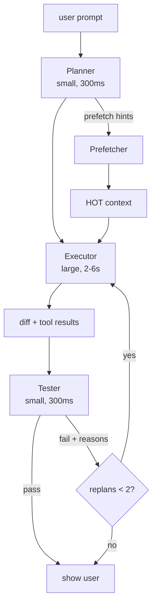

# ADR-0003: Tri-model pipeline — plan → execute → test как сквозной конвейер

**Дата:** 2026-10-18
**Статус:** Proposed
**Связанные ADR:** ADR-0008 (router), ADR-0009 (streaming+early-exit), ADR-0011 (batch), ADR-0015 (best-of-N)

## Контекст

Все 5 SOTA-агентов реализуют цикл «запрос → инструменты → ответ» с одной моделью. Это означает:

- **Дорогая модель делает всю работу.** Sonnet/GPT-5/DeepSeek-V3 используется даже для тривиальных операций («прочитай файл и ответь, есть ли там функция X») — это дорого и медленно.
- **Нет самопроверки.** Если модель ошиблась, пользователь заметит это сам, инициирует ещё один ход — ещё один дорогой LLM-вызов.
- **Нет разделения ответственности.** Одна модель и планирует (декомпозирует задачу), и выполняет (пишет код), и проверяет (смотрит, работает ли). Это разные когнитивные задачи, и для них оптимальны разные модели.

Ближе всех к решению — MiMo с `Max Mode` (best-of-N + judge) и `goal+judge`. Но у MiMo это надстройка над циклом, не сам цикл. У всех остальных тестирование — внешняя активность пользователя.

**Противоречие (ТРИЗ):** модель должна **глубоко рассуждать** (для сложных задач), и модель должна **отвечать быстро** (для UX). Одна модель не может одновременно быть большой (для рассуждений) и маленькой (для скорости).

## Решение

Разделить ход на **три фазы**, каждая со своей моделью:

### Фаза 1 — Planner (small model, 200–400 ms)

Маленькая модель (Haiku / 4o-mini / Qwen-3B / local-7B):
1. Декомпозирует пользовательский промпт в plan из 1–N шагов.
2. Выдаёт **список символов/файлов**, нужных для выполнения (prefetch hints — см. ADR-0004).
3. Формулирует **success criteria** — проверяемые условия, по которым tester решит, прошёл ли ход.
4. Помечает сложность: `trivial` / `normal` / `hard` — это влияет на routing (ADR-0008).

Planner **не пишет код**. Его задача — структурировать.

### Фаза 2 — Executor (large model, 2–6 s)

Большая модель (Sonnet / GPT-5 / DeepSeek-V3):
1. Получает HOT-контекст (уже собранный prefetcher'ом) + plan + criteria.
2. Выполняет plan — генерирует tool-calls (read, edit, bash, LSP-queries).
3. Produce итоговый diff.

Executor работает с уже собранным контекстом — без обратных ходов «ой, дай ещё файл».

### Фаза 3 — Tester (small model, 200–400 ms)

Маленькая модель:
1. Получает: criteria от planner + diff от executor + результат запуска тестов/lint/typecheck.
2. Выносит verdict: `pass` / `fail` + конкретные причины.
3. Если `fail` — формирует feedback для replan.

Tester **не рассуждает открыто** — он проверяет критерии. Узкий контекст → маленькая модель → дёшево и быстро.

### Replan loop

Если tester выносит `fail`, ход идёт на replan с feedback. Лимит — 2 replan-итерации; дальше — показ пользователю с пометкой «не получилось, вот что tester нашёл».

## Положительные последствия

- **Latency типичного хода:** 2.7–7.6 s (planner + prefetch параллельно + executor + tester) против 11–33 s у SOTA.
- **Стоимость падает на 40–70%.** Planner и tester на маленькой модели — копейки; executor работает с готовым HOT, без итераций «дай ещё файл».
- **Self-verifying из коробки.** Каждый ход протестирован. Пользователь не получает «сломанный» код (с вероятностью >95% при хорошем tester).
- **Естественная база для batch pipeline** (ADR-0011) — конвейер уже есть, остался runner.
- **Естественная база для best-of-N** (ADR-0015) — просто запускаем N executors параллельно.

## Отрицательные последствия

- **Сложность оркестрации.** Три модели = три разных failure-mode. Нужна дисциплина обработки ошибок каждой фазы.
- **Planner может ошибиться.** Если planner не включил нужный символ в prefetch, executor будет делать retrieval-call → +одна LLM-итерация. Решение: planner всегда может попросить дополнительные retrieval-tools через tool-call (но это редкая ситуация).
- **Tester может ложно провалить.** Маленькая модель хуже понимает сложный код. Решение: на hard-задачах tester — модель среднего размера (router решает, ADR-0008).
- **Не подходит для свободной беседы.** Если пользователь просто спросил «объясни мне X» — plan→execute→test избыточен. Решение: router пропускает такие ходы в single-pass режим (только executor, без planner/tester).

## Альтернативы

1. **Одна модель** (как SOTA). Отвергнуто: противоречие не разрешено.
2. **Planner + executor без tester** (как половина MiMo). Отвергнуто: нет self-verification, половина выгоды теряется.
3. **External judge только для long-running tasks** (как dsh goals). Отвергнуто: самопроверка нужна в каждом ходе, не только в долгих.
4. **Planner на классификаторе** (не LLM). Рассматривается как будущая оптимизация (ADR-0016): tiny BERT-классификатор для router-фаз, если planner-LLM окажется узким местом.

## Применённый ТРИЗ-принцип

- **Principle 1 — Segmentation.** Один ход сегментирован на три фазы с разными моделями.
- **Principle 35 — Parameter Change.** Смена «концентрации» модели: маленькая → большая → маленькая.
- **Principle 9 — Preliminary Anti-Action.** Tester — предварительная анти-действие против ошибок executor'а, до показа пользователю.
- **Principle 10 — Preliminary Action.** Planner заранее готовит контекст (prefetch hints) до запуска executor'а.
- **Principle 25 — Self-Service.** Tester не делает работу за executor'а — он только проверяет, опираясь на критерии.

## Идеальный финальный результат (IFR)

Пользователь не получает непроверенный ответ. Каждое действие агента — это mini-PR с встроенным code review. Стоимость этого review пренебрежимо мала по сравнению с ценой исправления ошибки пользователем.
