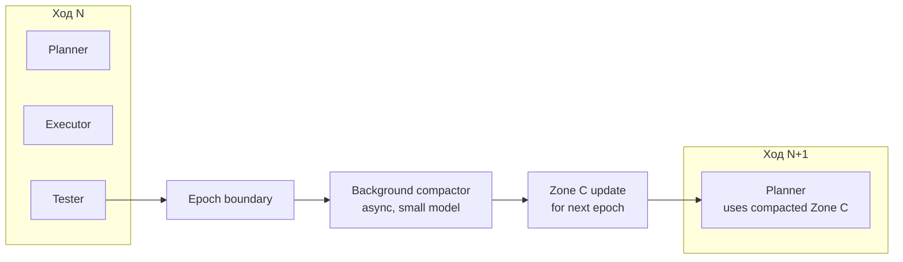

# ADR-0010: Background Compaction — фоновая компакция на границах ходов

**Дата:** 2026-10-18
**Статус:** Proposed
**Связанные ADR:** ADR-0001 (DFC), ADR-0007 (prompt-cache), ADR-0013 (diffs)

## Контекст

Все 5 SOTA-агентов делают компакцию **реактивно** — когда контекст приближается к лимиту окна. Это значит:

- Компакция происходит в **серёдине хода** → ломает prompt-cache (см. ADR-0007) → cache miss → дороже и медленнее.
- Компакция — это **отдельный LLM-вызов** (большой модели, чтобы она хорошо суммаризировала) → +5–15 s latency на ход, в котором компакция сработала.
- Компакция теряет детали — большая модель не идеальна в summarization, особенно технических деталей.
- Компакция непредсказуема — пользователь не знает, когда агент «забудет» важный контекст.

OpenCode Context Epoch — лучшее из существующих решений (стабильный prefix), но компакция всё ещё реактивная.

**Противоречие (ТРИЗ):** контекст должен быть **актуальным** (содержать всю важную историю), и контекст должен быть **компактным** (вмещаться в окно + быть cache-friendly).

## Решение

Ввести **фоновую компакцию на границах ходов**:

### Принцип

Компакция **никогда не происходит в середине хода**. Она происходит **только на границе хода** — после tester-фазы, перед следующим planner'ом. И она происходит **в фоне** — не блокируя следующий ход.

### Архитектура

### Как это работает

1. **Ход N завершён** — tester вынес verdict.
2. **Epoch boundary** — компактор запускается **в фоне**:
   - Берёт текущую Zone C (compacted summaries прошлых ходов) + лог хода N.
   - Маленькая модель (T0) генерирует новый summary — компактное представление того, что сделано в ходе N, что важно, что ещё нужно сделать.
   - Новый summary добавляется в Zone C (или заменяет самые старые summaries, если Zone C превышает бюджет 4–8 K токенов).
3. **Ход N+1 стартует немедленно** — не ждёт компактор. Если компактор ещё не закончил, ход N+1 использует **предыдущую** Zone C (cache hit!). Когда компактор закончит — следующий ход (N+2) возьмёт обновлённую Zone C.

### Что компактор сохраняет

- **Active plan** — что ещё нужно сделать (если задача многоходовая).
- **Success criteria** — чтобы tester следующих ходов знал, что проверять.
- **Decisions made** — какие файлы изменены, какие подходы отвергнуты.
- **Key facts** — имена символов, типов, важных значений (не текст, а **структурированные факты**).
- **Last error state** — если ход провалился, что именно пошло не так.

### Что компактор выбрасывает

- Промежуточные tool-results (большой `read`-вывод, длинный bash-output).
- Рассуждения executor'а, не приведшие к решению.
- Дублирующуюся информацию.

### Incremental compaction

Не «переписать всё», а **слить** старые summaries с новой. Маленькая модель делает merge: «вот старый summary + вот новый ход → новый summary». Это дешевле и быстрее, чем перекомпактить всю историю.

### Trigger

Компактор запускается на **каждой границе хода**, но с разной интенсивностью:

- **Light compact** (каждый ход): добавить summary хода в Zone C. Latency: 200–400 ms в фоне.
- **Heavy compact** (каждые 5 ходов, или когда Zone C > 6 K токенов): перепаковка всей Zone C в более плотный summary. Latency: 500–1500 ms в фоне.

## Положительные последствия

- **Cache никогда не ломается в середине хода** → cache hit 80–95% (см. ADR-0007).
- **Latency не страдает от компакции** — она в фоне.
- **Predictable behavior** — пользователь знает, что каждый ход компактор обновит Zone C на границе.
- **Incremental = дёшево.** Маленькая модель, маленькой задачей.
- **Recoverable** — полный session-log сохраняется (в ICE), компактор всегда может «распаковать» при необходимости.

## Отрицательные последствия

- **Один ход «отстаёт».** Ход N+1 видит Zone C без summary хода N (если компактор не успел). Решение: компактор приоритетизирует — лёгкий compact заканчивается обычно до старта следующего хода (200–400 ms < время на ввод пользователя).
- **Lossy.** Любая компакция теряет детали. Решение: критичные факты (success criteria, decisions) помечаются `pin: true` и не выбрасываются.
- **Background task management.** Нужно корректно обрабатывать случай, когда компактор ещё работает, а пользователь закрыл сессию. Решение: at-least-once persistence; компактор пишет в tmp, потом atomic-rename.

## Альтернативы

1. **Реактивная компакция** (как SOTA). Отвергнуто: ломает cache, непредсказуема, теряет детали в неподходящий момент.
2. **No compaction, only DFC layers.** Отвергнуто: Zone C рано или поздно переполнится, или нужно её ограничить искусственно.
3. **Compaction в середине хода, но с cache-breakpoint management.** Отвергнуто: всё равно +5–15 s latency на ход с компакцией.
4. **External summarization service** (отдельный процесс). Рассматривается как будущая оптимизация для очень длинных сессий; в v0.1 — in-process.

## Применённый ТРИЗ-принцип

- **Principle 19 — Periodic Action.** Компакция — периодическое действие на границах ходов, а не реактивное.
- **Principle 10 — Preliminary Action.** Компактор работает **до** того, как Zone C понадобится в обновлённом виде (ход N+1 может использовать старую, пока компактор делает новую).
- **Principle 20 — Continuity of Useful Action.** Фоновая компакция не блокирует основной ход.
- **Principle 15 — Dynamicity.** Light vs heavy compact — динамический выбор интенсивности.
- **Principle 2 — Taking Out.** Компакция «вынесена» из критического пути хода в фон.

## Идеальный финальный результат (IFR)

Контекст остаётся компактным и cache-friendly **автоматически**, без участия пользователя и без затрат на критическом пути. Модель всегда видит актуальный summary; детали — в ICE, доступны по требованию.
