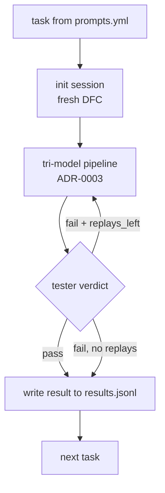

# ADR-0011: Batch Prompt Pipeline — `prompts.yml` → plan/execute/test → `results.jsonl`

**Дата:** 2026-10-18
**Статус:** Proposed
**Связанные ADR:** ADR-0003 (tri-model), ADR-0009 (early-exit), ADR-0015 (best-of-N)

## Контекст

Все 5 SOTA-агентов — **интерактивные**. У них нет режима «дай список задач, я прогоню их все». Это значит:

- Нет встроенного benchmark'а — нельзя сравнить версию N с версией N+1 по метрикам.
- Нет CI-режима — нельзя прогнать агента на наборе задач в GitHub Actions и убедиться, что ничего не сломалось.
- Нет оценки моделей — нельзя прогнать один и тот же список через разные модели и сравнить.
- Нет режима «ночной прогон 100 задач» — автономной работы нет (только у dsh/MiMo через cron, но это не pipeline, а single-task).

Пользователь хочет: «загрузить список промптов, каждый промпт планируется, выполняется, тестируется разными моделями, результаты сохраняются». Это именно **batch pipeline**.

**Противоречие (ТРИЗ):** агент должен быть **интерактивным** (быстрая обратная связь с пользователем), и агент должен быть **автономным batch-процессором** (прогон длинных списков без участия).

## Решение

Ввести **batch runner** — отдельный компонент (CLI: `orya batch prompts.yml`), который:

1. Загружает список промптов из YAML.
2. Для каждого промпта прогоняет tri-model pipeline (ADR-0003).
3. Сохраняет результат в `results.jsonl`.
4. Опционально — параллельно (несколько промптов в работе одновременно).

### Формат `prompts.yml`

```yaml
# prompts.yml — benchmark for OryaAgent
metadata:
  name: "orya-benchmark-v1"
  description: "End-to-end tasks on test repo"
  parallel: 2  # concurrent prompts in processing
  default_timeout_s: 120

tasks:
  - id: task-001
    prompt: "Add a /health endpoint to the FastAPI app in src/api.py"
    expected: "GET /health returns 200 {status: ok}"
    criteria:
      - "endpoint exists at /health"
      - "test_health in tests/test_api.py passes"
      - "no lint errors in src/api.py"
    tier: normal  # routing hint
    timeout_s: 60

  - id: task-002
    prompt: "Refactor UserService.create to use asyncpg instead of psycopg2"
    criteria:
      - "all tests pass"
      - "no psycopg2 imports remain in user_service.py"
      - "no type errors"
    tier: hard
    parallel_n: 3  # best-of-N (ADR-0015)
    timeout_s: 180

  - id: task-003
    prompt: "Find all functions in src/ that don't have type hints and add them"
    criteria:
      - "100% of functions in src/ have type hints"
      - "all tests still pass"
    tier: normal
    timeout_s: 120
```

### Формат `results.jsonl`

```json
{"id":"task-001","status":"pass","duration_ms":4823,"attempts":1,"tokens":{"planner":1200,"executor":8400,"tester":600},"cost_usd":0.018,"diff":"...","test_log":"...","models":{"planner":"qwen-3b","executor":"sonnet-4.5","tester":"qwen-3b"}}
{"id":"task-002","status":"pass","duration_ms":14210,"attempts":1,"tokens":{"planner":1800,"executor":24500,"tester":900},"cost_usd":0.094,"diff":"...","test_log":"...","models":{"planner":"qwen-3b","executor":"opus-4.5","tester":"sonnet-4.5","best_of_n":3,"winner":2}}
{"id":"task-003","status":"fail","duration_ms":119800,"attempts":3,"tokens":{...},"cost_usd":0.412,"diff":"...","test_log":"...","failure_reason":"timeout after 120s, only 40% of functions had type hints"}
```

### Параметры запуска

- `--parallel N` — сколько промптов одновременно (по умолчанию 1; для CI — 2–4).
- `--tier T0|T1|T2|auto` — фиксированный тир или auto-routing (ADR-0008).
- `--best-of N` — глобальный best-of-N (для benchmark'а моделей).
- `--model-map planner=...,executor=...,tester=...` — явно задать модели.
- `--continue results.jsonl` — продолжить с того места, где остановились (пропустить уже готовые).
- `--fail-fast` — остановить весь прогон при первом fail.

### Конвейер одной задачи



### Использование

1. **Self-benchmark.** Прогон `prompts.yml` на main и на PR-ветке — сравнение метрик (latency, cost, pass rate). CI-gate: PR не мёрджится, если pass rate упал.
2. **Model comparison.** Прогон того же `prompts.yml` с разными `--model-map` — какая модель лучше на каких задачах.
3. **Autonomous runs.** Ночной прогон 100 задач на свежем репо — утром review результатов.
4. **Regression suite.** Набор известных проблемных кейсов — каждый релиз проверяет, что они не сломались.

### Aggregate stats

После прогона — `aggregate_stats.json`:

```json
{
  "total": 50,
  "passed": 42,
  "failed": 8,
  "pass_rate": 0.84,
  "avg_duration_ms": 8234,
  "p95_duration_ms": 24500,
  "total_cost_usd": 4.21,
  "total_tokens": 1240000,
  "by_tier": { "trivial": {"count": 12, "pass": 12}, "normal": {"count": 30, "pass": 26}, "hard": {"count": 8, "pass": 4} }
}
```

## Положительные последствия

- **Встроенный benchmark** — каждый релиз измерим, не «кажется лучше».
- **CI-gate** — regression на типовых задачах ловится до релиза.
- **Model comparison** — данные для решений «какую модель в прод».
- **Autonomous режим** — ночные прогоны, batch-задачи.
- **Same pipeline as interactive** — нет отдельного кода для batch; tri-model pipeline работает в обоих режимах.

## Отрицательные последствия

- **Cost.** Прогон 50 задач = $4–20 в зависимости от тиров. Решение: бюджет в metadata.yml; runner останавливается при превышении.
- **State isolation.** Каждая задача должна стартовать с чистым DFC. Решение: per-task session, полный reset между задачами.
- **Reproducibility.** LLM-выводы недетерминированны; один прогон != другой. Решение: `temperature: 0` по умолчанию в batch; фиксация seed'ов где возможно.
- **Test repo.** Нужен стабильный репо для тестовых задач. Решение: `fixtures/` в репо OryaAgent, копируется в tmp на каждый прогон.

## Альтернативы

1. **Только интерактив.** Отвергнуто: нет benchmark, нет CI-gate.
2. **External benchmark** (типа SWE-bench). Рассматривается как дополнительный набор tasks; но не заменяет собственный `prompts.yml`.
3. **Cron + single-task** (как MiMo). Отвергнуто: нет списка, нет агрегированной статистики.
4. **Human evaluation.** Отвергнуто как основной метод — медленно, субъективно, не масштабируется.

## Применённый ТРИЗ-принцип

- **Principle 10 — Preliminary Action.** Список промптов готовится заранее, прогон — автоматически.
- **Principle 20 — Continuity of Useful Action.** Параллельные задачи (N=2–4) не дают простаивать ресурсам.
- **Principle 25 — Self-Service.** Pipeline сам планирует, исполняет, тестирует — без человека.
- **Principle 35 — Parameter Change.** `--tier`, `--model-map`, `--best-of` — параметризация под цель.
- **Principle 9 — Preliminary Anti-Action.** `--fail-fast` — предварительная защита от долгих прогонов на сломанной версии.

## Идеальный финальный результат (IFR)

Любое изменение в агенте измеримо за минуты. Regression ловится до релиза. Сравнение моделей — одна команда. Стоимость прогона предсказуема и контролируема.
