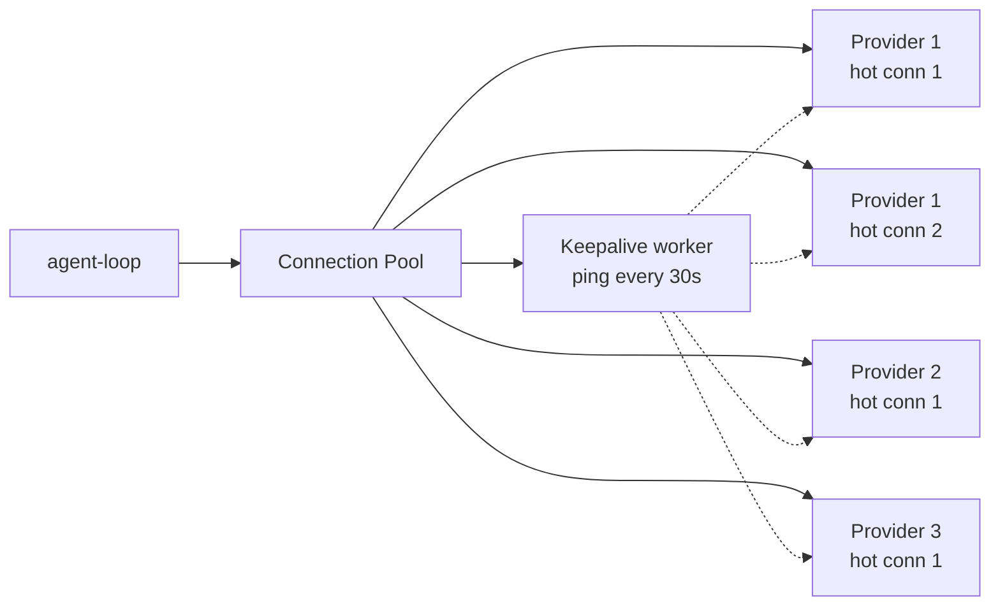

# ADR-0014: Connection Pool with Keepalive — горячий пул коннектов к LLM-провайдерам

**Дата:** 2026-10-18
**Статус:** Proposed
**Связанные ADR:** ADR-0008 (routing), ADR-0009 (streaming)

## Контекст

Современные LLM-провайдеры общаются по HTTPS + Server-Sent Events (для streaming). Каждый холодный HTTPS-вызов включает:

- **DNS lookup** — 10–100 ms (если не cached).
- **TCP handshake** — 1 RTT (~30–100 ms типично, до 300 ms на плохих сетях).
- **TLS handshake** — 1–2 RTT (~50–200 ms).
- **HTTP/2 negotiation** — обычно в TLS ALPN, бесплатно.
- **Auth (Bearer token check)** — на стороне сервера, 5–20 ms.

Суммарно: **90–500 ms на каждый холодный HTTPS-запрос**. На типичном ходе (3 LLM-фазы: planner + executor + tester) — это **270–1500 ms чистого network overhead**, сверх собственно inference latency.

Все 5 SOTA-агентов используют стандартные HTTP-клиенты (fetch / undici / axios) без явного управления пулом коннектов. Многие делают `fetch()` с дефолтными настройками, которые **не переиспользуют TLS-sessions оптимально** — особенно при idle-периодах >30 s (typical между ходами пользователя).

**Противоречие (ТРИЗ):** соединения должны быть **открытыми** (для low-latency), и соединения должны быть **закрытыми** (ресурсы не бесконечны).

## Решение

Ввести **connection pool с keepalive** для всех LLM-провайдеров:

### Архитектура



### Параметры пула

- **Per-provider hot connections:** 1–2 (по умолчанию 1; 2 для провайдеров, на которых идут parallel best-of-N).
- **HTTP/2** обязательно — multiplexing позволяет делать много requests на одном connection.
- **TLS session resumption** — включён (session tickets).
- **Keepalive:** TCP-level keepalive каждые 30 s; HTTP-level ping (HEAD на health-endpoint) каждые 60 s, если нет реального трафика.
- **Idle timeout:** 5 min без трафика → connection закрывается (новый откроется при следующем запросе, +200 ms — приемлемо).

### Pre-warm при старте сессии

При старте агента — открыть connection к **основному** провайдеру (по конфигу). Не к «потенциальным» — только к тем, что в `~/.orya/providers.yml` помечены как `default: true` или `prewarm: true`.

```typescript
async function prewarmProviders(config: Config) {
  const targets = config.providers.filter(p => p.default || p.prewarm);
  await Promise.all(targets.map(p => openConnection(p)));
}
```

### Multi-tier готовность

Поскольку есть tiered routing (ADR-0008), пул держит connection к:
- T0-провайдеру (для planner/tester).
- T1-провайдеру (для normal executor).
- T2-провайдеру (для hard executor).

Если все три тира на одном провайдере (например, всё у Anthropic) — один connection с HTTP/2 multiplexing. Если на разных (T0 локально, T1 у Anthropic, T2 у OpenAI) — три connection'а.

### Streaming-friendly

Streaming (SSE) — это long-lived HTTP-запрос. На время streaming connection «занят». Решение:
- Для streaming — отдельный connection из пула (или HTTP/2 stream на том же connection).
- Pool размером 2–4 на провайдера, чтобы выдержать параллельные ходы (в batch-режиме, ADR-0011).

### Failure handling

- Если connection упал — pool автоматически открывает новый, ретраит текущий запрос (с экспоненциальным backoff).
- Circuit breaker: если провайдер упал 5 раз за минуту — mark down на 60 s, reroute на fallback-провайдер (по конфигу).

### Метрики

Pool экспонирует:
- `pool.hits` — переиспользования connection.
- `pool.misses` — холодные открытия.
- `pool.reconnects` — упавшие connection.
- `pool.avg_handshake_ms` — если cold-start случился, сколько стоил.

В TUI: `/pool-stats` — посмотреть метрики.

## Положительные последствия

- **Network overhead на ход: 0–50 ms** (только HTTP/2 stream init) против 270–1500 ms без пула.
- **Latency первого токена падает на 100–500 ms.**
- **Stability.** Circuit breaker + auto-reconnect — пользователь не видит «сетевых» ошибок.
- **Multi-provider готовность.** Tier-routing (ADR-0008) работает без cold-start penalty при переключении тира.

## Отрицательные последствия

- **Resources.** Каждый open connection = ~1 MB RAM + сокет в OS. На 4 провайдера × 2 = 8 MB — незаметно.
- **Idle keepalive traffic.** 60 s ping × 8 connections = ~8 requests/min — пренебрежимо.
- **Сложность testing.** Mock-провайдеры в тестах должны поддерживать keepalive-семантику. Решение: в тестах — `pool: 'mock'` mode, без реального keepalive.
- **Provider-specific особенности.** Некоторые провайдеры (Cloudflare fronted) могут закрыть connection раньше нашего idle timeout. Решение: detect-and-reopen прозрачно для agent-loop.

## Альтернативы

1. **Без пула** (как SOTA). Отвергнуто: 270–1500 ms overhead на каждый ход.
2. **HTTP/1.1 + keep-alive header.** Отвергнуто: HTTP/1.1 не multiplex — один request на connection; для parallel нужен pool большего размера.
3. **gRPC.** Отвергнуто: большинство LLM-провайдеров не поддерживают; добавляет зависимость.
4. **WebSocket.** Рассматривается для будущего (если провайдеры начнут поддерживать); сейчас SSE — стандарт.

## Применённый ТРИЗ-принцип

- **Principle 11 — Beforehand Cushioning.** Connection открывается заранее, до того, как понадобится.
- **Principle 10 — Preliminary Action.** Pre-warm при старте сессии.
- **Principle 20 — Continuity of Useful Action.** Keepalive поддерживает connection живым между ходами.
- **Principle 35 — Parameter Change.** Pool размер и idle timeout — настраиваемые параметры под нагрузку.
- **Principle 9 — Preliminary Anti-Action.** Circuit breaker — предварительная защита от каскадных ошибок.

## Идеальный финальный результат (IFR)

Network overhead на ход → 0. Первое действие пользователя после 30-минутного перерыва — мгновенно. Многотировая маршрутизация не платит cold-start penalty при переключении.
