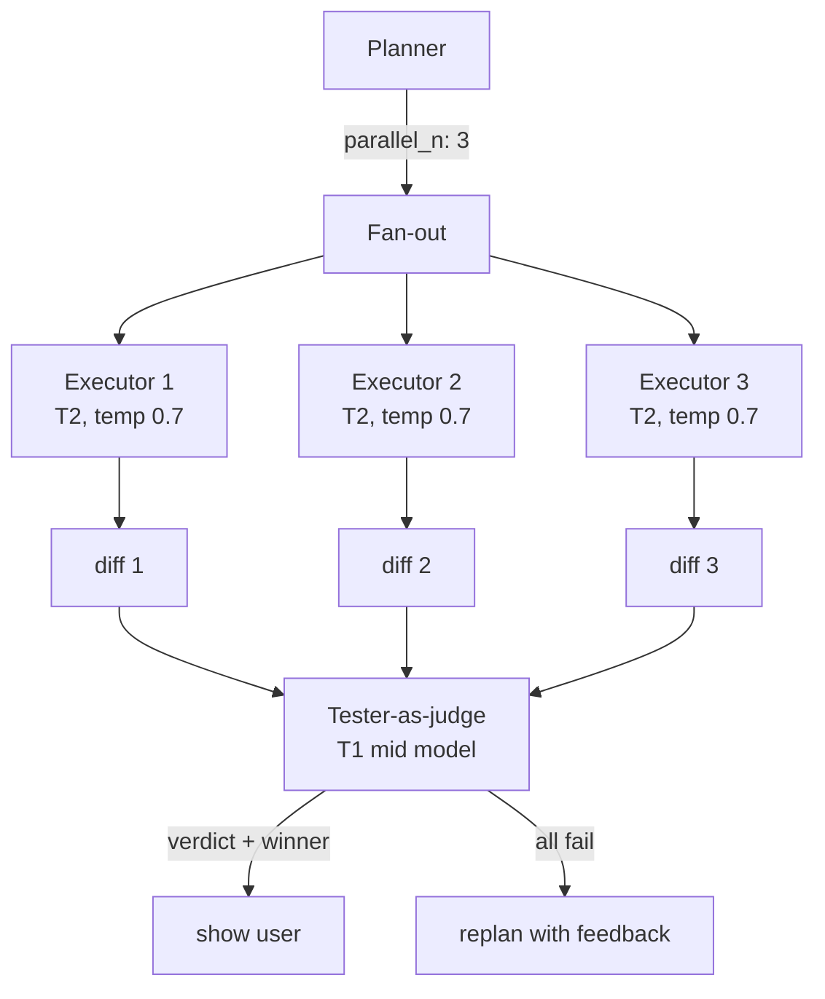

# ADR-0015: Tree of Thoughts (Max Mode) — параллельный best-of-N с judge

**Дата:** 2026-10-18
**Статус:** Proposed
**Связанные ADR:** ADR-0003 (tri-model), ADR-0008 (routing), ADR-0011 (batch)

## Контекст

На сложных задачах одна генерация executor'а часто даёт **неоптимальный** результат:

- Модель может пойти в неверном направлении с первых токенов.
- На задачах с несколькими валидными подходами — выбор зависит от случайностей decoding'а.
- Один проход не даёт возможности сравнить альтернативы.

MiMo реализует `Max Mode` — best-of-N с judge-выбором. Это даёт **+15–30% pass-rate** на hard-задачах, но стоит ×N. У MiMo это надстройка над циклом.

В OryaAgent уже есть tester-фаза (ADR-0003). Логичный следующий шаг — **параллельные executors + tester как judge**. Это не «дополнительный режим», а естественная расширение конвейера для `hard`-задач.

**Противоречие (ТРИЗ):** качество должно быть **высоким** (несколько попыток, сравнение), и стоимость должна быть **приемлемой** (не ×N на каждый ход).

## Решение

Ввести **Tree of Thoughts (Max Mode)** как естественное расширение tri-model pipeline для `hard`-задач:

### Триггер

Planner-фаза (ADR-0003) помечает задачу как `hard` (ADR-0008) и **опционально** указывает `parallel_n: K` (по умолчанию 3 для hard, 1 для normal/trivial).

Также planner может указать `parallel_n: K` явно на любой задаче, если хочет сравнить подходы.

### Конвейер

### Выбор моделей для веток

- **Все ветки на одной модели** (по умолчанию) — но с разным `temperature` (0.5, 0.7, 0.9) для диверсификации.
- **Разные модели** (опционально) — `--best-of-models "sonnet,opus,deepseek-v3"` для cross-model сравнения. Это особенно полезно в batch-режиме (ADR-0011) для model benchmarking.

### Tester-as-judge

Tester (ADR-0003) расширяется: вместо проверки одного diff против критериев — **ранжирование** K diffs:

1. Каждый diff проверяется против criteria: `pass` / `fail` + reasons.
2. Среди `pass`-diffs — выбор лучшего по:
   - Completeness (все criteria выполнены).
   - Code quality (test log, lint clean, no warnings).
   - Minimal diff (меньше изменений — лучше, при прочих равных).
3. Если все `fail` — выбирается «наименее плохой» + формируется feedback для replan.

### Early-exit в Max Mode

Если в Max Mode один из executors **уже прошёл tester** (pass) — другие можно прервать (ADR-0009). Это даёт существенную экономию: вместо ×N — часто ×1.5–2 в реальности (быстрый победитель обрывает медленных).

Это работает только если **тестирование не дожидается всех** — каждый diff тестируется немедленно по готовности.

### Cost control

- По умолчанию `parallel_n: 3` для hard, 1 для остальных.
- `--max-parallel-cost $X` — бюджет, после которого fan-out прекращается (даже на hard).
- В batch-режиме — `parallel_n` в `prompts.yml` per-task.

### Когда не использовать Max Mode

- `trivial`-задачи — всегда `parallel_n: 1`.
- Свободная беседа («объясни мне X») — не код-задача, Max Mode не нужен.
- Planner пометил `parallel_n: 1` явно — даже на hard-задаче, если planner уверен в подходе.

## Положительные последствия

- **+15–30% pass-rate на hard-задачах** (по данным MiMo, наши оценки сопоставимы).
- **Cross-model сравнение** в batch-режиме — ценные данные для model selection.
- **Early-exit экономит 30–60% стоимости Max Mode** — быстрый победитель обрывает остальных.
- **Естественная интеграция с tester'ом** — judge не отдельный механизм, а расширение tester'а.

## Отрицательные последствия

- **Стоимость ×N** на hard-задачах без early-exit. Решение: раннее тестирование каждого diff'а.
- **Сложность логирования.** K параллельных executors — K streams в логе. Решение: per-executor sub-sessions, в TUI — карточка per executor с live-status.
- **Риск «все плохие»** — если задача действительно сложная, N плохих не лучше одного. Решение: replan с feedback'ом от judge (вместо brute force ×N×M).
- **Resource pressure.** 3 параллельных T2-вызова — это 3× cost и 3× rate-limit pressure. Решение: пул коннектов (ADR-0014) + rate-limit-aware scheduler.

## Альтернативы

1. **Без Max Mode** (как большинство SOTA). Отвергнуто: -15–30% pass-rate на hard.
2. **Sequential retries** (если первый fail, попробовать ещё раз). Отвергнуто: нет сравнения; latency ×N вместо max.
3. **External judge-модель** (отдельная от tester'а). Отвергнуто: дублирование; tester уже умеет проверять критерии.
4. **Always Max Mode** (на всех задачах). Отвергнуто: дорого для trivial; `parallel_n: 1` по умолчанию.

## Применённый ТРИЗ-принцип

- **Principle 1 — Segmentation.** Одна задача → N параллельных веток.
- **Principle 35 — Parameter Change.** Разные temperature / модели в ветках для диверсификации.
- **Principle 9 — Preliminary Anti-Action.** Early-exit — предотвращение трат cycles после того, как победитель найден.
- **Principle 20 — Continuity of Useful Action.** Параллельные ветки не простаивают.
- **Principle 25 — Self-Service.** Tester сам выбирает лучшего — не пользователь, не planner.
- **Principle 40 — Composite Materials.** Композиция моделей / температур в одном конвейере.

## Идеальный финальный результат (IFR)

На сложной задаче агент сам понимает, что нужно «подумать несколькими способами», и выбирает лучший — за то же время, что и один проход (благодаря параллельности), и с максимальным качеством (благодаря сравнению). Cost-N оправдан pass-rate'ом там, где один проход не справляется.
