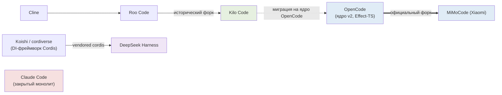
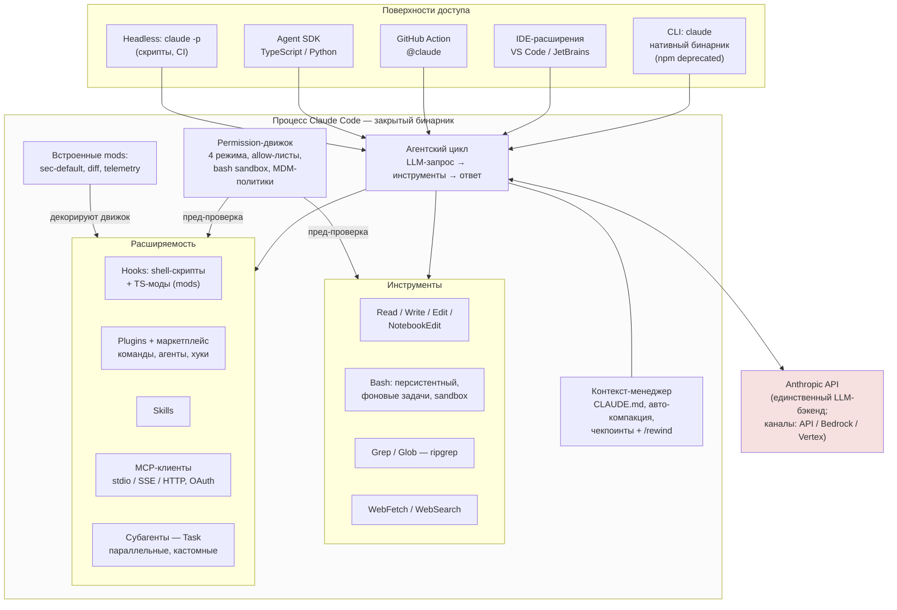
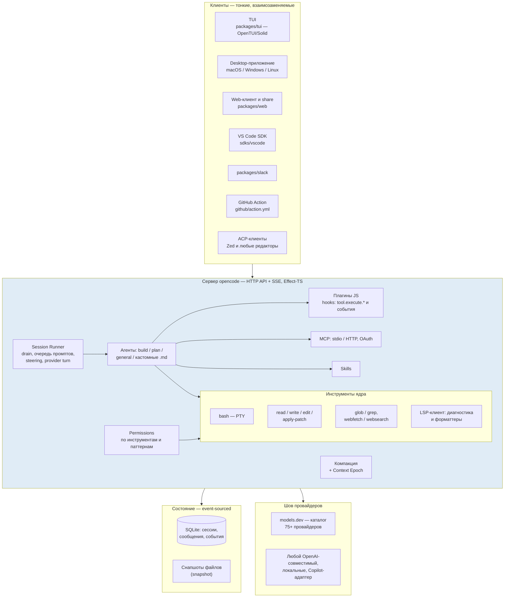
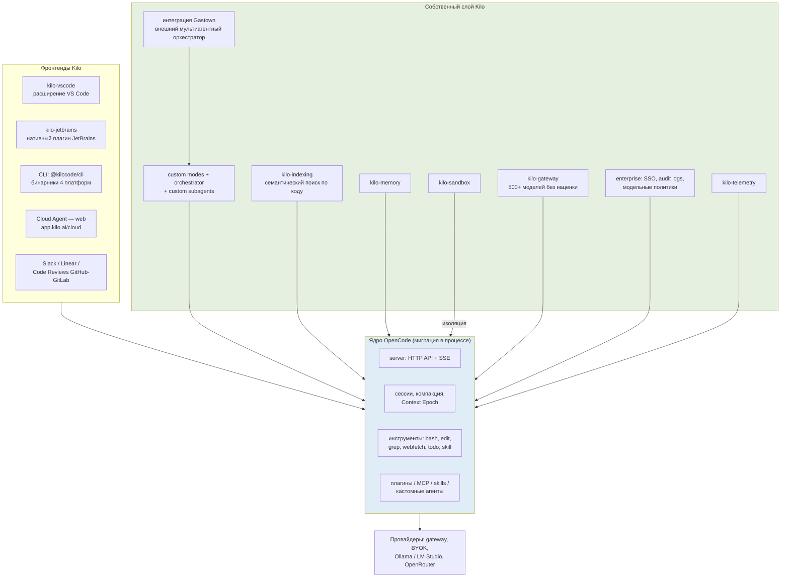
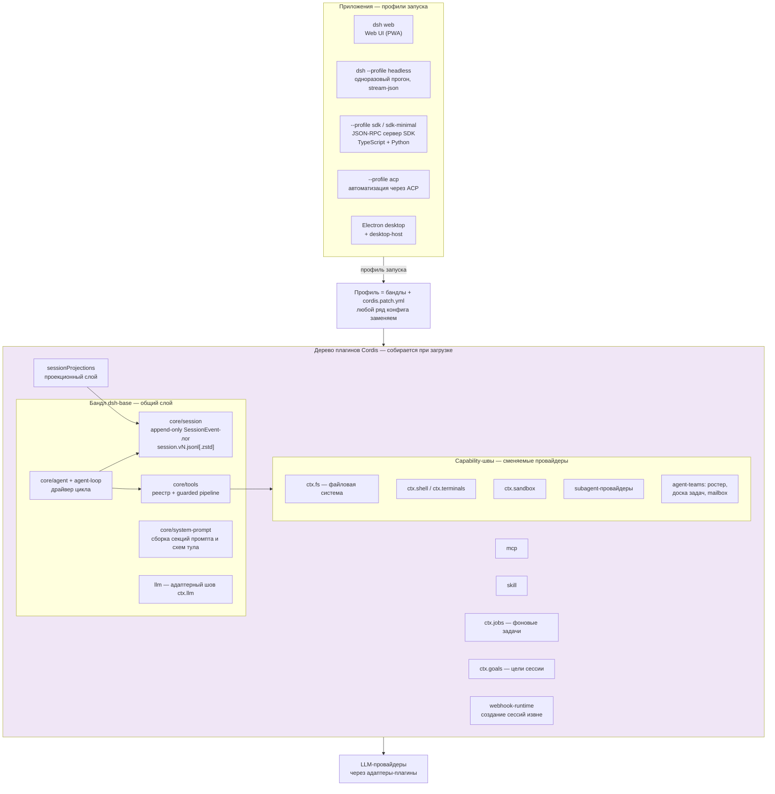
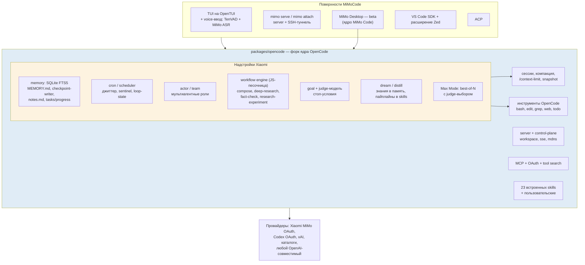

# Архитектуры ИИ-агентов для кодинга (agents-architect)

**Дата анализа:** 11 сентября 2026
**Методология:** схемы построены по фактической структуре монорепозиториев (состав пакетов, каталоги `src/`, спецификации `specs/`, встроенная документация и тесты), скачанных из GitHub 11.09.2026: `anthropics/claude-code`, `kilo-org/kilocode`, `anomalyco/opencode` (ветка `dev`), `deepseek-ai/deepseek-harness`, `XiaomiMiMo/MiMo-Code`. LLM-модели в сравнение не включаются — они изображены как внешний «шов» (adapter/provider seam).

---

## 0. Карта родословных

Ключ к пониманию всех пяти архитектур — три генеалогические линии:

Фактически на рынке три независимые архитектурные школы: **закрытый монолит** (Claude Code), **открытое клиент-серверное ядро + форки** (OpenCode → Kilo, MiMo) и **плагинная микро-ОС** (DeepSeek Harness на Cordis).

---

## 1. Claude Code — закрытый монолит с открытой плагинной оболочкой

### 1.1 Схема

### 1.2 Разбор

**Процессная модель — монолит.** Весь агент (UI-REPL, цикл, инструменты, права) живёт в одном нативном бинарнике (Node/Bun-сборка). Репозиторий на GitHub не содержит исходников ядра — это дистрибуционный хаб: README, CHANGELOG, примеры корпоративных настроек (MDM, LLM-гейтвеи AWS/GCP), официальный каталог плагинов и исходники трёх встроенных **mods**.

**Инструменты выполняются in-process**, кроме MCP-серверов (внешние процессы) и hooks (shell-команды / новые TypeScript-хук-модули с событиями движка: `register(on, options)`, обработчики `($, e, next)`). Мод-механизм (early access) — это плагины, вшитые в бинарник: `sec-default` изолирует корпоративные политики от пользовательских плагинов, `diff` рисует панель незакоммиченных изменений, `telemetry` даёт первым лицам аналитику.

**Контекст и память:** CLAUDE.md-файлы иерархии «проект → пользователь → организация», автоматическая компакция, система чекпоинтов с откатом (`/rewind`), микрокомпакция. Состояние сессий хранится локально в JSONL.

**Безопасность — сильнейшая сторона архитектуры:** permission-режимы (default / acceptEdits / plan / bypassPermissions), гранулярные allow-листы, песочница bash (настраиваемая, пример `settings-bash-sandbox.json` в репозитории), hooks как детерминированный «гейт» перед любым инструментом, MDM/managed settings для организаций, OTel-телеметрия.

**Слабое место — жёсткая связка с бэкендом Anthropic:** выбора провайдера нет по дизайну; харнесс и модель ко-эволюционируют (промпт-кэширование, thinking-блоки). Для всех остальных агентов из обзора LLM-бэкенд — сменяемый шов.

---

## 2. OpenCode — клиент-серверная платформа (родоначальник линии)

### 2.1 Схема

### 2.2 Разбор

**Ключевое решение — разделение клиента и сервера.** Ядро (`packages/core` на Effect-TS) не знает про терминал: оно публикует HTTP API + OpenAPI (`packages/server`, `httpapi-codegen` генерирует SDK). Все поверхности — TUI на OpenTUI/Solid, desktop-приложение, web, Slack, GitHub Action, ACP-сервер (`packages/opencode/src/acp`) — потребители одного API. Это и сделало OpenCode «материнской платформой»: форкнуть ядро и прикрутить свой фронтенд — тривиально (так появились Kilo и MiMo).

**Состояние — event-sourced SQLite:** сессии и сообщения хранятся как поток событий; поверх — проекции. Спецификации v2 (`specs/v2/session.md`) описывают продвинутую модель контекста: **Context Epoch** (неизменяемый базовый системный контекст как стабильный префикс для provider-cache), **Mid-Conversation System Messages** (дюрабельные обновления контекста на границах ходов), **Admitted Prompt / Prompt Promotion** (управление очередью ввода и steering).

**Инструменты** типизированы через один опак-конструктор `Tool.make` (вход/выход — схемы-кодеки, отмена через Effect interruption); реестр регистрирует их по именам с провайдер-нейтральной грамматикой.

**Расширяемость:** MCP + JS-плагины (хуки до/после инструмента, подписка на события, собственные провайдеры) + skills + кастомные агенты в `.opencode/agent/*.md`.

**Что не вошло в ядро:** оркестратор подзадач, команды агентов с доской задач, цели с судьёй, cron, sandbox, постоянная память — всё это достраивают наследники.

## 3. Kilo Code — ядро OpenCode + мультиплатформенный и enterprise-слой

### 3.1 Схема

### 3.2 Разбор

**Гибридная архитектура — след эволюции, а не дизайна.** Исторически Kilo Code был расширением VS Code на кодовой базе Roo Code/Cline (webview-UI ↔ контроллер в extension host ↔ исполнители инструментов через VS Code API, чекпоинты через shadow-git). В 2026 монорепозиторий переводится на **ядро OpenCode**: в репозитории лежат те же пакеты (`opencode`, `core`, `server`, `schema`, `session-ui`, `tui`, `plugin`, `llm`), что и у OpenCode, плюс документ `opencode-migration-plan.md` и разделы документации о «паритете» функций между платформами. CLI уже поставляется на новом ядре; IDE-фронтенды подключаются через HTTP API сервера.

**Слой Kilo — то, что добавлено поверх ядра:**
- **kilo-gateway** — прокси к 500+ моделям с единой квотой и «без наценки» (это же снимает с пользователя управление ключами);
- **kilo-indexing** (семантический индекс кодовой базы) и **kilo-memory** — то, чего нет в ядре OpenCode;
- **kilo-sandbox** — изоляция исполнения, которой ядро не имеет;
- организационный контур: enterprise (SSO, аудит, модельные политики), телеметрия, код-ревью как сервис, облачный агент.

**Мультиагентность:** custom modes и субагенты (наследие Roo-линии), orchestrator-режим с разбиением на подзадачи, agent-manager, плюс интеграция с внешним оркестратором Gastown.

**Архитектурный риск:** переходный период — две родословные в одном репозитории; задача №1 для команды — довести паритет VS Code/JetBrains/CLI на новом ядре.

---

## 4. DeepSeek Harness — «всё есть плагин» на Cordis

### 4.1 Схема

### 4.2 Разбор

**Единственный агент обзора без «привилегированного ядра».** Фреймворк **Cordis** (vendored из экосистемы Koishi) даёт контекст, в который плагины вкладывают сервисы, типизированные события и обратимо откатываемые регистрации. Модель-адаптер, реестр инструментов, лог сессий и сам агентский цикл — плагины; всё заменяется из конфигурации без патчей кода.

**Композиция запуска — три слоя:** *профиль* (именованный список бандлов: `web`, `headless`, `sdk`, `sdk-minimal`, `acp`) → *бандлы* (`dsh-base` + прикладные: web-app, headless, sdk-app, acp-app) → *патчи* (`cordis.patch.yml` на уровнях профиля/дома/--patch). Любой ряд конфига, который печатает `dsh --profile web --dump-config`, можно заменить. Профили веба поддерживают live-reload патчей.

**Сессия как источник истины.** Append-only `SessionEvent`-лог — единственный источник контекста модели; инвариант «model-visible means logged» проверяется рантаймом: всё, что видела модель, восстанавливается из лога. Формат версионированный (`session.v1.jsonl[.zstd]`, v2, v3) с цепочкой миграций и эксклюзивной публикацией новых поколений; неудавшиеся попытки стримов сохраняются как `assistant/attempt`, не попадая в историю модели. Поверх лога — обязательный проекционный шов `sessionProjections`.

**Событийные швы вместо точек расширения:** три домена — дюрабельные session-события, живые `agent/*` (inbox, шаг, запрос, валидация, продолжение, turn-stopping) и capability-события (`fs/*`, `tools/*`, `telemetry/*`). Waterfall-события требуют `next()` — это даёт цепочки промежуточных обработчиков, а не просто подписки.

**Мультиагентность через швы:** субагент — сменяемый провайдер за одним интерфейсом (от дочернего агента до делегирования во внешний продукт); поверх «продолжаемых» субагентов построены экспериментальные **Agent Teams** (дюрабельный ростер, доска задач, mailbox). Плюс форк сессий на границе хода и agent-пресеты с realm-изоляцией регистраций.

**Автономность:** фоновые `jobs`, цели сессии `ctx.goals`, webhook-правила (создание сессий по внешним событиям), планировщики, семантические чекпоинты, компакция.

**Изоляция:** fs/shell/terminals/sandbox — один «мир исполнения»: перенос fs+subprocess на удалённый песочный бэкенд автоматически переносит Bash, PTY и LSP без веток кода.

---

## 5. MiMoCode — форк OpenCode + слой автономности Xiaomi

### 5.1 Схема

### 5.2 Разбор

**Стратегия — «форк вместо ветки апстрима».** MiMoCode честно документирует родство: сохранены все возможности OpenCode (мультипровайдерность, TUI, LSP, MCP, плагины), и добавлен слой, который апстрим сознательно не строит. Дальнейшие синхронизации с апстримом — рукотворные (это цена стратегии форка).

**Слой Xiaomi закрывает три пробела OpenCode:**

1. **Память и контекст.** Постоянная кросс-сессионная память на SQLite FTS5: проектный `MEMORY.md`, автоматический **checkpoint-writer-субагент** (структурированный снимок состояния), заметки и прогресс задач; при подходе к лимиту окна контекст **реконструируется** заново из чекпоинта + памяти + последних сообщений; инъекции памяти — с токен-бюджетом и ранжированием важности; `/context-limit` позволяет занижать точку компакции на модель (экономия на ценовых порогах провайдеров). Мета-уровень: `/dream` выжимает знания из следов сессий в память, `/distill` упаковывает повторяющиеся ручные пайплайны в skills/субагенты/команды — контур самоулучшения.

2. **Автономность.** Модуль `cron` (расписания с джиттером и sentinel-файлами), **goal + stop-condition**: при попытке агента завершиться независимая judge-модель оценивает, достигнута ли цель; **workflows** — детерминированные JS-скрипты в песочнице, оркестрирующие фазы с ограниченными ретраями и автопараллелизмом в git-worktrees (compose-конвейер: brainstorm → design → implement → verify → review → merge); дерево задач T1/T1.1/…; Max Mode — параллельный best-of-N с судейским выбором.

3. **Поверхности.** `mimo serve`/`attach` для удалённой работы через SSH, десктоп-приложение (MiMo Desktop, ядром которого объявлен MiMo Code), голосовой ввод (VAD + ASR), режим `llm-server`, ACP, Zed-расширение.

**Инструменты** — форк набора OpenCode (bash/PTY, edit, grep, webfetch, todo, skill…), плюс свои доки-спеки на exec-инструменты, чекпоинт-райтера, MCP tool search и контроль бюджета контекста (`docs/compose/spec/*`).

**Компромиссы:** нет песочницы и enterprise-политик (низкий приоритет форка), двойное бремя сопровождения форка, в репозитории есть USE_RESTRICTIONS — ограничения на использование торговой марки и сервиса.

---

## 6. Сравнительная таблица архитектурных решений

| Измерение | Claude Code | OpenCode | Kilo Code | DeepSeek Harness | MiMoCode |
|---|---|---|---|---|---|
| **Процессная модель** | монолит: один закрытый бинарник | клиент-сервер: тонкие клиенты + сервер | клиент-сервер на ядре OpenCode + IDE-хосты | дерево плагинов Cordis + профили-приложения | форк OpenCode: клиент-сервер + надстройки |
| **Разделение UI и ядра** | нет (UI вшит) | да — HTTP API/SSE, OpenAPI-кодген SDK | да — через API ядра | да — Web UI, headless, SDK, ACP потребляют один рантайм | да — TUI/desktop/attach через сервер |
| **Язык / рантайм** | TS, нативная сборка (Node/Bun) | TypeScript, Bun, Effect-TS | TypeScript, Bun, Effect-TS | TypeScript, Node, Cordis (DI) | TypeScript, Bun, Effect-TS |
| **Хранение сессий** | локальные JSONL | event-sourced SQLite + снапшоты | как в OpenCode (+ память/индекс Kilo) | append-only JSONL-лог с версионными поколениями и zstd | event-sourced SQLite форка + FTS5-память |
| **Механизм расширения** | hooks (shell + TS-моды), плагины/маркетплейс, skills, MCP | JS-плагины, события, MCP, skills | всё ядро OpenCode + hub/маркетплейс + modes | плагины Cordis, швы-сервисы, профили/бандлы/патчи, MCP, skills | плагины ядра + workflows (JS) + skills + cron |
| **Мультиагентность** | Task-субагенты, кастомные агенты | general + кастомные агенты, @-упоминания | orchestrator, субагенты, agent-manager, Gastown | subagent-seam, Agent Teams, форк сессий | параллельные субагенты, compose-оркестратор, team/, Max Mode |
| **Изоляция / безопасность** | sandbox bash, permission-режимы, MDM, sec-default | permission-правила по паттернам | kilo-sandbox + enterprise-контур | sandbox/швы, approval-политики | permission-правила, без sandbox |
| **Автономные механизмы** | фоновый bash, headless, hooks-автоматизация | очередь промптов, GitHub Action | фоновые агенты, цели, ревью-сервис | jobs, goals, webhooks, расписания | cron, goal+judge, workflows, auto-worktree |
| **LLM-шов** | только Anthropic (Bedrock/Vertex) | models.dev, 75+, любой совместимый | gateway Kilo, 500+, BYOK, локальные | адаптеры-плагины ctx.llm | каталоги + OAuth + любой совместимый |
| **Ключевая архитектурная фишка** | самая богатая контурная автоматизация (hooks/plugins/mods) | одно ядро — все поверхности | ядро апстрима + enterprise-надстройка | «всё есть плагин», сессия-лог как истина | автономный слой: память + judge + workflows |

---

## 7. Архитектурные выводы

1. **Победила клиент-серверная схема.** Четыре агента из пяти (все, кроме Claude Code) строят одно серверное ядро с HTTP/SSE-API и набор взаимозаменяемых клиентов (TUI, desktop, web, IDE, ACP, SDK). Это одновременно и стратегия расширения экосистемы: OpenCode стал «материнским ядром» для Kilo и MiMo.
2. **Событийно-ориентированное хранение — стандарт де-факто.** OpenCode (SQLite + Context Epoch), dsh (append-only лог с «model-visible means logged») и MiMoCode (наследие OpenCode + FTS5-память) трактуют сессию как восстанавливаемый поток событий, а не строку сообщений. Claude Code с JSONL-файлами выглядит здесь наиболее традиционно.
3. **Три философии расширяемости:** детерминированные гейты (hooks/плагины Claude Code — максимальный контроль корпорации), открытые JS-хуки (OpenCode/форки — минимум трения) и полная инверсия контроля (Cordis в dsh — сам цикл агента заменяем). Выбор определяет целевую аудиторию: enterprise / prosumer / платформенные разработчики.
4. **Автономность надстраивается над циклом, а не в нём.** Cron, цели с судьёй, webhook-триггеры, фоновые jobs и workflow-движки у dsh и MiMoCode — всё это обёртки вокруг того же базового цикла «запрос → инструмент → наблюдение». Именно эти обёртки — главный дифференциатор 2026 года.
5. **Форкинг стал легитимной стратегией продукта** (Kilo, MiMo), а не побочным эффектом лицензии: оба форка публично документируют родство и вносят слой поверх ядра. Обратная сторона — рукотворная синхронизация с апстримом и переходные швы (Kilo).
6. **Claude Code остаётся архитектурным изолятом** — и одновременно носителем самой зрелой контурной автоматизации (hooks → mods → plugins → skills). Его модель «ко-эволюции харнесса с одной моделью» — осознанный размен универсальности на глубину интеграции; все остальные ставки сделали на провайдер-нейтральный шов.

