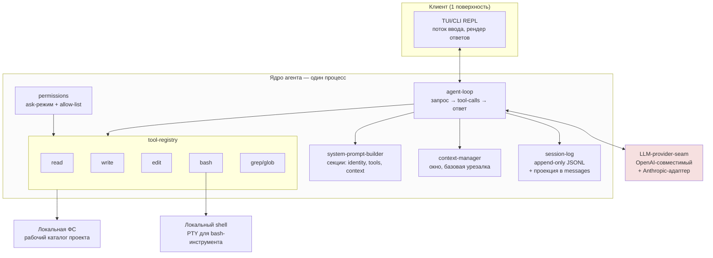

# Self-Agent MVP: выбор модулей по принципу 20/80

**Дата:** 13 сентября 2026
**Источник анализа:** `agents-architect.md` — сравнительный разбор архитектур Claude Code, OpenCode, Kilo Code, DeepSeek Harness, MiMoCode.
**Цель:** определить минимальный набор модулей для собственного LLM code-агента, который даёт ~80% полезности при ~20% усилий, и зафиксировать архитектурные решения.

---

## 1. Что показал обзор источников

Из сравнительной таблицы документа и шести архитектурных выводов вытащим шесть наблюдений, которые напрямую определяют выбор модулей для MVP.

**Во-первых, клиент-серверная схема победила.** Четыре из пяти агентов (все, кроме Claude Code) строят одно серверное ядро с HTTP/SSE-API и набором взаимозаменяемых клиентов. OpenCode стал «материнским ядром» для Kilo и MiMo — это доказывает, что разделение UI и ядра не дороже, а даёт бесплатный прирост в расширяемости. Для MVP это означает: ядро должно быть процессом с API, а не REPL-ом в терминале.

**Во-вторых, сессия — это поток событий, а не строка сообщений.** OpenCode (SQLite + Context Epoch), DeepSeek Harness (append-only JSONL с инвариантом «model-visible means logged») и MiMoCode (FTS5-память поверх лога) трактуют сессию как восстанавливаемый лог. Claude Code с JSONL выглядит здесь традиционно, и в выводах №2 документа это помечено как более слабое решение. Для MVP означает: сессия — append-only лог событий с проекцией в сообщения.

**В-третьих, LLM-шов обязателен как точка сменяемости.** Все, кроме Claude Code, ставят провайдер-нейтральный шов: OpenCode — `models.dev` + 75 провайдеров, Kilo — `kilo-gateway` с 500 моделями, dsh — `ctx.llm`, MiMo — каталоги + OAuth. Claude Code сознательно отказался от шва (ко-эволюция с Anthropic), но для собственного агента это недопустимо: шов делается с первого дня.

**В-четвёртых, автономность надстраивается над циклом, а не встраивается в него.** Cron, цели с судьёй, webhook-триггеры, фоновые jobs, workflow-движки у dsh и MiMo — всё это обёртки вокруг базового цикла «запрос → инструмент → наблюдение». Для MVP это означает: цикл делаем минимальным и чистым, автономность не трогаем вообще.

**В-пятых, инструменты выполняются in-process.** У всех пяти архитектур базовые инструменты (read/write/edit/bash/grep) — это функции в ядре, а не внешние процессы. MCP-серверы и hooks — внешние, но они — расширение, не ядро. Для MVP: инструменты — типизированные функции в реестре.

**В-шестых, базовый набор инструментов одинаков у всех.** Claude Code, OpenCode, Kilo, MiMo, dsh — все имеют read/write/edit/bash/grep/glob. Это стабильное ядро инструментов, проверенное пятью командами. Для MVP: ровно этот набор, без изобретательства.

---

## 2. Принцип 20/80: что в MVP, что откладывается

Принцип 20/80 здесь применяется так: из ~40 модулей и подсистем, описанных в документе, нужно выбрать те ~8, без которых агент не является кодинг-агентом, и которые в совокупности дают ~80% ценности продукта. Всё остальное — откладывается на v2+ или реализуется как заглушки.

### В MVP (20% усилий → 80% ценности)

| # | Модуль | Почему в MVP |
|---|--------|--------------|
| 1 | **LLM-провайдер-шов** | Сменяемость провайдера — единственный невосполнимый архитектурный шов. Не делается с первого дня → переписывание ядра. |
| 2 | **Агентский цикл** | Цикл «запрос → инструменты → ответ» — определение агента. Нет цикла → нет агента. |
| 3 | **Системный промпт-билдер** | Все 5 архитектур имеют отдельный модуль сборки секций промпта. Без него нельзя управлять поведением. |
| 4 | **Реестр инструментов + 5 базовых** | read/write/edit/bash/grep — обязательный минимум, подтверждённый всеми 5 командами. |
| 5 | **Сессии: append-only лог + проекция** | Сессия как поток событий — стандарт де-факто. Без проекции в сообщения нельзя показывать историю. |
| 6 | **Контекст-менеджер (базовый)** | Окно контекста конечно. Нужен минимальный механизм урезания/компакции. |
| 7 | **CLI/TUI клиент** | Один клиент — точка входа. Без него агентом нельзя пользоваться. |
| 8 | **Permissions (минимум: ask/allow-list)** | Bash без подтверждения — недопустимо. Минимум — ask-режим + статический allow-list. |

### Откладывается на v2+ (80% усилий → 20% ценности для MVP)

| Что откладывается | Почему | Когда вернуть |
|---|---|---|
| HTTP/SSE-сервер и OpenAPI-SDK | CLI уже работает; сервер нужен только для веб-клиентов и IDE-плагинов | v2 — когда появится второй клиент |
| Subagents / Task-делегирование | Один цикл решает 80% задач | v2 — когда задачи станут длиннее хода |
| Memory cross-session (SQLite FTS5) | Полезно, но требует решения по политике приватности | v2 — после стабилизации формата сессий |
| Cron / scheduler | Автономность надстраивается над циклом, MVP — интерактивный | v3 — вместе с goals+judge |
| Goals + judge-модель | Сложный механизм, нужен только автономному режиму | v3 |
| Workflows (JS-песочница) | Полный цикл уже даёт compose-поведение через промпт | v3 |
| Sandbox / изоляция | Bash с подтверждением покрывает MVP | v2 — для CI/headless-режима |
| MCP-клиент | Полезно, но не блокирует базовую работу | v2 — после стабилизации формата инструментов |
| Skills-система | Имеет смысл только с подустойчивым ядром | v2 |
| Hooks (pre/post tool) | Расширение, не ядро | v2 |
| Compaction + Context Epoch | Базовая урезалка достаточна для MVP | v2 — когда появятся длинные сессии |
| Multi-agent teams | Экспериментально даже у авторов | v3+ |
| Checkpoint-writer (как subagent) | Требует субагентов → откладывается | v3 |
| `/dream`, `/distill`, Max Mode | Контур самоулучшения — последняя фаза | v3+ |
| IDE-плагины (VS Code, JetBrains) | Один CLI-клиент покрывает MVP | v2 — после HTTP-сервера |

---

## 3. Архитектура MVP



Принципиальные решения диаграммы: один процесс (никакого клиент-серверного разделения в MVP — оно появится во v2, когда нужно будет добавить второй клиент); ядро общается с LLM через шов; инструменты работают с локальной файловой системой и shell; сессия — отдельный модуль, не встроенный в цикл.

---

## 4. Описание модулей MVP

Ниже — каждый модуль: зона ответственности, ключевой интерфейс, выбор реализации, обоснование из документа.

### 4.1. LLM-provider-seam

**Зона ответственности.** Единый интерфейс к LLM-провайдеру. Принимает сообщения + инструменты, возвращает либо текст, либо tool-calls. Скрывает различия между Anthropic, OpenAI, OpenAI-совместимыми (Ollama, vLLM, OpenRouter, модели из `models.dev`).

**Ключевой интерфейс:**
```typescript
interface LLMProvider {
  complete(req: {
    model: string;
    messages: Message[];        // role + content (text | tool_call | tool_result)
    tools?: ToolSpec[];        // схема инструментов для function-calling
    system?: string;
    temperature?: number;
    maxTokens?: number;
    stream?: boolean;
  }): AsyncIterable<LLMChunk>;  // токены или tool-call-фрагменты
}
```

**Выбор реализации.** В MVP — два адаптера: OpenAI-совместимый (покрывает Ollama, vLLM, OpenRouter, OpenAI, модели из `models.dev`) и Anthropic (отдельный формат tool-calls). Это даёт ~95% покрытия рынка моделей. Реестр провайдеров — конфигурационный файл `~/.self-agent/providers.yml`.

**Обоснование.** Вывод №6 документа: Claude Code остался изолятом именно потому, что отказался от шва. Все четыре остальных архитектуры ставят шов с первого дня. Цена отсутствия шва — переписывание ядра.

### 4.2. agent-loop

**Зона ответственности.** Главный цикл агента. Получает пользовательский ввод, собирает полный запрос (системный промпт + контекст + сообщения + инструменты), вызывает LLM, обрабатывает tool-calls, добавляет результаты в сессию, повторяет, пока LLM не вернёт финальный ответ. Реализует остановку по лимиту итераций, обработку ошибок LLM и прерывание пользователем (Ctrl+C).

**Ключевой интерфейс:**
```typescript
interface AgentLoop {
  run(userMessage: string): AsyncIterable<LoopEvent>;
  // LoopEvent = assistant_token | tool_call_start | tool_result
  //           | assistant_message | error | stop
}

// Псевдокод цикла
async *run(userMessage) {
  this.session.append({ role: 'user', content: userMessage });
  while (this.iterations < MAX_ITER) {
    const sys = this.sysPrompt.build(this.session, this.tools);
    const ctx = this.ctxMgr.window(this.session);
    const stream = this.llm.complete({ model, system: sys, messages: ctx, tools });
    const assistant = await this.consume(stream);   // накапливает
    this.session.append(assistant);
    if (!assistant.tool_calls) return;              // финал
    for (const call of assistant.tool_calls) {
      if (!this.perm.check(call)) { /* ask user */ }
      const result = await this.tools.execute(call);
      this.session.append({ role: 'tool', tool_call_id: call.id, content: result });
      yield { type: 'tool_result', call, result };
    }
  }
}
```

**Выбор реализации.** Простой while-цикл с лимитом итераций (по умолчанию 25, как у большинства агентов). Stream-потребление — обязательно, иначе пользователь видит «зависший» агент на длинных ответах. Прерывание — через AbortController.

**Обоснование.** Вывод №4 документа: автономность надстраивается над циклом. Значит, цикл должен быть чистым и заменяемым — никаких cron-хуков и goals внутри. Все 5 архитектур имеют отдельный модуль цикла (Claude — LOOP, OpenCode — Session Runner, dsh — `core/agent + agent-loop`).

### 4.3. system-prompt-builder

**Зона ответственности.** Собирает системный промпт из секций: идентичность агента, описание инструментов (генерируется из схем в реестре), инъекции контекста (рабочий каталог, git-статус, пользовательские преференсы), правила поведения. Должен поддерживать версионирование и кэширование префикса (для prompt-cache провайдеров).

**Ключевой интерфейс:**
```typescript
interface SystemPromptBuilder {
  build(session: Session, tools: ToolRegistry): {
    text: string;
    cacheablePrefix: string;   // стабильная часть для prompt-cache
  };
  addUserPreference(pref: Preference): void;
}
```

**Выбор реализации.** Секции — простые строковые шаблоны. Префикс (identity + tool-схемы + пользовательские преференсы) помечается как cacheable — это даёт бесплатные 60-90% экономии токенов на провайдерах с prompt-cache (Anthropic, OpenAI). Пользовательские преференсы — файл `~/.self-agent/memory.md` (по образцу `coding-agent/memory-template.md` из репозитория).

**Обоснование.** У всех 5 архитектур есть отдельный модуль: Claude — `CTX` (контекст-менеджер с иерархией CLAUDE.md), OpenCode — `core/system-prompt`, dsh — `core/system-prompt`. Разделение — стандарт.

### 4.4. tool-registry + 5 базовых инструментов

**Зона ответственности.** Реестр инструментов с типизированными схемами входа/выхода (для генерации tool-spec в LLM-запросе). Каждый инструмент — функция `(input, ctx) => output`, с описанием для LLM и валидацией входа. Реестр поддерживает регистрацию/удаление, вызов по имени, обработку ошибок и таймаутов.

**Ключевой интерфейс:**
```typescript
interface Tool<I, O> {
  name: string;
  description: string;          // для LLM
  inputSchema: JSONSchema;      // для LLM + валидация
  execute(input: I, ctx: ToolContext): Promise<O>;
}

interface ToolRegistry {
  register(tool: Tool): void;
  spec(): ToolSpec[];            // для передачи в LLM
  execute(call: ToolCall): Promise<ToolResult>;
}
```

**5 базовых инструментов (минимум):**
- `read(path, start?, limit?)` — чтение файла с постраничной навигацией (по образцу всех 5 агентов).
- `write(path, content)` — атомарная запись (temp file + rename).
- `edit(path, oldString, newString)` — точечная замена (как у Claude Code, требует уникальности oldString).
- `bash(command, timeout?)` — выполнение через PTY, с возможностью прерывания (AbortController).
- `grep(pattern, glob?, path?)` — обёртка над ripgrep (как у всех 5).

**Выбор реализации.** Схемы — JSON Schema (стандарт для OpenAI tool-calling). Для Anthropic — конвертация. PTY — через `node-pty` или аналог. ripgrep — внешний бинарник (вездесущ).

**Обоснование.** Вывод документа: базовый набор инструментов одинаков у всех пяти. Не нужно изобретать — это уже проверенное ядро.

### 4.5. session-log (append-only + проекция)

**Зона ответственности.** Хранение сессии как append-only потока событий. Каждый шаг (пользовательский ввод, ассистентское сообщение, tool-call, tool-result, ошибка, системное событие) — отдельное событие с временным штампом. Поверх лога — проекция в массив сообщений для LLM (фильтрация, нормализация). Лог — источник истины; сообщения для LLM — производная.

**Ключевой интерфейс:**
```typescript
type SessionEvent =
  | { type: 'user_message'; content: string; ts: number }
  | { type: 'assistant_message'; content: string; tool_calls?: ToolCall[]; ts: number }
  | { type: 'tool_result'; tool_call_id: string; content: string; ts: number }
  | { type: 'system'; event: string; ts: number }
  | { type: 'error'; message: string; ts: number };

interface SessionLog {
  append(event: SessionEvent): void;
  events(): Iterable<SessionEvent>;
  toMessages(): Message[];       // проекция для LLM
  save(path: string): Promise<void>;
  load(path: string): Promise<void>;
}
```

**Выбор реализации.** Хранение — один JSONL-файл на сессию, в `~/.self-agent/sessions/<id>.jsonl`. Это самый простой формат, достаточный для MVP. SQLite (как у OpenCode/MiMo) — избыточен, пока нет индексов и поиска. Имя сессии — timestamp + slug пользовательского сообщения.

**Обоснование.** Вывод №2 документа: событийно-ориентированное хранение — стандарт де-факто. Claude Code с plain JSONL выглядит наиболее традиционно, но нам для MVP подходит именно этот уровень — простота важнее продвинутости. Проекционный шов (как у dsh `sessionProjections`) — обязательно, без него лог нельзя превратить в сообщения.

### 4.6. context-manager (базовый)

**Зона ответственности.** Управляет окном контекста: подсчитывает токены, решает, что включать в LLM-запрос, что урезать. В MVP — простая стратегия: системный промпт + последние N сообщений + N последних tool-результатов (с урезанием длинных). Не делает компакцию (это v2), не делает Context Epoch (это v2).

**Ключевой интерфейс:**
```typescript
interface ContextManager {
  window(session: SessionLog): Message[];     // итоговый массив для LLM
  tokenCount(messages: Message[]): number;
  setMaxTokens(n: number): void;
}
```

**Выбор реализации.** Подсчёт токенов — через `tiktoken` (для OpenAI-совместимых) или approximation `chars/4`. Стратегия — простая: всегда держим системный промпт + последние N сообщений, урезаем длинные tool-результаты (показываем первые/последние 100 строк + `... [N lines truncated] ...`).

**Обоснование.** Окно контекста конечно у всех провайдеров. Без базового менеджмента агент «сломается» на длинной сессии. Полноценная компакция (как у OpenCode `Context Epoch` или у MiMo `checkpoint-writer`) — это v2.

### 4.7. CLI/TUI клиент

**Зона ответственности.** Точка входа пользователя. REPL: чтение ввода, передача в `agent-loop`, рендер ответов (включая stream-токены и события tool-call), обработка команд (`/exit`, `/clear`, `/model`, `/sessions`). Один клиент — MVP-минимум, HTTP-сервер и IDE-плагины откладываются.

**Ключевой интерфейс:**
```typescript
interface Client {
  start(): Promise<void>;
  render(event: LoopEvent): void;
  // команды: /model <name>, /sessions, /clear, /exit
}
```

**Выбор реализации.** Минимальный TUI на `inquirer` + `chalk` + `cli-spinner`. Stream-токены печатаются посимвольно, tool-calls — компактными карточками `[bash] $ ls -la`. Никаких сложных фреймов (OpenTUI/Solid — это v2).

**Обоснование.** Вывод №1 документа: клиент-сервер победил, но в MVP достаточно одного клиента. После стабилизации API ядра — добавляется HTTP-сервер (v2) и IDE-плагины (v3). Один процесс → одна команда запуска → можно пользоваться.

### 4.8. permissions (минимум)

**Зона ответственности.** Контроль перед вызовом инструмента. В MVP — два режима: `ask` (по умолчанию, спрашивает пользователя перед каждым опасным инструментом: bash, write, edit) и `auto` (всё разрешено, для CI). Статический allow-list по регуляркам (например, `bash: ls *` разрешён без подтверждения). Не делаем: песочницу, MDM, sec-default, hooks.

**Ключевой интерфейс:**
```typescript
interface Permissions {
  check(call: ToolCall): 'allow' | 'deny' | 'ask';
  // ask — значит показать пользователю и ждать yes/no
  setMode(mode: 'ask' | 'auto'): void;
  addAllowRule(tool: string, pattern: string): void;
}
```

**Выбор реализации.** Конфиг `~/.self-agent/permissions.yml` с режимом и allow-листом. Спрашивание — через TUI-промпт. Никаких сложных approval-политик (как у dsh `approval-политики` или у Kilo `kilo-sandbox`) — это v2.

**Обоснование.** Bash без подтверждения — недопустимо в MVP. Документ: Claude Code помечает безопасность как «сильнейшую сторону архитектуры», но это не значит, что MVP должен повторить всё — достаточно ask-режима + allow-list.

---

## 5. Roadmap фаз

### Фаза 0 — каркас (1 неделя)
- Структура проекта: `packages/core`, `packages/cli` (один процесс, как в MVP).
- LLM-шов с двумя адаптерами (OpenAI-compat + Anthropic).
- Минимальный `agent-loop` без инструментов (просто запрос-ответ).
- `session-log` с JSONL и проекцией в messages.
- Базовый CLI: ввод → ответ → вывод.

**Критерий готовности:** можно отправить промпт и получить стримящийся ответ от любой модели из двух провайдеров.

### Фаза 1 — инструменты (1 неделя)
- `tool-registry` с типизацией.
- 5 базовых инструментов: read, write, edit, bash (PTY), grep.
- Сборка tool-specs для LLM из реестра.
- Подключение инструментов к `agent-loop`.

**Критерий готовности:** агент может прочитать файл, отредактировать его, запустить bash-команду, найти строку в проекте.

### Фаза 2 — контекст и промпт (3-4 дня)
- `system-prompt-builder` с секциями: identity, tools, context.
- Поддержка пользовательских преференсов из `~/.self-agent/memory.md`.
- Базовый `context-manager` с урезанием длинных tool-результатов.
- Подсчёт токенов.

**Критерий готовности:** агент адекватно ведёт себя на длинных сессиях, не падает от переполнения контекста.

### Фаза 3 — безопасность (2 дня)
- `permissions` с ask-режимом и allow-list.
- Команды `/model`, `/sessions`, `/clear`, `/exit` в TUI.
- Прерывание по Ctrl+C (AbortController).

**Критерий готовности:** MVP можно отдать пользователю. Базовый цикл работает, инструменты безопасны, сессии сохраняются.

### Фаза 4 — polish (2-3 дня)
- Stream-рендер токенов.
- Карточки tool-calls в TUI.
- Документация: `README.md` + `CONTRIBUTING.md`.
- Тесты: smoke-тесты цикла + e2e на 3-4 кейсах (read+edit+run).

**Критерий готовности:** релиз v0.1.0.

---

## 6. Что сознательно НЕ делаем в MVP

Это список того, что хочется сделать, но что прямо нарушает принцип 20/80 — то есть 80% усилий ради 20% ценности на старте.

**Клиент-серверное разделение.** HTTP/SSE-сервер, OpenAPI-кодген, отдельные клиенты (web, desktop, IDE) — не делаем. Один процесс, один CLI-клиент. Сервер появится во v2, когда появится второй клиент. Все архитектуры из обзора начинали с одного процесса.

**Subagents и Task-делегирование.** Параллельные субагенты, кастомные агенты в `.md`, orchestrator с разбиением на подзадачи, Agent Teams — не делаем. Один цикл решает 80% задач. Субагенты нужны, когда задачи станут длиннее одного хода или потребуют разных промптов — это v2.

**Память между сессиями.** SQLite FTS5, `MEMORY.md`, checkpoint-writer, семантический индекс кодовой базы — не делаем. В MVP — только пользовательские преференсы в `memory.md`. Кросс-сессионная память требует решения по политике приватности и формату — это v2 (как у MiMo).

**Автономность.** Cron, scheduler, goals+judge, webhook-триггеры, workflows, Max Mode, `dream`/`distill` — не делаем. Документ чётко говорит: «автономность надстраивается над циклом». Сначала стабильный цикл, потом обёртки. Это v3.

**MCP-клиент.** Полезно, но не блокирует базовую работу. MCP-серверы — внешние процессы, требуют управления жизненным циклом, OAuth, кэширования tool-list. Это v2.

**Skills-система.** Имеет смысл только с подустойчивым ядром и когда появляются повторяющиеся пайплайны. v2.

**Hooks (pre/post tool).** Расширение, не ядро. Достаточно permissions. v2.

**Компакция и Context Epoch.** Базовая урезалка достаточна. Полноценная компакция (как у OpenCode — `Context Epoch` с неизменяемым базовым префиксом для prompt-cache) — это v2, когда появятся длинные сессии.

**Песочница.** Bash с ask-подтверждением покрывает MVP. Полноценная песочница (как `kilo-sandbox` или `bash sandbox` у Claude) — v2, для headless/CI-режима.

**Multi-agent teams.** Экспериментально даже у авторов (dsh, MiMo). v3+.

**IDE-плагины (VS Code, JetBrains, Zed).** Один CLI-клиент покрывает MVP. IDE-плагины требуют HTTP-сервера — это v2 после сервера.

---

## 7. Ключевые архитектурные решения (summary)

| Решение | Выбор | Обоснование из документа |
|---|---|---|
| Процессная модель | один процесс, ядро + CLI в одном бинарнике | вывод №1: клиент-сервер победил, но для MVP один процесс достаточно; разделение появится во v2 |
| Язык | TypeScript (Node или Bun) | совпадает с 4 из 5 архитектур; Effect-TS откладывается — избыточен для MVP |
| LLM-шов | OpenAI-compat + Anthropic адаптеры, конфиг `providers.yml` | вывод №6: Claude Code изолят именно из-за отсутствия шва; все остальные ставят шов с первого дня |
| Хранение сессий | JSONL append-only + проекция в messages | вывод №2: событийно-ориентированное хранение — стандарт; SQLite — v2 |
| Инструменты | 5 базовых: read, write, edit, bash, grep | вывод №5: базовый набор одинаков у всех пяти команд |
| Системный промпт | секции identity/tools/context + cacheable prefix | у всех 5 есть отдельный модуль; prompt-cache даёт 60-90% экономии |
| Расширяемость | нет в MVP (MCP/hooks/skills — v2) | вывод №3: три философии расширяемости; для MVP выбираем минимум — permissions достаточно |
| Безопасность | ask-режим + allow-list | документ: безопасность — сильная сторона Claude, но MVP-минимум — это подтверждение, не песочница |
| Автономность | нет в MVP | вывод №4: автономность надстраивается над циклом; сначала цикл |
| Клиент | один TUI/CLI | вывод №1: один клиент покрывает MVP; сервер и IDE — v2/v3 |

---

## 8. Метрики успеха MVP

Чтобы объективно понимать, что MVP «работает», фиксируем три проверяемые метрики:

**Полный проход по 5 эталонным задачам.** Набор: (1) прочитать файл и ответить вопросом по содержимому, (2) найти функцию по имени через grep, (3) отредактировать файл точечной заменой, (4) запустить тесты и разобрать вывод, (5) создать новый файл с кодом из спецификации. Все 5 должны проходить без падения ядра.

**Сменяемость провайдера.** Одна и та же сессия должна прогоняться через OpenAI-compat и Anthropic-провайдеры с переключением одной строкой конфига. Если переключение требует правки кода — шов спроектирован неверно.

**Восстановление сессии.** После `Ctrl+C` или kill-сигнала агент должен подняться, загрузить последнюю сессию из JSONL и продолжить диалог. Если лог не восстанавливается — формат событий спроектирован неверно.

---

## 9. Что делать после MVP

После релиза v0.1.0 — последовательное добавление по приоритету ценности:

1. **HTTP/SSE-сервер** — открывает путь ко всем остальным клиентам (v2.0).
2. **MCP-клиент** — даёт доступ к внешним инструментам без написания кода (v2.1).
3. **Compaction + Context Epoch** — корректно работает с длинными сессиями (v2.2).
4. **Skills + кастомные агенты** — повторяющиеся сценарии упаковываются в переиспользуемые блоки (v2.3).
5. **Subagents** — параллельные задачи, разные промпты для разных ролей (v3.0).
6. **Memory cross-session** — SQLite FTS5, индекс кодовой базы, checkpoint-writer (v3.1).
7. **Автономность: cron + goals + judge** — полноценный автономный режим (v3.2).
8. **Sandbox** — headless/CI-режим без подтверждений (v3.3).
9. **IDE-плагины** — VS Code, JetBrains, Zed через HTTP-API (v4.0).
10. **Workflows** — JS-песочница для детерминированных пайплайнов (v4.1).

Каждый шаг здесь — это либо модуль из таблицы «откладывается», либо часть автономного слоя. Порядок выбран так, чтобы каждый следующий шаг опирался на уже стабилизированное, а не на экспериментальное.

---

## 10. Итог

MVP собственного LLM code-агента по принципу 20/80 — это 8 модулей: LLM-шов, agent-loop, system-prompt-builder, tool-registry с 5 базовыми инструментами, session-log, context-manager, CLI/TUI, permissions. Один процесс, TypeScript, JSONL для сессий, два LLM-адаптера (OpenAI-compat + Anthropic). Всё остальное — автономность, мультиагентность, IDE-плагины, MCP, skills, hooks, sandbox, компакция, кросс-сессионная память — откладывается на v2+.

Принцип 20/80 здесь срабатывает так: эти 8 модулей — это ровно то, что присутствует (в том или ином виде) у всех 5 архитектур из обзора. Это ядро, проверенное пятью независимыми командами, и его достаточно, чтобы агентом можно было пользоваться. Остальное — надстройки для отдельных сценариев (автономность, enterprise, мультиагентность), без которых кодинг-агент остаётся кодинг-агентом, а вот без этих восьми — перестаёт им быть.
